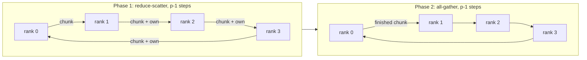
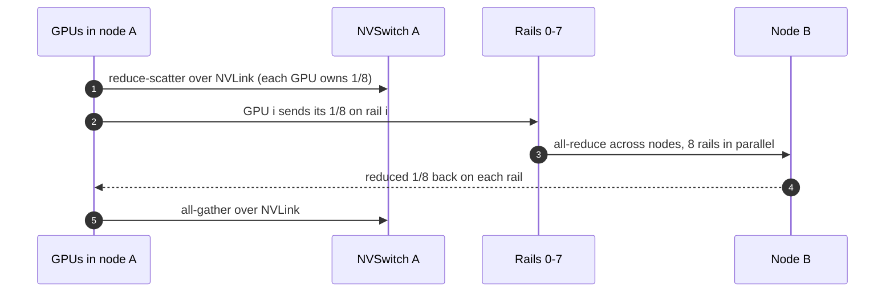

+++
title = 'Collectives and networking'
description = 'All-reduce, all-gather, and reduce-scatter carry gradients and activations between GPUs. A ring is bandwidth-optimal but its latency grows with the number of ranks; a tree has logarithmic latency. The fabric underneath decides which one wins and how often jobs stall.'
question = 'How long does an all-reduce take, and when does a tree beat a ring?'
weight = 2
difficulty = 4
prerequisites = ['/notes/machine-learning-systems/clusters-and-hardware/01-nvlink-pcie-and-topology', '/notes/machine-learning-systems/training-at-scale/03-data-parallelism-and-all-reduce']
date = 2026-10-30T06:10:00Z
lastmod = 2026-10-30T06:10:00Z
verified = 2026-10-30
+++

## The idea in one minute

Distributed training is a computation punctuated by **collectives**: every rank
contributes a buffer, and every rank ends with a combined result. Data
parallelism all-reduces gradients, FSDP all-gathers parameters and
reduce-scatters gradients, tensor parallelism all-reduces activations, and
expert parallelism does all-to-all.

The **alpha-beta model** predicts their cost: each step pays a latency
`alpha` plus `bytes / bandwidth`. A **ring** all-reduce moves the minimum
possible data per rank, `2(p-1)/p × n`, but takes `2(p-1)` sequential steps,
so its latency grows linearly with rank count. A **tree** needs only about
`2 log2 p` steps. Large gradient buckets are bandwidth-bound and either
algorithm comes near the floor; small messages on thousands of ranks are
latency-bound, and the ring loses by an order of magnitude. NCCL picks between
them per call, and the network under it (lossless, rail-optimized, not
oversubscribed) decides whether either reaches the floor.

## A picture



## How it really works

### The collectives and who uses them

| Collective | Result on each rank | Bytes sent per rank (bandwidth-optimal) | Typical user |
|---|---|---|---|
| All-reduce | Sum of all buffers | `2(p-1)/p × n` | Data parallel gradients, tensor parallel activations |
| Reduce-scatter | One `1/p` slice of the sum | `(p-1)/p × n` | FSDP / ZeRO gradients |
| All-gather | Concatenation of all slices | `(p-1)/p × n` | FSDP parameters before each layer |
| All-to-all | Slice *j* of every rank goes to rank *j* | `(p-1)/p × n` | Mixture-of-experts token routing |
| Broadcast | Root's buffer | `n` | Initial weights, configuration |

An all-reduce is a reduce-scatter followed by an all-gather, which is why the
two-phase ring above is bandwidth-optimal (Patarasuk and Yuan, 2009). FSDP
splits the two halves around the computation so each can overlap with work.

### Ring: optimal bytes, linear latency

The data is cut into `p` chunks. In each of `p-1` reduce-scatter steps, every
rank sends one chunk to its neighbor and adds the chunk it receives to its own.
After that, each rank holds one fully reduced chunk, and `p-1` all-gather steps
circulate them. Total:

```text
T_ring = 2(p-1) × alpha  +  2(p-1)/p × n / B
```

The bandwidth term is almost independent of `p`: a 1 GiB all-reduce at 50 GB/s
costs about 43 ms whether there are 16 ranks or 1,024. The latency term is not:
at 1,024 ranks and 5 µs per step, the ring spends 10 ms on latency alone,
regardless of message size.

### Tree: logarithmic latency

A tree reduces up toward a root and broadcasts back down, `log2 p` levels each
way. A plain binary tree wastes bandwidth because leaves only send and the root
only receives. NCCL (since 2.4) uses a **double binary tree** (Sanders, Speck,
and Träff, 2009): two trees where every interior node of one is a leaf of the
other, each carrying half the data. With pipelining over chunks, every rank
sends and receives about `n` bytes in each direction, so the bandwidth term is
close to the ring's, while the latency term is about `2 log2 p × alpha`.

### What NCCL actually does

NCCL builds rings and trees from the topology it detects, then picks an
algorithm and protocol per call from a cost model. The algorithms include:

- `Ring` and `Tree`, as above, usually hierarchical: NVLink inside the node,
  one channel per network rail between nodes.
- `NVLS` (NVLink SHARP): on Hopper and later NVSwitch systems, the switch
  itself performs the reduction, so each GPU sends its data once.
- `CollNet`: in-network reduction on InfiniBand switches with SHARP.

Protocols trade latency for bandwidth: `LL` and `LL128` use flag-carrying
stores for low latency on small messages; `Simple` gets full bandwidth on
large ones. `NCCL_ALGO` and `NCCL_PROTO` override the choice; they are tools
for experiments, not defaults to ship.

`nccl-tests` reports **bus bandwidth**, which rescales the measured rate by
`2(p-1)/p` for all-reduce so it can be compared directly with link speed. A
busbw far below the per-GPU link rate means a topology or fabric problem.

### Worked arithmetic: data-parallel gradients

An 8B-parameter model has 16 GB of BF16 gradients per step. Flat ring
all-reduce over 128 GPUs at 50 GB/s per GPU: `2 × 127/128 × 16 / 50 = 635 ms`.
Hierarchically, each node first reduce-scatters over NVLink (fast), then each
of its eight GPUs all-reduces its 2 GB eighth over its own rail, and all eight
rails run in parallel. The inter-node phase is `2 × 15/16 × 2 / 50 = 75 ms`
across 16 nodes. Training frameworks hide most of that by bucketing gradients
and overlapping all-reduce with the rest of the backward pass.



### The network underneath

RDMA expects a fabric that rarely drops packets. **InfiniBand** has
credit-based, lossless link-level flow control and adaptive routing built in.
**RoCE v2** runs RDMA over UDP on Ethernet and needs a lossless or
congestion-controlled configuration (PFC, ECN, and DCQCN or newer schemes) to
avoid retransmission storms. Both work at scale; the operational difference is
how much tuning and monitoring the Ethernet variant needs.

Collectives are **synchronous**. One slow link, one rank on a degraded NIC, or
one congested spine port delays every rank in the communicator. That is why
large training clusters prefer non-blocking (1:1) spines, and why a single
flapping link shows up as a cluster-wide throughput drop rather than a local
error.

## Code

The program applies the alpha-beta model to ring and pipelined double-binary
tree all-reduce. It ignores contention, protocol overheads, and NCCL's
hierarchical schedules; it shows the shape of the tradeoff, not NCCL's exact
crossover points.

```python {title="collectives.py"}
"""collectives.py: alpha-beta model of ring vs tree all-reduce (simplified, no contention)."""
import math

def ring(n_bytes: float, p: int, alpha_us: float, bw_gbs: float) -> float:
    # reduce-scatter + all-gather: 2(p-1) steps, each moves n/p bytes
    steps = 2 * (p - 1)
    return steps * alpha_us * 1e-6 + steps * (n_bytes / p) / (bw_gbs * 1e9)

def tree(n_bytes: float, p: int, alpha_us: float, bw_gbs: float, chunks: int = 64) -> float:
    # pipelined reduce up + broadcast down a binary tree of depth log2(p).
    # Double binary tree: two trees each carry half the data; every rank still sends ~n up
    # and ~n down, so the bandwidth term is ~2n/B, like the ring. Only latency differs.
    depth = math.ceil(math.log2(p))
    chunk = n_bytes / chunks
    per_chunk = alpha_us * 1e-6 + chunk / (bw_gbs * 1e9)
    return 2 * (depth + chunks - 1) * per_chunk if p > 1 else 0.0

def best_chunks(n, p, a, b):
    return min((tree(n, p, a, b, c), c) for c in (1, 2, 4, 8, 16, 32, 64, 128, 256, 512))

if __name__ == "__main__":
    alpha, bw = 5.0, 50.0  # us per step, GB/s per direction (one 400G rail per GPU)
    print(f"alpha={alpha} us/step, link={bw} GB/s; times in ms\n")
    print(f"{'size':>8} {'ranks':>5} {'ring':>9} {'tree':>9} {'faster':>6}")
    for size in (8 * 1024, 1 << 20, 64 << 20, 1 << 30):
        for p in (16, 128, 1024):
            r = ring(size, p, alpha, bw)
            t, _ = best_chunks(size, p, alpha, bw)
            label = f"{size/1024:.0f}K" if size < 1 << 20 else f"{size/(1<<20):.0f}M"
            print(f"{label:>8} {p:>5} {r*1e3:9.3f} {t*1e3:9.3f} {'ring' if r < t else 'tree':>6}")
    n = 1 << 30
    print(f"\nbus-bandwidth floor for 1G all-reduce: 2(p-1)/p * n / B = "
          f"{2*(1023/1024)*n/(bw*1e9)*1e3:.1f} ms at p=1024")
```

Run it with `python3 collectives.py`:

```text
alpha=5.0 us/step, link=50.0 GB/s; times in ms

    size ranks      ring      tree faster
      8K    16     0.150     0.041   tree
      8K   128     1.270     0.072   tree
      8K  1024    10.230     0.103   tree
      1M    16     0.189     0.143   tree
      1M   128     1.312     0.205   tree
      1M  1024    10.272     0.259   tree
     64M    16     2.667     3.286   ring
     64M   128     3.933     3.568   tree
     64M  1024    12.912     3.792   tree
   1024M    16    40.415    45.266   ring
   1024M   128    43.884    46.303   ring
   1024M  1024    53.138    47.110   tree

bus-bandwidth floor for 1G all-reduce: 2(p-1)/p * n / B = 42.9 ms at p=1024
```

Small messages are latency-bound: at 1,024 ranks the tree is 40 to 100 times
faster. For 1 GiB at small scale the ring wins, because the tree's pipeline
fill costs a little extra; both sit near the 43 ms bandwidth floor. At 1,024
ranks, the ring's 10 ms of accumulated latency is enough to tip even 1 GiB
toward the tree.

## Where it breaks

- **Contention and congestion.** The model assumes every rank gets its full
  link. All-to-all for mixture-of-experts sends every rank's traffic across the
  spine at once; on an oversubscribed fabric its time is set by the spine, not
  the NIC.
- **Stragglers.** Synchronous collectives run at the pace of the slowest rank.
  Thermal throttling, a noisy neighbor on a shared host, or one NIC at half
  speed slows the whole job.
- **Hangs.** A rank that crashes or never enters the collective leaves every
  other rank waiting. Set collective timeouts and watchdogs
  (`TORCH_NCCL_ASYNC_ERROR_HANDLING`, heartbeat monitors) so a hang becomes a
  restart instead of hours of idle GPUs.
- **Overlap is not free.** Communication kernels use SMs and memory bandwidth;
  overlapping them with compute slows the compute a little.

## Remember this

- All-reduce = reduce-scatter + all-gather; minimum traffic per rank is `2(p-1)/p × n`.
- Ring: optimal bandwidth, `2(p-1)` latency steps. Tree: about `2 log2 p` steps.
- Large buckets are bandwidth-bound; small messages at large scale are latency-bound.
- Hierarchical collectives use NVLink inside a node and all rails in parallel between nodes.
- Collectives are synchronous: one slow link or rank sets the pace for all.

## Try it

1. Set `alpha` to 1 µs (NVLink-class) and rerun. Where does the crossover move?
2. Add a function for reduce-scatter alone and compute FSDP's per-layer cost
   for a 500 MB layer at 64 ranks.
3. On a GPU cluster, run `all_reduce_perf` from `nccl-tests` across 2 and 4
   nodes and compare the reported busbw with your NIC line rate.

## Check yourself

1. What is the bandwidth-only time of a 4 GB ring all-reduce over 64 ranks at
   25 GB/s?
   
   `2 × 63/64 × 4 / 25 ≈ 0.315 s`, about 315 ms.
   
2. Why does a plain binary tree waste bandwidth, and how does the double binary
   tree fix it?
   
   Leaves only send and the root only receives, so many links sit idle in each
   phase. Two complementary trees, each carrying half the data, make every rank
   an interior node in one tree, so all ranks send and receive about equally.
   
3. `nccl-tests` reports algbw 200 GB/s and busbw 350 GB/s for an 8-GPU node
   all-reduce. Why are they different, and which do you compare with NVLink?
   
   busbw = algbw × 2(p-1)/p = 200 × 1.75 = 350 GB/s;
   it accounts for the bytes each rank must actually move. Compare busbw with
   the per-direction NVLink rate.
   
4. One NIC in a 512-GPU job negotiates at half speed. What do you expect to see?
   
   Every collective that crosses that NIC slows to its rate, and since
   collectives are synchronous the whole job's step time rises, not just one
   rank's.
   

## Sources

- P. Patarasuk and X. Yuan, "Bandwidth optimal all-reduce algorithms for clusters of workstations," *J. Parallel and Distributed Computing* 69(2), 2009.
- R. Thakur, R. Rabenseifner, W. Gropp, "Optimization of collective communication operations in MPICH," *IJHPCA* 19(1), 2005.
- P. Sanders, J. Speck, J. L. Träff, "Two-tree algorithms for full bandwidth broadcast, reduction and scan," *Parallel Computing* 35(12), 2009.
- NVIDIA, *NCCL User Guide* (collectives, algorithms, environment variables). <https://docs.nvidia.com/deeplearning/nccl/user-guide/docs/>
- NVIDIA, "Massively scale your deep learning training with NCCL 2.4" (double binary trees), NVIDIA Technical Blog, 2019. <https://developer.nvidia.com/blog/massively-scale-deep-learning-training-nccl-2-4/>
- NVIDIA, *nccl-tests* performance notes (algbw and busbw). <https://github.com/NVIDIA/nccl-tests/blob/master/doc/PERFORMANCE.md>
- Y. Zhu et al., "Congestion control for large-scale RDMA deployments" (DCQCN), SIGCOMM 2015.
