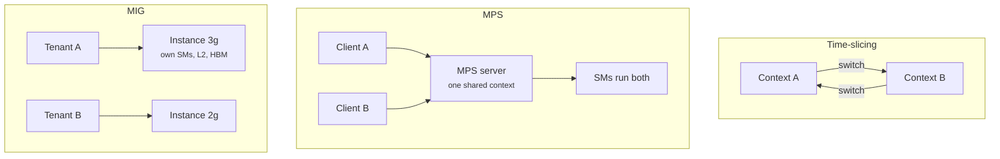
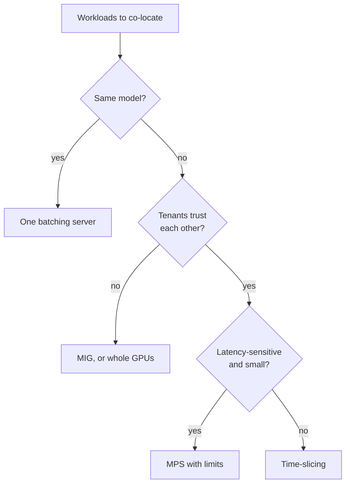

+++
title = 'Sharing GPUs'
description = 'Time-slicing, MPS, and MIG let several workloads share one GPU. They trade utilization against isolation of memory, performance, and faults, and only MIG gives hard partitions. Often the best sharing is one batching server.'
question = 'When several workloads share one GPU, which mechanism gives the throughput and isolation you need?'
weight = 3
difficulty = 3
prerequisites = ['/notes/infrastructure-security/securing-gpu-clusters/01-multi-tenant-gpu-isolation']
date = 2026-10-30T06:15:00Z
lastmod = 2026-10-30T06:15:00Z
verified = 2026-10-30
+++

## The idea in one minute

An H100 has 132 SMs and 80 GB of memory. A small embedding model, a notebook,
or a lightly loaded service uses a fraction of that, and an idle GPU costs the
same per hour as a busy one. There are three hardware-level ways to share it:

- **Time-slicing**: separate contexts take turns on the whole GPU.
- **MPS** (Multi-Process Service): clients' kernels run concurrently in one
  shared context, with soft limits.
- **MIG** (Multi-Instance GPU): the GPU is cut into up to seven instances,
  each with its own SMs, L2 slice, and memory.

They sit on a line from **flexible and leaky** to **rigid and isolated**.
Time-slicing wastes the SMs a small job leaves idle. MPS fills them, but one
tenant can still hurt the others. MIG gives hard walls, at the cost of fixed
slice sizes that cannot borrow idle capacity. A fourth option often beats all
three: one inference server that batches every tenant's requests into the same
kernels.

## A picture



## How it really works

### Time-slicing

By default each process gets its own GPU context, and the hardware scheduler
runs one context at a time on the compute engines, switching on a timeslice.
While A runs, B waits, even if A's kernels occupy a tenth of the SMs. Each
switch saves and restores state. Faults stay within the context that caused
them, because contexts have separate address spaces.

Memory is not sliced. All contexts' allocations coexist with no per-process
limit, so one process that grabs 75 GB makes the others fail with out of
memory. The Kubernetes NVIDIA device plugin's time-slicing mode advertises one
GPU as several `nvidia.com/gpu` replicas; it adds no memory or compute limits
and the plugin documentation says so.

### MPS

The MPS control daemon funnels clients through a server that owns one context,
so kernels from different processes can occupy different SMs at the same time.
For many small jobs this removes both the idle SMs and the switch overhead.

The limits are soft. `CUDA_MPS_ACTIVE_THREAD_PERCENTAGE` caps the share of
SMs a client may use, and `CUDA_MPS_PINNED_DEVICE_MEM_LIMIT` caps its device
memory. Since Volta each client has its own GPU address space, so one client
cannot read another's memory directly. But clients still share L2 and memory
bandwidth, so a bandwidth-heavy neighbor raises everyone's latency. And a fatal
GPU fault in one client can terminate the other clients on that GPU; the MPS
documentation's error-containment section describes the exact behavior per
architecture. MPS is for **mutually trusting** processes, typically replicas
of your own service.

### MIG

On A100, H100, H200, and Blackwell data-center GPUs, MIG partitions the GPU into
**GPU instances**, each with dedicated SMs, a dedicated slice of L2 and memory
controllers, and dedicated HBM. On an H100 80 GB the profile menu runs from
`1g.10gb` (up to seven per GPU) through `2g.20gb`, `3g.40gb`, `4g.40gb`, to
`7g.80gb`. To CUDA and Kubernetes, each instance looks like a smaller GPU.

Isolation is real for memory capacity, memory bandwidth, and faults: a tenant
cannot use another instance's memory, saturate its bandwidth, or crash it.
The costs are rigidity and fragmentation. Sizes come from a fixed menu,
reconfiguring requires the affected instances to be idle, an instance cannot
borrow idle SMs from its neighbor, and some layouts strand capacity. MIG is
the mechanism to use when tenants do not trust each other or need guaranteed
capacity; the security analysis, including memory scrubbing between tenants,
is in [multi-tenant GPU isolation](/notes/infrastructure-security/securing-gpu-clusters/01-multi-tenant-gpu-isolation/).

### Sharing inside one process

An LLM server with continuous batching merges requests from many users into
the same matrix multiplications. That shares weights (one copy instead of
several), fills the SMs with one large kernel instead of several small ones,
and isolates tenants at the scheduler, where you can enforce fairness. It is
usually the most efficient option when the tenants run the same model. The
three mechanisms above are for workloads that cannot live in one process:
different models, different frameworks, or tenants that must not share an
address space.



### Scheduling in Kubernetes

The NVIDIA device plugin and GPU Operator expose all three: time-sliced
replicas, MIG instances as separate resources (`nvidia.com/mig-3g.40gb` in
the mixed strategy), and MPS-shared GPUs. As of 2026 Kubernetes
Dynamic Resource Allocation (DRA) is the newer route, letting a claim ask for
a device with given attributes rather than a count. The scheduler only sees
what the plugin advertises; it cannot know that two time-sliced replicas will
contend for memory.

## Code

The program runs three small jobs under each mechanism with a toy model:
time-slicing runs one job at a time at its own parallelism; MPS shares SMs
proportionally when demand exceeds 132; MIG gives each job a fixed slice
(approximated as 2/7, 2/7, and 3/7 of the SMs). Switch cost and slice length
are assumptions. It then prints the tradeoff table.

```python {title="sharing.py"}
"""sharing.py: time-slicing vs MPS vs MIG for small jobs on one GPU (toy model, 132 SMs)."""
from dataclasses import dataclass

SMS = 132          # H100 SXM has 132 SMs enabled
SWITCH_MS = 0.25   # assumed cost per time-slice context switch
SLICE_MS = 2.0     # assumed time-slice length

@dataclass
class Job:
    name: str
    work_sm_ms: float   # total work, in SM-milliseconds
    max_sms: int        # SMs it can keep busy at once (its parallelism)

def time_sliced(jobs):
    """One context at a time; each job only uses its own parallelism while it runs."""
    left = {j.name: j.work_sm_ms for j in jobs}
    t, done = 0.0, {}
    while left:
        for j in jobs:
            if j.name not in left:
                continue
            need = left[j.name] / j.max_sms
            run = min(SLICE_MS, need)
            t += run + (SWITCH_MS if len(left) > 1 else 0)
            left[j.name] -= run * j.max_sms
            if left[j.name] <= 1e-9:
                del left[j.name]
                done[j.name] = t
    return done

def mps(jobs):
    """All run together; SMs shared proportionally when oversubscribed."""
    left = {j.name: j.work_sm_ms for j in jobs}
    t, done = 0.0, {}
    while left:
        active = [j for j in jobs if j.name in left]
        demand = sum(j.max_sms for j in active)
        scale = min(1.0, SMS / demand)
        rate = {j.name: j.max_sms * scale for j in active}
        step = min(left[n] / r for n, r in rate.items())
        t += step
        for n, r in rate.items():
            left[n] -= r * step
            if left[n] <= 1e-9:
                del left[n]
                done[n] = t
    return done

def mig(jobs, slice_sms):
    """Each job gets a fixed slice; it can never use more, even if neighbors idle."""
    return {j.name: j.work_sm_ms / min(j.max_sms, s) for j, s in zip(jobs, slice_sms)}

if __name__ == "__main__":
    jobs = [Job("svc-a", 2000, 40), Job("svc-b", 2000, 40), Job("batch", 12000, 132)]
    # H100 MIG 7-slice layout: 3g + 2g + 2g ~ 3/7, 2/7, 2/7 of the SMs (approximation)
    layout = [SMS * 2 // 7, SMS * 2 // 7, SMS * 3 // 7]
    rows = {"time-slicing": time_sliced(jobs), "MPS": mps(jobs), "MIG 2g/2g/3g": mig(jobs, layout)}
    print(f"{'mode':<14}" + "".join(f"{j.name:>9}" for j in jobs) + f"{'makespan':>10}")
    for mode, d in rows.items():
        print(f"{mode:<14}" + "".join(f"{d[j.name]:9.1f}" for j in jobs) + f"{max(d.values()):10.1f}")
    print("(finish times in ms; work alone on the full GPU: "
          + ", ".join(f"{j.name} {j.work_sm_ms/min(j.max_sms,SMS):.1f}" for j in jobs) + ")\n")

    props = [
        ("concurrent kernels", "no", "yes", "yes"),
        ("memory limit per tenant", "none", "soft (pinned limit)", "hard (own HBM slice)"),
        ("compute limit per tenant", "none", "soft (thread %)", "hard (own SMs)"),
        ("L2 / memory bandwidth", "shared", "shared", "partitioned"),
        ("fault blast radius", "own context", "other clients can die", "own instance"),
        ("reconfigure", "any time", "restart MPS daemon", "drain GPU first"),
        ("fits", "dev, bursty notebooks", "trusted replicas", "separate tenants"),
    ]
    w = [26, 22, 22, 22]
    print("| " + " | ".join(h.ljust(x) for h, x in zip(("property", "time-slicing", "MPS", "MIG"), w)) + " |")
    print("|" + "|".join("-" * (x + 2) for x in w) + "|")
    for r in props:
        print("| " + " | ".join(c.ljust(x) for c, x in zip(r, w)) + " |")
```

Run it with `python3 sharing.py`:

```text
mode              svc-a    svc-b    batch  makespan
time-slicing      164.2    166.5    209.4     209.4
MPS                80.3     80.3    121.2     121.2
MIG 2g/2g/3g       54.1     54.1    214.3     214.3
(finish times in ms; work alone on the full GPU: svc-a 50.0, svc-b 50.0, batch 90.9)

| property                   | time-slicing           | MPS                    | MIG                    |
|----------------------------|------------------------|------------------------|------------------------|
| concurrent kernels         | no                     | yes                    | yes                    |
| memory limit per tenant    | none                   | soft (pinned limit)    | hard (own HBM slice)   |
| compute limit per tenant   | none                   | soft (thread %)        | hard (own SMs)         |
| L2 / memory bandwidth      | shared                 | shared                 | partitioned            |
| fault blast radius         | own context            | other clients can die  | own instance           |
| reconfigure                | any time               | restart MPS daemon     | drain GPU first        |
| fits                       | dev, bursty notebooks  | trusted replicas       | separate tenants       |
```

MPS finishes everything first because it fills idle SMs. Time-slicing triples
the small services' latency, since they wait for the batch job's turns. MIG
gives the small services predictable times (slightly over their alone time,
because a 2g slice has fewer SMs than they could use) but leaves the batch job
on 3/7 of the GPU long after its neighbors finish: the stranded capacity is
the price of the walls.

## Where it breaks

- **The toy ignores memory.** Real interference under MPS and time-slicing
  comes as much from shared L2 and HBM bandwidth as from SMs, and out-of-memory
  failures caused by a neighbor are common with time-slicing.
- **MIG does not partition everything.** Instances share the PCIe link, NVLink,
  and host resources; copy-heavy tenants can still interfere there. Some
  features (for example, peer-to-peer between instances) are unavailable.
- **Soft limits are not boundaries.** MPS limits manage well-behaved clients;
  do not use them to separate customers.
- **Fragmentation.** A cluster of GPUs each split differently can have plenty
  of free slices and nowhere to place a `4g` job.

## Remember this

- Time-slicing: whole GPU, one context at a time, no memory limits.
- MPS: concurrent kernels, soft compute and memory limits, shared fate on faults.
- MIG: hard partitions of SMs, L2, and HBM; fixed sizes; no borrowing.
- For one model and many users, a batching server shares better than any of them.
- Isolation for untrusted tenants means MIG or whole GPUs, never MPS.

## Try it

1. Change `svc-a` and `svc-b` to `max_sms=16`. Which mode now wins on the
   small services' latency, and why does MIG's disadvantage disappear?
2. Add a fourth job and a MIG layout of `1g/1g/2g/3g`. Compute the stranded
   SM-milliseconds after each job finishes.
3. On an H100, run `nvidia-smi mig -lgip` to list the instance profiles and
   check the counts against this lesson.

## Check yourself

1. Why can one process cause another to fail under time-slicing even though
   their contexts are separate?
   
   Memory is shared without per-process limits. A process that allocates most
   of the HBM leaves the other without memory, so its allocations fail.
   
2. A team wants to co-locate two replicas of the same service on one GPU. What
   do you recommend first, and what second?
   
   First, one server process with batching for both, sharing one copy of the
   weights. If they must be separate processes, MPS with thread and memory
   limits, since the replicas trust each other.
   
3. Why can MIG lower total throughput compared with MPS?
   
   Slices cannot borrow idle capacity. When one tenant is idle or finishes, its
   SMs sit unused while a neighbor is limited to its own fixed slice.
   
4. Which of the three is acceptable for tenants from different customers?
   
   MIG (with scrubbing and a patched driver), or dedicated GPUs. MPS and
   time-slicing share too much state and fate.
   

## Sources

- NVIDIA, *Multi-Instance GPU User Guide* (supported GPUs, H100 profiles, isolation). <https://docs.nvidia.com/datacenter/tesla/mig-user-guide/>
- NVIDIA, *Multi-Process Service* documentation (architecture, resource limits, error containment). <https://docs.nvidia.com/deploy/mps/>
- NVIDIA, *k8s-device-plugin* README: time-slicing and MPS sharing. <https://github.com/NVIDIA/k8s-device-plugin>
- NVIDIA, *GPU Operator* documentation: MIG strategies. <https://docs.nvidia.com/datacenter/cloud-native/gpu-operator/latest/>
- Kubernetes documentation, *Dynamic Resource Allocation*. <https://kubernetes.io/docs/concepts/scheduling-eviction/dynamic-resource-allocation/>
- NVIDIA, *H100 Tensor Core GPU Architecture* whitepaper (2022): 132 SMs on H100 SXM5.
