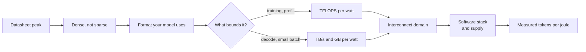
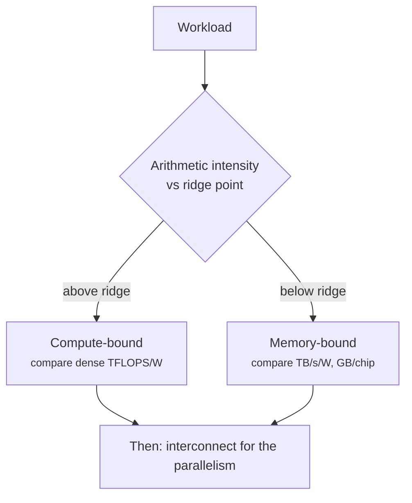

+++
title = 'The accelerator landscape'
description = 'Datasheet peaks are a starting point, not an answer. Compare accelerators on dense throughput, memory capacity and bandwidth, interconnect, and power, normalized to the bottleneck of your workload, then check the software stack.'
question = 'How do you compare accelerators honestly from their published specifications?'
weight = 4
difficulty = 3
prerequisites = ['/notes/inference-engineering/inference-mechanics/03-why-decode-is-memory-bound']
date = 2026-10-30T06:20:00Z
lastmod = 2026-10-30T06:20:00Z
verified = 2026-10-30
+++

## The idea in one minute

Every accelerator datasheet leads with a peak FLOP figure. Reading it well
takes four corrections. First, use **dense** numbers: many headline figures
assume 2:4 structured sparsity and are double the dense rate. Second, match
the **number format** to your workload: FP8 peaks are twice BF16, FP4 twice
again, and only some layers tolerate them. Third, ask what bounds your
workload: training and prefill are mostly **compute-bound**, while batch-small
decode is **memory-bandwidth-bound** and cares about TB/s and GB, not FLOPs.
Fourth, divide by **power**, because in a power-limited data hall watts, not
chips, are the scarce resource.

After that, the decisive factors are often not on the datasheet: the size of
the high-bandwidth interconnect domain, the maturity of the compiler and
kernels for your model, and what you can actually buy and run.

## A picture



## How it really works

### The specifications, as of October 2026

Peak dense figures from vendor datasheets. Power is the maximum module or board
power the vendor publishes; real draw under load is lower and varies.

| Accelerator | BF16 dense TFLOPS | FP8 dense TFLOPS | HBM | HBM bandwidth | Max power | Scale-up domain |
|---|---|---|---|---|---|---|
| NVIDIA H100 SXM | 989 | 1,979 | 80 GB | 3.35 TB/s | 700 W | 8 GPUs (NVLink 4) |
| NVIDIA H200 SXM | 989 | 1,979 | 141 GB | 4.8 TB/s | 700 W | 8 GPUs |
| NVIDIA B200 (HGX) | 2,250 | 4,500 | 180 GB | 8 TB/s | 1,000 W | 8 GPUs; 72 in GB200 NVL72 |
| AMD Instinct MI300X | 1,307 | 2,615 | 192 GB | 5.3 TB/s | 750 W | 8 GPUs (Infinity Fabric) |
| AMD Instinct MI325X | 1,307 | 2,615 | 256 GB | 6 TB/s | 1,000 W | 8 GPUs |
| Google TPU v5p | 459 | not listed | 95 GB | 2.76 TB/s | not published | pods of up to 8,960 chips (ICI) |

NVIDIA's datasheets print H100 FP8 as 3,958 TFLOPS "with sparsity"; the dense
figure is half. B200 numbers are per GPU derived from the DGX B200 system
datasheet (eight GPUs). Blackwell adds FP4, and newer parts (B300, MI355X,
TPU generations after v5p, AWS Trainium2 and later) continue the trend; check
current datasheets rather than trusting any table, including this one.

### Ratios that matter

Three derived numbers are more useful than any peak:

- **TFLOPS per watt** for compute-bound work. Process node and number formats
  drive it more than architecture.
- **GB/s per watt and GB per chip** for decode. A 70B BF16 model needs 140 GB
  of weights; on 80 GB parts that is two chips and a tensor-parallel
  all-reduce per layer, on 192 GB parts it is one chip.
- **The ridge point**, peak FLOPS divided by bandwidth: the arithmetic
  intensity a kernel needs to become compute-bound. At about 300 FLOP/byte on
  H100, a decode step at batch 1 is far below it: each BF16 weight (2 bytes)
  is read once for 2 FLOPs, about 1 FLOP per byte. Raising the batch is what moves it
  toward the ridge.

### Beyond the GPU

Other designs make different bets:

- **TPUs** use large systolic matrix units and connect chips directly in a 3D
  torus (ICI), giving very large scale-up domains without external switches.
  The software path is XLA via JAX or PyTorch/XLA.
- **AWS Trainium and Inferentia** and other hyperscaler chips trade generality
  for cost inside one cloud, programmed through the vendor's compiler (Neuron
  SDK on AWS).
- **SRAM-centric machines** (Groq's LPU, Cerebras' wafer-scale engine) keep
  weights in on-chip SRAM, with far higher bandwidth than HBM but far less
  capacity per chip, so large models span many chips. They excel at low-latency
  decode for the models that fit their capacity plan.

The portability cost is real. CUDA kernels such as FlashAttention variants and
fused MoE routers appear first on NVIDIA; ROCm, XLA, and vendor compilers
usually catch up, but a model that depends on a new kernel may run slower, or
not at all, for a period.

### What the datasheet does not tell you

- **Achievable fraction of peak.** Large BF16 matmuls on mature stacks reach
  roughly 60–80% of dense peak; whole training runs report model FLOPs
  utilization (MFU) of roughly 35–55%. Measure your own.
- **Thermals and power capping.** Many sites cap GPUs below maximum power;
  clocks and throughput drop with the cap.
- **Rack density.** A GB200 NVL72 rack draws on the order of 120 kW and needs
  liquid cooling, which many existing halls cannot supply.
- **Total cost.** Price, availability, networking, and engineering time to
  port and tune often dominate the per-chip comparison.



## Code

The program derives per-watt ratios and the ridge point from the table, then
estimates the batch-1 decode ceiling for a 70B BF16 model: tokens per second
equal aggregate HBM bandwidth divided by bytes read per token, assuming 10% of
memory is held back and perfect tensor-parallel scaling. Both assumptions
flatter the multi-chip cases.

```python {title="perfwatt.py"}
"""perfwatt.py: compare accelerators from published datasheet numbers (dense, no sparsity).

Numbers are peak datasheet values as of October 2026; see the lesson's sources.
None = not published by the vendor.
"""
from dataclasses import dataclass

@dataclass
class Chip:
    name: str
    bf16_tflops: float      # dense
    fp8_tflops: float | None
    hbm_gb: float
    hbm_tbs: float
    watts: float | None     # max board/module power

CHIPS = [
    Chip("NVIDIA H100 SXM", 989, 1979, 80, 3.35, 700),
    Chip("NVIDIA H200 SXM", 989, 1979, 141, 4.8, 700),
    Chip("NVIDIA B200 (HGX)", 2250, 4500, 180, 8.0, 1000),
    Chip("AMD MI300X", 1307, 2615, 192, 5.3, 750),
    Chip("AMD MI325X", 1307, 2615, 256, 6.0, 1000),
    Chip("Google TPU v5p", 459, None, 95, 2.76, None),
]

def fmt(x, spec="7.2f"):
    return "n/a".rjust(len(format(0.0, spec))) if x is None else format(x, spec)

if __name__ == "__main__":
    print(f"{'chip':<18}{'BF16 TF':>8}{'TF/W':>7}{'FP8 TF/W':>9}{'GB/s/W':>8}"
          f"{'FLOP/B':>8}{'GB/TF':>7}")
    for c in CHIPS:
        tfw = c.bf16_tflops / c.watts if c.watts else None
        f8w = c.fp8_tflops / c.watts if (c.watts and c.fp8_tflops) else None
        bww = c.hbm_tbs * 1000 / c.watts if c.watts else None
        ridge = c.bf16_tflops / c.hbm_tbs   # BF16 FLOPs per byte at the roofline ridge
        print(f"{c.name:<18}{c.bf16_tflops:8.0f}{fmt(tfw, '7.2f')}{fmt(f8w, '9.2f')}"
              f"{fmt(bww, '8.2f')}{ridge:8.0f}{c.hbm_gb / c.bf16_tflops:7.3f}")
    # decode is bandwidth-bound: tokens/s per GPU ~ HBM bandwidth / bytes read per token
    weights_gb = 70 * 2   # 70B parameters in BF16
    print(f"\nbatch-1 decode ceiling for a 70B BF16 model (weights only, ignores KV cache):")
    for c in CHIPS:
        gpus = -(-weights_gb // (c.hbm_gb * 0.9))   # keep 10% free for KV and workspace
        tok_s = c.hbm_tbs * 1000 * gpus / weights_gb
        jw = f"{tok_s / (c.watts * gpus):.3f} tok/s/W" if c.watts else "power n/a"
        print(f"  {c.name:<18} {int(gpus)} chip(s)  {tok_s:6.1f} tok/s  {jw}")
```

Run it with `python3 perfwatt.py`:

```text
chip               BF16 TF   TF/W FP8 TF/W  GB/s/W  FLOP/B  GB/TF
NVIDIA H100 SXM        989   1.41     2.83    4.79     295  0.081
NVIDIA H200 SXM        989   1.41     2.83    6.86     206  0.143
NVIDIA B200 (HGX)     2250   2.25     4.50    8.00     281  0.080
AMD MI300X            1307   1.74     3.49    7.07     247  0.147
AMD MI325X            1307   1.31     2.62    6.00     218  0.196
Google TPU v5p         459    n/a      n/a     n/a     166  0.207

batch-1 decode ceiling for a 70B BF16 model (weights only, ignores KV cache):
  NVIDIA H100 SXM    2 chip(s)    47.9 tok/s  0.034 tok/s/W
  NVIDIA H200 SXM    2 chip(s)    68.6 tok/s  0.049 tok/s/W
  NVIDIA B200 (HGX)  1 chip(s)    57.1 tok/s  0.057 tok/s/W
  AMD MI300X         1 chip(s)    37.9 tok/s  0.050 tok/s/W
  AMD MI325X         1 chip(s)    42.9 tok/s  0.043 tok/s/W
  Google TPU v5p     2 chip(s)    39.4 tok/s  power n/a
```

On compute per watt, B200 leads by about 60% over H100. On bandwidth per watt
the spread is narrower, and capacity changes the answer: the 192 GB MI300X
serves the 70B model on one chip at about 90% of a B200's tokens per joule, while H100 needs two chips and burns more energy per token. The two-chip
H200 figure looks fastest only because the model assumes free tensor
parallelism. None of these are measurements; they are ceilings that tell you
what to benchmark.

## Where it breaks

- **Peaks are not throughput.** Kernel quality, batch size, and communication
  decide real numbers; a chip with a lower peak and a better stack can win.
- **Power figures are maxima.** Board power excludes host CPUs, NICs, switches,
  and cooling. Compare at the rack or facility level for real cost.
- **Specs change and differ by SKU.** PCIe and SXM variants, air- and
  liquid-cooled parts, and regional variants have different clocks and power.
- **Unpublished numbers.** Where a vendor does not publish power, the honest
  entry is "n/a", not an estimate from a blog.

## Remember this

- Use dense, not sparse, peaks and the number format your model actually uses.
- Compute-bound work compares TFLOPS/W; decode compares TB/s/W and GB per chip.
- Memory capacity decides how many chips a model needs, and so its communication.
- The scale-up domain (NVLink, Infinity Fabric, ICI) limits tensor and expert parallelism.
- Datasheets set ceilings; only a benchmark of your model sets a price per token.

## Try it

1. Add a row for a newer accelerator from its current datasheet. Mark any
   number you could not find as `None`.
2. Change the decode model to 8-bit weights (`70 * 1`). Which chips now serve
   it on one device?
3. Compute the batch size at which H100 decode reaches the ridge point,
   ignoring KV-cache reads.

## Check yourself

1. A datasheet lists 3,958 TFLOPS FP8 "with sparsity". What do you use for a
   dense transformer?
   
   Half: 1,979 TFLOPS dense. And only for layers that run in FP8.
   
2. Why does more HBM capacity improve tokens per joule for decode even at the
   same bandwidth per watt?
   
   Fewer chips are needed to hold the weights, so there is less
   tensor-parallel communication and fewer chips' worth of power for the same
   per-token weight reads.
   
3. What is the ridge point, and why does it matter for choosing hardware?
   
   Peak FLOPS divided by memory bandwidth: the FLOPs per byte a kernel needs to
   be compute-bound. Workloads below it gain from bandwidth, not FLOPs.
   
4. Name two decisive factors that are not on an accelerator datasheet.
   
   Any two of: software and kernel maturity for your model, achievable
   utilization, supply and price, rack power and cooling, networking cost.
   

## Sources

- NVIDIA, *H100 Tensor Core GPU* datasheet (2023). <https://www.nvidia.com/en-us/data-center/h100/>
- NVIDIA, *H200 Tensor Core GPU* product page (accessed October 2026). <https://www.nvidia.com/en-us/data-center/h200/>
- NVIDIA, *DGX B200* datasheet (2024). <https://www.nvidia.com/en-us/data-center/dgx-b200/>
- AMD, *Instinct MI300X* and *MI325X* accelerator data sheets (2023, 2024). <https://www.amd.com/en/products/accelerators/instinct.html>
- Google Cloud, *TPU v5p* documentation (accessed October 2026). <https://cloud.google.com/tpu/docs/v5p>
- N. P. Jouppi et al., "TPU v4: An optically reconfigurable supercomputer for machine learning," ISCA 2023. <https://arxiv.org/abs/2304.01433>
- S. Williams, A. Waterman, D. Patterson, "Roofline: an insightful visual performance model," *CACM* 52(4), 2009.
- NVIDIA, *GB200 NVL72* product page (accessed October 2026). <https://www.nvidia.com/en-us/data-center/gb200-nvl72/>
