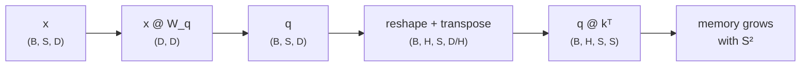
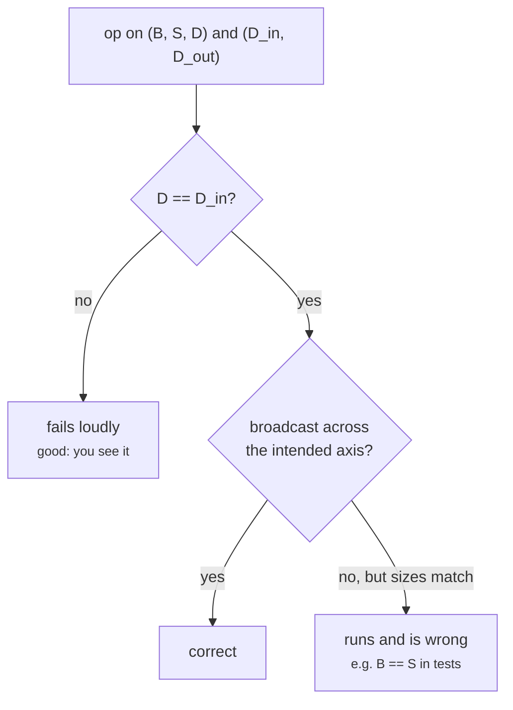

+++
title = 'Tensors and shapes'
description = 'A tensor is a block of numbers with a shape, a dtype, and a memory layout. Reading every layer as shapes tells you its memory, its arithmetic, and most of its bugs before you run anything.'
question = 'What does a tensor shape tell you about memory, compute, and correctness?'
weight = 1
difficulty = 1
date = 2026-10-30T01:05:00Z
lastmod = 2026-10-30T01:05:00Z
verified = 2026-10-30
+++

## The idea in one minute

A **tensor** is an n-dimensional array: a flat buffer of numbers plus a
**shape** (the size of each dimension), a **dtype** (how many bytes per
number), and **strides** (how far to jump in memory to move one step along
each dimension). Everything a model does is operations on tensors whose shapes
must agree.

Three numbers fall straight out of a shape:

- **Bytes** = product of the shape × bytes per element. An activation of shape
  `(8, 2048, 4096)` in BF16 is 128 MiB.
- **FLOPs** of a matrix multiply `(m, k) @ (k, n)` = `2 × m × k × n`: one
  multiply and one add per term.
- **Correctness**: the inner dimensions of a matmul must match, and most model
  bugs show up first as a shape that is wrong or, worse, accidentally right.

The habit to build: before reading a layer's code, write down the shape of
every tensor it touches. That is how you find which tensor dominates memory
(in attention, the `S × S` score matrix) and which operation dominates compute
(in a transformer, the weight matmuls).

## A picture



## How it really works

### Shape, dtype, stride

A tensor's values live in one contiguous buffer. Shape and strides map an
index to an offset: for a row-major `(B, S, D)` tensor the strides are
`(S·D, D, 1)` elements, so element `[b, s, d]` is at `b·S·D + s·D + d`.

Many operations change only this metadata. A **reshape** of a contiguous
tensor, a **transpose**, slicing, and broadcasting a dimension of size 1 are
all free: no bytes move. The cost appears later, when a kernel needs a layout
the strides do not provide and something must copy the data (`.contiguous()`
in PyTorch). In attention, `q` of shape `(B, S, D)` is viewed as
`(B, S, H, D/H)` and transposed to `(B, H, S, D/H)` so that each head is a
separate batched matmul; whether that transpose costs a copy depends on the
kernel.

### Broadcasting

Elementwise operations between tensors of different shapes follow
**broadcasting** rules (NumPy's, adopted by PyTorch and JAX): align shapes
from the right; each pair of dimensions must be equal or one of them must be 1;
size-1 dimensions stretch. Adding a bias of shape `(D,)` to `(B, S, D)` works.
Adding a `(B, 1)` mask to `(B, S)` scores works. Adding `(S,)` to `(B, S)`
works by accident of alignment, and adding `(B,)` to `(B, S)` fails unless
`B == S`, in which case it silently does the wrong thing. That last case is the
classic shape bug: tests at `B == S` pass.

### Bytes per element

| dtype | bytes | typical use |
| --- | --- | --- |
| FP32 | 4 | optimizer state, master weights, reductions |
| BF16 / FP16 | 2 | training and inference activations and weights |
| FP8 (E4M3, E5M2) | 1 | matmul inputs on Hopper and later GPUs, KV cache |
| INT4 / FP4 | 0.5 | weight-only quantized inference |

Number formats get their own lesson in the GPU architecture module. For now:
memory is the shape product times this column.

### Matmul arithmetic

Nearly all model FLOPs are matrix multiplies. For `(m, k) @ (k, n)` there are
`m × n` outputs, each a dot product of length `k`: `m·n·k` multiply-adds, or
`2mnk` FLOPs. With leading batch dimensions, multiply by their product. So
`x @ W_q` with `x` of shape `(8, 2048, 4096)` and `W_q` of shape
`(4096, 4096)` is `2 × 8 × 2048 × 4096 × 4096 ≈ 550 GFLOP`.

A useful consequence: for a linear layer, FLOPs per token = `2 × parameters`.
Every weight is used in one multiply-add per token. This is where the
"2N FLOPs per token" forward-pass rule comes from, and it is exact for weight
matmuls. Inference uses this rule constantly; see
[Prefill and decode](/notes/inference-engineering/inference-mechanics/01-prefill-and-decode/).

### Which tensor dominates

At batch 8, sequence 2048, width 4096, and 32 heads, the attention scores
`(B, H, S, S)` are 16 times the size of the input activation, because
`S · H / D = 2048 · 32 / 4096 = 16`. They grow with `S²`. That single shape is
why naive attention runs out of memory at long context and why fused attention
kernels never materialize the score matrix in GPU main memory (the GPU
performance module covers that kernel).



## Code

The program does no arithmetic on values. It tracks shapes, bytes, and matmul
FLOPs through the first steps of a Llama-3-8B-sized layer (grouped-query
attention is ignored here), and shows a shape check catching a wrong weight.

```python {title="shapes.py"}
"""shapes.py: track tensor shapes, element counts, and bytes through one transformer layer.

No arithmetic on values, only bookkeeping: each op checks that its input
shapes agree and reports the output shape. Standard library only.
"""

from __future__ import annotations

from dataclasses import dataclass
from math import prod

DTYPE_BYTES = {"fp32": 4, "bf16": 2, "fp8": 1}


@dataclass(frozen=True)
class T:
    name: str
    shape: tuple[int, ...]
    dtype: str = "bf16"

    @property
    def nbytes(self) -> int:
        return prod(self.shape) * DTYPE_BYTES[self.dtype]


def matmul(a: T, b: T, name: str) -> tuple[T, int]:
    """Batched matmul over leading dims: (..., m, k) @ (k, n) -> (..., m, n)."""
    if a.shape[-1] != b.shape[0]:
        raise ValueError(f"{name}: inner dims {a.shape[-1]} != {b.shape[0]}")
    out = T(name, a.shape[:-1] + (b.shape[1],), a.dtype)
    flops = 2 * prod(a.shape) * b.shape[1]  # one multiply and one add per term
    return out, flops


def show(t: T, flops: int = 0) -> None:
    f = f"{flops / 1e9:8.1f} GFLOP" if flops else ""
    print(f"  {t.name:<14}{str(t.shape):<22}{t.nbytes / 2**20:9.1f} MiB {f}")


def main() -> None:
    B, S, D, H, F = 8, 2048, 4096, 32, 14336  # Llama-3-8B widths, GQA ignored here
    hd = D // H
    print(f"batch={B} seq={S} d_model={D} heads={H} head_dim={hd} d_ff={F}")
    x = T("x", (B, S, D)); show(x)
    wq = T("W_q", (D, D)); show(wq)
    q, f = matmul(x, wq, "q"); show(q, f)
    qh = T("q heads", (B, H, S, hd)); show(qh)  # reshape + transpose: no copy of meaning, same bytes
    scores = T("scores", (B, H, S, S)); show(scores, 2 * B * H * S * S * hd)
    up, f = matmul(x, T("W_up", (D, F)), "ffn up"); show(up, f)
    print(f"  scores / x bytes ratio: {scores.nbytes / x.nbytes:.0f}x  (S*H/D = {S * H / D:.0f})")
    try:
        matmul(x, T("W_bad", (F, D)), "bad")
    except ValueError as e:
        print("  caught:", e)


if __name__ == "__main__":
    main()
```

Run it with `python3 shapes.py`:

```text
batch=8 seq=2048 d_model=4096 heads=32 head_dim=128 d_ff=14336
  x             (8, 2048, 4096)           128.0 MiB 
  W_q           (4096, 4096)               32.0 MiB 
  q             (8, 2048, 4096)           128.0 MiB    549.8 GFLOP
  q heads       (8, 32, 2048, 128)        128.0 MiB 
  scores        (8, 32, 2048, 2048)      2048.0 MiB    274.9 GFLOP
  ffn up        (8, 2048, 14336)          448.0 MiB   1924.1 GFLOP
  scores / x bytes ratio: 16x  (S*H/D = 16)
  caught: bad: inner dims 4096 != 14336
```

The FFN up-projection costs 3.5 times the query projection because its weight
is 3.5 times wider (14,336 vs 4,096). The score tensor is the biggest
allocation even though it holds no parameters.

## Where it breaks

- **Shapes do not show layout.** Two tensors with the same shape can have
  different strides; a kernel that assumes contiguity is slow or wrong on a
  transposed view.
- **FLOP counts are not time.** `2mnk` says how much arithmetic there is, not
  whether the GPU is limited by arithmetic or by memory bandwidth. A matmul
  with `m = 1` (one decode token) has the same weight bytes as `m = 2048` and
  1/2048 of the FLOPs. The GPU architecture module develops this as the
  roofline.
- **Dynamic shapes.** Real serving sees a different sequence length on every
  request, which affects kernel choice and graph capture. The bookkeeping is
  the same, but the numbers change per batch.
- **The program ignores grouped-query attention**, where `W_k` and `W_v` are
  narrower than `W_q`; the transformer block lesson in the next module counts it properly.

## Remember this

- A tensor is a buffer plus shape, dtype, and strides; views change only metadata.
- Bytes = product of shape × bytes per element.
- A matmul `(m, k) @ (k, n)` costs `2mnk` FLOPs; a linear layer costs 2 FLOPs per parameter per token.
- Attention scores scale with `S²` and dominate activation memory at long context.
- The dangerous shape bug is the one that broadcasts silently.

## Try it

1. Change `S` to 32,768 in the program. How large is the score tensor, and how
   does it compare to an 80 GB GPU?
2. Add `W_k` and `W_v` with 8 KV heads (width 1,024) and print their shapes
   and FLOPs.
3. Write a broadcasting check that rejects `(B,)` + `(B, S)` even when
   `B == S`, by requiring named dimensions.

## Check yourself

1. How many bytes is a `(4, 4096, 8192)` BF16 tensor?

   
   4 × 4096 × 8192 × 2 = 268,435,456 bytes, 256 MiB.
   

2. Why does a linear layer cost two FLOPs per parameter per token?

   
   Each weight participates in exactly one multiply and one add for each input
   row (token), so a `(k, n)` weight applied to `m` tokens is `2mkn` FLOPs,
   which is `2 × parameters × tokens`.
   

3. Is transposing a tensor expensive?

   
   The transpose itself only swaps strides and moves no data. It becomes
   expensive when a later operation requires a contiguous layout and the
   framework copies the data.
   

## Sources

- NumPy developers, [Broadcasting](https://numpy.org/doc/stable/user/basics.broadcasting.html), NumPy documentation, accessed October 2026.
- PyTorch, [Tensor views](https://pytorch.org/docs/stable/tensor_view.html), PyTorch documentation, accessed October 2026.
- A. Grattafiori et al., [The Llama 3 Herd of Models](https://arxiv.org/abs/2407.21783), Meta, July 2024 (model widths used above).
- J. Kaplan et al., [Scaling Laws for Neural Language Models](https://arxiv.org/abs/2001.08361), January 2020 (forward pass ≈ 2N FLOPs per token).
