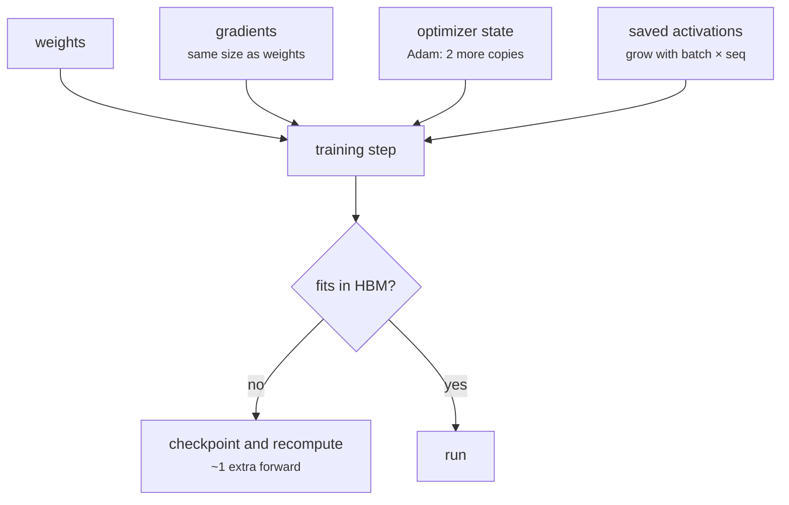

+++
title = 'Gradients and backpropagation'
description = 'Backpropagation applies the chain rule backward through the computation graph, giving the gradient of the loss for every weight at about twice the cost of the forward pass. That cost, and the activations it must keep, set the compute and memory of training.'
question = 'How does a framework compute gradients for billions of weights, and what does it cost?'
weight = 2
difficulty = 2
prerequisites = ['/notes/machine-learning-systems/foundations/01-tensors-and-shapes']
date = 2026-10-30T01:10:00Z
lastmod = 2026-10-30T01:10:00Z
verified = 2026-10-30
+++

## The idea in one minute

Training adjusts weights to reduce a **loss**, a single number measuring how
wrong the model is on a batch. To know which way to move each weight you need
the **gradient**: the partial derivative of the loss with respect to that
weight.

**Backpropagation** (Rumelhart, Hinton and Williams, 1986) computes all of
them in one backward sweep. The forward pass records every operation as a node
in a graph. The backward pass starts at the loss with gradient 1 and walks the
graph in reverse, multiplying by each operation's local derivative (the chain
rule) and summing where a value fed several consumers. Frameworks call this
**reverse-mode automatic differentiation**.

Two costs follow, and both shape every training system:

- **Compute:** the backward pass of a matmul is two matmuls of the same size
  (one for the input gradient, one for the weight gradient), so training costs
  about **3× the forward pass: 6 FLOPs per parameter per token**.
- **Memory:** the backward pass needs the forward activations, so training
  must **keep them** until they are used, unlike inference.

## A picture

```mermaid {title="Forward records the graph; backward walks it in reverse"}
flowchart LR
  subgraph F["forward"]
    direction LR
    x["x"] --> m["× w"] --> a["+ b"] --> t["tanh"] --> L["loss"]
  end
  subgraph Bk["backward"]
    direction RL
    gL["∂L/∂L = 1"] --> gt["× (1 − tanh²)"] --> ga["∂L/∂b"] --> gm["∂L/∂w = ∂L/∂(xw) · x"]
  end
  L -.-> gL
  class x,m,a,t,L compute
  class gL,gt,ga,gm memory
```

## How it really works

### The chain rule, mechanically

For `y = f(g(x))`, `dy/dx = f'(g(x)) · g'(x)`. A graph generalizes this: each
node knows the derivative of its output with respect to each input (its
**local gradient**). The backward pass visits nodes in reverse topological
order and does, for every edge:

```text
parent.grad += local_derivative × node.grad
```

The `+=` matters. A weight used in several places (a shared embedding, a value
read by two branches, the same layer applied to every token) receives the sum
of the gradients from all its uses.

### Why reverse mode

There are two ways to apply the chain rule. **Forward mode** pushes
derivatives from inputs to outputs and costs one pass per input. **Reverse
mode** pulls them from outputs to inputs and costs one pass per output. A
neural network has billions of inputs (weights) and one output (the loss), so
reverse mode wins by a factor of billions. Finite differences, the brute-force
alternative, cost two forward passes per weight; they survive only as a test
that an implementation is right, which the program below uses.

### The matmul backward and the factor of 6

For `Y = X W` with `X` of shape `(tokens, k)` and `W` of shape `(k, n)`:

```text
∂L/∂X = ∂L/∂Y · Wᵀ      (tokens, n) @ (n, k)   2·tokens·k·n FLOPs
∂L/∂W = Xᵀ · ∂L/∂Y      (k, tokens) @ (tokens, n)   2·tokens·k·n FLOPs
```

Each is the same size as the forward matmul. Forward 2, backward 4: 6 FLOPs
per weight per token. Kaplan et al. (2020) use `C ≈ 6ND` for training compute
on this basis, and it is the number every training budget in this course
starts from. Attention scores, norms, and activations add a few percent at
moderate context (the transformer block lesson counts them).

If the first layer's input gradient is not needed (it is the input data), that
one matmul can be skipped, and recomputation (below) adds a forward pass back.
`6ND` is the clean baseline, not a measurement.

### Activations are the memory cost

`∂L/∂W = Xᵀ · ∂L/∂Y` needs `X`, the layer's input from the forward pass. Every
nonlinearity needs its input or output too (tanh's derivative uses `tanh(x)`).
So the forward pass of training stores activations for every layer until the
backward pass reaches it. For a large transformer this is tens of gigabytes
per GPU and grows with batch × sequence length.

The standard trade is **activation checkpointing** (Chen et al., 2016): keep
only some layers' inputs, and recompute the rest during the backward pass.
Checkpointing every layer boundary costs one extra forward pass, raising
compute from 6ND to about 8ND, in exchange for storing one activation per
layer instead of all of them. The training-at-scale module returns to this.



### Vanishing and exploding gradients

Backward through `L` layers multiplies `L` local derivatives. If they are
mostly below 1 (saturated tanh or sigmoid), the gradient shrinks
geometrically and early layers stop learning; if above 1, it grows until it
overflows. Modern networks control this with **residual connections** (the
gradient has an identity path around each block), **normalization** layers,
careful initialization, and **gradient clipping** (rescale the gradient when
its norm exceeds a threshold, commonly 1.0 in LLM training).

## Code

A scalar autodiff engine in 50 lines. It builds the graph as you compute,
runs backward, checks every gradient against central finite differences on a
13-parameter network, then uses the gradients to train it.

```python {title="autodiff.py"}
"""autodiff.py: reverse-mode automatic differentiation on scalars, checked against finite differences.

Each Value records its parents and the local derivative to each. backward()
walks the graph in reverse topological order and accumulates gradients.
Standard library only.
"""

from __future__ import annotations

import math
import random


class Value:
    def __init__(self, data: float, parents: tuple = (), grads: tuple = ()) -> None:
        self.data, self.grad = data, 0.0
        self._parents, self._local = parents, grads  # d(self)/d(parent)

    def __add__(self, o):
        o = o if isinstance(o, Value) else Value(o)
        return Value(self.data + o.data, (self, o), (1.0, 1.0))

    def __mul__(self, o):
        o = o if isinstance(o, Value) else Value(o)
        return Value(self.data * o.data, (self, o), (o.data, self.data))

    __radd__, __rmul__ = __add__, __mul__

    def __sub__(self, o):
        return self + (-1.0) * o

    def tanh(self):
        t = math.tanh(self.data)
        return Value(t, (self,), (1 - t * t,))

    def backward(self) -> int:
        order, seen = [], set()

        def visit(v):
            if id(v) not in seen:
                seen.add(id(v))
                for p in v._parents:
                    visit(p)
                order.append(v)

        visit(self)
        self.grad = 1.0
        for v in reversed(order):
            for p, local in zip(v._parents, v._local):
                p.grad += local * v.grad  # chain rule; += because a node can feed many
        return len(order)


def mlp_loss(w: list[float], xs, ys, track: bool):
    """Two-input, three-hidden, one-output tanh MLP with squared error."""
    W = [Value(v) for v in w] if track else w
    tanh = (lambda v: v.tanh()) if track else math.tanh
    loss = 0.0
    for (x1, x2), y in zip(xs, ys):
        h = [tanh(W[3 * j] * x1 + W[3 * j + 1] * x2 + W[3 * j + 2]) for j in range(3)]
        out = W[9] * h[0] + W[10] * h[1] + W[11] * h[2] + W[12]
        loss = loss + (out - y) * (out - y)
    return loss, W


def main() -> None:
    random.seed(0)
    w = [random.uniform(-1, 1) for _ in range(13)]
    xs = [(random.uniform(-1, 1), random.uniform(-1, 1)) for _ in range(8)]
    ys = [math.sin(a) * b for a, b in xs]

    loss, W = mlp_loss(w, xs, ys, track=True)
    nodes = loss.backward()
    print(f"loss={loss.data:.6f}  graph nodes={nodes}  params=13")
    eps, worst = 1e-6, 0.0
    print(" param    autodiff      finite-diff")
    for i in range(13):
        up = w[:]; up[i] += eps
        dn = w[:]; dn[i] -= eps
        fd = (mlp_loss(up, xs, ys, False)[0] - mlp_loss(dn, xs, ys, False)[0]) / (2 * eps)
        worst = max(worst, abs(fd - W[i].grad))
        if i < 4 or i == 12:
            print(f"  w{i:<3} {W[i].grad:+.8f}  {fd:+.8f}")
    print(f"max |autodiff - finite diff| = {worst:.1e}")
    print("finite differences cost 2 x 13 = 26 forward passes; backprop cost 1 forward + 1 backward")

    lr = 0.03
    for step in range(301):
        loss, W = mlp_loss(w, xs, ys, track=True)
        loss.backward()
        w = [v - lr * p.grad for v, p in zip(w, W)]
        if step % 100 == 0:
            print(f"step {step:3d} loss {loss.data:.6f}")


if __name__ == "__main__":
    main()
```

Run it with `python3 autodiff.py`:

```text
loss=5.013398  graph nodes=278  params=13
 param    autodiff      finite-diff
  w0   -0.66739494  -0.66739494
  w1   -0.49062251  -0.49062251
  w2   -1.45390905  -1.45390905
  w3   -3.14855960  -3.14855960
  w12  -11.30771204  -11.30771204
max |autodiff - finite diff| = 8.4e-10
finite differences cost 2 x 13 = 26 forward passes; backprop cost 1 forward + 1 backward
step   0 loss 5.013398
step 100 loss 0.310703
step 200 loss 0.200153
step 300 loss 0.086812
```

Autodiff and finite differences agree to 1e-9. The 13-parameter network over
8 examples builds a 278-node graph; a real framework records the same kind of
graph with tensor nodes instead of scalars. Raising the learning rate to 0.05
makes this run diverge near step 300, which is the subject of the next lesson.

## Where it breaks

- **Scalar graphs do not scale.** Python object overhead per scalar is
  enormous; real frameworks record one node per tensor operation and call
  fused GPU kernels for each backward.
- **Stored activations dominate memory** at long sequence and large batch;
  the program keeps everything because its graph is tiny.
- **Gradients can be exactly right and still useless** if they vanish,
  explode, or are dominated by numerical error in low precision. Mixed
  precision and loss scaling are covered in the training-at-scale module.
- **Non-differentiable steps** (argmax, sampling, integer indexing) pass no
  gradient. Embedding lookup works because the gradient flows to the selected
  rows only.

## Remember this

- Backprop is the chain rule in reverse topological order, with gradients summed over every use.
- Reverse mode costs one backward pass for any number of weights.
- Training compute ≈ 6 FLOPs per parameter per token: forward 2, backward 4.
- The backward pass needs forward activations; storing them is training's big memory cost.
- Checkpointing trades about one extra forward pass for most of that memory.

## Try it

1. Add `exp` and `relu` operations with their local derivatives, and verify
   them with the finite-difference check.
2. Count how many nodes the graph has as you double the number of examples.
   What does that say about activation memory versus batch size?
3. Make the network 20 layers of tanh with small weights and print the
   gradient magnitude of the first layer.

## Check yourself

1. Why is reverse mode chosen over forward mode for training?

   
   Reverse mode costs one pass per output; forward mode one pass per input.
   Training has one scalar loss and billions of weights.
   

2. Where does the 6 in `6ND` come from?

   
   Each weight costs 2 FLOPs per token in the forward matmul, and the backward
   pass does two matmuls of the same size (input gradient and weight
   gradient), 4 more FLOPs.
   

3. Why can inference discard activations immediately but training cannot?

   
   The weight gradient of each layer needs that layer's input, and
   nonlinearities need their forward values. Training must keep them until
   the backward pass reaches the layer, or recompute them.
   

## Sources

- D. E. Rumelhart, G. E. Hinton, R. J. Williams, [Learning representations by back-propagating errors](https://www.nature.com/articles/323533a0), Nature 323, October 1986.
- A. G. Baydin, B. A. Pearlmutter, A. A. Radul, J. M. Siskind, [Automatic Differentiation in Machine Learning: a Survey](https://arxiv.org/abs/1502.05767), JMLR 2018.
- T. Chen, B. Xu, C. Zhang, C. Guestrin, [Training Deep Nets with Sublinear Memory Cost](https://arxiv.org/abs/1604.06174), April 2016.
- J. Kaplan et al., [Scaling Laws for Neural Language Models](https://arxiv.org/abs/2001.08361), January 2020 (C ≈ 6ND).
- K. He, X. Zhang, S. Ren, J. Sun, [Deep Residual Learning for Image Recognition](https://arxiv.org/abs/1512.03385), CVPR 2016.
