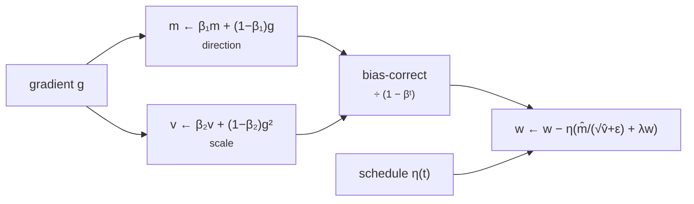

+++
title = 'Optimizers and learning rates'
description = 'An optimizer turns gradients into weight updates. Plain SGD diverges above a learning rate set by the sharpest curvature; momentum and Adam change that limit, and Adam costs two extra FP32 copies of the weights. Warmup and decay schedules keep large runs stable.'
question = 'How do SGD, momentum, and Adam differ, and why does the learning rate decide whether training diverges?'
weight = 3
difficulty = 2
prerequisites = ['/notes/machine-learning-systems/foundations/02-gradients-and-backpropagation']
date = 2026-10-30T01:15:00Z
lastmod = 2026-10-30T01:15:00Z
verified = 2026-10-30
+++

## The idea in one minute

Given a gradient `g`, **stochastic gradient descent** updates each weight by
`w ← w − η g`, where `η` is the **learning rate**. "Stochastic" because `g` is
estimated from a minibatch, not the whole dataset.

The learning rate has a hard ceiling. On a quadratic with curvature `λ`, SGD
converges only if `η < 2/λ`. The loss surface of a real network has some
directions far sharper than others, so the sharpest direction sets the ceiling
and the flattest direction then moves painfully slowly.

Two fixes dominate. **Momentum** accumulates a running sum of gradients so
consistent directions speed up and oscillating ones cancel. **Adam** (Kingma
and Ba, 2015) also divides each coordinate's step by a running estimate of its
gradient magnitude, so every weight moves at roughly the learning rate
regardless of scale. Large language models are trained almost universally with
**AdamW**, Adam with decoupled weight decay, plus a learning-rate **schedule**:
linear warmup, then cosine or linear decay.

The systems cost to remember: Adam stores two extra values per parameter, and
with mixed precision a training run holds about **16 bytes per parameter**
before counting activations.

## A picture



## How it really works

### The stability limit

Near a minimum, the loss looks like a quadratic `½ Σ λᵢ xᵢ²`. One SGD step
multiplies coordinate `i` by `(1 − ηλᵢ)`. If `|1 − ηλᵢ| > 1` for any `i`, that
coordinate grows every step and the loss explodes. So `η < 2/λ_max`. The
coordinate with the smallest `λ` shrinks by `(1 − ηλ_min)` per step, so
convergence time scales with the **condition number** `λ_max/λ_min`. The
program uses curvatures 100 and 1: SGD diverges just above `η = 0.02`.

Momentum with coefficient `β` raises the limit to `2(1 + β)/λ_max` (0.038 at
`β = 0.9`) and speeds the flat direction by about `1/(1 − β)`. It does not
remove the dependence on scale.

### Adam

Adam keeps two exponential moving averages per weight: `m` of the gradient and
`v` of its square. Both start at zero, so early estimates are biased low;
dividing by `1 − βᵗ` corrects that. The update is `η · m̂ / (√v̂ + ε)`. For a
consistent gradient, `m̂/√v̂ ≈ ±1`, so each weight moves about `η` per step
whatever its gradient scale. That is why one learning rate works across
embeddings, attention, and MLP weights whose gradients differ by orders of
magnitude, and why Adam tolerates `η = 0.1` on a problem where SGD diverges at
0.021.

Typical LLM settings are `β₁ = 0.9`, `β₂ = 0.95`, `ε = 1e-8`, weight decay 0.1,
gradient clipping at norm 1.0; Llama 2 used exactly these with a peak learning
rate of 3e-4 for its 7B and 13B models (Touvron et al., 2023). The lower `β₂`
(0.95 rather than the default 0.999) makes `v` react faster to gradient spikes.

### Weight decay, decoupled

L2 regularization adds `λw` to the gradient. Inside Adam that term is then
divided by `√v̂`, so weights with large gradients are barely decayed. **AdamW**
(Loshchilov and Hutter, 2019) applies decay directly to the weight, outside
the adaptive scaling. In practice decay is usually not applied to biases and
normalization gains.

### Schedules

```mermaid {title="Warmup then cosine decay"}
xychart-beta
  x-axis "step (thousands)" [0, 1, 2, 25, 50, 75, 100]
  y-axis "learning rate (×1e-4)" 0 --> 3.2
  line [0.0, 1.5, 3.0, 2.65, 1.69, 0.71, 0.30]
```

**Warmup** ramps `η` from near zero over the first few thousand steps. At
initialization the curvature is high and Adam's `v` estimate is noisy, so a
full-size step is the most likely to blow up then. **Decay** lowers `η` as
training progresses so the weights settle instead of bouncing around the
minimum with minibatch noise; cosine to 10% of peak is common, and
warmup-stable-decay schedules (constant, then a short decay at the end) are
used when the training length is not fixed in advance.

### The memory bill

| per parameter | bytes |
| --- | --- |
| BF16 weights | 2 |
| BF16 gradients | 2 |
| FP32 master weights | 4 |
| Adam `m` (FP32) | 4 |
| Adam `v` (FP32) | 4 |
| **total** | **16** |

This is the accounting from the ZeRO paper (Rajbhandari et al., 2020). An
8B-parameter model needs 128 GB of training state before activations: more
than one 80 GB GPU. Sharding that state across data-parallel ranks is the
subject of the ZeRO and FSDP lesson later in this course. SGD with momentum
needs one state copy instead of two; memory-light optimizers (Adafactor,
8-bit Adam) exist for the same reason.

## Code

SGD, momentum, and Adam on a quadratic with condition number 100, at several
learning rates, with and without gradient noise, plus a warmup-cosine
schedule.

```python {title="optimizers.py"}
"""optimizers.py: SGD, momentum, and Adam on an ill-conditioned quadratic, plus a warmup-cosine schedule.

Loss f(x, y) = 0.5 * (100 x^2 + y^2): curvature 100 along x, 1 along y
(condition number 100). Gradients are exact; optionally noisy to mimic minibatches.
Standard library only.
"""

from __future__ import annotations

import math
import random

CURV = (100.0, 1.0)


def grad(p: list[float], noise: float, rng: random.Random) -> list[float]:
    return [c * v + rng.gauss(0, noise) for c, v in zip(CURV, p)]


def loss(p: list[float]) -> float:
    return 0.5 * sum(c * v * v for c, v in zip(CURV, p))


def run(kind: str, lr: float, steps: int = 200, noise: float = 0.0) -> float:
    rng = random.Random(1)
    p, m, v = [1.0, 1.0], [0.0, 0.0], [0.0, 0.0]
    b1, b2, eps = 0.9, 0.999, 1e-8
    for t in range(1, steps + 1):
        g = grad(p, noise, rng)
        for i in range(2):
            if kind == "sgd":
                p[i] -= lr * g[i]
            elif kind == "momentum":
                m[i] = 0.9 * m[i] + g[i]
                p[i] -= lr * m[i]
            else:  # adam
                m[i] = b1 * m[i] + (1 - b1) * g[i]
                v[i] = b2 * v[i] + (1 - b2) * g[i] * g[i]
                mh, vh = m[i] / (1 - b1 ** t), v[i] / (1 - b2 ** t)
                p[i] -= lr * mh / (math.sqrt(vh) + eps)
        if not math.isfinite(loss(p)) or loss(p) > 1e12:
            return float("inf")
    return loss(p)


def schedule(step: int, peak: float, warmup: int, total: int, floor: float = 0.1) -> float:
    if step < warmup:
        return peak * (step + 1) / warmup
    frac = (step - warmup) / max(1, total - warmup)
    return peak * (floor + (1 - floor) * 0.5 * (1 + math.cos(math.pi * frac)))


def main() -> None:
    print("loss after 200 steps, start (1, 1), initial loss 50.5")
    print(f"{'lr':>7}{'sgd':>12}{'momentum':>12}{'adam':>12}")
    for lr in (0.001, 0.01, 0.019, 0.021, 0.1):
        cells = [run(k, lr) for k in ("sgd", "momentum", "adam")]
        print(f"{lr:>7}" + "".join(f"{c:>12.3g}" for c in cells))
    print("SGD stability limit: lr < 2 / max curvature = 0.02")
    print("\nwith gradient noise sd=1.0 (minibatch stand-in), lr=0.01")
    for k in ("sgd", "momentum", "adam"):
        print(f"  {k:<9}{run(k, 0.01, noise=1.0):.4f}")
    print("\nwarmup-cosine, peak 3e-4, 2,000 warmup of 100,000 steps, floor 10%")
    for s in (0, 999, 1999, 25000, 50000, 75000, 99999):
        print(f"  step {s:>6}: lr {schedule(s, 3e-4, 2000, 100_000):.2e}")


if __name__ == "__main__":
    main()
```

Run it with `python3 optimizers.py`:

```text
loss after 200 steps, start (1, 1), initial loss 50.5
     lr         sgd    momentum        adam
  0.001       0.335     0.00725          33
   0.01     0.00898     1.5e-08      0.0122
  0.019    0.000233    3.54e-08     7.3e-08
  0.021         inf    7.49e-08    1.54e-07
    0.1         inf         inf    2.63e-09
SGD stability limit: lr < 2 / max curvature = 0.02

with gradient noise sd=1.0 (minibatch stand-in), lr=0.01
  sgd      0.0119
  momentum 0.0570
  adam     0.0203

warmup-cosine, peak 3e-4, 2,000 warmup of 100,000 steps, floor 10%
  step      0: lr 1.50e-07
  step    999: lr 1.50e-04
  step   1999: lr 3.00e-04
  step  25000: lr 2.65e-04
  step  50000: lr 1.69e-04
  step  75000: lr 7.11e-05
  step  99999: lr 3.00e-05
```

SGD goes from converging at 0.019 to diverging at 0.021, as `2/λ_max`
predicts. Momentum survives 0.021 and fails by 0.1. Adam converges at every
rate shown, but at 0.001 it has barely moved: its step is about `η` per
coordinate, and 200 × 0.001 is not enough to travel distance 1. With noisy
gradients, momentum at 0.01 does worst, because its effective step
`η/(1 − β) = 0.1` amplifies the noise; learning rate and momentum are not
independent knobs.

## Where it breaks

- **A quadratic is not a network.** Real loss surfaces are non-convex and
  their curvature changes during training (sharpness tends to rise until it
  reaches the stability limit, the "edge of stability", Cohen et al., 2021).
  The program shows the mechanism, not a tuned recipe.
- **Loss spikes in large runs** come from rare large gradients, stale Adam
  statistics, and low-precision overflow. Clipping, lower `β₂`, and restarting
  from a checkpoint with skipped batches are the usual responses.
- **Learning rate depends on batch size and width.** A larger batch reduces
  gradient noise and usually permits a larger `η`, up to a critical batch size
  beyond which returns diminish (McCandlish et al., 2018). Changing either
  means retuning.
- **The 16-byte figure** assumes mixed precision with FP32 master weights;
  other recipes differ.

## Remember this

- SGD diverges above `η = 2/λ_max`; the condition number sets its speed.
- Momentum speeds consistent directions; Adam normalizes each weight's step to about `η`.
- AdamW decouples weight decay from the adaptive scaling.
- Warmup protects the unstable start; decay lets the weights settle.
- Mixed-precision Adam costs about 16 bytes per parameter of training state.

## Try it

1. Change the curvatures to (1000, 1). At what learning rate does SGD now
   diverge, and how many steps does it need to converge in `y`?
2. Implement AdamW's decoupled decay and compare it to L2-in-the-gradient on
   the same problem.
3. Remove bias correction from Adam and print the first ten steps.

## Check yourself

1. Why does the sharpest direction set SGD's learning rate?

   
   Each step multiplies coordinate `i` by `1 − ηλᵢ`. The first coordinate to
   exceed magnitude 1 is the one with the largest `λ`, so stability requires
   `η < 2/λ_max`.
   

2. How much optimizer-related memory does a 70B model need with mixed-precision AdamW?

   
   About 16 bytes × 70e9 = 1.12 TB, before activations, which is why the state
   is sharded across many GPUs.
   

3. Why warm up the learning rate?

   
   Early in training the curvature is high and Adam's second-moment estimates
   are based on few samples, so a full step is most likely to diverge. A
   gradual ramp lets both settle.
   

## Sources

- D. P. Kingma, J. Ba, [Adam: A Method for Stochastic Optimization](https://arxiv.org/abs/1412.6980), ICLR 2015.
- I. Loshchilov, F. Hutter, [Decoupled Weight Decay Regularization](https://arxiv.org/abs/1711.05101), ICLR 2019.
- I. Loshchilov, F. Hutter, [SGDR: Stochastic Gradient Descent with Warm Restarts](https://arxiv.org/abs/1608.03983), ICLR 2017 (cosine schedule).
- S. Rajbhandari, J. Rasley, O. Ruwase, Y. He, [ZeRO: Memory Optimizations Toward Training Trillion Parameter Models](https://arxiv.org/abs/1910.02054), SC 2020.
- H. Touvron et al., [Llama 2: Open Foundation and Fine-Tuned Chat Models](https://arxiv.org/abs/2307.09288), Meta, July 2023 (optimizer settings).
- J. Cohen, S. Kaur, Y. Li, J. Z. Kolter, A. Talwalkar, [Gradient Descent on Neural Networks Typically Occurs at the Edge of Stability](https://arxiv.org/abs/2103.00065), ICLR 2021.
- S. McCandlish, J. Kaplan, D. Amodei, [An Empirical Model of Large-Batch Training](https://arxiv.org/abs/1812.06162), December 2018.
