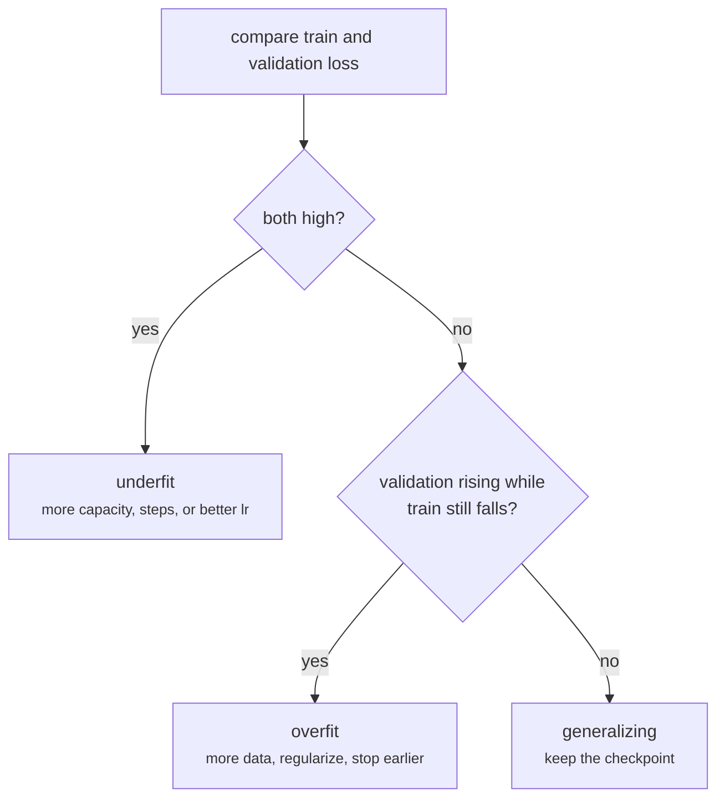
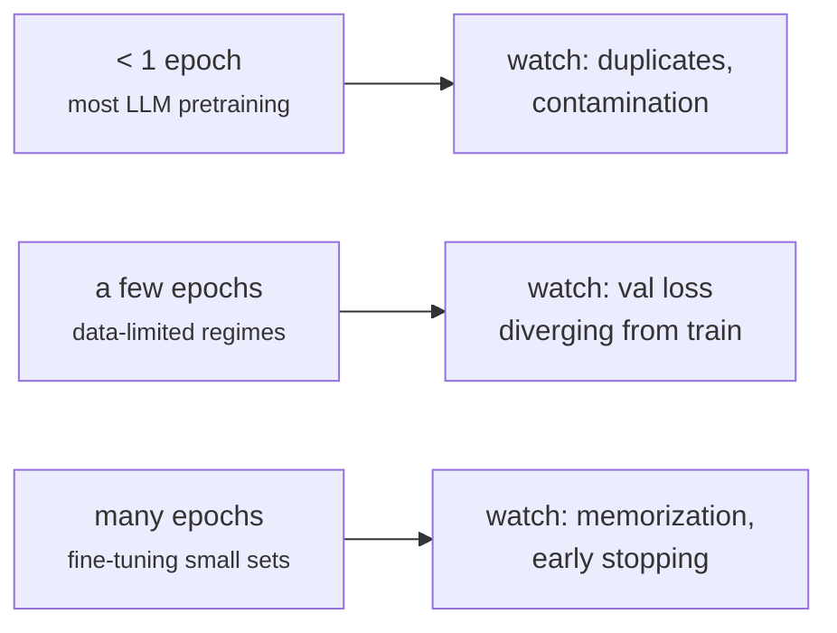

+++
title = 'Generalization and overfitting'
description = 'A model is useful only if it does well on data it has not seen. Held-out validation measures that; capacity, data size, and regularization move it. Large language models mostly train for less than one epoch, which changes what overfitting looks like.'
question = 'How do you tell a model that learned from one that memorized, and what moves the gap?'
weight = 4
difficulty = 2
prerequisites = ['/notes/machine-learning-systems/foundations/03-optimizers-and-learning-rates']
date = 2026-10-30T01:20:00Z
lastmod = 2026-10-30T01:20:00Z
verified = 2026-10-30
+++

## The idea in one minute

Training minimizes loss on the training set. What you want is low loss on
**new** data from the same distribution. The difference is the
**generalization gap**, and the only way to measure it is to hold data out:
a **validation set** you never train on and use to choose settings, and a
**test set** you look at once at the end.

A model **overfits** when training loss keeps falling while validation loss
rises: it is fitting the noise and quirks of its particular samples. It
**underfits** when both are high: it lacks the capacity or training to
capture the signal. Three levers move the gap:

- **Capacity** (parameters, training steps): more fits more, including noise.
- **Data**: more independent examples make noise harder to memorize.
- **Regularization** (weight decay, dropout, early stopping, augmentation):
  penalizes or prevents solutions that rely on memorization.

The consequence for large models: they usually train on each token **once or
a few times**, so validation loss tracks training loss closely and the real
risks move elsewhere, to duplicated data, contamination of evaluation sets,
and memorized training text.

## A picture



## How it really works

### Splits and leakage

The validation set is only a measurement if it is **independent** of
training. Leakage breaks that silently: the same document in both splits,
near-duplicates (a web page and its mirror), a time series split at random
instead of by time, or a feature computed from the label. For text corpora,
deduplicating before splitting is the first defense; Lee et al. (2022) found
that common language-model datasets contain many near-duplicate documents and
that deduplication reduces memorized output.

Every decision made by looking at validation results (learning rate, when to
stop, which checkpoint) fits the validation set a little. That is why a
separate test set exists, and why a benchmark used to choose between many
models stops being an unbiased estimate.

### Capacity, data, and the classical U

In the program, polynomials of growing degree fit 12 noisy samples of
`sin(3x)`. Degree 1 underfits. Degree 3 is close to the noise floor
(validation MSE 0.056 against an irreducible 0.04). By degree 11, with 12
parameters for 12 points, the fit passes through every training point (train
MSE 0.0000) and validation error is 199.5: it memorized the noise. Give the
same degree-9 model 400 points and train and validation MSE converge on the
noise floor.

### Regularization

- **Weight decay** (L2) pulls weights toward zero, preferring smooth
  functions. In the program, a tiny penalty (`1e-3`) turns the degree-11
  disaster back into a reasonable fit.
- **Early stopping** keeps the checkpoint with the best validation loss;
  training steps are capacity too.
- **Dropout** (Srivastava et al., 2014) zeroes random activations during
  training so no unit can rely on a specific other unit. Many recent LLM
  pretraining recipes use no dropout, because single-epoch training rarely
  overfits.
- **Data augmentation** creates new valid examples (crops, paraphrases).

### Double descent and the modern regime

The classical U curve is not the whole story. Belkin et al. (2019) and
Nakkiran et al. (2020) showed that as capacity grows past the point where the
model can exactly fit the training set, test error can **fall again**:
"double descent." Large overparameterized networks trained with SGD tend to
find simple interpolating solutions. This is why huge models do not
automatically overfit, and also why "more parameters than data points" is not
by itself a warning.



### What overfitting looks like for language models

When each token is seen once, the training loss on the next batch is
effectively a validation loss, and the two curves overlap. Muennighoff et al.
(2023) found that repeating data up to about four epochs costs little compared
with unique data, with returns falling off quickly beyond that. The failure
modes that remain are:

- **Memorization of repeated text.** Carlini et al. (2021) extracted verbatim
  training sequences, including personal data, from GPT-2; memorization grows
  with model size and with how often a sequence repeats.
- **Evaluation contamination.** If benchmark questions are in the training
  corpus, benchmark scores measure recall. The post-training and evaluation
  module covers detecting it.
- **Fine-tuning overfit.** Small supervised datasets trained for several
  epochs overfit in the classical way; early stopping on a held-out set
  applies directly.

## Code

The program fits polynomials of degree 1 to 11 to 12 noisy points, with and
without weight decay, then refits degree 9 with more data. The solver is
exact least squares; there is no gradient descent, so "capacity" here is the
degree only.

```python {title="overfit.py"}
"""overfit.py: train vs validation error as model capacity grows, and what weight decay does.

Fit polynomials of increasing degree to 12 noisy samples of sin(3x) by ridge
regression (normal equations, solved exactly). Validation uses 200 fresh
samples from the same distribution. Standard library only.
"""

from __future__ import annotations

import math
import random


def features(x: float, degree: int) -> list[float]:
    return [x ** k for k in range(degree + 1)]


def solve(a: list[list[float]], b: list[float]) -> list[float]:
    n = len(b)
    m = [row[:] + [bi] for row, bi in zip(a, b)]
    for c in range(n):
        piv = max(range(c, n), key=lambda r: abs(m[r][c]))
        m[c], m[piv] = m[piv], m[c]
        for r in range(n):
            if r != c:
                f = m[r][c] / m[c][c]
                m[r] = [x - f * y for x, y in zip(m[r], m[c])]
    return [m[i][n] / m[i][i] for i in range(n)]


def fit(xs, ys, degree: int, l2: float) -> list[float]:
    X = [features(x, degree) for x in xs]
    k = degree + 1
    ata = [[sum(r[i] * r[j] for r in X) + (l2 if i == j and i > 0 else 0.0) for j in range(k)] for i in range(k)]
    aty = [sum(r[i] * y for r, y in zip(X, ys)) for i in range(k)]
    return solve(ata, aty)


def mse(w, xs, ys) -> float:
    return sum((sum(c * f for c, f in zip(w, features(x, len(w) - 1))) - y) ** 2 for x, y in zip(xs, ys)) / len(xs)


def sample(n: int, rng: random.Random, noise: float = 0.2):
    # stratified: one point per equal-width bin, so the fit interpolates rather than extrapolates
    xs = [-1 + 2 * (i + rng.random()) / n for i in range(n)]
    return xs, [math.sin(3 * x) + rng.gauss(0, noise) for x in xs]


def main() -> None:
    rng = random.Random(7)
    tx, ty = sample(12, rng)
    vx, vy = sample(200, rng)
    print("12 training points, noise sd 0.2 (irreducible MSE 0.04)")
    print(f"{'degree':>6}{'params':>8}{'train':>10}{'val':>10}{'val, l2=1e-3':>14}")
    for d in (1, 3, 5, 7, 9, 11):
        w = fit(tx, ty, d, 0.0)
        wr = fit(tx, ty, d, 1e-3)
        print(f"{d:>6}{d + 1:>8}{mse(w, tx, ty):>10.4f}{mse(w, vx, vy):>10.4g}{mse(wr, vx, vy):>14.4g}")
    print("\nsame degree 9 model, more data")
    for n in (12, 50, 400):
        xs, ys = sample(n, random.Random(n))
        w = fit(xs, ys, 9, 0.0)
        print(f"  n={n:<4} train {mse(w, xs, ys):.4f}  val {mse(w, vx, vy):.4f}")


if __name__ == "__main__":
    main()
```

Run it with `python3 overfit.py`:

```text
12 training points, noise sd 0.2 (irreducible MSE 0.04)
degree  params     train       val  val, l2=1e-3
     1       2    0.1850    0.2034        0.2034
     3       4    0.0446   0.05636       0.05628
     5       6    0.0033   0.09258       0.09248
     7       8    0.0019    0.1837        0.0932
     9      10    0.0016    0.1121       0.09094
    11      12    0.0000     199.5        0.0897

same degree 9 model, more data
  n=12   train 0.0001  val 0.6181
  n=50   train 0.0268  val 0.0479
  n=400  train 0.0439  val 0.0472
```

Training error falls monotonically with degree; validation error has its
minimum at degree 3. Weight decay holds validation near 0.09 at every degree
above 5. More data closes the gap for a fixed model: at 400 points, train and
validation both approach the 0.04 noise floor. (The `n=12` row uses a
different random sample than the table, which is why its numbers differ.)

## Where it breaks

- **Polynomials are a caricature.** They show the gap and the levers, not
  double descent or the behavior of networks trained by SGD.
- **Validation loss is a proxy.** A model can match validation loss and fail
  on the inputs you care about if production data differs from the training
  distribution (dataset shift). Evaluate on samples of real traffic.
- **Contamination is hard to rule out** for web-scale corpora; n-gram overlap
  checks miss paraphrases and translations.
- **Lower validation loss is not always better behavior** after post-training,
  where the objective (preferences, instruction following) differs from
  next-token loss.

## Remember this

- Measure generalization on held-out data that cannot leak into training.
- Train falling and validation rising means overfitting; both high means underfitting.
- More data, regularization, and early stopping close the gap.
- Overparameterized networks can generalize past the interpolation point (double descent).
- For single-epoch LLM training, the risks are duplicates, contamination, and memorization.

## Try it

1. Add early stopping to the autodiff network from
   [Gradients and backpropagation](/notes/machine-learning-systems/foundations/02-gradients-and-backpropagation/)
   using a held-out set of 8 examples.
2. Insert three copies of one training point into `overfit.py`. How does the
   degree-9 fit change around that point?
3. Sweep the L2 strength from 1e-6 to 1 at degree 11 and find the best value.

## Check yourself

1. Why keep a test set separate from the validation set?

   
   Choices made using validation results fit the validation set slightly.
   A test set used once gives an unbiased estimate of the final model.
   

2. A pretraining run shows training and validation loss overlapping for its
   whole length. Has it avoided memorization?

   
   Not necessarily. Overlapping curves show average generalization, but
   sequences repeated many times in the corpus can still be memorized
   verbatim. Deduplication and extraction tests address that.
   

3. Why did the degree-11 polynomial reach zero training error?

   
   It has 12 coefficients and there are 12 training points, so it can
   interpolate every point exactly, noise included.
   

## Sources

- M. Belkin, D. Hsu, S. Ma, S. Mandal, [Reconciling modern machine learning practice and the bias-variance trade-off](https://arxiv.org/abs/1812.11118), PNAS 2019.
- P. Nakkiran et al., [Deep Double Descent: Where Bigger Models and More Data Hurt](https://arxiv.org/abs/1912.02292), ICLR 2020.
- N. Srivastava, G. Hinton, A. Krizhevsky, I. Sutskever, R. Salakhutdinov, [Dropout: A Simple Way to Prevent Neural Networks from Overfitting](https://jmlr.org/papers/v15/srivastava14a.html), JMLR 2014.
- K. Lee et al., [Deduplicating Training Data Makes Language Models Better](https://arxiv.org/abs/2107.06499), ACL 2022.
- N. Carlini et al., [Extracting Training Data from Large Language Models](https://arxiv.org/abs/2012.07805), USENIX Security 2021.
- N. Muennighoff et al., [Scaling Data-Constrained Language Models](https://arxiv.org/abs/2305.16264), NeurIPS 2023.
