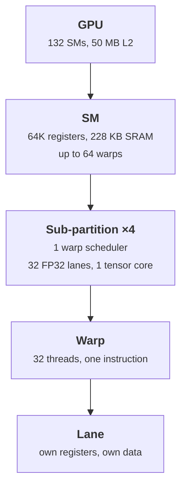
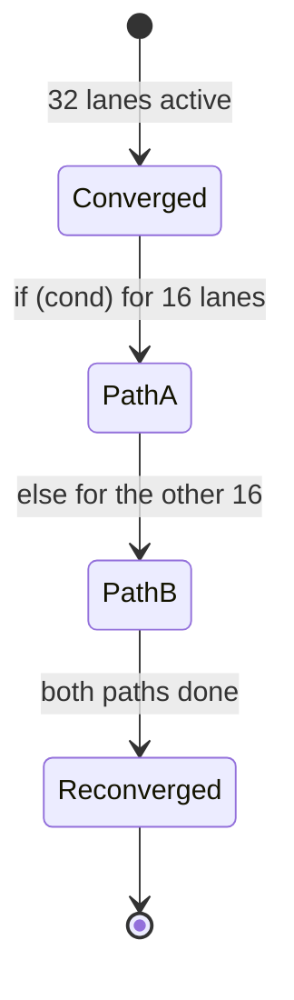

+++
title = 'SMs, warps, and SIMT'
description = 'A GPU is a set of streaming multiprocessors, each running many warps of 32 threads that share one instruction stream. The scheduler hides latency by switching warps every cycle, and branches that split a warp cost both paths.'
question = 'How does a GPU actually execute thousands of threads, and why do branches inside a warp cost so much?'
weight = 2
difficulty = 3
prerequisites = ['/notes/machine-learning-systems/gpu-architecture/01-why-gpus-and-the-roofline']
date = 2026-10-30T03:10:00Z
lastmod = 2026-10-30T03:10:00Z
verified = 2026-10-30
+++

## The idea in one minute

A GPU is an array of **streaming multiprocessors (SMs)**. The H100 SXM has 132.
Each SM holds up to 64 **warps**, and a warp is 32 threads that execute the
same instruction at the same time on different data. NVIDIA calls this
**SIMT**: single instruction, multiple threads.

Every cycle, each of an SM's four warp schedulers picks a warp whose next
instruction is ready and issues it. A warp waiting hundreds of cycles for
memory simply is not picked. With enough resident warps, some warp is always
ready, and the latency disappears from view. That is how a GPU hides latency:
**by having other work, not by caching**.

The cost of sharing one instruction stream is **divergence**. If threads in a
warp take different sides of a branch, the warp runs both sides one after the
other, masking off the lanes that did not take each one.

## A picture



## How it really works

### Inside an SM

The Hopper whitepaper describes the H100 SM as four processing blocks, or
sub-partitions. Each has its own warp scheduler and dispatch unit, a 16K-entry
slice of the 32-bit register file, 32 FP32 units, 16 INT32 units, 16 FP64
units, and one fourth-generation tensor core. The SM shares 256 KB of
combined L1 data cache and shared memory, of which up to 228 KB can be
configured as shared memory (as of October 2026).

Threads are grouped into warps when a block is placed on an SM: threads 0–31
of the block form warp 0, threads 32–63 form warp 1, and so on. A warp stays
on its sub-partition for its whole life. Its registers are allocated up front,
which is why switching warps costs nothing: there is no state to save.

### Latency hiding is Little's law

Suppose an instruction's result is ready 4 cycles after issue (a typical
arithmetic pipeline) and a load from HBM takes several hundred cycles. A
scheduler can issue one instruction per cycle. If every warp needs the result
of the previous instruction before it can continue, the scheduler needs about
as many ready warps as the latency in cycles divided by the number of
independent instructions each warp can offer between stalls.

That is Little's law: concurrency = throughput × latency. It is why the
hardware allows 16 resident warps per scheduler. It is also why
**instruction-level parallelism** inside a thread (several independent loads
before the first use) can stand in for more warps. The next lesson puts
numbers on this for memory.

### SIMT and the active mask

At any moment a warp has an **active mask**: one bit per lane saying which
lanes execute the current instruction. On a branch, the hardware evaluates the
condition per lane. If all lanes agree, the warp takes one path at full speed.
If they disagree, the warp executes the taken path with some lanes masked, then
the other path with the rest masked, then reconverges.

Since Volta (2017), each thread has its own program counter and call stack
("independent thread scheduling"), so diverged paths can interleave and threads
in a warp can wait on each other without deadlock. That changes correctness,
not cost: two divergent paths still take the sum of their times, because only
one instruction issues per warp per cycle.



### What divergence costs, and what it does not

Divergence costs lanes, not warps. If the branch condition is the same for
every lane of a warp (for example, `if (blockIdx.x % 2)` or a condition on
`threadIdx.x / 32`), different warps take different paths and nothing is
wasted. The expensive pattern is a per-lane condition with mixed outcomes:
`if (threadIdx.x % 2)`, data-dependent conditions on unsorted input, or loops
whose trip count varies by lane. A loop runs until its slowest lane finishes.

Short branches are often compiled to **predicated** instructions instead of
real jumps: both sides are computed and the result selected. That trades a few
wasted instructions for no reconvergence overhead.

> [!TIP]
> When per-element work varies a lot, as in ragged sequence lengths or sparse
> rows, sort or bucket the work so similar items share a warp. Serving engines
> do this when they group sequences of similar length.

## Code

The program simulates 4,096 threads in warps of 32 with a two-way branch. A
warp spends the cost of every path any lane takes; "useful" counts only the
work each lane needed.

```python {title="divergence.py"}
"""Warp divergence cost: a SIMT warp runs every taken path, masked."""
import random

WARP = 32


def warp_cycles(takes_a: list[bool], cost_a: int, cost_b: int) -> int:
    cycles = 0
    if any(takes_a):
        cycles += cost_a          # lanes not taking A are masked off
    if not all(takes_a):
        cycles += cost_b
    return cycles


def run(name: str, pred, n: int = 4096, cost_a: int = 100, cost_b: int = 100) -> None:
    total = 0
    useful = 0
    for w in range(n // WARP):
        lanes = [pred(w * WARP + i) for i in range(WARP)]
        total += warp_cycles(lanes, cost_a, cost_b) * WARP
        useful += sum(cost_a if t else cost_b for t in lanes)
    print(f"{name:34} lane-cycles={total:>8,} useful={useful:>8,} "
          f"efficiency={useful / total:6.1%}")


if __name__ == "__main__":
    random.seed(7)
    rnd = [random.random() < 0.5 for _ in range(4096)]
    run("uniform (all take A)", lambda i: True)
    run("split by warp (i // 32 even)", lambda i: (i // 32) % 2 == 0)
    run("split by lane (i even)", lambda i: i % 2 == 0)
    run("random 50/50", lambda i: rnd[i])
    run("1 lane in 32 takes slow path", lambda i: i % 32 != 0, cost_a=10, cost_b=1000)
```

```text
$ python3 divergence.py
uniform (all take A)               lane-cycles= 409,600 useful= 409,600 efficiency=100.0%
split by warp (i // 32 even)       lane-cycles= 409,600 useful= 409,600 efficiency=100.0%
split by lane (i even)             lane-cycles= 819,200 useful= 409,600 efficiency= 50.0%
random 50/50                       lane-cycles= 819,200 useful= 409,600 efficiency= 50.0%
1 lane in 32 takes slow path       lane-cycles=4,136,960 useful= 167,680 efficiency=  4.1%
```

Splitting by warp costs nothing. Splitting by lane halves efficiency. The last
row is the dangerous case: one rare slow lane per warp forces all 32 lanes to
wait for it, so 96% of the lane-cycles do nothing.

## Where it breaks

- **The model ignores scheduling.** Real warps interleave; a divergent warp
  frees issue slots for other warps, so total SM throughput suffers less than
  per-warp efficiency suggests when many warps are resident.
- **Predication and compiler choices** can remove a branch entirely. Read the
  generated SASS, or a profiler's branch efficiency metric, before
  restructuring code.
- **Tensor-core work is warp-wide by design.** Matrix instructions require all
  lanes of the warp (or warpgroup, on Hopper) to participate. Divergence around
  them is a correctness error, not a slowdown.
- **Specs here are H100.** Other generations change the sub-partition layout,
  register counts, and resident warp limits.

## Remember this

- An SM runs many warps of 32 threads; each scheduler issues one warp instruction per cycle.
- Latency is hidden by switching to another ready warp, which costs nothing because registers stay allocated.
- Divergence is per warp: different paths in one warp run one after the other.
- Branches that are uniform across a warp are free.
- A loop in a warp runs as long as its slowest lane.

## Try it

1. Set `cost_a=10, cost_b=1000` and make 1 lane in 4 take the slow path. What
   is the efficiency?
2. Sort `rnd` before running the random case. What happens, and why?
3. Change `WARP` to 64 (as on some AMD GPUs in wave64 mode) and rerun the "1
   lane in 32" case with a slow lane in every 64.

## Check yourself

1. Why can a GPU switch between warps every cycle at no cost, when a CPU
   context switch takes microseconds?
   
   Every resident warp's registers stay allocated in the SM's register file for
   the warp's whole life. Switching only changes which warp the scheduler
   issues from; nothing is saved or restored.
   

2. A kernel branches on `if (threadIdx.x < 64)` with 256 threads per block. Is
   there divergence?
   
   No. Threads 0–63 are exactly warps 0 and 1, and threads 64–255 are warps 2–7.
   Every warp is uniform. The condition `threadIdx.x < 48` would make warp 1
   diverge.
   

3. Did independent thread scheduling in Volta make divergence cheap?
   
   No. It gives each thread its own program counter so diverged paths can
   interleave and synchronize safely. The warp still issues one instruction per
   cycle for one path, so the paths' costs add.
   

## Sources

- NVIDIA, *NVIDIA H100 Tensor Core GPU Architecture* whitepaper, 2022.
  <https://resources.nvidia.com/en-us-tensor-core>
- NVIDIA, *NVIDIA Tesla V100 GPU Architecture* whitepaper (independent thread
  scheduling), 2017. <https://images.nvidia.com/content/volta-architecture/pdf/volta-architecture-whitepaper.pdf>
- NVIDIA, *CUDA C++ Programming Guide*, "SIMT architecture" and "Hardware
  multithreading". <https://docs.nvidia.com/cuda/cuda-c-programming-guide/>
- John D. C. Little, "A Proof for the Queuing Formula: L = λW", *Operations
  Research* 9(3), 1961. <https://doi.org/10.1287/opre.9.3.383>
