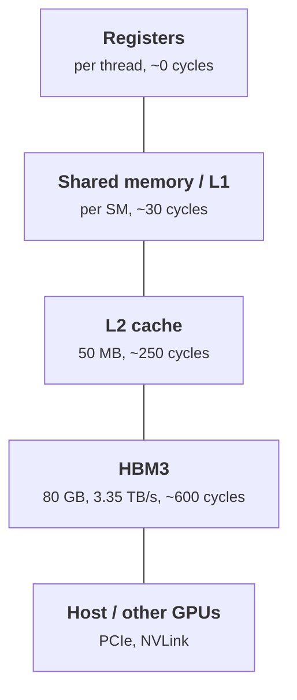
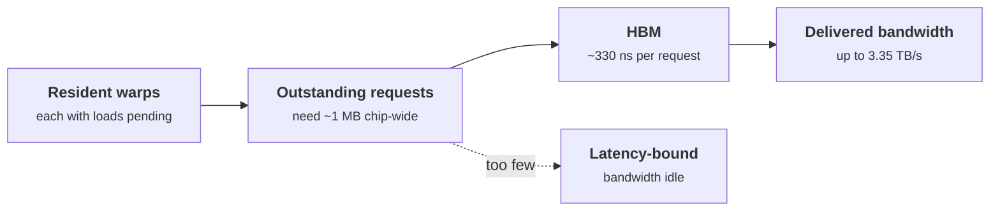

+++
title = 'The memory hierarchy'
description = "Registers, shared memory, L2, and HBM differ by orders of magnitude in latency and bandwidth. Little's law says how many bytes must be in flight to use each level, and why fast kernels keep data on chip."
question = 'How far is each level of GPU memory from the arithmetic, and how much parallelism does it take to keep HBM busy?'
weight = 3
difficulty = 3
prerequisites = ['/notes/machine-learning-systems/gpu-architecture/02-sms-warps-and-simt']
date = 2026-10-30T03:15:00Z
lastmod = 2026-10-30T03:15:00Z
verified = 2026-10-30
+++

## The idea in one minute

A GPU has four levels of memory that matter for kernels:

| Level | H100 SXM size | Scope | Rough latency |
| --- | --- | --- | --- |
| Registers | 256 KB per SM (64K × 32-bit) | one thread | ~0 extra cycles |
| Shared memory / L1 | up to 228 KB shared, 256 KB combined, per SM | one block | ~30 cycles |
| L2 cache | 50 MB | whole GPU | ~250 cycles |
| HBM3 | 80 GB | whole GPU | ~500–700 cycles |

Capacity grows by about a thousand times per step down; bandwidth falls and
latency rises. Sizes are from NVIDIA's Hopper documents; latencies are rounded
from published microbenchmarks and vary with clock and access pattern.

Two consequences shape every kernel. To use HBM at full bandwidth, roughly a
megabyte of loads must be in flight across the chip at all times. And data that
is used more than once should be read from HBM once and reused from shared
memory or registers.

## A picture



## How it really works

### Registers

Each thread's local variables live in registers. An SM has 65,536 32-bit
registers, shared among all resident threads, and a thread can use at most 255
(CUDA Programming Guide, compute capability 9.0). Registers are the fastest
storage and the scarcest: a kernel using 128 registers per thread can have at
most 512 threads resident per SM. When a kernel needs more than the compiler
allocates, values **spill** to "local memory", which despite the name lives in
HBM behind the caches.

### Shared memory and L1

Shared memory is a software-managed scratchpad visible to every thread in a
block. It is the tool for reuse: load a tile of data from HBM once, then let
every thread in the block read it many times. It is divided into 32 **banks**,
4 bytes wide; if two lanes of a warp hit different addresses in the same bank,
the accesses serialize (a **bank conflict**). The same SRAM serves as the L1
cache, and the split is configurable per kernel.

Hopper adds two features around shared memory. The **Tensor Memory
Accelerator (TMA)** copies multidimensional tiles between HBM and shared memory
asynchronously, so threads do not spend instructions on address arithmetic.
**Thread block clusters** let blocks on neighboring SMs read each other's
shared memory ("distributed shared memory").

### L2 and HBM

The L2 is shared by all SMs and caches HBM traffic. At 50 MB on H100 it can
hold a meaningful working set, such as a KV-cache block or a weight matrix
reused across a short burst of kernels. HBM3 on the H100 SXM is 80 GB at 3.35
TB/s across five active stacks.

Every global load is served in 32-byte **sectors** grouped into 128-byte
cache lines. The unit of traffic is the sector, not the byte, which is why
access patterns matter so much (see
[coalescing and occupancy](/notes/machine-learning-systems/gpu-performance/02-coalescing-and-occupancy/)).

### Little's law for memory

Bandwidth × latency = bytes that must be in flight. For HBM, 3.35 TB/s × about
330 ns is roughly 1.1 MB of outstanding requests, about 8 KB per SM. A warp
loading 16 bytes per lane has 512 bytes outstanding. So each SM needs on the
order of 16 such warp-wide loads in flight at every moment, from enough warps
or enough independent loads per thread. A kernel with too few warps and
dependent loads cannot reach the bandwidth the roofline promises; it is
**latency-bound**.

## Code

The program applies Little's law to each level. The L2 and shared-memory
bandwidths are estimates (shared memory: 128 bytes per clock per SM × 132 SMs ×
1.83 GHz), not datasheet figures.

```python {title="memory_hierarchy.py"}
"""Memory hierarchy arithmetic: bytes in flight needed to hide latency.

Latencies are rounded orders of magnitude from published microbenchmarks;
bandwidths are H100 SXM figures. Treat them as illustrative.
"""
CLOCK_GHZ = 1.83   # H100 SXM boost clock (approx.)
SMS = 132

levels = [
    # name, latency cycles, aggregate bandwidth TB/s
    ("shared memory / L1", 30, 31.0),
    ("L2 cache", 260, 10.0),
    ("HBM3", 600, 3.35),
]

if __name__ == "__main__":
    print(f"{'level':20} {'lat ns':>7} {'TB/s':>6} {'in flight':>10} {'per SM':>8}")
    for name, cyc, tbps in levels:
        ns = cyc / CLOCK_GHZ
        inflight = tbps * 1e12 * ns * 1e-9          # Little's law
        print(f"{name:20} {ns:7.0f} {tbps:6.2f} {inflight / 1024:8.0f} KiB "
              f"{inflight / SMS / 1024:6.1f} KiB")
    # How many warps must be waiting on HBM per SM if each issues one 16 B/lane load?
    per_sm = 3.35e12 * (600 / CLOCK_GHZ) * 1e-9 / SMS
    per_warp_load = 32 * 16
    print(f"\nHBM: each SM needs ~{per_sm / per_warp_load:.0f} warp-wide 16-byte loads "
          f"outstanding to saturate bandwidth")
    t_hbm = 80e9 / 3.35e12
    print(f"reading all 80 GB of HBM once: {t_hbm * 1e3:.1f} ms")
```

```text
$ python3 memory_hierarchy.py
level                 lat ns   TB/s  in flight   per SM
shared memory / L1        16  31.00      496 KiB    3.8 KiB
L2 cache                 142  10.00     1387 KiB   10.5 KiB
HBM3                     328   3.35     1073 KiB    8.1 KiB

HBM: each SM needs ~16 warp-wide 16-byte loads outstanding to saturate bandwidth
reading all 80 GB of HBM once: 23.9 ms
```

Reading the whole of HBM once takes about 24 ms. That is a useful floor for
anything that touches every weight: one decode step of a model whose weights
fill an 80 GB GPU cannot be faster than that.



## Where it breaks

- **Latencies are approximate.** They depend on clock, contention, TLB misses,
  and whether the line is in L2. Measure on your hardware with a pointer-chasing
  microbenchmark if a decision depends on the exact value.
- **L2 is partitioned.** On H100 the L2 is split in two halves; data in the far
  partition costs more. The program treats it as uniform.
- **Achievable HBM bandwidth is below peak.** Streaming kernels typically
  reach 80–90% of the datasheet figure.
- **Register spills hide in the compiler output.** A kernel can look fine in
  source and still spill; check `-Xptxas -v` or the profiler.

## Remember this

- Registers, shared memory, L2, HBM: each step is far larger, slower, and narrower.
- Bytes in flight = bandwidth × latency; HBM needs about 1 MB in flight on an H100.
- Shared memory is the reuse tool: load once from HBM, read many times on chip.
- Register pressure limits how many threads fit; spills go to HBM.
- Reading all 80 GB of HBM once takes about 24 ms.

## Try it

1. Change the HBM figures to an H200 (141 GB at 4.8 TB/s, as of October 2026).
   How long does one full read take, and how many bytes must be in flight?
2. If each lane loads only 4 bytes, how many warp-wide loads per SM must be
   outstanding to saturate HBM?
3. A kernel has 8 warps per SM and each warp issues one 16-byte-per-lane load
   and then waits. What fraction of peak HBM bandwidth can it reach?

## Check yourself

1. Why does a kernel with high occupancy sometimes still not reach peak
   bandwidth?
   
   Occupancy counts resident warps, not outstanding loads. If each warp issues
   one load and immediately depends on it, there may still be too few bytes in
   flight. Independent loads per thread (instruction-level parallelism) raise
   bytes in flight without more warps.
   

2. What is local memory, and where does it live?
   
   Per-thread storage used for register spills and large thread-private
   arrays. It lives in device memory (HBM), cached in L1 and L2, so heavy
   spilling costs HBM traffic.
   

3. When does a 50 MB L2 change a roofline estimate?
   
   When the working set reused across accesses fits in it. Then repeat reads hit
   L2, real HBM traffic falls, and the effective intensity rises above the naive
   count.
   

## Sources

- NVIDIA, *NVIDIA H100 Tensor Core GPU Architecture* whitepaper, 2022.
  <https://resources.nvidia.com/en-us-tensor-core>
- NVIDIA, *CUDA C++ Programming Guide*, "Device memory accesses", "Shared
  memory", and "Compute capabilities".
  <https://docs.nvidia.com/cuda/cuda-c-programming-guide/>
- NVIDIA, *Hopper Tuning Guide*. <https://docs.nvidia.com/cuda/hopper-tuning-guide/>
- Zhe Jia, Marco Maggioni, Benjamin Staiger, Daniele P. Scarpazza,
  "Dissecting the NVIDIA Volta GPU Architecture via Microbenchmarking", 2018.
  <https://arxiv.org/abs/1804.06826>
- Weile Luo et al., "Benchmarking and Dissecting the Nvidia Hopper GPU
  Architecture", 2024. <https://arxiv.org/abs/2402.13499>
