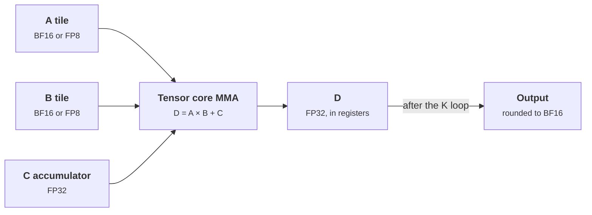

+++
title = 'Tensor cores and number formats'
description = "Tensor cores multiply small matrix tiles per instruction and deliver most of a GPU's FLOPs, at precisions from FP64 down to FP8 and below. Each format trades range against precision, and accumulation must stay wide."
question = 'What do tensor cores compute, and which number formats are safe for which parts of a model?'
weight = 4
difficulty = 3
prerequisites = ['/notes/machine-learning-systems/gpu-architecture/03-the-memory-hierarchy']
date = 2026-10-30T03:20:00Z
lastmod = 2026-10-30T03:20:00Z
verified = 2026-10-30
+++

## The idea in one minute

A **tensor core** executes a small matrix multiply-accumulate, `D = A × B + C`,
as a single warp-level operation. On the H100 SXM, tensor cores deliver 989
TFLOP/s dense in BF16 or FP16, against 67 TFLOP/s for the ordinary FP32 lanes
(NVIDIA datasheet, as of October 2026). Almost every FLOP a model performs in
training or inference should run on them.

Their speed rises as precision falls: FP8 doubles BF16 throughput, and each
halving of element size also halves the bytes moved. The catch is that every
format has a fixed number of exponent bits (range) and mantissa bits
(precision). Inputs can usually be narrow. **Accumulators must stay wide**,
usually FP32, or sums of many small terms are lost.

## A picture



## How it really works

### What the hardware computes

Tensor cores first appeared in Volta (2017). On Hopper, a **warpgroup** of
four warps issues `wgmma` instructions that read operand A from registers or
shared memory and operand B from shared memory, and accumulate into registers.
A library such as cuBLAS or CUTLASS, or a compiler such as Triton, tiles a
large matmul into many such operations. The FP32 lanes still handle everything
else: softmax, normalization, activation functions.

H100 SXM dense throughput by input type, from NVIDIA's datasheet (as of
October 2026):

| Input | Tensor TFLOP/s (dense) | Bytes per element |
| --- | --- | --- |
| FP64 | 67 | 8 |
| TF32 | 495 | 4 (19 bits used) |
| BF16 / FP16 | 989 | 2 |
| FP8 (E4M3, E5M2) | 1,979 | 1 |
| INT8 | 1,979 TOPS | 1 |

Blackwell-generation parts add FP6 and FP4 tensor-core formats with per-block
scale factors, along the lines of the OCP Microscaling (MX) specification.

### Range versus precision

A floating-point number is sign × 2^exponent × 1.mantissa. Exponent bits set
the range; mantissa bits set the spacing between neighbors.

| Format | Exponent bits | Mantissa bits | Largest finite | Step just above 1 |
| --- | --- | --- | --- | --- |
| FP32 | 8 | 23 | 3.4 × 10³⁸ | 1.2 × 10⁻⁷ |
| BF16 | 8 | 7 | 3.4 × 10³⁸ | 7.8 × 10⁻³ |
| FP16 | 5 | 10 | 65,504 | 9.8 × 10⁻⁴ |
| FP8 E4M3 | 4 | 3 | 448 | 0.125 |
| FP8 E5M2 | 5 | 2 | 57,344 | 0.25 |

**BF16** keeps FP32's exponent, so anything that fits in FP32 fits in BF16,
only less precisely. That is why it displaced FP16 for training: FP16 needs
**loss scaling** to keep small gradients from underflowing, BF16 usually does
not. **FP8** comes in two variants (Micikevicius et al., 2022): E4M3 for
weights and activations, where precision matters more, and E5M2 for gradients,
where range does. E4M3 has no infinities; its largest value is 448.

### Scaling makes FP8 work

With 448 as its maximum, FP8 data needs a **scale factor** per tensor (or per
block of a tensor) so the data's range maps onto the format's range. A typical
recipe stores `x / s` in FP8, keeps `s` in FP32, and folds `s` back in after
the matmul. Per-tensor scaling is cheap, but one outlier compresses everything
else into a few codes; finer-grained (per-channel or per-block) scaling keeps
more precision. NVIDIA's Transformer Engine and the MX formats are both built
on this idea.

```mermaid {title="FP8 with a scale factor: map the data's range onto the format's"}
flowchart LR
  X["<b>BF16 tensor</b><br/><small>max |x| = 12.6</small>"] --> S["<b>scale</b><br/><small>s = 12.6 ÷ 448</small>"]
  S --> Q["<b>FP8 E4M3</b><br/><small>x ÷ s, rounded</small>"]
  Q --> M["<b>Tensor core</b><br/><small>FP8 × FP8, FP32 accumulate</small>"]
  M --> R["<b>Rescale</b><br/><small>× s_a × s_b</small>"]
  class X,Q memory
  class S,R neutral
  class M compute
```

### Why accumulation stays wide

A dot product of length 8,192 adds 8,192 products. If the running sum has 8
significant bits, once it is a few hundred times larger than each term the
term rounds away entirely. Tensor cores therefore accumulate BF16 and FP16
products in FP32. For FP8 matmuls, the effective accumulation width inside the
tensor core has been a practical concern; the DeepSeek-V3 report (2024)
describes promoting partial sums to FP32 on CUDA cores at fixed intervals for
this reason.

## Code

The program emulates each format with the standard library. FP32 and FP16 use
`struct`; BF16 keeps the top 16 bits of FP32 with round-to-nearest-even; FP8
rounds to the nearest representable value and saturates at the format's
maximum (a common conversion mode, rather than producing infinity).

```python {title="number_formats.py"}
"""Emulate FP32, BF16, FP16, FP8 (E4M3, E5M2) rounding with the stdlib."""
import math
import struct


def to_fp32(x: float) -> float:
    return struct.unpack("f", struct.pack("f", x))[0]


def to_fp16(x: float) -> float:
    try:
        return struct.unpack("e", struct.pack("e", x))[0]
    except OverflowError:
        return math.inf


def to_bf16(x: float) -> float:
    bits = struct.unpack("I", struct.pack("f", x))[0]
    bits += 0x7FFF + ((bits >> 16) & 1)       # round to nearest even
    return struct.unpack("f", struct.pack("I", (bits >> 16) << 16 & 0xFFFFFFFF))[0]


def to_small_float(x: float, exp_bits: int, man_bits: int, max_val: float) -> float:
    """Round to a tiny float format with subnormals; saturate at max_val."""
    if x == 0:
        return 0.0
    bias = 2 ** (exp_bits - 1) - 1
    sign = -1.0 if x < 0 else 1.0
    a = abs(x)
    e = max(math.floor(math.log2(a)), 1 - bias)   # subnormals share min exponent
    step = 2.0 ** (e - man_bits)
    q = round(a / step) * step                    # Python round = half to even
    return sign * min(q, max_val)


def e4m3(x: float) -> float:
    return to_small_float(x, 4, 3, 448.0)


def e5m2(x: float) -> float:
    return to_small_float(x, 5, 2, 57344.0)


FORMATS = [("FP32", to_fp32), ("BF16", to_bf16), ("FP16", to_fp16),
           ("FP8 E4M3", e4m3), ("FP8 E5M2", e5m2)]

if __name__ == "__main__":
    for v in [3.14159265, 0.001234, 70000.0, 1e-6]:
        row = "  ".join(f"{n}={f(v):.6g}" for n, f in FORMATS)
        print(f"{v:<11g} {row}")
    print("\nsumming 1.0 + 0.001 ten thousand times (exact 11.0):")
    for n, f in FORMATS:
        acc = 1.0
        for _ in range(10_000):
            acc = f(acc + f(0.001))
        print(f"  {n:9} accumulator -> {acc:.4f}")
```

```text
$ python3 number_formats.py
3.14159     FP32=3.14159  BF16=3.14062  FP16=3.14062  FP8 E4M3=3.25  FP8 E5M2=3
0.001234    FP32=0.001234  BF16=0.00123596  FP16=0.00123405  FP8 E4M3=0.00195312  FP8 E5M2=0.0012207
70000       FP32=70000  BF16=70144  FP16=inf  FP8 E4M3=448  FP8 E5M2=57344
1e-06       FP32=1e-06  BF16=9.98378e-07  FP16=1.01328e-06  FP8 E4M3=0  FP8 E5M2=0

summing 1.0 + 0.001 ten thousand times (exact 11.0):
  FP32      accumulator -> 11.0008
  BF16      accumulator -> 1.0000
  FP16      accumulator -> 4.0000
  FP8 E4M3  accumulator -> 1.0000
  FP8 E5M2  accumulator -> 1.0000
```

The first rows show range: 70,000 overflows FP16 and saturates both FP8
formats, and 10⁻⁶ underflows to zero in FP8. The accumulation test is the
important one. Adding 0.001 to a running total near 1 stalls at once in BF16
and FP8, because half the step between neighbors near 1 is larger than the
increment, so every addition rounds back. FP16 climbs to 4, where its step
reaches about 0.004. Only the FP32 accumulator ends near 11.

## Where it breaks

- **Emulation is not bit-exact hardware.** Real conversions have rounding
  modes, saturation options, and NaN handling per instruction. The program shows
  the effect of exponent and mantissa width, not exact hardware results.
- **Peak FLOPs need large, aligned tiles.** Matrix dimensions that are not
  multiples of 8 or 16 elements waste tensor-core work or fall back to slower
  paths.
- **Some operations stay wide.** Softmax, normalization statistics, the loss,
  and optimizer state stay in FP32 in standard mixed-precision recipes,
  because small errors there compound.
- **Quality is empirical.** Whether FP8 or FP4 is acceptable for a given model
  is measured on evaluations, not derived from the format table. Quantization
  for serving is covered in [quantization](/notes/inference-engineering/making-it-cheaper/01-quantization/).

## Remember this

- Tensor cores do `D = A × B + C` on tiles and supply nearly all of a GPU's FLOPs.
- Each halving of input width doubles tensor throughput and halves bytes moved.
- BF16 has FP32's range with less precision; FP16 has more precision but needs loss scaling.
- FP8 needs scale factors; E4M3 for weights and activations, E5M2 for gradients.
- Keep accumulators in FP32.

## Try it

1. Change the increment in the accumulation test to 0.01. Where does each
   format stall?
2. Implement Kahan summation with a BF16 accumulator and a BF16 compensation
   term. How close does it get to 11?
3. Quantize `[0.01, 0.02, 0.5, 300.0]` to E4M3 with a per-tensor scale chosen
   so the maximum maps to 448. What happens to 0.01 and 0.02?

## Check yourself

1. Why did BF16 displace FP16 as the default training format?
   
   BF16 has FP32's 8 exponent bits, so values do not underflow or overflow
   where FP32 would not. FP16's 5 exponent bits require loss scaling to keep
   small gradients representable.
   

2. Why are there two FP8 formats?
   
   With 7 bits after the sign, range and precision trade directly. E4M3 has
   more precision and a maximum of 448, suited to weights and activations; E5M2
   has more range, suited to gradients.
   

3. A matmul with BF16 inputs accumulates in BF16 over K = 4,096. What goes
   wrong?
   
   With 8 significant bits, once the partial sum is a few hundred times larger
   than each product, products round away. The result loses most of its
   accuracy even though each input was represented well.
   

## Sources

- NVIDIA, *H100 Tensor Core GPU datasheet* and *NVIDIA H100 Tensor Core GPU
  Architecture* whitepaper, 2022. <https://www.nvidia.com/en-us/data-center/h100/>
- Paulius Micikevicius et al., "FP8 Formats for Deep Learning", 2022.
  <https://arxiv.org/abs/2209.05433>
- Paulius Micikevicius et al., "Mixed Precision Training", ICLR 2018.
  <https://arxiv.org/abs/1710.03740>
- Open Compute Project, *OCP Microscaling Formats (MX) Specification v1.0*,
  2023. <https://www.opencompute.org/documents/ocp-microscaling-formats-mx-v1-0-spec-final-pdf>
- IEEE, *IEEE Standard for Floating-Point Arithmetic* (IEEE 754-2019).
  <https://doi.org/10.1109/IEEESTD.2019.8766229>
- DeepSeek-AI, "DeepSeek-V3 Technical Report", 2024.
  <https://arxiv.org/abs/2412.19437>
- NVIDIA, *Transformer Engine documentation*.
  <https://docs.nvidia.com/deeplearning/transformer-engine/>
