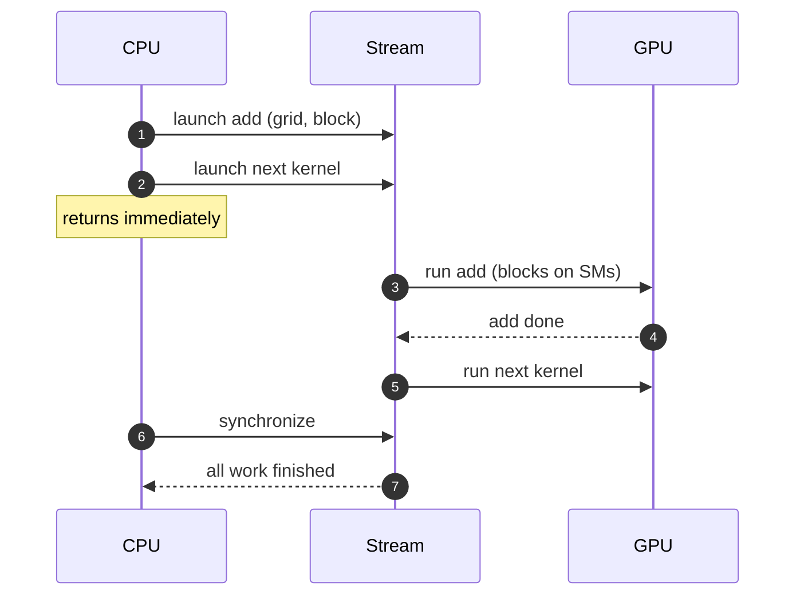

+++
title = 'The programming model'
description = 'A CUDA kernel is one function run by a grid of thread blocks. Each thread computes its own index from block and thread coordinates; blocks are independent and scheduled onto SMs in any order.'
question = 'How does one kernel function turn into millions of threads, and how does each thread know which data is its own?'
weight = 1
difficulty = 2
prerequisites = ['/notes/machine-learning-systems/gpu-architecture/02-sms-warps-and-simt']
date = 2026-10-30T04:05:00Z
lastmod = 2026-10-30T04:05:00Z
verified = 2026-10-30
+++

## The idea in one minute

A **kernel** is a function the CPU launches on the GPU with a launch
configuration: a **grid** of **thread blocks**, each with a fixed number of
threads. Every thread runs the same code. It finds its own piece of the data
from built-in coordinates, typically

`i = blockIdx.x * blockDim.x + threadIdx.x`

and guards against running off the end with `if (i < n)`.

Two rules shape everything else. **Blocks are independent**: the hardware may
run them in any order, on any SM, so a block cannot wait on another block.
**Threads within a block can cooperate**: they share shared memory and can
synchronize with `__syncthreads()`. The block is the unit of scheduling; the
warp is the unit of execution.

## A picture

```mermaid {title="A launch: grid of blocks, blocks of warps, scheduled onto SMs"}
flowchart LR
  H["<b>Host</b><br/><small>kernel&lt;&lt;&lt;grid, block&gt;&gt;&gt;</small>"] --> G["<b>Grid</b><br/><small>3,907 blocks</small>"]
  G --> B0["<b>Block 0</b><br/><small>256 threads = 8 warps</small>"]
  G --> B1["<b>Block 1</b>"]
  G --> BN["<b>Block 3,906</b>"]
  B0 --> SM1["<b>SM 0</b>"]
  B1 --> SM2["<b>SM 1</b>"]
  BN --> SM1
  class H io
  class G queue
  class B0,B1,BN neutral
  class SM1,SM2 compute
```

## How it really works

### A kernel and its launch

```c
__global__ void add(const float *x, const float *y, float *out, int n) {
    int i = blockIdx.x * blockDim.x + threadIdx.x;
    if (i < n) out[i] = x[i] + y[i];
}

int block = 256;
int grid = (n + block - 1) / block;    // ceil(n / block)
add<<<grid, block>>>(x, y, out, n);
```

Launches are **asynchronous**: the call returns as soon as the work is queued
on a **stream**. Work on one stream runs in order; work on different streams
may overlap. The CPU only waits when it synchronizes or copies a result back.

### Coordinates

`threadIdx`, `blockIdx`, `blockDim`, and `gridDim` each have `x`, `y`, and `z`
components. Two- and three-dimensional launches are a convenience for 2D and
3D data; the hardware linearizes them. Within a block, the linear thread id is
`threadIdx.x + threadIdx.y * blockDim.x + threadIdx.z * blockDim.x * blockDim.y`,
and consecutive groups of 32 linear ids form warps. So `x` is the fast
dimension: lay out a 2D block so that `threadIdx.x` walks along contiguous
memory, and each warp reads a contiguous row segment.

Limits from the CUDA Programming Guide (compute capability 9.0, as of October
2026): at most 1,024 threads per block, a grid of up to 2³¹ − 1 blocks in `x`
and 65,535 in `y` and `z`.

### Choosing block and grid sizes

Block size should be a multiple of 32, otherwise the last warp of every block
runs partly empty. 128 to 512 threads is the usual range; the right value
depends on the registers and shared memory each thread needs (the next lesson
computes this). The grid should have at least several blocks per SM so the
whole chip is busy and the last partial wave is a small fraction of the run.

A **grid-stride loop** decouples the grid from the data size:

```c
for (int i = blockIdx.x * blockDim.x + threadIdx.x; i < n;
     i += blockDim.x * gridDim.x)
    out[i] = x[i] + y[i];
```

Launch a grid sized to the hardware (a few blocks per SM) and each thread
handles several elements. That amortizes per-thread setup and lets one launch
handle any `n`.

### Synchronization and its scope

`__syncthreads()` is a barrier for one block. There is no cheap barrier across
blocks within a kernel; the usual global barrier is the kernel boundary itself.
Cooperative launches and Hopper's thread block clusters provide limited
cross-block synchronization, at the cost of constraints on how many blocks can
be resident. Atomics in global memory let blocks combine results without a
barrier.

> [!WARNING]
> A `__syncthreads()` inside a branch that not all threads of the block reach
> is undefined behavior. It may hang or silently produce wrong results.



## Code

The program reproduces the index arithmetic for a 1D launch, a 2D launch over
a 100 × 100 matrix with 32 × 8 blocks, and a grid-stride loop sized to 132 SMs.

```python {title="index_mapping.py"}
"""Grid/block/thread index mapping, as a CUDA kernel computes it."""
from dataclasses import dataclass


@dataclass(frozen=True)
class Dim3:
    x: int
    y: int = 1


def launch_1d(n: int, block: int) -> None:
    grid = (n + block - 1) // block          # ceil-divide
    idle = grid * block - n
    print(f"n={n:,} block={block}: grid={grid:,} blocks, {idle} idle threads "
          f"masked by `if (i < n)`")
    for b, t in [(0, 0), (0, block - 1), (1, 0), (grid - 1, block - 1)]:
        i = b * block + t
        print(f"  blockIdx.x={b:<5} threadIdx.x={t:<4} -> i={i:<7} "
              f"{'work' if i < n else 'skip'}  warp {t // 32} of its block")


def launch_2d(rows: int, cols: int, block: Dim3) -> None:
    grid = Dim3((cols + block.x - 1) // block.x, (rows + block.y - 1) // block.y)
    print(f"\n{rows}x{cols} matrix, block=({block.x},{block.y}) -> grid=({grid.x},{grid.y})")
    for bx, by, tx, ty in [(0, 0, 0, 0), (0, 0, 31, 0), (0, 0, 0, 1), (2, 1, 5, 3)]:
        col = bx * block.x + tx
        row = by * block.y + ty
        lin = ty * block.x + tx                       # linear thread id -> warp
        print(f"  block=({bx},{by}) thread=({tx:>2},{ty}) -> row={row:<3} col={col:<3} "
              f"offset={row * cols + col:<6} warp={lin // 32}")


def grid_stride(n: int, grid: int, block: int) -> None:
    total = grid * block
    per = [len(range(t, n, total)) for t in (0, total - 1)]
    print(f"\ngrid-stride loop: n={n:,} with {grid}x{block}={total:,} threads; "
          f"thread 0 does {per[0]} elements, last thread {per[1]}")


if __name__ == "__main__":
    launch_1d(1_000_000, 256)
    launch_2d(100, 100, Dim3(32, 8))
    grid_stride(1_000_000, 132 * 4, 256)
```

```text
$ python3 index_mapping.py
n=1,000,000 block=256: grid=3,907 blocks, 192 idle threads masked by `if (i < n)`
  blockIdx.x=0     threadIdx.x=0    -> i=0       work  warp 0 of its block
  blockIdx.x=0     threadIdx.x=255  -> i=255     work  warp 7 of its block
  blockIdx.x=1     threadIdx.x=0    -> i=256     work  warp 0 of its block
  blockIdx.x=3906  threadIdx.x=255  -> i=1000191 skip  warp 7 of its block

100x100 matrix, block=(32,8) -> grid=(4,13)
  block=(0,0) thread=( 0,0) -> row=0   col=0   offset=0      warp=0
  block=(0,0) thread=(31,0) -> row=0   col=31  offset=31     warp=0
  block=(0,0) thread=( 0,1) -> row=1   col=0   offset=100    warp=1
  block=(2,1) thread=( 5,3) -> row=11  col=69  offset=1169   warp=3

grid-stride loop: n=1,000,000 with 528x256=135,168 threads; thread 0 does 8 elements, last thread 7
```

The 1D launch needs 3,907 blocks, and the last block has 192 threads past the
end, which the `if (i < n)` guard turns into no-ops. In the 2D case thread
`(0, 1)` is warp 1: a 32-wide block makes each warp exactly one row segment.
The grid-stride loop runs 528 blocks (four per SM) and each thread handles 7 or
8 elements.

## Where it breaks

- **Index overflow.** `blockIdx.x * blockDim.x` is a 32-bit `int` product.
  Tensors with more than 2³¹ elements need 64-bit indexing, a classic source of
  silent corruption in large models.
- **Ordering assumptions.** Code that assumes block 0 runs before block 1, or
  that blocks run concurrently, works in testing and fails on a different GPU
  or load.
- **Tail effects.** With 132 SMs and 140 equal blocks, the last 8 blocks run
  in a second wave on an otherwise idle chip. Grid sizes should be many waves
  or an exact multiple of the SM count.
- **The program simulates arithmetic, not scheduling.** It says which data a
  thread touches, not when the thread runs.

## Remember this

- A kernel runs as a grid of independent blocks; blocks run in any order.
- `i = blockIdx.x * blockDim.x + threadIdx.x`, guarded by `if (i < n)`.
- Threads in a block share shared memory and `__syncthreads()`; blocks do not.
- Make `threadIdx.x` the contiguous dimension so warps read contiguous memory.
- Block sizes are multiples of 32; grids should cover the SMs many times or evenly.

## Try it

1. Change the 2D block to `Dim3(8, 32)`. Which offsets does warp 0 touch now,
   and why is that worse?
2. For `n = 3_000_000_000`, compute `blockIdx.x * blockDim.x + threadIdx.x` for
   the last thread with 32-bit wraparound (`& 0xFFFFFFFF`, interpreted as
   signed). What index does it compute?
3. With 132 SMs and blocks that each take 1 ms, compare total time for grids
   of 132, 140, and 264 blocks, assuming one block per SM at a time.

## Check yourself

1. Why can't a block wait for a result produced by another block in the same
   kernel?
   
   Blocks may run in any order and not all are resident at once. If the
   producer block is not scheduled until the waiting block exits, the waiting
   block spins forever.
   

2. What does the `if (i < n)` guard cost?
   
   Almost nothing. Only the last block has threads past the end, and those
   whole warps (or the tail of one warp) skip the body. Divergence happens in at
   most one warp.
   

3. Why prefer a grid-stride loop for elementwise kernels?
   
   It lets you size the grid to the hardware rather than the data, amortizes
   per-thread setup across several elements, and handles any `n` with one
   launch configuration.
   

## Sources

- NVIDIA, *CUDA C++ Programming Guide*, "Programming model", "Thread
  hierarchy", and "Compute capabilities".
  <https://docs.nvidia.com/cuda/cuda-c-programming-guide/>
- NVIDIA, *CUDA C++ Best Practices Guide*, "Execution configuration
  optimizations". <https://docs.nvidia.com/cuda/cuda-c-best-practices-guide/>
- Mark Harris, "CUDA Pro Tip: Write Flexible Kernels with Grid-Stride Loops",
  NVIDIA Technical Blog, 2013.
  <https://developer.nvidia.com/blog/cuda-pro-tip-write-flexible-kernels-grid-stride-loops/>
