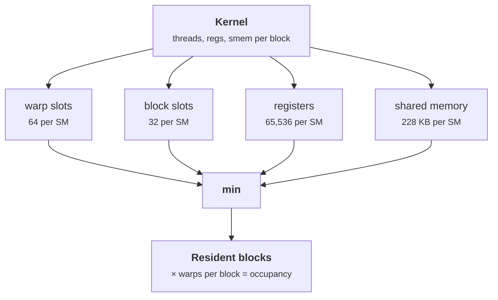

+++
title = 'Coalescing and occupancy'
description = "A warp's memory request is served in 32-byte sectors, so neighboring lanes should touch neighboring addresses. Occupancy, the number of resident warps, is set by whichever of registers, shared memory, or thread limits runs out first."
question = 'Why does the same amount of data cost eight times more when accessed with a stride, and what decides how many warps an SM can hold?'
weight = 2
difficulty = 3
prerequisites = ['/notes/machine-learning-systems/gpu-performance/01-the-programming-model', '/notes/machine-learning-systems/gpu-architecture/03-the-memory-hierarchy']
date = 2026-10-30T04:10:00Z
lastmod = 2026-10-30T04:10:00Z
verified = 2026-10-30
+++

## The idea in one minute

When a warp executes a load, the memory system gathers the 32 lanes' addresses
and fetches the distinct **32-byte sectors** they touch. If lane `k` reads the
`k`-th consecutive 4-byte word, the warp needs 4 sectors for 128 useful bytes:
the access is **coalesced**. If the lanes read every eighth word, the warp
needs 32 sectors, 1,024 bytes, for the same 128 useful bytes. Bandwidth is
spent on bytes nobody uses.

**Occupancy** is the number of warps resident on an SM as a fraction of the
maximum (64 on H100). It is set by the scarcest per-SM resource: registers,
shared memory, thread and block slots. Occupancy matters because resident warps
are what hide latency, but beyond the point where latency is hidden, more does
not help.

## A picture

```mermaid {title="Coalesced vs strided: same useful bytes, different sector counts"}
flowchart LR
  subgraph C["Stride 1"]
    W1["<b>32 lanes</b><br/><small>4 B each</small>"] --> S1["<b>4 sectors</b><br/><small>128 B moved</small>"]
  end
  subgraph S["Stride 8"]
    W2["<b>32 lanes</b><br/><small>4 B each</small>"] --> S2["<b>32 sectors</b><br/><small>1,024 B moved</small>"]
  end
  S1 --> E1["100% efficient"]
  S2 --> E2["12.5% efficient"]
  class W1,W2 compute
  class S1,S2 memory
  class E1 good
  class E2 neutral
```

## How it really works

### Sectors and lines

Global memory traffic is managed in 128-byte cache lines made of four 32-byte
sectors. A warp's request is split into the sectors it touches, and each
distinct sector is one unit of DRAM or L2 traffic (CUDA Programming Guide,
"Device memory accesses"). Three patterns matter:

- **Contiguous and aligned**: 32 lanes × 4 bytes = 128 bytes = 4 sectors. Ideal.
- **Misaligned**: the same contiguous run starting 4 bytes into a sector
  touches 5 sectors. Mild, 80%.
- **Strided**: a stride of 8 or more 4-byte words puts each lane in its own
  sector. 32 sectors for 128 bytes, 12.5%. Reading a column of a row-major
  matrix is this case.

Wider loads per lane (`float4`, 16 bytes) move 512 bytes per warp in 16
sectors, which reduces instruction count for the same efficiency.

### Fixing strided access

The standard fix for a transpose or column access is to go through shared
memory: each warp reads a contiguous row segment of a tile into shared memory,
the block synchronizes, then each warp reads a column from shared memory and
writes a contiguous row segment out. Both global accesses are coalesced; the
strided access happens in shared memory, where padding the tile by one column
(`tile[32][33]`) avoids bank conflicts. The other fix is a better layout:
store data structure-of-arrays rather than array-of-structures, so the field a
warp reads is contiguous.

### Occupancy limits

On compute capability 9.0, per SM (CUDA Programming Guide, as of October
2026): 64 resident warps (2,048 threads), 32 resident blocks, 65,536 32-bit
registers, and up to 228 KB of shared memory, with 1 KB reserved per block. The
number of blocks per SM is the minimum over the limits:

```text
blocks = min( 64 / warps_per_block,
              32,
              65536 / (regs_per_warp × warps_per_block),
              228 KB / (smem_per_block + 1 KB) )
```

Registers are allocated per warp in units of 256. A kernel with 256 threads
and 64 registers per thread uses 16,384 registers per block, so four blocks
fit: 32 warps, 50% occupancy.



### How much occupancy is enough

Occupancy is a means. A memory-bound kernel needs enough bytes in flight
(about 8 KB per SM for HBM on H100, from the previous module); a kernel that
issues several independent 16-byte loads per thread can get there at 25%
occupancy. Matmul kernels routinely run at low occupancy on purpose, because
they use many registers per thread to hold accumulator tiles, and that register
reuse is what makes them fast. Volkov's "Better performance at lower
occupancy" (GTC 2010) is the classic argument.

> [!IMPORTANT]
> Raise occupancy when a profiler shows warps stalled on memory with idle issue
> slots. Do not raise it by cutting registers if that causes spills.

## Code

The program counts sectors per warp load for several strides, then computes
occupancy for a few kernel configurations on H100 limits.

```python {title="coalescing_occupancy.py"}
"""Count memory transactions per warp access; compute SM occupancy (H100)."""

WARP, SECTOR = 32, 32   # a warp's request is served in 32-byte sectors


def sectors(addresses: list[int]) -> int:
    return len({a // SECTOR for a in addresses})


def access(name: str, stride_elems: int, elem: int = 4, offset: int = 0) -> None:
    addrs = [offset + lane * stride_elems * elem for lane in range(WARP)]
    s = sectors(addrs)
    useful = WARP * elem
    print(f"{name:28} sectors={s:>2}  bytes moved={s * SECTOR:>5}  "
          f"efficiency={useful / (s * SECTOR):6.1%}")


# H100 (compute capability 9.0) per-SM limits, CUDA Programming Guide
MAX_WARPS, MAX_BLOCKS, REGS, SMEM = 64, 32, 65536, 228 * 1024
REG_ALLOC = 256  # registers allocated per warp in units of 256


def occupancy(threads: int, regs_per_thread: int, smem_per_block: int) -> None:
    warps = (threads + WARP - 1) // WARP
    regs_per_warp = -(-regs_per_thread * WARP // REG_ALLOC) * REG_ALLOC
    limits = {
        "warps": MAX_WARPS // warps,
        "blocks": MAX_BLOCKS,
        "registers": REGS // (regs_per_warp * warps),
        "shared mem": SMEM // (smem_per_block + 1024) if smem_per_block else MAX_BLOCKS,
    }
    blocks = min(limits.values())
    limiter = min(limits, key=limits.get)
    print(f"{threads:>4} thr, {regs_per_thread:>3} regs, {smem_per_block // 1024:>3} KiB smem "
          f"-> {blocks:>2} blocks, {blocks * warps:>2}/64 warps "
          f"({blocks * warps / MAX_WARPS:5.1%}), limited by {limiter}")


if __name__ == "__main__":
    access("stride 1 (coalesced)", 1)
    access("stride 1, misaligned by 4 B", 1, offset=4)
    access("stride 2", 2)
    access("stride 8", 8)
    access("stride 32 (column of 32x32)", 32)
    print()
    occupancy(256, 32, 0)
    occupancy(256, 64, 0)
    occupancy(256, 128, 0)
    occupancy(128, 32, 48 * 1024)
    occupancy(1024, 255, 0)
```

```text
$ python3 coalescing_occupancy.py
stride 1 (coalesced)         sectors= 4  bytes moved=  128  efficiency=100.0%
stride 1, misaligned by 4 B  sectors= 5  bytes moved=  160  efficiency= 80.0%
stride 2                     sectors= 8  bytes moved=  256  efficiency= 50.0%
stride 8                     sectors=32  bytes moved= 1024  efficiency= 12.5%
stride 32 (column of 32x32)  sectors=32  bytes moved= 1024  efficiency= 12.5%

 256 thr,  32 regs,   0 KiB smem ->  8 blocks, 64/64 warps (100.0%), limited by warps
 256 thr,  64 regs,   0 KiB smem ->  4 blocks, 32/64 warps (50.0%), limited by registers
 256 thr, 128 regs,   0 KiB smem ->  2 blocks, 16/64 warps (25.0%), limited by registers
 128 thr,  32 regs,  48 KiB smem ->  4 blocks, 16/64 warps (25.0%), limited by shared mem
1024 thr, 255 regs,   0 KiB smem ->  0 blocks,  0/64 warps ( 0.0%), limited by registers
```

The last line is a real failure mode: 1,024 threads at 255 registers needs
262,144 registers after allocation rounding, four times the SM's file, so the launch fails with "too many
resources requested for launch". Register count is set at compile time
(`__launch_bounds__` or `-maxrregcount` constrain it).

## Where it breaks

- **Caches can rescue strided reads.** If neighboring warps read the other
  words of the same sectors soon after, those hits come from L1 or L2. The
  sector count per request overstates DRAM traffic in that case.
- **Occupancy is not throughput.** The calculator gives theoretical
  occupancy. Achieved occupancy is lower when blocks finish unevenly or the grid
  is small, and neither number says whether latency is actually hidden.
- **Limits differ by generation.** The constants are compute capability 9.0.
  Check the table in the programming guide for the GPU you target.
- **Shared-memory carve-out.** Using more than 48 KB of shared memory per block
  requires opting in with `cudaFuncSetAttribute`; the program ignores this.

## Remember this

- A warp's load costs one unit per distinct 32-byte sector touched.
- Neighboring lanes should read neighboring addresses; a stride of 8 words wastes 87.5%.
- Fix strided access with a shared-memory tile or a structure-of-arrays layout.
- Occupancy is the minimum over warp, block, register, and shared-memory limits.
- Enough occupancy hides latency; more does not help, and spills hurt.

## Try it

1. Add an `elem=16` (a `float4` load) case with stride 1. How many sectors per
   warp, and what efficiency?
2. Find the largest register count per thread that still gives 100% occupancy
   at 256 threads per block.
3. Model a 32 × 32 FP32 transpose tile in shared memory without padding: the
   column read has all 32 lanes in bank 0. How many serialized accesses is
   that, and what does `tile[32][33]` change?

## Check yourself

1. Lanes read 4-byte words at stride 2. What is the efficiency, and why?
   
   50%. The warp spans 256 bytes, which is 8 sectors, and only half the bytes
   in each are used.
   

2. A kernel with 128 threads per block and 48 KB of shared memory per block
   gets 25% occupancy. What limits it, and what are two fixes?
   
   Shared memory: 228 KB ÷ 49 KB fits 4 blocks, 16 warps. Use less shared
   memory per block (smaller tiles), or more threads per block sharing the same
   tile.
   

3. Why do fast matmul kernels often run at low occupancy?
   
   They keep large accumulator tiles in registers so each loaded value is
   reused many times. That uses many registers per thread, which lowers
   occupancy, but the reuse and instruction-level parallelism hide latency
   without many warps.
   

## Sources

- NVIDIA, *CUDA C++ Programming Guide*, "Device memory accesses" and "Compute
  capabilities". <https://docs.nvidia.com/cuda/cuda-c-programming-guide/>
- NVIDIA, *CUDA C++ Best Practices Guide*, "Coalesced access to global memory"
  and "Occupancy". <https://docs.nvidia.com/cuda/cuda-c-best-practices-guide/>
- Mark Harris, "An Efficient Matrix Transpose in CUDA C/C++", NVIDIA Technical
  Blog, 2013. <https://developer.nvidia.com/blog/efficient-matrix-transpose-cuda-cc/>
- Vasily Volkov, "Better Performance at Lower Occupancy", GPU Technology
  Conference, 2010. <https://www.nvidia.com/content/GTC-2010/pdfs/2238_GTC2010.pdf>
