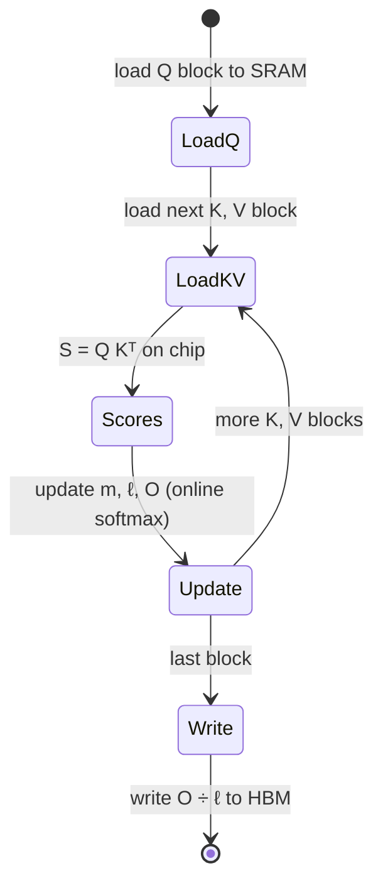

+++
title = 'Fusion and IO-aware kernels'
description = 'Most non-matmul operations are memory-bound, so running them as separate kernels pays for HBM round trips of every intermediate. Fusion keeps intermediates on chip; FlashAttention applies the same idea to attention and never writes the score matrix.'
question = 'Why does combining kernels make a model faster without doing less arithmetic, and how does FlashAttention avoid the quadratic memory traffic of attention?'
weight = 4
difficulty = 4
prerequisites = ['/notes/machine-learning-systems/gpu-performance/03-tiling-a-matmul']
date = 2026-10-30T04:20:00Z
lastmod = 2026-10-30T04:20:00Z
verified = 2026-10-30
+++

## The idea in one minute

A bias add, a GELU, and a dropout each read a tensor from HBM and write it
back. Run as three kernels, they move the tensor six times; their arithmetic is
negligible. Run as one kernel, they read it once and write it once. **Fusion**
does not reduce FLOPs. It removes the HBM round trips of intermediate results,
which is what memory-bound operations are paying for.

Attention is the important case. Standard attention computes the scores
`S = QKᵀ`, writes the `N × N` matrix to HBM, reads it back for softmax, writes
the probabilities, and reads them again to multiply by `V`. For long sequences,
that quadratic traffic dominates. **FlashAttention** (Dao et al., 2022) tiles
`Q`, `K`, and `V` through shared memory and uses an **online softmax** so the
`N × N` matrix never exists in HBM. The FLOPs are the same; the memory traffic
becomes linear in sequence length for practical head sizes.

## A picture

```mermaid {title="Unfused vs fused: intermediates either round-trip HBM or stay on chip"}
flowchart LR
  subgraph U["Three kernels"]
    X1["x in HBM"] --> K1["bias"] --> H1["HBM"] --> K2["GELU"] --> H2["HBM"] --> K3["dropout"] --> Y1["y in HBM"]
  end
  subgraph F["One fused kernel"]
    X2["x in HBM"] --> KF["<b>bias → GELU → dropout</b><br/><small>in registers</small>"] --> Y2["y in HBM"]
  end
  class X1,X2,Y1,Y2,H1,H2 memory
  class K1,K2,K3 neutral
  class KF good
```

## How it really works

### Why elementwise chains are pure traffic

An elementwise operation on `n` BF16 values moves at least `4n` bytes (read
and write) and does a few FLOPs per element. At under 1 FLOP/byte it is
hundreds of times below the H100 ridge, so its time is its bytes divided by
bandwidth. A chain of `k` such operations, unfused, costs `k` round trips.
Fused, it costs one. The speedup approaches `k`.

There is also a fixed cost per kernel. Launching a kernel and draining it costs
a few microseconds of CPU and GPU overhead. A decode step in a large model can
issue hundreds of small kernels; at a few microseconds each, overhead alone
can rival the step's useful work. **CUDA Graphs** record a sequence of launches
once and replay it with one call, which removes most of the CPU launch cost;
fusion removes the kernels themselves.

### Who does the fusing

- **Compilers**: `torch.compile` (TorchInductor), XLA, and TensorRT fuse
  chains of elementwise and reduction operations automatically and generate
  Triton or CUDA code for them.
- **Epilogue fusion**: matmul libraries apply bias, activation, scaling, and
  type conversion to the output tile while it is still in registers, before
  writing it. A GEMM followed by GELU should be one kernel.
- **Hand-written kernels** for patterns compilers miss: attention, fused
  normalization with residual add, fused MoE routing, fused optimizer steps.

### FlashAttention

For one head with sequence length `N` and head dimension `d`, standard
attention's HBM traffic is dominated by the `N × N` score and probability
matrices: written and read twice in the program below, so `4N²` elements.
FlashAttention restructures the computation:

1. Split `Q` into blocks of rows; each thread block owns one.
2. Stream blocks of `K` and `V` through shared memory.
3. For each `K` block, compute that slice of scores on chip, and update a
   running maximum `m`, running denominator `ℓ`, and running output `O`
   (the online softmax of Milakov and Gimelshein, 2018).
4. After the last block, normalize `O` by `ℓ` and write it.

The paper shows HBM accesses of `Θ(N²d²/M)` for SRAM size `M`, compared with
`Θ(Nd + N²)` for the standard algorithm. In the backward pass, FlashAttention
**recomputes** the scores from `Q` and `K` instead of storing them: more FLOPs,
far fewer bytes, faster overall. FlashAttention-2 (2023) improved work
partitioning across warps; FlashAttention-3 (2024) targets Hopper with
warp-specialized TMA loads, `wgmma`, and FP8.



> [!NOTE]
> The same IO-aware structure drives paged attention in serving engines,
> where the KV cache is read block by block from non-contiguous pages. See
> [paged KV memory](/notes/inference-engineering/batching-and-scheduling/02-paged-kv-memory/).

## Code

The program counts HBM bytes for elementwise chains, unfused and fused, on a
4096 × 8192 BF16 activation, and for attention with `d = 128` and 32 heads.
The IO-aware count is a lower bound: it counts `Q`, `K`, `V`, and `O` once and
ignores the extra reads of `K` and `V` per query block, which real kernels pay
when `K` and `V` do not fit in shared memory.

```python {title="fusion.py"}
"""HBM traffic of unfused vs fused kernels, including attention (FlashAttention-style)."""
ELEM = 2
HBM = 3.35e12


def chain(n: int, ops: int) -> tuple[int, int]:
    unfused = ops * 2 * n * ELEM            # each op reads and writes the tensor
    fused = 2 * n * ELEM                    # read once, write once
    return unfused, fused


def attention(seq: int, d: int, heads: int, batch: int) -> tuple[int, int]:
    bh = batch * heads
    qkvo = 4 * seq * d * ELEM * bh
    scores = seq * seq * ELEM * bh
    # standard: write S, read S for softmax, write P, read P for PV
    standard = qkvo + 4 * scores
    # tiled: S and P live in SRAM; Q, K, V read (K,V once per Q block), O written
    return standard, qkvo


if __name__ == "__main__":
    n = 4096 * 8192   # one activation tensor
    for ops, label in [(3, "bias + GELU + dropout"), (5, "RMSNorm-style chain")]:
        u, f = chain(n, ops)
        print(f"{label:24} unfused {u / 1e6:7.0f} MB ({u / HBM * 1e6:5.0f} us)  "
              f"fused {f / 1e6:5.0f} MB ({f / HBM * 1e6:4.0f} us)  {u / f:.1f}x")
    print()
    for seq in (1024, 4096, 16384):
        s, fl = attention(seq, 128, 32, 1)
        print(f"attention seq={seq:>5}: standard {s / 1e9:6.2f} GB, IO-aware "
              f"{fl / 1e9:5.2f} GB -> {s / fl:5.1f}x less HBM traffic")
    print("\nlaunch overhead: 5 tiny kernels x ~5 us each =", 5 * 5, "us vs 5 us fused")
```

```text
$ python3 fusion.py
bias + GELU + dropout    unfused     403 MB (  120 us)  fused   134 MB (  40 us)  3.0x
RMSNorm-style chain      unfused     671 MB (  200 us)  fused   134 MB (  40 us)  5.0x

attention seq= 1024: standard   0.30 GB, IO-aware  0.03 GB ->   9.0x less HBM traffic
attention seq= 4096: standard   4.43 GB, IO-aware  0.13 GB ->  33.0x less HBM traffic
attention seq=16384: standard  69.26 GB, IO-aware  0.54 GB -> 129.0x less HBM traffic

launch overhead: 5 tiny kernels x ~5 us each = 25 us vs 5 us fused
```

Fusing a three-operation chain saves two thirds of the traffic. For attention,
the savings grow linearly with sequence length because the standard version's
traffic is quadratic: at 16k tokens, 69 GB against about half a gigabyte, per
layer, per sequence.

## Where it breaks

- **Fusion has limits.** Fusing across a reduction that needs the whole tensor
  (a full softmax over a long row, a global norm) forces either multiple passes
  or an online algorithm. Not every chain can be fused into one pass.
- **Register pressure.** A long fused kernel holds more live values per thread;
  past a point it spills or loses occupancy and gets slower.
- **Correctness of online softmax.** The rescaling by the running maximum is
  what keeps it numerically stable; a hand-rolled version that skips it
  overflows in low precision.
- **The counts are lower bounds.** Real FlashAttention traffic is above the
  program's figure, and still far below standard attention for long sequences.
- **Decode is different.** With one query token per sequence, attention is
  dominated by reading the KV cache, not by the score matrix. Split-K variants
  (FlashDecoding) parallelize across the sequence instead.

## Remember this

- Memory-bound operations cost their bytes; fusion removes intermediate round trips.
- A fused chain of `k` elementwise operations is about `k` times faster.
- Matmul epilogues should absorb bias, activation, and type conversion.
- FlashAttention never writes the `N × N` score matrix; online softmax makes that possible.
- Recomputing on chip is often cheaper than storing to HBM.

## Try it

1. Add the K/V re-read term to the IO-aware count: with a query block of 128
   rows, each `K` and `V` element is read `N / 128` times. How does the
   advantage at 16k change?
2. Model a GEMM followed by a separate GELU kernel on a 4096 × 8192 output
   versus an epilogue-fused GELU. How many microseconds does fusion save?
3. Count kernel launches for a 32-layer decoder step with 10 kernels per layer.
   At 4 µs each, what is the overhead per token?

## Check yourself

1. Fusion does not reduce FLOPs. Why does it speed things up?
   
   The fused operations are memory-bound, so their time is set by bytes moved.
   Fusion removes the writes and reads of intermediate tensors, and the
   per-kernel launch overhead.
   

2. What makes it possible to compute softmax over a row without having the
   whole row at once?
   
   The online softmax keeps a running maximum and running sum. When a new block
   raises the maximum, the previous sum and partial output are rescaled by
   `exp(old_max − new_max)`. The final result equals the full softmax.
   

3. Why does FlashAttention's backward pass recompute attention scores?
   
   Storing the `N × N` scores would reintroduce the quadratic HBM traffic and
   memory. Recomputing them from `Q` and `K` on chip costs extra FLOPs, but the
   kernel is memory-bound enough that the trade is a net win.
   

## Sources

- Tri Dao, Daniel Y. Fu, Stefano Ermon, Atri Rudra, Christopher Ré,
  "FlashAttention: Fast and Memory-Efficient Exact Attention with
  IO-Awareness", NeurIPS 2022. <https://arxiv.org/abs/2205.14135>
- Tri Dao, "FlashAttention-2: Faster Attention with Better Parallelism and
  Work Partitioning", 2023. <https://arxiv.org/abs/2307.08691>
- Jay Shah et al., "FlashAttention-3: Fast and Accurate Attention with
  Asynchrony and Low-precision", 2024. <https://arxiv.org/abs/2407.08608>
- Maxim Milakov, Natalia Gimelshein, "Online normalizer calculation for
  softmax", 2018. <https://arxiv.org/abs/1805.02867>
- NVIDIA, *CUDA C++ Programming Guide*, "CUDA Graphs".
  <https://docs.nvidia.com/cuda/cuda-c-programming-guide/>
- PyTorch, *torch.compile documentation*.
  <https://pytorch.org/docs/stable/torch.compiler.html>
