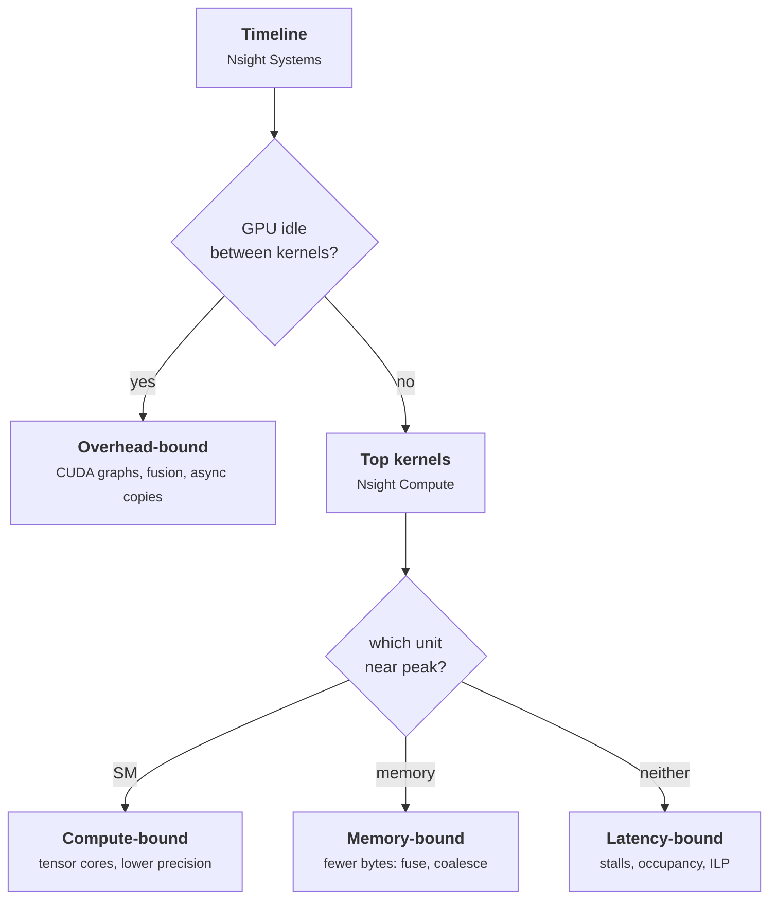

+++
title = 'Profiling GPU code'
description = 'Profiling starts with a timeline to find where time goes, then a per-kernel report to find why. Comparing achieved FLOP/s and bandwidth with the roofline, and reading stall reasons, names the limiter.'
question = 'Given a profiler report, how do you tell whether a kernel is limited by compute, memory, latency, or launch overhead?'
weight = 5
difficulty = 3
prerequisites = ['/notes/machine-learning-systems/gpu-performance/04-fusion-and-io-aware-kernels']
date = 2026-10-30T04:25:00Z
lastmod = 2026-10-30T04:25:00Z
verified = 2026-10-30
+++

## The idea in one minute

GPU profiling has two levels, and the order matters.

1. **System view first.** A timeline (Nsight Systems, or the PyTorch profiler's
   trace) shows where wall time goes: kernels, gaps between kernels, host-device
   copies, CPU work, synchronization. Many slow programs have an idle GPU, and
   no kernel optimization fixes that.
2. **Kernel view second.** For the few kernels that dominate, a per-kernel
   report (Nsight Compute) gives achieved compute and memory throughput,
   occupancy, memory access efficiency, and why warps were stalled.

The reading rule is the roofline from the start of the architecture module:
compute the kernel's intensity, compare achieved throughput with the roof at
that intensity, and look at which unit is busy. The answer is one of four:
**compute-bound, memory-bound, latency-bound, or overhead-bound**, and each has
a different fix.

## A picture



## How it really works

### The timeline

A system trace answers "is the GPU busy?" before "is the kernel good?". Common
findings:

- **Gaps between kernels** from Python overhead, small launches, or a CPU
  thread that cannot enqueue work fast enough. Fix with CUDA Graphs, fusion,
  larger batches, or moving work off the critical path.
- **Synchronous copies** (`cudaMemcpy` from pageable memory, `.item()` or
  `.cpu()` in a training loop) that stall the stream. Fix with pinned memory,
  `non_blocking=True`, and fewer host reads of device values.
- **Serialized communication** in multi-GPU jobs: all-reduce or all-to-all
  kernels running after compute instead of overlapping with it.

Use NVTX ranges (or `torch.profiler.record_function`) to label regions so the
timeline maps onto the model's structure.

### The kernel report

Nsight Compute replays a kernel with hardware counters and summarizes it. The
sections worth reading first:

| Section | What to read | What it tells you |
| --- | --- | --- |
| GPU Speed Of Light Throughput | Compute (SM) % and Memory % of peak | Which unit, if any, is the limiter |
| Roofline chart | Achieved point vs roofs | Distance from the ceiling at this intensity |
| Memory Workload Analysis | Sectors per request, L1/L2 hit rates | Coalescing and cache reuse |
| Occupancy | Theoretical vs achieved, limiting resource | Whether enough warps are resident |
| Warp State Statistics | Stall reasons per instruction | What warps are waiting on |

Stall reasons translate directly to causes. "Long scoreboard" means warps wait
on global or local memory: memory latency, too few loads in flight, or spills.
"Math pipe throttle" means an arithmetic pipe is saturated, which is good for a
compute-bound kernel. "Barrier" points at `__syncthreads()` imbalance; "not
selected" means more warps were ready than the scheduler could issue, so
occupancy is not the problem.

### A reading discipline

For each top kernel, write down three numbers before looking at anything else:
FLOPs, DRAM bytes, and duration. From them:

- intensity = FLOPs ÷ bytes
- achieved FLOP/s and achieved bandwidth
- percent of the roof at that intensity

Then check the report agrees with your model. If you expect 2 GB of traffic
and the profiler reports 8 GB, there is uncoalesced access, spilling, or a
missed reuse, and that discrepancy is usually the bug.

```mermaid {title="Measuring a kernel: the profiler perturbs what it measures"}
sequenceDiagram
  autonumber
  participant You
  participant NCU as Nsight Compute
  participant GPU
  You->>NCU: profile kernel (sections)
  NCU->>GPU: replay kernel, counter set 1
  NCU->>GPU: restore memory, replay, counter set 2
  GPU-->>NCU: counters
  NCU-->>You: report (duration under replay)
  Note over You,GPU: times are per-kernel and serialized, not end-to-end
```

## Code

The program reads five simulated kernel summaries shaped like the Nsight
Compute "speed of light" section and names the limiter. The numbers are made
up but consistent with H100 SXM peaks; the rules are the ones above.

```python {title="read_profile.py"}
"""Read a (simulated) Nsight Compute-style summary and name the limiter."""
from dataclasses import dataclass

PEAK_TFLOPS, PEAK_TBPS = 989.0, 3.35


@dataclass
class Report:
    kernel: str
    duration_us: float
    flops: float
    dram_bytes: float
    sm_throughput_pct: float      # "Compute (SM) Throughput"
    mem_throughput_pct: float     # "Memory Throughput"
    achieved_occupancy_pct: float
    sectors_per_request: float    # global loads; 4 is ideal for 4-byte words


def diagnose(r: Report) -> list[str]:
    tflops = r.flops / (r.duration_us * 1e-6) / 1e12
    tbps = r.dram_bytes / (r.duration_us * 1e-6) / 1e12
    ai = r.flops / r.dram_bytes
    if ai >= 1:
        roof = min(PEAK_TFLOPS, ai * PEAK_TBPS)
        out = [f"{tflops:.0f} TFLOP/s at {ai:.0f} FLOP/B; roof {roof:.0f} TFLOP/s "
               f"-> {tflops / roof:.0%} of roofline"]
    else:  # pure data movement: compare with peak DRAM bandwidth
        out = [f"{tbps:.2f} TB/s of DRAM -> {tbps / PEAK_TBPS:.0%} of peak bandwidth"]
    if r.duration_us < 10:
        out.append("tiny kernel: launch overhead dominates; fuse or use CUDA graphs")
    if r.sectors_per_request > 8:
        out.append(f"{r.sectors_per_request:.0f} sectors/request: uncoalesced access")
    if max(r.sm_throughput_pct, r.mem_throughput_pct) < 60:
        out.append("neither unit busy: latency-bound; check occupancy and stalls")
        if r.achieved_occupancy_pct < 25:
            out.append(f"occupancy {r.achieved_occupancy_pct:.0f}%: too few warps to hide latency")
    elif r.mem_throughput_pct > r.sm_throughput_pct:
        out.append("memory-bound: cut bytes (fuse, lower precision, reuse in SRAM)")
    else:
        out.append("compute-bound: use tensor cores / lower precision, or accept")
    return out


if __name__ == "__main__":
    reports = [
        Report("gemm_bf16_8192", 1600, 1.1e12, 0.55e9, 82, 28, 24, 4),
        Report("layernorm", 95, 0.17e9, 0.27e9, 18, 86, 71, 4),
        Report("transpose_naive", 410, 0.0, 0.54e9, 9, 41, 88, 32),
        Report("gather_embed", 160, 0.0, 0.05e9, 12, 22, 14, 6),
        Report("bias_add", 4, 0.2e6, 1.2e6, 6, 9, 60, 4),
    ]
    for r in reports:
        print(r.kernel)
        for line in diagnose(r):
            print("   ", line)
```

```text
$ python3 read_profile.py
gemm_bf16_8192
    688 TFLOP/s at 2000 FLOP/B; roof 989 TFLOP/s -> 70% of roofline
    compute-bound: use tensor cores / lower precision, or accept
layernorm
    2.84 TB/s of DRAM -> 85% of peak bandwidth
    memory-bound: cut bytes (fuse, lower precision, reuse in SRAM)
transpose_naive
    1.32 TB/s of DRAM -> 39% of peak bandwidth
    32 sectors/request: uncoalesced access
    neither unit busy: latency-bound; check occupancy and stalls
gather_embed
    0.31 TB/s of DRAM -> 9% of peak bandwidth
    neither unit busy: latency-bound; check occupancy and stalls
    occupancy 14%: too few warps to hide latency
bias_add
    0.30 TB/s of DRAM -> 9% of peak bandwidth
    tiny kernel: launch overhead dominates; fuse or use CUDA graphs
    neither unit busy: latency-bound; check occupancy and stalls
```

The GEMM is at 70% of the compute roof, a normal result. The layer norm is at
85% of peak bandwidth: already good, so the remaining win is to fuse it with
its neighbors, not to tune it. The naive transpose shows 32 sectors per
request, the coalescing signature from earlier in this module. The embedding
gather uses neither unit and has 14% occupancy: it is latency-bound. The bias
add takes 4 µs, so launch overhead is a large share of its cost; it should be
fused into the preceding matmul's epilogue.

## Where it breaks

- **Replay changes timing.** Nsight Compute serializes and replays kernels,
  flushes caches by default, and may lock clocks. Its durations are not the
  durations under real concurrency. Use the timeline for end-to-end time.
- **Profiler overhead hides launch problems.** Tracing adds per-launch cost, so
  measure overhead-bound workloads with and without the profiler.
- **Percent-of-peak can mislead.** "Memory 90%" may be L1 or shared-memory
  throughput, not DRAM. Check which unit the percentage refers to.
- **The program's rules are simple.** Real triage looks at stall reasons and
  source-level hot spots; thresholds like 60% are judgment, not standards.
- **Production differs from benchmarks.** Clocks drop under sustained power
  and thermal load; profile at realistic batch sizes and sequence lengths.

## Remember this

- Timeline first, kernel report second.
- Name the limiter: compute, memory, latency, or overhead. Each has a different fix.
- Write down FLOPs, bytes, and duration; compare with the roof at that intensity.
- Sectors per request above the ideal means uncoalesced access.
- A kernel near peak bandwidth is done; fuse it rather than tune it.

## Try it

1. Add a report for a FlashAttention forward kernel at 16k tokens using the
   FLOPs and bytes from the previous lesson, at 60% compute utilization. Which
   rule fires?
2. Change the transpose to 4 sectors per request and twice the memory
   throughput. What does the diagnosis say now?
3. Profile any small PyTorch model with `torch.profiler` on a GPU you have
   access to and count kernels shorter than 10 µs.

## Check yourself

1. A training step takes 200 ms and the sum of kernel durations is 120 ms.
   Where do you look first?
   
   At the 80 ms where the GPU runs no kernels: launch gaps, host-side work,
   synchronous copies, or waiting on communication. Kernel tuning can save at
   most part of the 120 ms.
   

2. A kernel shows 25% compute and 30% memory throughput with "long scoreboard"
   as its top stall. What does that mean?
   
   It is latency-bound: warps are waiting on global memory, but too few
   requests are in flight to use the bandwidth. Raise occupancy or
   instruction-level parallelism, improve coalescing, or check for spills.
   

3. Why do Nsight Compute durations differ from timeline durations?
   
   Nsight Compute replays each kernel in isolation, often with flushed caches
   and fixed clocks, to collect counters. The timeline measures kernels running
   with real concurrency, cache state, and clocks.
   

## Sources

- NVIDIA, *Nsight Compute documentation*, "Kernel profiling guide" (sections,
  replay, stall reasons). <https://docs.nvidia.com/nsight-compute/ProfilingGuide/>
- NVIDIA, *Nsight Systems user guide*. <https://docs.nvidia.com/nsight-systems/UserGuide/>
- NVIDIA, *CUDA C++ Best Practices Guide*. <https://docs.nvidia.com/cuda/cuda-c-best-practices-guide/>
- PyTorch, *torch.profiler documentation*. <https://pytorch.org/docs/stable/profiler.html>
- Samuel Williams, Andrew Waterman, David Patterson, "Roofline: An Insightful
  Visual Performance Model for Multicore Architectures", *Communications of the
  ACM* 52(4), 2009. <https://doi.org/10.1145/1498765.1498785>
