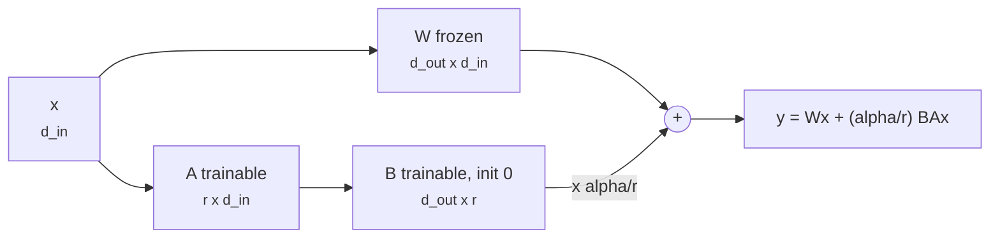
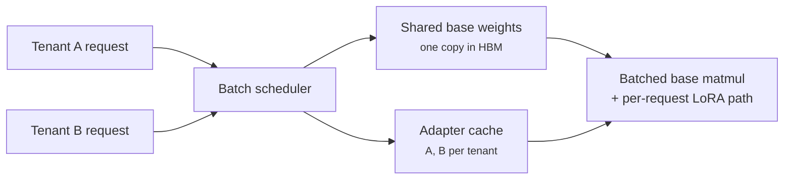

+++
title = 'Fine-tuning and LoRA'
description = 'Full fine-tuning updates every weight and needs about 16 bytes of state per parameter. LoRA freezes the base and trains a low-rank update, cutting trainable parameters by hundreds of times and making one base model serve many adapters.'
question = 'What does it cost to adapt a pretrained model, and what does LoRA trade away to make it cheap?'
weight = 1
difficulty = 3
prerequisites = ['/notes/inference-engineering/making-it-cheaper/01-quantization']
date = 2026-10-30T07:05:00Z
lastmod = 2026-10-30T07:05:00Z
verified = 2026-10-30
+++

## The idea in one minute

**Supervised fine-tuning** (SFT) continues training a pretrained model on
examples of the behavior you want: instruction and answer pairs, domain text,
tool-call transcripts. Done in full, it updates every parameter, and the
optimizer state dominates memory: with mixed-precision Adam, about **16 bytes
per parameter** before activations. An 8B model needs about 128 GB, more than
one 80 GB GPU.

**LoRA** (low-rank adaptation) freezes the pretrained weight `W` and learns a
correction `ΔW = B·A`, where `A` is `r × d_in` and `B` is `d_out × r` with a
small rank `r` such as 8 or 16. Only `A` and `B` get gradients and optimizer
state. For the same 8B model, rank 16 on every linear layer trains 42 million
parameters, half a percent of the base, and the memory falls to the frozen
weights plus a little. **QLoRA** stores the frozen base in 4 bits and fits the
same job in under 5 GB plus activations.

The trade is capacity: a low-rank update cannot express every change a full
fine-tune can. For adapting style, format, and narrow tasks, that rarely
matters. For teaching a lot of new knowledge, it can.

## A picture



## How it really works

### Where fine-tuning memory goes

For mixed-precision training with Adam, the ZeRO paper's accounting per
parameter is 2 bytes of BF16 weights, 2 bytes of BF16 gradients, and 12 bytes
of FP32 optimizer state (master weights, first moment, second moment): 16
bytes. Activations come on top and scale with batch size and sequence length;
activation checkpointing trades recomputation for most of them.

| 8B model, before activations | Bytes per base param | Total |
|---|---|---|
| Full fine-tune, mixed-precision Adam | 16 | ~128 GB |
| LoRA: BF16 frozen base + adapter state | ~2 | ~16–19 GB |
| QLoRA: 4-bit base + adapter state | ~0.5 | ~4–7 GB |

Full fine-tuning at this size needs sharding (FSDP or ZeRO across several
GPUs). LoRA fits on one GPU with room for activations.

### The low-rank update

LoRA (Hu et al., 2021) starts from the observation that the weight change
during adaptation has low "intrinsic rank". It parameterizes the change as
`ΔW = (α/r) · B·A`. `A` starts random and `B` starts at zero, so the model
begins exactly at the pretrained function and training moves it smoothly. The
scale `α/r` keeps the effective step size roughly stable when you change `r`.

Trainable parameters per adapted matrix are `r × (d_in + d_out)` instead of
`d_in × d_out`. For a 4096 × 4096 projection at `r = 16`, that is 131,072
instead of 16.8 million, 128 times fewer. On GPT-3 175B the paper reports
10,000 times fewer trainable parameters and about a third of the training
memory, with quality on par with full fine-tuning on the tasks it tested.

Which matrices to adapt matters. The original paper adapted only the attention
query and value projections; later practice, including QLoRA, found that
adapting all linear layers (attention and MLP) closes most of the remaining
gap with full fine-tuning.

### QLoRA

QLoRA (Dettmers et al., 2023) quantizes the frozen base to 4-bit **NormalFloat**
(NF4), a format whose levels match the roughly normal distribution of
pretrained weights. It also quantizes the quantization constants ("double
quantization") and pages optimizer state to CPU memory during spikes.
Gradients still flow through the dequantized base into BF16 adapters. The
paper fine-tuned a 65B model on a single 48 GB GPU. The cost is extra compute
per step for dequantization, and a small quality gap that depends on the task.

### Serving: merge or keep separate

After training you can **merge** `W + (α/r)BA` into a single matrix: no extra
latency, but one full copy of the model per adapter. Or keep the adapter
separate and serve many on one base. Systems such as S-LoRA and Punica batch
requests for different adapters through the same base weights with custom
kernels for the low-rank path; vLLM supports multi-LoRA serving in the same
way. With 100 tenants that is the difference between 100 model copies and one
copy plus 100 small files.



## Code

The program computes trainable parameters and pre-activation training memory
for a Llama-style 8B model under full fine-tuning, LoRA at several ranks and
targets, and QLoRA. The shapes match Llama 3 8B (hidden 4096, 32 layers, eight
KV heads, MLP 14336, vocabulary 128256).

```python {title="lora_math.py"}
"""lora_math.py: trainable parameters and training memory, full fine-tune vs LoRA vs QLoRA.

Shapes follow a Llama-style 8B model (hidden 4096, 32 layers, GQA with 8 KV heads,
MLP 14336, vocab 128256). Activations are excluded: they depend on batch and
sequence length, and checkpointing, and are the same order for all three methods.
"""
from dataclasses import dataclass

@dataclass
class Model:
    hidden: int = 4096
    layers: int = 32
    kv_dim: int = 1024        # 8 KV heads x 128
    mlp: int = 14336
    vocab: int = 128256

    def matrices(self):
        """(name, d_in, d_out) of every linear layer in one block."""
        h, kv, m = self.hidden, self.kv_dim, self.mlp
        return [("q", h, h), ("k", h, kv), ("v", h, kv), ("o", h, h),
                ("gate", h, m), ("up", h, m), ("down", m, h)]

    def params(self):
        block = sum(i * o for _, i, o in self.matrices()) + 2 * self.hidden
        return self.layers * block + 2 * self.vocab * self.hidden + self.hidden

def lora_params(m: Model, r: int, targets: set[str]) -> int:
    return m.layers * sum(r * (i + o) for n, i, o in m.matrices() if n in targets)

GB = 1e9
if __name__ == "__main__":
    m = Model()
    n = m.params()
    print(f"base parameters: {n/1e9:.2f} B\n")
    # Full fine-tune, mixed precision Adam: bf16 weights 2 + bf16 grads 2 + fp32 master 4 + m 4 + v 4
    full = n * 16
    print(f"{'method':<34}{'trainable':>12}{'% of base':>10}{'memory GB':>11}")
    print(f"{'full fine-tune (Adam, mixed)':<34}{n/1e6:10.0f} M{100:9.1f}%{full/GB:11.1f}")
    for r, targets in [(8, {"q", "v"}), (16, {"q", "k", "v", "o"}),
                       (16, {"q", "k", "v", "o", "gate", "up", "down"}),
                       (64, {"q", "k", "v", "o", "gate", "up", "down"})]:
        t = lora_params(m, r, targets)
        lora = n * 2 + t * 16                 # frozen bf16 base + adapter with full Adam state
        qlora = n * 0.5 * 1.03 + t * 16       # 4-bit NF4 base (+~3% for quantization constants)
        tag = "all" if len(targets) == 7 else "+".join(sorted(targets))
        print(f"{'LoRA r=' + str(r) + ' on ' + tag:<34}{t/1e6:10.1f} M{100*t/n:9.2f}%{lora/GB:11.1f}")
        print(f"{'  same, QLoRA 4-bit base':<34}{'':>12}{'':>10}{qlora/GB:11.1f}")
    t = lora_params(m, 16, {"q", "k", "v", "o", "gate", "up", "down"})
    print(f"\ncheckpoint size: full {n*2/GB:.1f} GB in bf16, adapter r=16 all {t*2/1e6:.0f} MB")
    print(f"serving 100 tenants: 100 full copies {100*n*2/GB:.0f} GB "
          f"vs one base + 100 adapters {(n*2 + 100*t*2)/GB:.1f} GB")
```

Run it with `python3 lora_math.py`:

```text
base parameters: 8.03 B

method                               trainable % of base  memory GB
full fine-tune (Adam, mixed)            8030 M    100.0%      128.5
LoRA r=8 on q+v                          3.4 M     0.04%       16.1
  same, QLoRA 4-bit base                                        4.2
LoRA r=16 on k+o+q+v                    13.6 M     0.17%       16.3
  same, QLoRA 4-bit base                                        4.4
LoRA r=16 on all                        41.9 M     0.52%       16.7
  same, QLoRA 4-bit base                                        4.8
LoRA r=64 on all                       167.8 M     2.09%       18.7
  same, QLoRA 4-bit base                                        6.8

checkpoint size: full 16.1 GB in bf16, adapter r=16 all 84 MB
serving 100 tenants: 100 full copies 1606 GB vs one base + 100 adapters 24.4 GB
```

The parameter count reproduces the 8.03B of the published model, a useful
check on the shapes. Even rank 64 on every layer trains 2% of the parameters;
memory barely moves with rank because the frozen base dominates. The serving
numbers explain why multi-tenant fine-tuning products use separate adapters.

## Where it breaks

- **Capacity.** Biderman et al. (2024) found LoRA learns less than full
  fine-tuning on large continued-pretraining and code or math tasks, while
  also forgetting less of the base model's abilities. For lots of new
  knowledge, full fine-tuning or higher rank may be needed.
- **Activations are not free.** The table excludes them. At long sequences
  they can exceed the weights; checkpointing, smaller micro-batches, or
  sequence packing decide whether the job fits.
- **Forgetting and safety drift.** Any fine-tune, LoRA included, can erode
  behaviors learned in post-training. Qi et al. (2023) showed a few harmful
  examples, and even benign data, can weaken refusal behavior. Re-run safety
  and capability evals after every fine-tune.
- **Hyperparameters interact.** `α`, `r`, and learning rate are coupled; a
  learning rate tuned for full fine-tuning is usually too small for LoRA.

## Remember this

- Full fine-tuning with mixed-precision Adam costs about 16 bytes per parameter plus activations.
- LoRA trains `r × (d_in + d_out)` per matrix; `B = 0` at init so training starts from the base.
- Adapt all linear layers, not only Q and V, when quality matters.
- QLoRA keeps the frozen base in 4-bit NF4 and fits large models on one GPU.
- Merged adapters cost nothing at inference; separate adapters let one base serve many tenants.

## Try it

1. Change the model to 70B shapes (hidden 8192, 80 layers, KV dim 1024, MLP
   28672, vocabulary 128256). How much memory does QLoRA r=16 need before
   activations?
2. Add an activation estimate: `layers × seq × hidden × 34 bytes` per sequence
   without checkpointing (a common rough figure for BF16). At what sequence
   length does it exceed the frozen weights for the 8B model?
3. Compute how many separate adapters fit in 10 GB of HBM at r=16 on all layers.

## Check yourself

1. Why is `B` initialized to zero?
   
   So `BA = 0` at the start, and the adapted model computes exactly the
   pretrained function. Training then moves it gradually instead of starting
   from a random perturbation.
   
2. How many trainable parameters does rank 8 add to a 4096 × 14336 matrix?
   
   `8 × (4096 + 14336) = 147,456`.
   
3. Why does LoRA reduce memory far more than its parameter count alone
   suggests?
   
   The frozen base needs no gradients or optimizer state, which are 14 of the
   16 bytes per parameter in full fine-tuning. Only the small adapter carries
   them.
   
4. When would you merge an adapter instead of serving it separately?
   
   When one fine-tuned model serves most traffic and latency matters: merging
   removes the extra low-rank computation. Keep adapters separate when many
   variants share one base.
   

## Sources

- E. J. Hu et al., "LoRA: Low-rank adaptation of large language models," 2021. <https://arxiv.org/abs/2106.09685>
- T. Dettmers et al., "QLoRA: Efficient finetuning of quantized LLMs," 2023. <https://arxiv.org/abs/2305.14314>
- S. Rajbhandari et al., "ZeRO: Memory optimizations toward training trillion parameter models," SC 2020. <https://arxiv.org/abs/1910.02054>
- Y. Sheng et al., "S-LoRA: Serving thousands of concurrent LoRA adapters," 2023. <https://arxiv.org/abs/2311.03285>
- L. Chen et al., "Punica: Multi-tenant LoRA serving," 2023. <https://arxiv.org/abs/2310.18547>
- D. Biderman et al., "LoRA learns less and forgets less," 2024. <https://arxiv.org/abs/2405.09673>
- X. Qi et al., "Fine-tuning aligned language models compromises safety, even when users do not intend to!," 2023. <https://arxiv.org/abs/2310.03693>
- V. Korthikanti et al., "Reducing activation recomputation in large transformer models," 2022 (the 34 bytes per token per hidden unit figure). <https://arxiv.org/abs/2205.05198>
- Meta, Llama 3 8B model configuration (accessed October 2026). <https://huggingface.co/meta-llama/Meta-Llama-3-8B>
