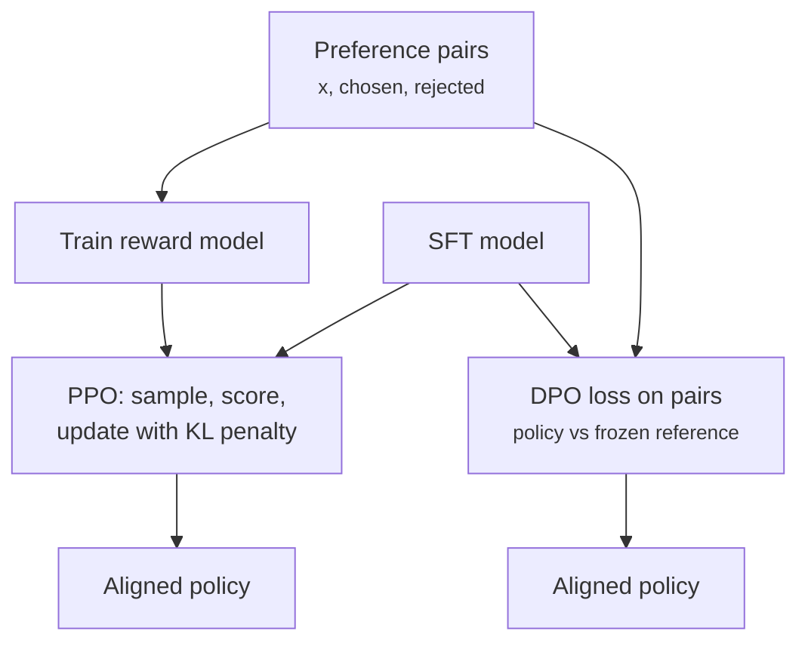
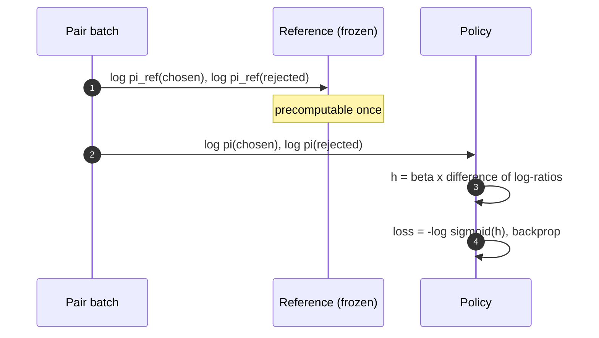

+++
title = 'Preference optimization'
description = 'RLHF trains a reward model on human comparisons and optimizes the policy against it with a KL leash to the starting model. DPO reaches the same objective with a classification loss on preference pairs, no reward model or sampling loop. Both inherit every bias in the labels.'
question = 'How do preference pairs turn into a better model, and what goes wrong?'
weight = 2
difficulty = 4
prerequisites = ['/notes/machine-learning-systems/post-training-and-evaluation/01-fine-tuning-and-lora']
date = 2026-10-30T07:10:00Z
lastmod = 2026-10-30T07:10:00Z
verified = 2026-10-30
+++

## The idea in one minute

Demonstrations teach a model what a good answer looks like. **Preferences**
teach it which of two answers is better, which is easier for people to judge
than writing the ideal answer. The data is triples: a prompt `x`, a chosen
response `y_w`, and a rejected response `y_l`.

**RLHF**, as in InstructGPT, trains a **reward model** to score responses so
that chosen beats rejected, then uses reinforcement learning (PPO) to raise
the policy's expected reward while a **KL penalty** keeps it close to the
supervised model. **DPO** shows that the optimum of that same objective can be
reached directly: the policy's own log-probability ratio against the reference
acts as an implicit reward, and a logistic loss on preference pairs trains it.
No reward model, no sampling during training, two models in memory instead of
four.

Neither method knows what "better" means. They learn what the labels reward,
including length, confidence, and flattery, and an optimizer pushed hard
against an imperfect reward finds its flaws.

## A picture



## How it really works

### The reward model

Given pairs, the **Bradley-Terry** model says the probability that `y_w` is
preferred is `σ(r(x, y_w) - r(x, y_l))`. The reward model, usually the SFT
model with a scalar head, is trained to maximize that likelihood. It only
learns differences, so its absolute scale is arbitrary.

### RLHF with PPO

InstructGPT (Ouyang et al., 2022) ran three stages: SFT on about 13,000
demonstrations, a reward model on about 33,000 prompts' worth of rankings, and
PPO on about 31,000 prompts. The RL objective is

```text
maximize  E[ r(x, y) ]  -  β · KL( π(y|x) || π_ref(y|x) )
```

The KL term keeps the policy near the reference, where the reward model's
judgments are still trustworthy. Labelers preferred outputs of the 1.3B
InstructGPT model to those of the 175B GPT-3 base model, which shows how much
behavior post-training changes for very little compute.

Systems-wise, PPO is heavy: the policy, a value model, the reward model, and
the reference model all sit in memory, and every step generates samples, so
training is bottlenecked on inference throughput as much as on gradients.

### DPO

Rafailov et al. (2023) solved the KL-regularized objective in closed form. Its
optimum is `π*(y|x) ∝ π_ref(y|x) · exp(r(x,y)/β)`, so any reward can be written
in terms of the optimal policy: `r(x,y) = β log(π*(y|x)/π_ref(y|x)) + const`.
Substituting into Bradley-Terry, the constant cancels between chosen and
rejected, which leaves a loss on the policy alone:

```text
h = β · [ (log π(y_w|x) - log π_ref(y_w|x)) - (log π(y_l|x) - log π_ref(y_l|x)) ]
L = -log σ(h)
```

The gradient raises the log-probability of chosen and lowers rejected, weighted
by `σ(-h)`: pairs the model already ranks correctly get small updates, wrong
ones get large updates. `β` sets how far from the reference the policy may go
for a given preference strength. The reference log-probabilities do not change,
so they can be computed once over the dataset, leaving one trainable model in
memory.



### What changed since

DPO is **offline**: it learns from fixed pairs, usually produced by an older
model. Variants address this by sampling fresh pairs from the current policy
(online or iterative DPO). For tasks with checkable answers (math, code,
tests passing), **RL with verifiable rewards** replaces the learned reward
with a program; GRPO (Shao et al., 2024) drops the value model by normalizing
rewards within a group of samples for the same prompt. The pipeline shape
is the same: generate, score, update, stay near the reference.

## Code

The program trains DPO on a toy policy: for each of three prompts, a softmax
over four canned responses. The reference prefers "verbose". Clean
preferences rank helpful above verbose and wrong, and refusing above wrong. The
noisy set adds two votes for verbose over helpful per prompt, imitating
labelers who reward length. Real DPO sums token log-probabilities from a
transformer; the loss and gradient have the same form.

```python {title="dpo_toy.py"}
"""dpo_toy.py: DPO on a toy policy that picks one of four canned responses per prompt.

The policy is a softmax over per-prompt logits. Real DPO computes log pi(y|x) as a sum
of token log-probabilities from a transformer; the loss and its gradient have the same form.
"""
import math, random

RESPONSES = ["helpful", "verbose", "refuses", "wrong"]
PROMPTS = ["p1", "p2", "p3"]

def log_softmax(z):
    m = max(z)
    s = math.log(sum(math.exp(v - m) for v in z)) + m
    return [v - s for v in z]

def sigmoid(x):
    return 1 / (1 + math.exp(-x))

def train(pairs, beta, steps=300, lr=0.5, seed=0):
    rng = random.Random(seed)
    ref = {p: [1.0, 1.5, 0.0, 0.5] for p in PROMPTS}            # SFT model: likes verbose
    pol = {p: list(v) for p, v in ref.items()}
    ref_lp = {p: log_softmax(v) for p, v in ref.items()}
    for _ in range(steps):
        p, w, l = rng.choice(pairs)
        lp = log_softmax(pol[p])
        h = beta * ((lp[w] - ref_lp[p][w]) - (lp[l] - ref_lp[p][l]))
        g = -beta * sigmoid(-h)          # dLoss/dh times dh/dmargin
        # d(logpi_w - logpi_l)/dlogits = onehot(w) - onehot(l); the normalizer cancels
        pol[p][w] -= lr * g
        pol[p][l] += lr * g
    loss = 0.0
    for p, w, l in pairs:
        lp = log_softmax(pol[p])
        h = beta * ((lp[w] - ref_lp[p][w]) - (lp[l] - ref_lp[p][l]))
        loss += -math.log(sigmoid(h))
    kl = 0.0
    for p in PROMPTS:
        lp, lr_ = log_softmax(pol[p]), ref_lp[p]
        kl += sum(math.exp(a) * (a - b) for a, b in zip(lp, lr_))
    return pol, ref_lp, loss / len(pairs), kl / len(PROMPTS)

def show(title, pairs, beta):
    pol, ref_lp, loss, kl = train(pairs, beta)
    print(f"{title}  beta={beta}  final loss={loss:.3f}  KL(pi||ref)={kl:.3f}")
    lp = log_softmax(pol["p1"])
    print("   p1 " + "  ".join(f"{r}:{math.exp(a):.2f}->{math.exp(b):.2f}"
                               for r, a, b in zip(RESPONSES, ref_lp["p1"], lp)))

if __name__ == "__main__":
    H, V, R, W = range(4)
    clean = [(p, H, V) for p in PROMPTS] + [(p, H, W) for p in PROMPTS] + [(p, R, W) for p in PROMPTS]
    print("loss at start = -log sigmoid(0) =", round(-math.log(0.5), 3))
    show("clean prefs ", clean, beta=0.1)
    show("clean prefs ", clean, beta=0.5)
    noisy = clean + [(p, V, H) for p in PROMPTS] * 2     # labelers who reward length
    show("noisy prefs ", noisy, beta=0.5)
```

Run it with `python3 dpo_toy.py`:

```text
loss at start = -log sigmoid(0) = 0.693
clean prefs   beta=0.1  final loss=0.572  KL(pi||ref)=0.591
   p1 helpful:0.28->0.76  verbose:0.46->0.10  refuses:0.10->0.11  wrong:0.17->0.02
clean prefs   beta=0.5  final loss=0.080  KL(pi||ref)=1.007
   p1 helpful:0.28->0.92  verbose:0.46->0.01  refuses:0.10->0.07  wrong:0.17->0.00
noisy prefs   beta=0.5  final loss=0.456  KL(pi||ref)=0.231
   p1 helpful:0.28->0.19  verbose:0.46->0.70  refuses:0.10->0.11  wrong:0.17->0.00
```

Every pair starts at loss 0.693, since policy equals reference. With clean
labels the policy moves mass to "helpful" and away from "verbose" and "wrong";
a larger `β` (here also a larger effective step) drives the loss lower and the
policy further from the reference. With the noisy labels, the 2-to-1 majority
for verbose wins: the policy ends up preferring verbose more than the
reference did. DPO optimized exactly what the labels said.

## Where it breaks

- **Reward overoptimization.** Gao et al. (2022) measured that as a policy is
  optimized against a learned reward model, the true (gold) reward first rises
  then falls. The KL penalty and early stopping are the defense; neither is a
  guarantee.
- **Label bias.** Length, confident tone, and agreement with the user are
  rewarded by many raters. Singhal et al. (2023) found much of RLHF's measured
  gain on some datasets tracked increased length. Control for length in evals.
- **Offline staleness.** Pairs from an older model cover responses the new
  policy no longer produces; DPO can lower the probability of both chosen and
  rejected while widening their gap, moving mass to responses nobody rated.
- **Toy limits.** The program has four responses and exact gradients; real
  policies have astronomically many sequences, and the KL is estimated.

## Remember this

- Preference data is (prompt, chosen, rejected); Bradley-Terry turns it into a likelihood.
- RLHF: reward model plus PPO with a KL penalty to the reference.
- DPO: same objective, closed form, `-log σ(β × difference of log-ratios)`.
- `β` controls how far the policy may move from the reference.
- Both learn the labelers' biases; evaluate length-controlled and on held-out tasks.

## Try it

1. Set the noisy set to one extra vote instead of two. Does verbose still win?
2. Add a `margin` of chosen minus rejected log-probability to the printout,
   and watch it grow while both absolute probabilities change.
3. Replace DPO with a Bradley-Terry reward model plus a policy update toward
   `π_ref · exp(r/β)` and compare the final distributions.

## Check yourself

1. What is the DPO loss of a pair when policy equals reference?
   
   `h = 0`, so the loss is `-log σ(0) = log 2 ≈ 0.693`.
   
2. Why does DPO need no reward model at training time?
   
   The optimal policy of the KL-regularized objective determines the reward up
   to a per-prompt constant, `β log(π/π_ref)`. In the Bradley-Terry
   difference the constant cancels, so the policy's own log-ratios serve as the
   reward.
   
3. What does the KL term in RLHF protect against?
   
   The policy drifting into regions where the reward model is wrong and can be
   exploited, as well as losing fluency and capabilities of the reference.
   
4. Why is PPO-based RLHF more expensive to run than DPO?
   
   It keeps policy, value, reward, and reference models in memory and generates
   samples every step, so it pays for inference and training together. DPO
   trains one model on fixed pairs with precomputed reference log-probabilities.
   

## Sources

- L. Ouyang et al., "Training language models to follow instructions with human feedback" (InstructGPT), 2022. <https://arxiv.org/abs/2203.02155>
- P. Christiano et al., "Deep reinforcement learning from human preferences," 2017. <https://arxiv.org/abs/1706.03741>
- R. Rafailov et al., "Direct preference optimization: Your language model is secretly a reward model," 2023. <https://arxiv.org/abs/2305.18290>
- J. Schulman et al., "Proximal policy optimization algorithms," 2017. <https://arxiv.org/abs/1707.06347>
- L. Gao, J. Schulman, J. Hilton, "Scaling laws for reward model overoptimization," 2022. <https://arxiv.org/abs/2210.10760>
- P. Singhal et al., "A long way to go: Investigating length correlations in RLHF," 2023. <https://arxiv.org/abs/2310.03716>
- Z. Shao et al., "DeepSeekMath" (introduces GRPO), 2024. <https://arxiv.org/abs/2402.03300>
