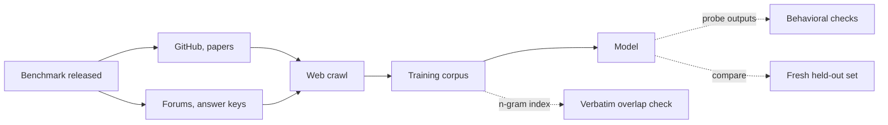
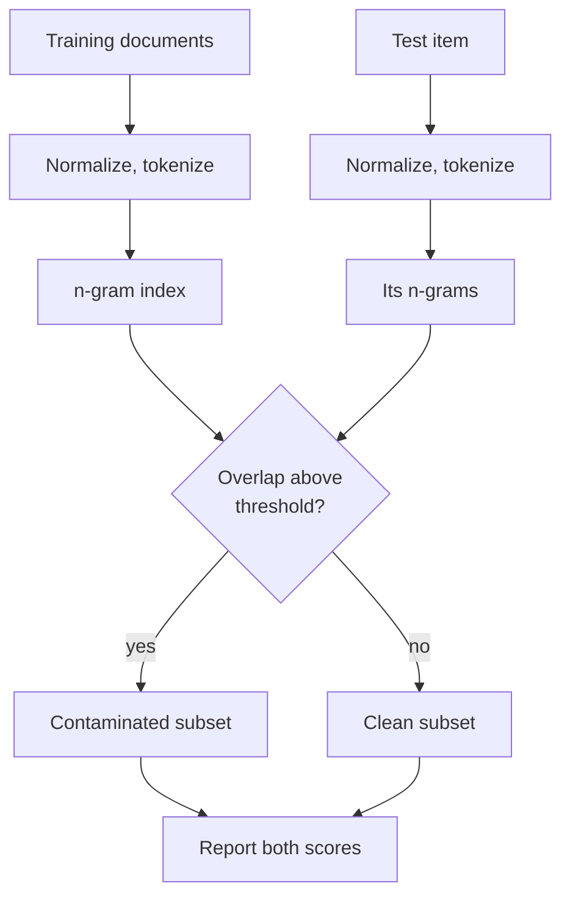

+++
title = 'Evaluation and contamination'
description = 'A benchmark score measures generalization only if the model has not seen the test items. Web-scale training data leaks benchmarks, n-gram checks catch only verbatim copies, and fresh or private test sets are the strongest evidence.'
question = 'How do you know a benchmark score reflects ability rather than memorized test data?'
weight = 3
difficulty = 3
prerequisites = ['/notes/systems-design/evaluation-in-production/01-designing-evals']
date = 2026-10-30T07:15:00Z
lastmod = 2026-10-30T07:15:00Z
verified = 2026-10-30
+++

## The idea in one minute

Model evaluation borrows the rule of all machine learning: score on data the
model was not trained on. At web scale that rule is hard to keep. Benchmarks
are published on GitHub, quoted in papers, discussed on forums, and copied into
answer-key sites, and all of that is crawled. A model that has seen a test
item can score on it by recall.

**Contamination checks** look for test items in training data. The standard
method is **n-gram overlap**: GPT-3 flagged any test item that shared a
13-token sequence with the training set. It is cheap and catches verbatim
copies, but misses paraphrases, translations, and reformatted answer keys, and
it needs access to the training data. **Behavioral checks** probe the model
instead. The most convincing evidence is a **fresh test set** built the same
way after the training cutoff: if the score drops on it, the original score
was inflated.

This lesson is about benchmark integrity for models. Designing evals for a
production system is covered in
[designing evals](/notes/systems-design/evaluation-in-production/01-designing-evals/),
[model graders](/notes/systems-design/evaluation-in-production/02-model-graders/),
and [online evaluation](/notes/systems-design/evaluation-in-production/03-online-evaluation/).

## A picture



## How it really works

### What contamination does to a score

Contamination inflates scores in two ways. **Exact memorization**: the model
has seen the question and the answer and reproduces it. **Format and
distribution leakage**: the model has seen many near-duplicates or the same
templates, so it has learned the benchmark's quirks rather than the skill.
Both survive fine-tuning, and the second survives rewording.

The size of the effect varies. Brown et al. (2020) found modest differences
between clean and flagged subsets on most GPT-3 benchmarks. Zhang et al. (2024)
built GSM1k, a new set of grade-school math problems written to match GSM8K's
style and difficulty, and found accuracy drops of up to 13 points for some
model families, while the strongest frontier models showed little or no drop.
Contamination is model-specific; you have to measure it.

### N-gram overlap

The procedure:

1. **Normalize** training documents and test items: lowercase, strip
   punctuation, tokenize consistently.
2. **Index** all training n-grams, at web scale with a Bloom filter or
   suffix array rather than a set.
3. **Score** each test item by the fraction of its n-grams found, or flag it on
   any match.
4. **Report** scores on the clean and contaminated subsets separately.

The choice of `n` is a tradeoff. Large `n` (13 in GPT-3) has few false
positives but misses short items and anything reworded. Small `n` catches more
but flags common phrases ("how many apples does she have"). Llama 2's report
counted a test item contaminated if a large share of its tokens were covered by
long matching spans, a variant that weights coverage instead of any-match.



### When you cannot see the training data

For a model whose corpus you cannot inspect, checks probe the model:

- **Completion probes.** Give the model the first half of a test item, with
  the benchmark name, and see whether it completes it verbatim (Golchin and
  Surdeanu, 2023).
- **Likelihood tests.** Min-K% Prob (Shi et al., 2023) flags text whose
  least-likely tokens are still unusually likely under the model. Oren et al.
  (2023) showed that a model which assigns higher likelihood to a dataset's
  canonical ordering than to shuffled orderings has seen it.
- **Perturbation.** Change names and numbers in a math problem; a large score
  drop suggests recall of the original.

These give evidence, not proof. A model can recall a test item without the
probe finding it, and probes give false positives on famous text.

### Defenses for benchmark builders and users

- **Canary strings.** BIG-bench embeds a unique GUID in its files and asks
  that training pipelines drop documents containing it. It works only if
  crawlers and copiers keep the string and trainers honor it.
- **Private and rolling test sets.** Keep a held-out set that is never
  published, or keep releasing new items dated after model cutoffs.
- **Report clean subsets.** Publish contamination analysis with every number.
- **Your own eval wins.** For a production decision, a set of cases from your
  own traffic, never published, is uncontaminated by construction and measures
  what you care about.

## Code

The program builds an n-gram index from a tiny corpus and scores four test
items at `n` = 13, 8, and 5. One item appears verbatim in a scraped answer key,
one is a lightly reworded copy of a forum post, one is clean, and one is a
paraphrase of the leaked item.

```python {title="contamination.py"}
"""contamination.py: flag benchmark items whose n-grams appear in a training corpus."""
import re

def tokens(text: str) -> list[str]:
    return re.findall(r"[a-z0-9]+", text.lower())   # normalize case and punctuation

def ngrams(toks: list[str], n: int) -> set[tuple[str, ...]]:
    return {tuple(toks[i:i + n]) for i in range(len(toks) - n + 1)}

def build_index(corpus: list[str], n: int) -> set[tuple[str, ...]]:
    idx: set[tuple[str, ...]] = set()
    for doc in corpus:
        idx |= ngrams(tokens(doc), n)
    return idx

def overlap(item: str, idx: set, n: int) -> float:
    grams = ngrams(tokens(item), n)
    return len(grams & idx) / len(grams) if grams else 0.0

CORPUS = [
    "Forum post: Q: A train leaves at 3 pm travelling 60 miles per hour. How far has it "
    "gone by 5:30 pm? A: 150 miles. Thanks, that helped with my homework!",
    "Blog: twelve tips for sourdough. Keep the starter warm and feed it twice a day.",
    "Scraped answer key. Natalia sold clips to 48 of her friends in April, and then she "
    "sold half as many clips in May. How many clips did Natalia sell altogether? 72",
    "News: the city council voted to expand the bike lane network next spring.",
]
BENCH = {
    "q1": "Natalia sold clips to 48 of her friends in April, and then she sold half as many "
          "clips in May. How many clips did Natalia sell altogether in April and May?",
    "q2": "A train leaves at 3 PM traveling 60 mph. How far has it gone by 5:30 PM?",
    "q3": "A baker uses 3 cups of flour per loaf. How much flour do 7 loaves need?",
    "q4": "Natalia sold 48 clips to friends in April and half as many in May. "
          "What is the total number she sold?",
}

if __name__ == "__main__":
    for n in (13, 8, 5):
        idx = build_index(CORPUS, n)
        row = "  ".join(f"{k}={overlap(v, idx, n):4.0%}" for k, v in BENCH.items())
        print(f"n={n:<2}  {row}")
    idx = build_index(CORPUS, 13)
    flagged = [k for k, v in BENCH.items() if overlap(v, idx, 13) > 0]
    print("\nflagged at n=13 (any shared 13-gram):", flagged)
    print("q2 differs by spelling and 'mph'; q4 is a paraphrase. Neither is caught at n=13.")
```

Run it with `python3 contamination.py`:

```text
n=13  q1= 79%  q2=  0%  q3=  0%  q4=  0%
n=8   q1= 83%  q2= 18%  q3=  0%  q4=  0%
n=5   q1= 85%  q2= 50%  q3=  0%  q4=  0%

flagged at n=13 (any shared 13-gram): ['q1']
q2 differs by spelling and 'mph'; q4 is a paraphrase. Neither is caught at n=13.
```

The verbatim item is caught at every `n`. The reworded train question
("travelling" for "traveling", "mph" for "miles per hour") escapes 13-grams
and is only partly caught at smaller `n`. The paraphrase escapes every
setting, even though a model trained on the answer key would likely solve it
from memory. That is the case n-gram checks cannot see.

## Where it breaks

- **Paraphrase and translation.** N-gram checks miss semantically identical
  items. Embedding-similarity search catches some at a much higher cost and
  false-positive rate.
- **Synthetic data.** Training on outputs of another model that saw the test
  set launders contamination through text that overlaps nothing.
- **Fine-tuning data.** Post-training sets are small and curated, and may
  include benchmark-like items; check them, not only pretraining data.
- **Overfitting to the benchmark without contamination.** Repeated model
  selection on the same public test set fits its noise. Freeze a final test
  set and look at it rarely.

## Remember this

- A score measures generalization only on items the model has not seen.
- N-gram overlap catches verbatim copies; it misses paraphrases and synthetic leakage.
- Report scores on clean and flagged subsets separately.
- A fresh set built after the cutoff is the strongest test of inflation.
- For production decisions, an unpublished eval from your own traffic beats any public benchmark.

## Try it

1. Add a corpus document containing q3 with every number changed. Which `n`
   flags it, and should it count as contamination?
2. Replace the set index with a Bloom filter (a bit array and two hashes from
   `hashlib`) and measure the false-positive rate at 1,000 bits.
3. Write three perturbations of q1 (new name, new numbers) and describe how you
   would use a model's accuracy on them as a contamination signal.

## Check yourself

1. Why do short test items evade a 13-gram check?
   
   An item with few tokens has few or no 13-grams, so even a near-copy shares
   none. Coverage-based or smaller-n checks are needed for short items.
   
2. A model scores 90% on a public benchmark and 78% on a fresh set built to the
   same specification. What do you conclude, and what else could explain it?
   
   Likely contamination or overfitting to the public set. Check that the fresh
   set really matches the original's difficulty, since a harder new set would
   also lower the score.
   
3. Why does a canary string only partially protect a benchmark?
   
   Copies that strip the canary (reposted questions, answer keys, quotes in
   papers) are not filtered, and it depends on every trainer honoring it.
   
4. What contamination check is possible for a model whose training data you
   cannot access?
   
   Behavioral probes: verbatim completion of test items, likelihood tests such
   as Min-K% Prob or ordering tests, and accuracy under perturbation, plus
   comparison with a fresh held-out set.
   

## Sources

- T. Brown et al., "Language models are few-shot learners" (GPT-3, section 4 and appendix C on 13-gram contamination), 2020. <https://arxiv.org/abs/2005.14165>
- H. Touvron et al., "Llama 2: Open foundation and fine-tuned chat models" (contamination analysis appendix), 2023. <https://arxiv.org/abs/2307.09288>
- H. Zhang et al., "A careful examination of large language model performance on grade school arithmetic" (GSM1k), 2024. <https://arxiv.org/abs/2405.00332>
- S. Golchin and M. Surdeanu, "Time travel in LLMs: Tracing data contamination in large language models," 2023. <https://arxiv.org/abs/2308.08493>
- W. Shi et al., "Detecting pretraining data from large language models" (Min-K% Prob), 2023. <https://arxiv.org/abs/2310.16789>
- Y. Oren et al., "Proving test set contamination in black box language models," 2023. <https://arxiv.org/abs/2310.17623>
- A. Srivastava et al., "Beyond the imitation game" (BIG-bench, canary string), 2022. <https://arxiv.org/abs/2206.04615>
