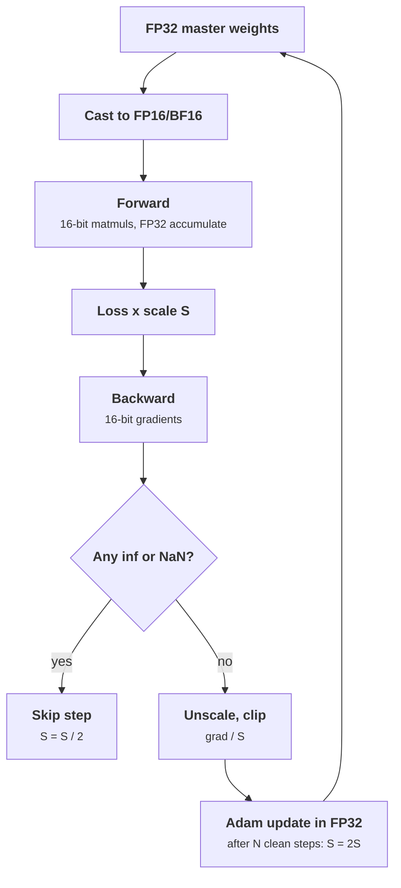

+++
title = 'Mixed precision and stability'
description = 'Why training runs in BF16 or FP16 with FP32 master weights, how loss scaling keeps small FP16 gradients from flushing to zero, and the instabilities (loss spikes, divergence) that appear at scale.'
question = 'How do you train in 16-bit numbers without losing the gradients, and what makes large runs diverge?'
weight = 2
difficulty = 3
prerequisites = ['/notes/machine-learning-systems/training-at-scale/01-data-pipelines']
date = 2026-10-30T05:10:00Z
lastmod = 2026-10-30T05:10:00Z
verified = 2026-10-30
+++

## The idea in one minute

Tensor cores run 16-bit matrix multiplies at many times the FP32 rate, and
16-bit activations halve memory and bandwidth. **Mixed precision** does the
heavy math in 16 bits while keeping a 32-bit copy of the weights for the
update, because a small learning-rate step added to a large weight in 16 bits
rounds away.

The two 16-bit formats fail differently. **FP16** has 10 mantissa bits but
only 5 exponent bits: values above 65,504 overflow and gradients below about
6e-8 flush to zero. **Loss scaling** multiplies the loss by a large factor so
gradients land in range, then divides before the update; if anything
overflows, the step is skipped and the scale halved. **BF16** keeps FP32's
8-bit exponent with 7 mantissa bits, so it rarely needs loss scaling and is
the default for large-model training on hardware that supports it.

Stable numbers do not make a stable run. Large runs see **loss spikes** from
outlier batches, attention logit growth, and optimizer state interactions.
Gradient clipping, learning-rate warmup, normalization choices, and
rewinding to a checkpoint are the standard defenses.

## A picture



## How it really works

### The formats

| Format | Exponent bits | Mantissa bits | Max | Smallest normal | Notes |
|---|---|---|---|---|---|
| FP32 | 8 | 23 | 3.4e38 | 1.2e-38 | master weights, optimizer state |
| FP16 | 5 | 10 | 65,504 | 6.1e-5 (subnormal to 6.0e-8) | needs loss scaling |
| BF16 | 8 | 7 | 3.4e38 | 1.2e-38 | same range as FP32, coarse precision |
| FP8 E4M3 / E5M2 | 4 / 5 | 3 / 2 | 448 / 57,344 | | per-tensor scaling required |

BF16's 7 mantissa bits mean a value near 1.0 has spacing of 2^-7, about
0.008. Adding an update of 1e-4 to a BF16 weight of 1.0 does nothing. That is
why the master copy stays in FP32 even when compute is entirely BF16.

### Why the master copy and what it costs

Micikevicius et al. (2017) set out the recipe: FP16 storage and compute for
weights, activations, and gradients; an FP32 master copy for the update; loss
scaling; and FP32 accumulation inside matrix multiplies and reductions. With
Adam the per-parameter state becomes 2 bytes (16-bit weights) + 2 (16-bit
gradients) + 4 (FP32 master) + 4 + 4 (FP32 Adam moments) = **16 bytes per
parameter**. That 16 is the number ZeRO divides in
[ZeRO and FSDP](/notes/machine-learning-systems/training-at-scale/04-zero-and-fsdp/).

### Dynamic loss scaling

Activation gradients in deep networks are often far smaller than 6e-5. The
mixed-precision paper's histograms showed a large share of gradient values
would become zero in FP16. Scaling the loss by *S* scales every gradient by
*S* (chain rule), shifting them into range. The dynamic algorithm, used by
`torch.amp.GradScaler`:

1. Start with a large *S* (PyTorch default 2^16).
2. After backward, check all gradients for inf/NaN.
3. If found: skip the optimizer step, set *S* = *S* × 0.5.
4. If not: unscale, step, and after `growth_interval` (default 2,000) clean
   steps set *S* = *S* × 2.

Unscale before gradient clipping, otherwise the clip threshold applies to
scaled values. A few skipped steps per thousand is normal; skipping
continuously means the model itself has produced inf or NaN, and no scale
will fix it.

### FP8

Hopper-generation tensor cores add FP8 matmuls. With only 3 or 2 mantissa
bits, FP8 needs a scale per tensor (or per block), chosen from recent
maximum absolute values. NVIDIA's Transformer Engine keeps a history of
amax values to set scales; FP8 is typically used for matmul inputs while
master weights, optimizer state, and sensitive operations stay in higher
precision.

### Instability at scale

Numerics are one source of divergence. Others, reported across large runs
(PaLM, OPT logbooks, Llama 3):

- **Loss spikes** that sometimes recover and sometimes do not. PaLM's
  mitigation was to restart from a checkpoint about 100 steps before the spike
  and skip 200 to 500 batches, which suggests specific data plus optimizer
  state rather than bad data alone.
- **Attention logit growth** causing softmax saturation; QK-normalization and
  logit soft-capping are used against it.
- **Adam epsilon and second-moment** effects when gradients for some
  parameters become very small.

Standard defenses: learning-rate warmup, global-norm gradient clipping
(commonly 1.0), z-loss on output logits, and keeping softmax, normalization,
and loss in FP32.

## Code

The simulation draws gradient magnitudes from a lognormal centered near 2e-9,
applies FP16 range limits (overflow above 65,504, flush below half the
smallest subnormal), and runs dynamic loss scaling with a growth interval of
200. Three injected spikes force overflow. It models range only, not rounding.

```python {title="lossscale.py"}
"""Dynamic loss scaling with overflow detection, FP16 range simulated."""
import math
import random

FP16_MAX = 65504.0
FP16_MIN_SUB = 2.0 ** -24   # smallest positive subnormal


def to_fp16(x: float) -> float:
    if abs(x) > FP16_MAX:
        return math.inf
    if abs(x) < FP16_MIN_SUB / 2:
        return 0.0
    return x


def run(steps: int, seed: int = 1) -> None:
    rng = random.Random(seed)
    scale, good, growth_interval = 2.0 ** 16, 0, 200
    skipped = 0
    for step in range(steps):
        # Gradient magnitudes: mostly tiny, occasionally a spike.
        grads = [rng.lognormvariate(-20, 2.0) for _ in range(256)]
        if step in (450, 451, 900):
            grads[0] = 3.0
        scaled = [to_fp16(g * scale) for g in grads]
        underflow = sum(1 for s in scaled if s == 0.0) / len(scaled)
        if any(math.isinf(s) for s in scaled):
            skipped += 1
            print(f"step {step:4d}: overflow at scale 2^{int(math.log2(scale))}, skip, halve")
            scale /= 2
            good = 0
            continue
        good += 1
        if good == growth_interval:
            scale *= 2
            good = 0
        if step % 250 == 0:
            print(f"step {step:4d}: scale 2^{int(math.log2(scale)):2d}  underflow {underflow:5.1%}")
    print(f"skipped {skipped} of {steps} steps, final scale 2^{int(math.log2(scale))}")
    unscaled = sum(1 for g in grads if to_fp16(g) == 0.0) / len(grads)
    print(f"same gradients cast to FP16 with no scaling: {unscaled:.1%} flush to zero")


if __name__ == "__main__":
    run(1000)
```

Run it with `python3 lossscale.py`:

```text
step    0: scale 2^16  underflow  0.0%
step  250: scale 2^17  underflow  0.0%
step  450: overflow at scale 2^18, skip, halve
step  451: overflow at scale 2^17, skip, halve
step  500: scale 2^16  underflow  0.0%
step  750: scale 2^17  underflow  0.0%
step  900: overflow at scale 2^18, skip, halve
skipped 3 of 1000 steps, final scale 2^17
same gradients cast to FP16 with no scaling: 87.1% flush to zero
```

Without scaling, 87 percent of these gradients become zero in FP16. With
scaling, none do, at the cost of three skipped steps out of 1,000. Every
overflow comes from an injected spike; the scale drops, then grows back every
200 clean steps. With a long run and no spikes it would keep growing until the
largest gradients overflow, then oscillate around that point.

## Where it breaks

- **Loss scaling cannot rescue a model that produces inf.** Repeated skips
  mean a numerical bug, often in a softmax or normalization run in 16 bits.
- **BF16 precision** can hurt reductions over long sequences or large
  batches; accumulate in FP32.
- **Skipped steps desynchronize** if ranks disagree on overflow; the check must
  be an all-reduce over a flag so every rank skips together.
- **The program** ignores rounding and subnormal precision loss, which matter
  for small updates.

## Remember this

- 16-bit compute, FP32 master weights and optimizer state: 16 bytes per parameter with Adam.
- FP16 needs dynamic loss scaling; BF16 usually does not.
- Overflow means skip the step and halve the scale; clean steps grow it back.
- Unscale before clipping, and agree on overflow across ranks.
- Loss spikes are usually handled by rewinding and skipping data, not by format changes.

## Try it

1. Set the lognormal mean to -14 and see how the steady-state scale changes.
2. Make the growth interval 2,000 (the PyTorch default) and count skips.
3. Model BF16 by changing the limits and confirm no scaling is needed.

## Check yourself

1. Why keep FP32 master weights when compute is in BF16?

   
   BF16 has 7 mantissa bits, so an update much smaller than about 1/128 of the
   weight rounds to zero. Accumulating updates into an FP32 copy preserves
   them.
   

2. Why must gradients be unscaled before clipping?

   
   The clip threshold is defined for true gradient norms. Scaled gradients are
   *S* times larger, so clipping them would apply a much stronger clip than
   intended and the effect would change as *S* changes.
   

3. A run skips every step after step 40,000. What does that suggest?

   
   The forward or backward pass itself produces inf or NaN regardless of
   scale (for example, an overflowing softmax or a diverged weight). Rewind
   to a checkpoint and investigate; reducing *S* will not help.
   

## Sources

- Micikevicius et al. "Mixed Precision Training." arXiv:1710.03740, 2017 (ICLR 2018). https://arxiv.org/abs/1710.03740
- PyTorch documentation, "Automatic Mixed Precision package - torch.amp" (GradScaler). https://pytorch.org/docs/stable/amp.html
- Micikevicius et al. "FP8 Formats for Deep Learning." arXiv:2209.05433, 2022. https://arxiv.org/abs/2209.05433
- Chowdhery et al. "PaLM: Scaling Language Modeling with Pathways." arXiv:2204.02311, 2022 (training instability, section 5.1). https://arxiv.org/abs/2204.02311
- Kalamkar et al. "A Study of BFLOAT16 for Deep Learning Training." arXiv:1905.12322, 2019. https://arxiv.org/abs/1905.12322
