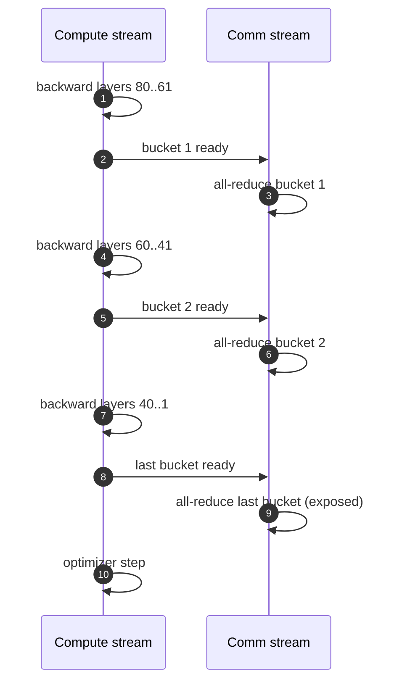

+++
title = 'Data parallelism and all-reduce'
description = 'Replicate the model, split the batch, and average gradients with all-reduce. The ring algorithm, its alpha-beta time model, bucketing and overlap with backward, and why large global batches change the optimization.'
question = 'How long does gradient synchronization take, and how do you hide it behind computation?'
weight = 3
difficulty = 3
prerequisites = ['/notes/machine-learning-systems/training-at-scale/02-mixed-precision-and-stability']
date = 2026-10-30T05:15:00Z
lastmod = 2026-10-30T05:15:00Z
verified = 2026-10-30
+++

## The idea in one minute

**Data parallelism** gives every GPU a full copy of the model and a different
slice of the batch. After backward, each GPU holds gradients for its slice;
an **all-reduce** sums them so every GPU applies the same update and the
copies stay identical.

The ring all-reduce sends each GPU's buffer around a ring in 2(*n*−1) steps
of size 1/*n*. Each GPU sends and receives about **2 × the buffer size**
regardless of *n*, so bandwidth cost is flat as the job grows, while latency
cost grows linearly with *n*. For an 8-billion-parameter model with BF16
gradients that is 32 GB per GPU per step, about 0.6 seconds at 400 Gb/s.

That time is hidden, not avoided: frameworks group gradients into **buckets**
and start all-reducing each bucket as soon as backward produces it, overlapping
communication with the rest of backward. Data parallelism ends when the model
no longer fits on one GPU or when the global batch becomes too large to train
well.

## A picture

```mermaid {title="Ring all-reduce: reduce-scatter then all-gather, n-1 steps each"}
flowchart LR
  G0["<b>GPU 0</b><br/><small>chunks a0 b0 c0 d0</small>"] -->|"send 1/n"| G1["<b>GPU 1</b>"]
  G1 -->|"send 1/n"| G2["<b>GPU 2</b>"]
  G2 -->|"send 1/n"| G3["<b>GPU 3</b>"]
  G3 -->|"send 1/n"| G0
  RS["<b>Reduce-scatter</b><br/><small>n-1 steps: GPU i owns sum of chunk i</small>"] --> AG["<b>All-gather</b><br/><small>n-1 steps: everyone gets every sum</small>"]
  class G0,G1,G2,G3 compute
  class RS,AG neutral
```



## How it really works

### The ring

Split each GPU's gradient buffer into *n* chunks. In **reduce-scatter**, at each
of *n*−1 steps every GPU sends one chunk to its neighbor and adds the chunk it
receives. Afterward GPU *i* holds the full sum of chunk *i*. In
**all-gather**, another *n*−1 steps circulate the summed chunks so everyone
has all of them. Each GPU sends 2(*n*−1)/*n* × *M* bytes for a buffer of *M*
bytes, which is optimal for bandwidth.

The **alpha-beta model** gives time:

*T* = 2(*n*−1) × (α + *M* / (*n* × β))

where α is per-message latency and β is link bandwidth. As *n* grows the
bandwidth term approaches 2*M*/β and the latency term grows as 2*n*α. For
large buffers bandwidth dominates; for small buffers at large *n*, latency
dominates and rings become slow. NCCL therefore also uses **tree** algorithms
(log *n* latency) and, on NVLink Switch and InfiniBand SHARP systems,
in-network reduction. NCCL picks among them by message size and topology.

### Bus bandwidth

`nccl-tests` reports **bus bandwidth** = algorithm bandwidth × 2(*n*−1)/*n*
for all-reduce. It normalizes away the 2× factor so the figure can be compared
with link speed. A healthy 8-GPU NVLink node shows bus bandwidth close to
the per-GPU NVLink rate; a multi-node test shows close to NIC rate. Compare
against these when a job is slow.

### Hierarchy

A cluster has fast links inside a node (NVLink, hundreds of GB/s) and slower
links between nodes (one 400 Gb/s NIC per GPU, about 50 GB/s). NCCL builds
rings and trees that cross the slow fabric as few times as possible, and
rail-optimized fabrics (GPU *k* of every node on the same leaf switch) keep
cross-node traffic on one switch hop. The cluster design is covered in
[A training cluster](/notes/systems-design/ai-infrastructure/01-a-training-cluster/).

### Overlap: buckets in DDP

PyTorch `DistributedDataParallel` registers hooks on parameter gradients and
groups them into buckets (default 25 MB) in roughly reverse forward order.
When a bucket's gradients are all ready, it launches an asynchronous
all-reduce. Only the last bucket's communication is exposed after backward
finishes. Li et al. (2020) describe the design and show that bucket size
trades launch overhead against overlap.

Overlap works when backward compute time exceeds communication time. For a
step with 4 seconds of backward compute and 0.6 seconds of all-reduce, almost
all of it hides. With small per-GPU batches, compute shrinks and the
all-reduce becomes exposed.

### Gradient accumulation and batch size

Running several micro-batches before one all-reduce cuts communication per
sample. But global batch = per-GPU batch × accumulation × number of GPUs, and
optimization quality falls off past a **critical batch size** that depends on
the model and loss (McCandlish et al., 2018). Large runs warm the batch size
up over training. This is one reason data parallelism alone does not scale to
arbitrarily many GPUs.

## Code

The program applies the alpha-beta formula with α = 5 µs to a 16 GB BF16
gradient buffer (8B parameters), first on NVLink-class links and then on a
400 Gb/s NIC, and then to a 1 MB message.

```python {title="allreduce.py"}
"""Ring all-reduce time model: alpha-beta cost per step."""


def ring_time(n: int, bytes_: float, bw: float, alpha: float) -> float:
    """2(n-1) steps, each sends bytes/n. bw in bytes/s, alpha in s."""
    return 2 * (n - 1) * (alpha + bytes_ / n / bw)


def bus_bw(n: int, bytes_: float, t: float) -> float:
    return bytes_ / t * 2 * (n - 1) / n


if __name__ == "__main__":
    params = 8e9
    grad_bytes = params * 2            # BF16 gradients
    links = {"NVLink-class 450 GB/s": 450e9, "400 Gb/s NIC (50 GB/s)": 50e9}
    for name, bw in links.items():
        print(name)
        for n in (8, 64, 512, 4096):
            t = ring_time(n, grad_bytes, bw, alpha=5e-6)
            print(f"  n={n:5d}  time {t*1e3:8.1f} ms   latency part {2*(n-1)*5e-6*1e3:6.1f} ms")
    print("\nsmall message (1 MB) on 50 GB/s:")
    for n in (8, 512, 4096):
        t = ring_time(n, 1e6, 50e9, 5e-6)
        print(f"  n={n:5d}  {t*1e3:6.2f} ms  bus bw {bus_bw(n, 1e6, t)/1e9:5.1f} GB/s")
```

Run it with `python3 allreduce.py`:

```text
NVLink-class 450 GB/s
  n=    8  time     62.3 ms   latency part    0.1 ms
  n=   64  time     70.6 ms   latency part    0.6 ms
  n=  512  time     76.1 ms   latency part    5.1 ms
  n= 4096  time    112.0 ms   latency part   41.0 ms
400 Gb/s NIC (50 GB/s)
  n=    8  time    560.1 ms   latency part    0.1 ms
  n=   64  time    630.6 ms   latency part    0.6 ms
  n=  512  time    643.9 ms   latency part    5.1 ms
  n= 4096  time    680.8 ms   latency part   41.0 ms

small message (1 MB) on 50 GB/s:
  n=    8    0.11 ms  bus bw  16.7 GB/s
  n=  512    5.15 ms  bus bw   0.4 GB/s
  n= 4096   40.99 ms  bus bw   0.0 GB/s
```

Large buffers barely notice *n*: going from 8 to 4,096 GPUs adds about 20
percent, almost all latency. A 1 MB message at 4,096 GPUs spends nearly all
its time in latency, which is why small collectives use trees and why buckets
should not be too small. The model assumes uniform links and ignores
congestion, which on real fabrics is often the larger effect.

## Where it breaks

- **Stragglers.** All-reduce is as slow as the slowest participant; one
  throttled GPU or flapping link slows the whole job.
- **Memory.** Every GPU holds full weights, gradients, and optimizer state:
  16 bytes per parameter. A 70B model needs 1.1 TB per replica, so plain
  data parallelism stops at a few billion parameters on 80 GB GPUs.
- **Batch size.** Past the critical batch, more GPUs cost tokens of quality.
- **Nondeterminism.** Reduction order varies with algorithm, so sums differ in
  the last bits between runs.

## Remember this

- Ring all-reduce moves about 2× the buffer per GPU, independent of *n*.
- Latency grows with *n*; small messages need trees or fewer, larger buckets.
- DDP hides communication by all-reducing buckets during backward.
- Bus bandwidth from `nccl-tests` is the number to compare with link speed.
- Data parallelism is limited by per-GPU memory and by critical batch size.

## Try it

1. Find the buffer size at which latency and bandwidth terms are equal for *n* = 512 on 50 GB/s.
2. Add a tree model with time 2 log2(*n*) × (α + *M*/β) and find where it beats the ring.
3. Given 4 s of backward and 25 MB buckets, estimate exposed communication for the 8B case.

## Check yourself

1. Why does the ring's bandwidth cost not grow with the number of GPUs?

   
   Each GPU sends 2(*n*−1) chunks of size *M*/*n*, a total that approaches
   2*M* as *n* grows. More GPUs mean more, smaller steps, not more bytes per
   GPU.
   

2. What is exposed communication in DDP and how do you reduce it?

   
   It is the all-reduce time that runs after backward finishes, mainly the
   last bucket. Smaller last buckets, more backward compute per step, and
   faster links reduce it.
   

3. Why not just add GPUs and increase the global batch?

   
   Beyond the critical batch size, larger batches give diminishing reduction
   in steps to a target loss, so compute is wasted. Memory per GPU also does
   not shrink with plain data parallelism.
   

## Sources

- Patarasuk and Yuan. "Bandwidth Optimal All-reduce Algorithms for Clusters of Workstations." Journal of Parallel and Distributed Computing 69(2), 2009. https://doi.org/10.1016/j.jpdc.2008.09.002
- Li et al. "PyTorch Distributed: Experiences on Accelerating Data Parallel Training." VLDB 2020, arXiv:2006.15704. https://arxiv.org/abs/2006.15704
- NVIDIA. "NCCL Tests: performance" (bus bandwidth definition). https://github.com/NVIDIA/nccl-tests/blob/master/doc/PERFORMANCE.md
- McCandlish et al. "An Empirical Model of Large-Batch Training." arXiv:1812.06162, 2018. https://arxiv.org/abs/1812.06162
- Sergeev and Del Balso. "Horovod: fast and easy distributed deep learning in TensorFlow." arXiv:1802.05799, 2018. https://arxiv.org/abs/1802.05799
