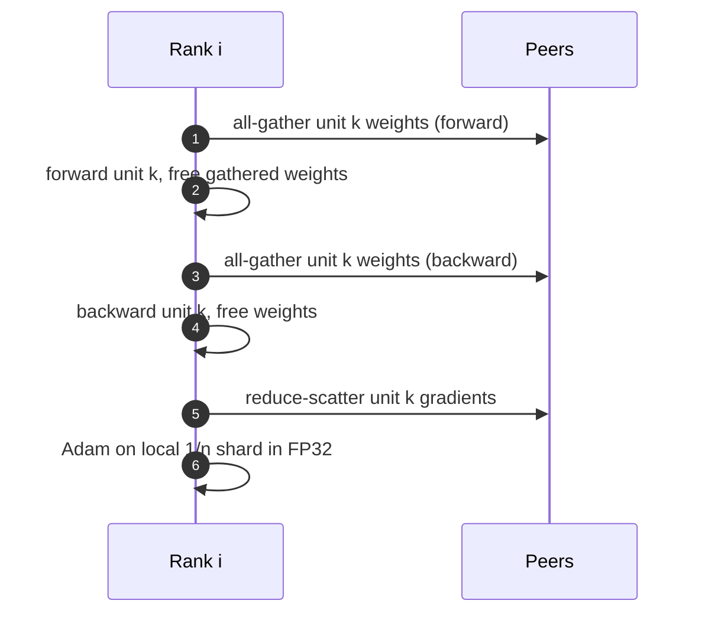

+++
title = 'ZeRO and FSDP'
description = 'Data parallelism replicates 16 bytes per parameter on every GPU. ZeRO stages shard optimizer state, gradients, and weights across ranks; FSDP implements stage 3 in PyTorch. Memory per GPU, communication cost, and activation memory.'
question = 'How much memory does each GPU need under each ZeRO stage, and what does sharding cost in communication?'
weight = 4
difficulty = 4
prerequisites = ['/notes/machine-learning-systems/training-at-scale/03-data-parallelism-and-all-reduce']
date = 2026-10-30T05:20:00Z
lastmod = 2026-10-30T05:20:00Z
verified = 2026-10-30
+++

## The idea in one minute

With mixed-precision Adam, model state costs 16 bytes per parameter: 2 for
16-bit weights, 2 for gradients, 12 for the FP32 master copy and two Adam
moments. Plain data parallelism keeps all 16 bytes on every GPU, so *n* GPUs
store *n* identical copies.

**ZeRO** (Rajbhandari et al., 2020) removes the redundancy in stages.
**Stage 1** shards the 12 bytes of optimizer state across the *n*
data-parallel ranks. **Stage 2** also shards gradients, using reduce-scatter
instead of all-reduce. **Stage 3** also shards weights, gathering each layer's
weights just before it is used and freeing them after. At stage 3 model state
per GPU is 16Ψ/*n* bytes for Ψ parameters.

Stages 1 and 2 cost no extra communication: an all-reduce is a reduce-scatter
plus an all-gather, and ZeRO just moves the all-gather to after the update.
Stage 3 adds one more all-gather of weights in backward, about 1.5× the
traffic of plain data parallelism. **PyTorch FSDP** is a stage-3
implementation that wraps modules into units, each gathered and freed as a
whole.

## A picture

```mermaid {title="What each ZeRO stage shards across n data-parallel ranks"}
flowchart LR
  D["<b>DDP</b><br/><small>W 2 + G 2 + O 12 = 16 B/param per GPU</small>"] --> Z1["<b>ZeRO-1</b><br/><small>O / n</small>"]
  Z1 --> Z2["<b>ZeRO-2</b><br/><small>O / n, G / n</small>"]
  Z2 --> Z3["<b>ZeRO-3 / FSDP</b><br/><small>O / n, G / n, W / n</small>"]
  class D neutral
  class Z1,Z2 memory
  class Z3 good
```



## How it really works

### Bytes per parameter

For Ψ parameters and *n* data-parallel ranks, model-state memory per GPU:

| Scheme | Formula | 7.5B, *n* = 64 |
|---|---|---|
| DDP | 16Ψ | 120 GB |
| ZeRO-1 | 4Ψ + 12Ψ/*n* | 31.4 GB |
| ZeRO-2 | 2Ψ + 14Ψ/*n* | 16.6 GB |
| ZeRO-3 | 16Ψ/*n* | 1.9 GB |

These match Figure 1 of the ZeRO paper. They exclude activations, temporary
buffers, and fragmentation, which in practice are often larger than the
sharded state.

### Communication

Plain DDP all-reduces gradients: about 2Ψ elements sent per GPU (reduce-scatter
Ψ + all-gather Ψ).

- **ZeRO-1/2:** reduce-scatter gradients (Ψ), each rank updates its shard,
  then all-gather updated weights (Ψ). Same 2Ψ total.
- **ZeRO-3:** all-gather weights in forward (Ψ), again in backward (Ψ), and
  reduce-scatter gradients (Ψ). Total 3Ψ, 1.5× DDP.

The extra all-gathers are on the critical path of each layer, so FSDP
**prefetches**: it issues the all-gather for the next unit while the current
one computes (`forward_prefetch`, `backward_prefetch`). Peak memory then
holds about two gathered units at once.

### FSDP specifics

FSDP (Zhao et al., 2023) flattens each wrapped module's parameters into one
contiguous `FlatParameter` and shards it evenly. The **wrapping policy**
decides unit size: one unit per transformer block is typical. Larger units
mean fewer, larger collectives but higher peak memory. FSDP2
(`fully_shard`) represents shards as per-parameter DTensors instead of flat
buffers, which makes it easier to combine with tensor parallelism.

**Hybrid sharding** (`HYBRID_SHARD`, or HSDP) shards within a group, often a
node, and replicates across groups. All-gathers then stay on NVLink, and only
a gradient all-reduce crosses the slower fabric. It trades memory for
network.

### Activations

Model state is not all of it. For a transformer layer, activation memory per
layer is roughly *s* × *b* × *h* × (34 + 5*a*s*/*h*) bytes in 16-bit
(Korthikanti et al., 2022), where *s* is sequence length, *b* micro-batch,
*h* hidden size, and *a* heads. At *s* = 8,192 and *h* = 8,192 that is
gigabytes per layer. Three tools:

- **Activation checkpointing** stores only layer inputs and recomputes the
  rest in backward, costing about one extra forward (≈33 percent more compute).
- **Selective recomputation** recomputes only the cheap but large attention
  intermediates; FlashAttention already avoids storing the *s*×*s* matrix.
- **CPU offload** (ZeRO-Offload, ZeRO-Infinity) moves optimizer state or
  parameters to host or NVMe, trading PCIe bandwidth for capacity.

### When ZeRO-3 is not enough

At very large *n*, ZeRO-3's per-layer all-gathers become small and
latency-bound, and every one crosses the data-parallel group. Very large
models therefore combine a modest FSDP group with tensor and pipeline
parallelism (next lesson), each mapped to the link that suits its traffic.

## Code

The program evaluates the formulas for 7.5B and 70B parameters at 8, 64, and
512 GPUs.

```python {title="zero.py"}
"""Per-GPU memory for model states under ZeRO stages (mixed-precision Adam)."""


def per_gpu_gb(params: float, n: int, stage: int) -> float:
    p, g, o = 2 * params, 2 * params, 12 * params   # bf16 weights, bf16 grads, fp32 master+m+v
    if stage >= 1:
        o /= n
    if stage >= 2:
        g /= n
    if stage >= 3:
        p /= n
    return (p + g + o) / 1e9


if __name__ == "__main__":
    for params, label in ((7.5e9, "7.5B"), (70e9, "70B")):
        print(f"{label} params, model states only (no activations)")
        print("  GPUs   DDP    ZeRO-1  ZeRO-2  ZeRO-3")
        for n in (8, 64, 512):
            row = "  ".join(f"{per_gpu_gb(params, n, s):6.1f}" for s in range(4))
            print(f"  {n:4d}  {row}")
    # Communication per step relative to DDP all-reduce (2x params bytes per GPU, ring)
    print("\ncomm volume per GPU per step, units of model size: DDP 2.0, ZeRO-1/2 2.0, ZeRO-3 3.0")
```

Run it with `python3 zero.py`:

```text
7.5B params, model states only (no activations)
  GPUs   DDP    ZeRO-1  ZeRO-2  ZeRO-3
     8   120.0    41.2    28.1    15.0
    64   120.0    31.4    16.6     1.9
   512   120.0    30.2    15.2     0.2
70B params, model states only (no activations)
  GPUs   DDP    ZeRO-1  ZeRO-2  ZeRO-3
     8  1120.0   385.0   262.5   140.0
    64  1120.0   293.1   155.3    17.5
   512  1120.0   281.6   141.9     2.2

comm volume per GPU per step, units of model size: DDP 2.0, ZeRO-1/2 2.0, ZeRO-3 3.0
```

The 7.5B row at 64 GPUs reproduces the paper. For 70B, ZeRO-1 and ZeRO-2 still
need 290 and 155 GB per GPU at 64 ranks, more than an 80 GB GPU, because
weights and gradients remain replicated. Only stage 3 fits, at 17.5 GB of
state, leaving room for activations.

## Where it breaks

- **Small units, many ranks.** ZeRO-3 all-gathers per unit; at thousands of
  ranks each piece is small and latency dominates.
- **Fragmentation and peaks.** Gathered weights, prefetch buffers, and
  allocator fragmentation can exceed the shard savings; measure peak, not
  steady state.
- **Checkpoint format.** Sharded state must be saved per rank or gathered;
  restoring to a different world size needs resharding (PyTorch Distributed
  Checkpoint handles this).
- **The formulas** ignore activations, communication buffers, and CUDA
  context (hundreds of MB per GPU).

## Remember this

- Mixed-precision Adam: 16 bytes per parameter, 12 of them optimizer state.
- ZeRO-1 shards optimizer state, ZeRO-2 adds gradients, ZeRO-3 adds weights.
- Stages 1 and 2 cost no extra traffic; stage 3 costs about 1.5× DDP.
- FSDP is stage 3 with per-unit gather, prefetch, and free.
- Activations, not model state, often decide whether a configuration fits.

## Try it

1. Add activation memory with the Korthikanti formula for *s* = 4,096, *b* = 1, *h* = 8,192, *a* = 64, 80 layers, and full checkpointing.
2. Compute HSDP memory for 70B with shard group 8 and 64 replicas.
3. Find the smallest *n* at which ZeRO-2 fits a 13B model in 80 GB with 20 GB reserved for activations.

## Check yourself

1. Why does ZeRO-2 not increase communication over DDP?

   
   An all-reduce is a reduce-scatter followed by an all-gather. ZeRO-2 does
   the reduce-scatter on gradients, updates the local shard, and does the
   all-gather on updated weights. The total bytes are the same.
   

2. Where does ZeRO-3's extra traffic come from?

   
   Weights are sharded, so each unit's weights must be all-gathered before
   forward and again before backward, since they were freed in between.
   That adds one Ψ all-gather over ZeRO-2.
   

3. What does hybrid sharding trade?

   
   It shards within a fast-link group and replicates across groups, so
   memory per GPU is higher than full sharding, but the frequent all-gathers
   stay on NVLink and only a gradient all-reduce crosses the fabric.
   

## Sources

- Rajbhandari et al. "ZeRO: Memory Optimizations Toward Training Trillion Parameter Models." SC20, arXiv:1910.02054. https://arxiv.org/abs/1910.02054
- Zhao et al. "PyTorch FSDP: Experiences on Scaling Fully Sharded Data Parallel." VLDB 2023, arXiv:2304.11277. https://arxiv.org/abs/2304.11277
- Korthikanti et al. "Reducing Activation Recomputation in Large Transformer Models." arXiv:2205.05198, 2022. https://arxiv.org/abs/2205.05198
- Ren et al. "ZeRO-Offload: Democratizing Billion-Scale Model Training." arXiv:2101.06840, 2021. https://arxiv.org/abs/2101.06840
- Chen et al. "Training Deep Nets with Sublinear Memory Cost." arXiv:1604.06174, 2016. https://arxiv.org/abs/1604.06174
- PyTorch documentation, "FullyShardedDataParallel" and "torch.distributed.checkpoint". https://pytorch.org/docs/stable/fsdp.html
