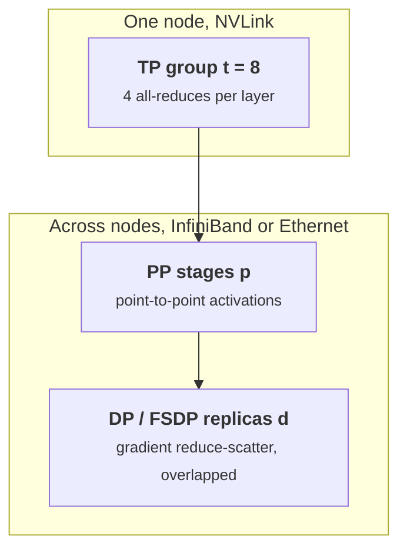

+++
title = 'Tensor and pipeline parallelism'
description = 'Split a layer across GPUs (tensor parallelism) or split layers into stages (pipeline parallelism). Megatron-style TP communication per layer, GPipe and 1F1B schedules and their bubble, and how 3D parallelism maps each dimension onto the network.'
question = 'When the model will not fit even sharded, how do you split it across GPUs, and what does each split cost?'
weight = 5
difficulty = 4
prerequisites = ['/notes/machine-learning-systems/training-at-scale/04-zero-and-fsdp']
date = 2026-10-30T05:25:00Z
lastmod = 2026-10-30T05:25:00Z
verified = 2026-10-30
+++

## The idea in one minute

**Tensor parallelism (TP)** splits each layer's weight matrices across *t*
GPUs. Megatron-LM splits the first MLP matrix by columns and the second by
rows, so each GPU computes its piece independently and one all-reduce at the
end of the block combines them. Attention is split by heads the same way.
That costs two all-reduces of the full activation per layer in forward and
two in backward, every layer, every micro-batch. TP needs NVLink-class
bandwidth and stays inside a node.

**Pipeline parallelism (PP)** places consecutive groups of layers on *p*
stages. Each stage sends only the activation at its boundary to the next, so
traffic is small and tolerates the cross-node fabric. The cost is the
**bubble**: at the start and end of each batch, stages wait. With *m*
micro-batches the idle fraction is (*p*−1)/(*m*+*p*−1). **1F1B** scheduling
keeps the same bubble as GPipe but limits stored activations to *p*
micro-batches; **interleaved** schedules cut the bubble further.

Large runs combine both with data parallelism (**3D parallelism**): TP within
a node, PP across nodes, and data parallelism (often with ZeRO/FSDP) across
everything else.

## A picture

```mermaid {title="Megatron MLP: column-parallel then row-parallel, one all-reduce"}
flowchart LR
  X["<b>X</b><br/><small>replicated on t GPUs</small>"] --> A1["<b>X A1</b><br/><small>GPU 0, GeLU</small>"]
  X --> A2["<b>X A2</b><br/><small>GPU 1, GeLU</small>"]
  A1 --> B1["<b>Y1 B1</b><br/><small>GPU 0</small>"]
  A2 --> B2["<b>Y2 B2</b><br/><small>GPU 1</small>"]
  B1 --> AR["<b>All-reduce</b><br/><small>sum partial outputs</small>"]
  B2 --> AR
  AR --> Z["<b>Z</b><br/><small>replicated</small>"]
  class X,Z memory
  class A1,A2,B1,B2 compute
  class AR io
```



## How it really works

### Tensor parallelism in detail

For an MLP *Z* = GeLU(*XA*)*B*, split *A* by columns into [*A*1, *A*2]. Each
GPU computes GeLU(*XA*i) without communicating, because GeLU is elementwise.
Split *B* by rows; each GPU computes a partial *Z*, and an all-reduce sums
them. Backward mirrors this: an all-reduce on the gradient of *X*. Attention
splits Q, K, V projections by head (column-parallel) and the output
projection by rows. Shoeybi et al. (2019) call the two operators *f* and *g*.

Per layer per micro-batch: 4 all-reduces of a *b* × *s* × *h* tensor. With
BF16 and ring all-reduce each moves 2(*t*−1)/*t* of the tensor per GPU. This
traffic is on the critical path; it can only be partly overlapped.

**Sequence parallelism** (Korthikanti et al., 2022) splits the LayerNorm and
dropout regions along the sequence dimension and replaces each all-reduce
with a reduce-scatter plus all-gather of the same total volume. Activation
memory in those regions drops by *t*, at no extra communication.

TP also divides weight and activation memory by *t*, but each GPU's matmuls
get smaller and less efficient. Past *t* = 8 the all-reduces would leave the
NVLink domain, so TP is usually capped at the node size (larger on NVL72-class
racks where the NVLink domain spans 72 GPUs).

### Pipeline parallelism and schedules

With *p* stages and a batch split into *m* micro-batches:

- **GPipe** (Huang et al., 2019) runs all forwards, then all backwards. The
  bubble is (*p*−1)/(*m*+*p*−1), and each stage stores activations for all
  *m* micro-batches.
- **1F1B** (PipeDream-Flush, Narayanan et al., 2021) runs a warm-up of
  forwards, then alternates one forward and one backward. Same bubble, but
  each stage holds at most *p* micro-batches of activations.
- **Interleaved 1F1B** gives each GPU *v* non-adjacent chunks of layers,
  shrinking the bubble by about *v* at the cost of *v* times more
  point-to-point messages.
- **Zero-bubble** schedules split backward into input-gradient and
  weight-gradient parts and fill the bubble with the latter.

Bubble falls with more micro-batches, but micro-batches multiply into the
global batch, which has a ceiling (previous lesson). Pipeline balance matters
too: the embedding and output layers make first and last stages heavier.

### Choosing t, p, d

Narayanan et al. (2021) give a practical rule: use TP up to the GPUs in a
node, then PP to fit the model across nodes, then data parallelism for the
rest. Keep the micro-batch count well above *p*. Their 1-trillion-parameter
configuration ran at 52 percent of peak on 3,072 A100s. Llama 3 405B used
TP 8, PP 16, context parallelism, and FSDP on 16,384 H100s at 38 to 43 percent
MFU.

## Code

The program computes per-GPU TP traffic for an 80-layer model with
*h* = 8,192 and *s* = 8,192, at one sequence per micro-batch, and pipeline
bubble fractions.

```python {title="tppp.py"}
"""Tensor-parallel communication and pipeline bubble arithmetic."""


def tp_bytes_per_layer(b: int, s: int, h: int, t: int) -> float:
    """Megatron TP: 2 all-reduces forward + 2 backward of b*s*h bf16 activations.
    Ring all-reduce moves 2(t-1)/t of the buffer per GPU."""
    buf = b * s * h * 2
    return 4 * buf * 2 * (t - 1) / t


def bubble(p: int, m: int, v: int = 1) -> float:
    """Fraction of time idle for GPipe/1F1B, with v interleaved chunks per stage."""
    return (p - 1) / (v * m + p - 1)


if __name__ == "__main__":
    b, s, h, layers = 1, 8192, 8192, 80
    for t in (2, 4, 8):
        per_layer = tp_bytes_per_layer(b, s, h, t)
        total = per_layer * layers
        print(f"TP={t}: {per_layer/1e6:6.0f} MB/layer, {total/1e9:5.1f} GB/step per GPU,"
              f" {total/450e9*1e3:6.1f} ms at 450 GB/s, {total/50e9*1e3:7.1f} ms at 50 GB/s")
    print("\npipeline bubble fraction")
    print("  p   m=8    m=32   m=128  m=32,v=4")
    for p in (4, 8, 16):
        print(f"  {p:2d}  {bubble(p,8):5.1%}  {bubble(p,32):5.1%}  {bubble(p,128):5.1%}  {bubble(p,32,4):5.1%}")
    # PP point-to-point: one activation tensor per microbatch boundary
    act = b * s * h * 2
    print(f"\nPP send per microbatch per boundary: {act/1e6:.0f} MB (forward), same backward")
```

Run it with `python3 tppp.py`:

```text
TP=2:    537 MB/layer,  42.9 GB/step per GPU,   95.4 ms at 450 GB/s,   859.0 ms at 50 GB/s
TP=4:    805 MB/layer,  64.4 GB/step per GPU,  143.2 ms at 450 GB/s,  1288.5 ms at 50 GB/s
TP=8:    940 MB/layer,  75.2 GB/step per GPU,  167.0 ms at 450 GB/s,  1503.2 ms at 50 GB/s

pipeline bubble fraction
  p   m=8    m=32   m=128  m=32,v=4
   4  27.3%   8.6%   2.3%   2.3%
   8  46.7%  17.9%   5.2%   5.2%
  16  65.2%  31.9%  10.5%  10.5%

PP send per microbatch per boundary: 134 MB (forward), same backward
```

TP at *t* = 8 moves 75 GB per GPU per micro-batch: about 167 ms on NVLink,
1.5 s on a 400 Gb/s NIC. That gap is why TP stays in the node. Pipeline
traffic is one 134 MB tensor per micro-batch per boundary, small by
comparison. The bubble at *p* = 16 drops from 65 percent at 8 micro-batches
to 10 percent at 128; four interleaved chunks get the same result with 32,
because the formula depends on *vm*. The interleaved formula here is an
approximation that ignores the extra communication.

## Where it breaks

- **TP across nodes** is almost always a mistake: all-reduces per layer on the
  slow fabric stall compute.
- **Imbalanced stages** set the pace of the pipeline at the slowest stage.
- **Small micro-batches** make kernels inefficient even as the bubble shrinks.
- **Failure blast radius** is the whole model replica: one GPU lost in any
  TP or PP group stops that replica, and synchronous DP stops the job.
- **The model** assumes perfect overlap and no kernel efficiency loss.

## Remember this

- TP: 4 activation all-reduces per layer per micro-batch; keep it on NVLink.
- PP: small point-to-point traffic, idle bubble of (*p*−1)/(*m*+*p*−1).
- 1F1B bounds activation memory; interleaving and zero-bubble shrink the bubble.
- Map TP to the node, PP across nodes, DP/FSDP over the remainder.
- Micro-batch count is limited by the global batch, so bubble and batch trade off.

## Try it

1. Compute TP traffic with sequence parallelism and confirm the volume is unchanged.
2. For *p* = 8 and global batch 1,024 sequences with DP = 64, what is *m* and the bubble?
3. Add stage imbalance: make stage 0 20 percent slower and compute step time.

## Check yourself

1. Why is the first MLP matrix split by columns and the second by rows?

   
   Column splitting lets each GPU apply the elementwise GeLU to its slice
   without communicating. Row splitting the second matrix consumes those
   slices directly and produces partial sums that need only one all-reduce.
   

2. What does 1F1B improve over GPipe, and what does it not?

   
   It caps stored activations at about *p* micro-batches instead of *m*. The
   bubble fraction is the same.
   

3. Why put PP rather than TP on the inter-node fabric?

   
   PP sends one boundary activation per micro-batch point-to-point; TP sends
   four full-activation all-reduces per layer. PP traffic is far smaller and
   easier to overlap.
   

## Sources

- Shoeybi et al. "Megatron-LM: Training Multi-Billion Parameter Language Models Using Model Parallelism." arXiv:1909.08053, 2019. https://arxiv.org/abs/1909.08053
- Narayanan et al. "Efficient Large-Scale Language Model Training on GPU Clusters Using Megatron-LM." SC21, arXiv:2104.04473. https://arxiv.org/abs/2104.04473
- Huang et al. "GPipe: Efficient Training of Giant Neural Networks using Pipeline Parallelism." NeurIPS 2019, arXiv:1811.06965. https://arxiv.org/abs/1811.06965
- Korthikanti et al. "Reducing Activation Recomputation in Large Transformer Models." arXiv:2205.05198, 2022. https://arxiv.org/abs/2205.05198
- Qi et al. "Zero Bubble Pipeline Parallelism." ICLR 2024, arXiv:2401.10241. https://arxiv.org/abs/2401.10241
- Llama Team, Meta. "The Llama 3 Herd of Models." arXiv:2407.21783, July 2024 (section 3.3). https://arxiv.org/abs/2407.21783
