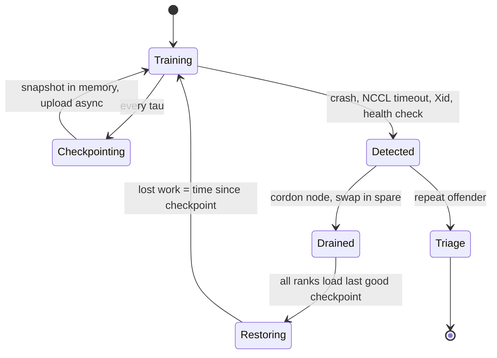

+++
title = 'Checkpoints and failures'
description = 'At thousands of GPUs a synchronous job is interrupted every few hours. Failure rates from production runs, the Young/Daly checkpoint interval, asynchronous and in-memory checkpointing, and detecting the failures that do not crash.'
question = 'How often will a large training job fail, and how often should it checkpoint to lose the least work?'
weight = 6
difficulty = 4
prerequisites = ['/notes/machine-learning-systems/training-at-scale/05-tensor-and-pipeline-parallelism', '/notes/systems-design/ai-infrastructure/01-a-training-cluster']
date = 2026-10-30T05:30:00Z
lastmod = 2026-10-30T05:30:00Z
verified = 2026-10-30
+++

## The idea in one minute

A synchronous training job stops when any one of its components fails. If
each GPU (with its share of host, NIC, and cables) fails independently with
mean time between failures *M*g, a job on *N* GPUs fails every *M*g/*N* on
average. Meta reported 419 unexpected interruptions in 54 days of Llama 3
405B pretraining on 16,384 H100s: about one every three hours.

Every failure costs the **restart time** plus the work since the last
checkpoint. Checkpointing more often loses less work per failure but stalls
training more often. The **Young/Daly** interval balances the two:
τ ≈ √(2δ*M*), where δ is the time to write a checkpoint and *M* the job's
MTBF. With a one-minute save and a three-hour MTBF, the optimum is about 19
minutes and roughly 85 percent of wall-clock time does useful work.

Two levers move that number more than tuning the interval: make δ small with
**asynchronous** or in-memory checkpoints, and make restarts fast with hot
spares and automated detection. Silent failures, where a GPU produces wrong
numbers or hangs without crashing, need separate detection.

## A picture



## How it really works

### Failure rates from real runs

The Llama 3 paper (section 3.3.4) gives the clearest public breakdown: 466
job interruptions in a 54-day snapshot, 47 planned and 419 unexpected.
About 78 percent of unexpected ones were confirmed or suspected hardware
issues: faulty GPUs 30.1 percent, GPU HBM3 memory 17.2 percent, then
software bugs, network switches and cables, and host maintenance. Despite
that, the team reported more than 90 percent effective training time,
helped by automation that resolved most failures without manual
intervention.

Other reports agree on order of magnitude: OPT-175B's logbook records dozens
of restarts over two months on 992 A100s, and failure rates of large GPU
fleets scale with GPU count as expected for independent failures. The
lesson for design: assume an interruption every few hours at 10,000+ GPUs and
treat restarts as routine.

### The Young/Daly interval

Let τ be the compute time between checkpoints, δ the save stall, *R* the
restart time, and *M* the job MTBF. Over one interval the expected overhead is
δ for the save plus, with probability about (τ+δ)/*M*, a failure that loses on
average half the interval plus *R*. Minimizing overhead per unit work gives
Young's (1974) first-order result:

τ\* = √(2δ*M*)

Daly (2006) gives a higher-order version that matters when δ is not small
relative to *M*. The intuition: overhead is δ/τ + τ/(2*M*), and the optimum
sets the two equal. Halving δ shortens the optimal interval by √2 and cuts
overhead by √2.

### Make the save cheap

A 405B-parameter model with mixed-precision Adam has about 16 × 405e9 = 6.5 TB
of state. Writing that synchronously to a parallel file system at 1 TB/s
aggregate takes 6.5 seconds; at 100 GB/s it is over a minute. Techniques:

- **Sharded saves**: each rank writes only its shard in parallel (PyTorch
  Distributed Checkpoint), so bandwidth scales with ranks.
- **Asynchronous checkpointing**: copy state to pinned host memory (a stall
  of seconds), then upload in the background while training continues.
  PyTorch DCP `async_save` does this.
- **In-memory or peer checkpoints**: keep the latest snapshot in host RAM
  of the node and a peer, so most restarts read from memory, with periodic
  durable copies (Gemini, Wang et al., 2023).
- **Skip redundant data**: under data parallelism every replica holds the
  same state; only one copy needs saving.

Checkpoint storage is also an attack surface: weights are the most valuable
artifact the run produces. See
[Storage and checkpoints](/notes/infrastructure-security/securing-gpu-clusters/03-storage-and-checkpoints/).

### Make restarts fast

Restart time *R* includes detecting the failure, replacing the node,
rescheduling all ranks, loading the checkpoint, and warming up (NCCL init,
compilation, data loader). At large scale *R* is often minutes to tens of
minutes. Reducing it:

- **Fast detection.** NCCL watchdog timeouts default to minutes; tighter
  timeouts and heartbeat monitors catch hangs sooner. GPU Xid errors and
  DCGM health checks flag hardware.
- **Hot spares.** Keep healthy nodes reserved so the scheduler does not wait
  for repair. Gang scheduling is covered in
  [GPU scheduling](/notes/systems-design/ai-infrastructure/04-gpu-scheduling/).
- **Elastic restart.** Restart with the same world size from a spare, rather
  than resharding to a new size.

### Failures that do not crash

**Silent data corruption**: a defective GPU returns wrong results without an
error. At scale this shows up as loss spikes or NaN on one rank. Detection
uses periodic known-answer tests, comparing gradient norms across
data-parallel replicas (they should match after all-reduce), and checksumming
parameters. **Stragglers**: a thermally throttled GPU or a degraded link slows
every step without failing; per-rank step-time telemetry finds them. The
fleet-level schedulers and fabrics that contain these failures are covered in
[Schedulers and fabrics](/notes/infrastructure-security/securing-gpu-clusters/02-schedulers-and-fabrics/).

## Code

The program sets a per-GPU MTBF so a 16,384-GPU job has a three-hour MTBF,
in line with the Llama 3 report, then simulates 500 hours of work with
exponential failures at several checkpoint intervals (20 runs each). It
assumes independent failures and constant save and restart times.

```python {title="ckpt.py"}
"""Checkpoint interval: Young/Daly optimum vs simulated goodput."""
import math
import random


def young(delta: float, mtbf: float) -> float:
    return math.sqrt(2 * delta * mtbf)


def simulate(interval: float, delta: float, restart: float, mtbf: float,
             work: float, rng: random.Random) -> float:
    """Return wall-clock hours to finish `work` hours of compute."""
    done = 0.0
    clock = 0.0
    next_fail = rng.expovariate(1 / mtbf)
    while done < work:
        seg = min(interval, work - done)
        need = seg + delta
        if clock + need <= next_fail:
            clock += need
            done += seg
        else:
            clock = next_fail + restart
            next_fail = clock + rng.expovariate(1 / mtbf)
    return clock


if __name__ == "__main__":
    gpus, gpu_mtbf_h = 16_384, 16_384 * 3.0   # job MTBF ~3 h, as in Llama 3 reports
    mtbf = gpu_mtbf_h / gpus
    delta, restart, work = 1 / 60, 10 / 60, 500.0  # 1 min save, 10 min restart
    opt = young(delta, mtbf)
    print(f"job MTBF {mtbf:.2f} h, save {delta*60:.0f} min, restart {restart*60:.0f} min")
    print(f"Young optimum interval {opt*60:.1f} min")
    print("interval  goodput")
    for minutes in (2, 5, opt * 60, 30, 60, 180):
        rng = random.Random(42)
        runs = [work / simulate(minutes / 60, delta, restart, mtbf, work, rng) for _ in range(20)]
        print(f"{minutes:6.1f}m  {sum(runs)/len(runs):6.1%}")
    print("\nasync save (stall 5 s) shifts the optimum:")
    d2 = 5 / 3600
    print(f"  Young interval {young(d2, mtbf)*60:.1f} min")
```

Run it with `python3 ckpt.py`:

```text
job MTBF 3.00 h, save 1 min, restart 10 min
Young optimum interval 19.0 min
interval  goodput
   2.0m   62.6%
   5.0m   77.7%
  19.0m   85.3%
  30.0m   84.2%
  60.0m   78.8%
 180.0m   54.6%

async save (stall 5 s) shifts the optimum:
  Young interval 5.5 min
```

Goodput peaks near the Young interval at 85 percent and is flat around it:
30 minutes loses one point. Too frequent (2 minutes) wastes a third of the
time saving; too rare (3 hours) loses nearly half to rework. Reducing the
stall to five seconds moves the optimum to about 5.5 minutes, and the
overhead falls with it. Restart time stays the largest fixed cost: with
*M* = 3 hours, a 10-minute restart costs about 5.5 percent by itself.

## Where it breaks

- **Correlated failures** (a switch, a power domain, a bad software rollout)
  break the independent-failure assumption and arrive in bursts.
- **A corrupt checkpoint** is worse than none: verify checkpoints after
  writing and keep several generations.
- **Silent corruption** may be checkpointed before it is detected; keep older
  checkpoints to rewind past it.
- **The simulation** uses constant δ and *R*; real save time varies with
  storage contention when thousands of ranks write at once.

## Remember this

- Job MTBF is component MTBF divided by component count: hours at 10,000+ GPUs.
- Young/Daly: checkpoint every √(2δ*M*); goodput is flat near the optimum.
- Cut δ with sharded, asynchronous, in-memory checkpoints.
- Cut restart time with fast detection and hot spares; it is a fixed tax per failure.
- Detect silent corruption and stragglers explicitly; they do not crash.

## Try it

1. Double the GPU count to 32,768 and recompute the optimum and goodput.
2. Set restart to 2 minutes and compare goodput at the optimum.
3. Add correlated failures: with probability 0.1, a second failure follows within 10 minutes.

## Check yourself

1. Why does a job on 16,000 GPUs fail every few hours when each GPU lasts years?

   
   Any single component failure stops a synchronous job, so failure rates
   add: job MTBF is roughly per-GPU MTBF divided by the number of GPUs
   (including their share of hosts, NICs, and cables).
   

2. Why does halving save time not halve checkpoint overhead?

   
   At the optimum, overhead is about √(2δ/*M*), so halving δ reduces it by
   √2. The optimal interval also shortens, so saves happen more often.
   

3. Name two ways to detect silent data corruption during training.

   
   Compare gradient norms or parameter checksums across data-parallel
   replicas, which should be identical; and run periodic known-answer
   compute tests on each GPU. Loss spikes on one rank are another signal.
   

## Sources

- Llama Team, Meta. "The Llama 3 Herd of Models." arXiv:2407.21783, July 2024 (section 3.3.4, reliability). https://arxiv.org/abs/2407.21783
- Young, J. W. "A first order approximation to the optimum checkpoint interval." Communications of the ACM 17(9), 1974. https://doi.org/10.1145/361147.361115
- Daly, J. T. "A higher order estimate of the optimum checkpoint interval for restart dumps." Future Generation Computer Systems 22(3), 2006. https://doi.org/10.1016/j.future.2004.11.016
- Zhang et al. "OPT: Open Pre-trained Transformer Language Models." arXiv:2205.01068, 2022 (training logbook). https://arxiv.org/abs/2205.01068
- Wang et al. "GEMINI: Fast Failure Recovery in Distributed Training with In-Memory Checkpoints." SOSP 2023. https://doi.org/10.1145/3600006.3613145
- PyTorch documentation, "Distributed Checkpoint - torch.distributed.checkpoint" (async_save). https://pytorch.org/docs/stable/distributed.checkpoint.html
- Dixit et al. "Silent Data Corruptions at Scale." arXiv:2102.11245, 2021. https://arxiv.org/abs/2102.11245
