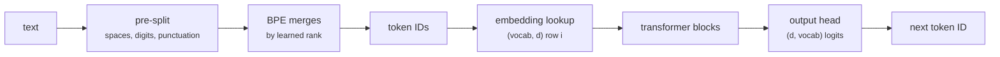
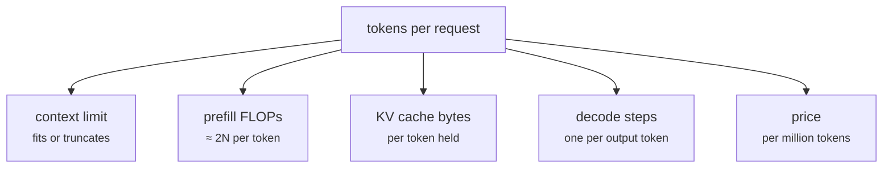

+++
title = 'Embeddings and tokenization'
description = 'A tokenizer turns text into integer IDs, and an embedding table turns IDs into vectors. Byte-pair encoding decides how many tokens a text costs, which sets context use, latency, and price, and it is uneven across languages and digits.'
question = 'How does text become vectors, and why does the tokenizer change cost and behavior?'
weight = 1
difficulty = 2
prerequisites = ['/notes/machine-learning-systems/foundations/01-tensors-and-shapes']
date = 2026-10-30T02:05:00Z
lastmod = 2026-10-30T02:05:00Z
verified = 2026-10-30
+++

## The idea in one minute

A model cannot read characters. A **tokenizer** splits text into pieces from a
fixed **vocabulary** and maps each to an integer ID. The model's first layer,
the **embedding table**, is a matrix of shape `(vocab, d_model)`; token ID `i`
selects row `i`. The last layer projects back to `vocab` scores to predict the
next token.

Most current models use **byte-pair encoding** (BPE), adapted to subwords by
Sennrich et al. (2016): start from bytes, and repeatedly merge the most
frequent adjacent pair into a new token. Frequent words become one token, rare
words become several, and any byte string can still be encoded, so nothing is
ever "unknown".

Why systems engineers care: **every cost is per token**. Context limits,
KV-cache memory, prefill time, decode steps, and API price all count tokens,
not characters. And the same text costs very different token counts depending
on how well the tokenizer's training data matched it. English prose runs
around four bytes per token in common tokenizers; other scripts, code, and
digit strings often get far fewer, so they cost more and fit less context.

## A picture



## How it really works

### Training BPE

1. Pre-split the corpus into chunks (GPT-2 uses a regex that keeps a leading
   space with each word and separates punctuation and digits), so merges never
   cross chunk boundaries.
2. Represent each chunk as a sequence of bytes. The base vocabulary is the 256
   byte values.
3. Count every adjacent pair across the corpus, weighted by chunk frequency.
4. Merge the most frequent pair everywhere into one new token, record the
   merge, and repeat until the vocabulary reaches its target size.

Encoding new text replays the learned merges in the order they were learned
(lowest rank first). Decoding concatenates the bytes. The program implements
both and checks that every encode-decode round trip is lossless.

Byte-level BPE (Radford et al., 2019, for GPT-2) is the variant that starts
from bytes rather than Unicode characters, guaranteeing coverage. The cost is
visible in the output below: `è` is two UTF-8 bytes, and a tokenizer that never
learned to merge them spends two tokens on one character. Other algorithms
exist: **WordPiece** (BERT) and the **unigram language model** (Kudo, 2018),
often trained with the SentencePiece library, which treats the input as raw
text including spaces.

### Vocabulary size is a trade

| | larger vocabulary | smaller vocabulary |
| --- | --- | --- |
| tokens per text | fewer | more |
| embedding and output head | `vocab × d` each, larger | smaller |
| output softmax per token | more FLOPs | fewer |
| rare-token training signal | thinner | denser |

GPT-2 used 50,257 tokens; Llama 3 moved to 128,256 and reports better
compression than Llama 2's 32,000 (Grattafiori et al., 2024). At `d = 4096`,
the embedding table alone is `128,256 × 4,096 = 525M` parameters, and Llama 3
8B has a separate output head of the same size, so about 13% of its 8B
parameters are vocabulary. The output head also costs `2 × vocab × d` FLOPs on
every token, about 1 GFLOP for Llama 3 8B.

### Embeddings

The embedding table is learned like any other weight. Its backward pass
touches only the rows of tokens that appeared in the batch. Some models
**tie** the embedding and output head (GPT-2, many small models) to save
parameters; larger models usually do not. Position is added separately:
learned position embeddings (GPT-2) or, in most current models, **rotary
position embeddings** (RoPE, Su et al., 2021), which rotate query and key
vectors by a position-dependent angle inside attention.



### Tokenization as a source of bugs

- **Fertility varies by language.** Petrov et al. (2023) measured tokenized
  length of the same content across languages and found differences of more
  than an order of magnitude for some language pairs in some tokenizers. Users
  of those languages pay more and get less context.
- **Digits.** Tokenizers that merge arbitrary digit runs give numbers
  inconsistent segmentations, which hurts arithmetic; Llama splits numbers into
  single digits, and others cap runs at three digits.
- **Leading spaces and boundaries.** `" token"` and `"token"` are different
  tokens. Prompts that end with a trailing space, or that split a word across a
  template boundary, can push the model into rare token sequences.
- **Special tokens.** Chat templates use control tokens such as end-of-turn
  markers. If user text that looks like a control token is encoded as the real
  token, the user can forge turn boundaries; tokenizer libraries have options
  to disable special-token parsing on untrusted input.
- **Glitch tokens.** Tokens that appeared in tokenizer training data but
  almost never in model training data have nearly untrained embeddings and can
  produce erratic output.

## Code

The program trains 60 BPE merges on a small repeated corpus, encodes four
test strings, checks lossless round trips, and shows how the corpus shrinks as
merges are added.

```python {title="bpe.py"}
"""bpe.py: train byte-level BPE merges on a small corpus, then encode and count tokens.

Follows Sennrich et al. (2016): start from bytes, repeatedly merge the most
frequent adjacent pair. Pre-splits on spaces (keeping the space with the
following word, as GPT-2 does) so merges never cross word boundaries.
Standard library only.
"""

from __future__ import annotations

import re
from collections import Counter

CORPUS = (
    "the model reads the tokens and the tokens become vectors. "
    "the server streams tokens to the user while the model generates new tokens. "
    "a tokenizer splits text into tokens; a detokenizer joins tokens into text. "
) * 20


def pretokenize(text: str) -> list[bytes]:
    return [w.encode() for w in re.findall(r" ?[^ ]+| +", text)]


def train(text: str, merges: int) -> list[tuple[bytes, bytes]]:
    words = Counter(tuple(bytes([b]) for b in w) for w in pretokenize(text))
    rules = []
    for _ in range(merges):
        pairs = Counter()
        for w, n in words.items():
            for a, b in zip(w, w[1:]):
                pairs[a, b] += n
        if not pairs:
            break
        (a, b), _ = pairs.most_common(1)[0]
        rules.append((a, b))
        new = Counter()
        for w, n in words.items():
            out, i = [], 0
            while i < len(w):
                if i + 1 < len(w) and w[i] == a and w[i + 1] == b:
                    out.append(a + b); i += 2
                else:
                    out.append(w[i]); i += 1
            new[tuple(out)] += n
        words = new
    return rules


def encode(text: str, rules: list[tuple[bytes, bytes]]) -> list[bytes]:
    rank = {r: i for i, r in enumerate(rules)}
    out = []
    for w in pretokenize(text):
        parts = [bytes([b]) for b in w]
        while len(parts) > 1:
            best = min(range(len(parts) - 1), key=lambda i: rank.get((parts[i], parts[i + 1]), 1 << 30))
            if (parts[best], parts[best + 1]) not in rank:
                break
            parts[best:best + 2] = [parts[best] + parts[best + 1]]
        out.extend(parts)
    return out


def main() -> None:
    rules = train(CORPUS, 60)
    print("first 10 merges:", [(a + b).decode() for a, b in rules[:10]])
    tests = {
        "in-domain": "the server streams tokens to the user.",
        "new words": "tokenization detokenizes streaming servers.",
        "non-English": "le modèle lit les jetons.",
        "digits": "order 1234567 costs 89.50",
    }
    for label, s in tests.items():
        toks = encode(s, rules)
        assert b"".join(toks).decode() == s  # lossless round trip
        print(f"{label:<12} {len(s.encode()):>3} bytes -> {len(toks):>3} tokens "
              f"({len(s.encode()) / len(toks):.2f} B/tok)  {[t.decode(errors='replace') for t in toks][:8]}")
    for n in (0, 20, 60, 120):
        r = train(CORPUS, n)
        t = encode(CORPUS, r)
        print(f"vocab 256+{n:<4} corpus {len(CORPUS)} bytes -> {len(t)} tokens")


if __name__ == "__main__":
    main()
```

Run it with `python3 bpe.py`:

```text
first 10 merges: [' t', 'en', ' to', 'ken', ' token', 'he', ' tokens', 'er', ' the', 'to']
in-domain     38 bytes ->   9 tokens (4.22 B/tok)  ['t', 'he', ' server', ' streams', ' tokens', ' to', ' the', ' user']
new words     43 bytes ->  21 tokens (2.05 B/tok)  ['to', 'ken', 'iz', 'a', 't', 'i', 'o', 'n']
non-English   26 bytes ->  23 tokens (1.13 B/tok)  ['l', 'e', ' mo', 'd', '�', '�', 'l', 'e']
digits        25 bytes ->  24 tokens (1.04 B/tok)  ['o', 'r', 'd', 'er', ' ', '1', '2', '3']
vocab 256+0    corpus 4180 bytes -> 4180 tokens
vocab 256+20   corpus 4180 bytes -> 2182 tokens
vocab 256+60   corpus 4180 bytes -> 1222 tokens
vocab 256+120  corpus 4180 bytes -> 701 tokens
```

In-domain text compresses to 4.2 bytes per token. New words built from known
pieces get partial merges. French text and digits fall back to nearly one token
per byte, and `è` becomes two byte tokens that print as replacement characters
on their own. Every added merge reduces the corpus token count, with
diminishing returns.

## Where it breaks

- **The corpus is tiny and repetitive**, so the merges overfit it. Real
  tokenizers train on a broad multilingual sample with tens of thousands of
  merges.
- **The pre-split regex** is simplified; GPT-2's and Llama 3's regexes also
  separate contractions, punctuation, and digit groups.
- **Encoding speed** here is quadratic per word. Production tokenizers (for
  example tiktoken and Hugging Face tokenizers) use efficient merge
  structures, and tokenization can still show up in serving latency for long
  prompts.
- **Token counts are tokenizer-specific.** A token budget or price from one
  model family does not transfer to another.

## Remember this

- A tokenizer maps text to IDs; the embedding table maps IDs to vectors.
- BPE merges the most frequent adjacent pair until the vocabulary is full; byte-level BPE never fails to encode.
- Every serving cost is per token, so tokenizer efficiency is a cost factor.
- Vocabulary size trades sequence length against embedding and output-head size.
- Non-English text, code, and digits often cost several times more tokens per byte.

## Try it

1. Add a French paragraph to the training corpus and rerun. How do the French
   bytes per token change?
2. Add a rule that splits digit runs into groups of three and compare token
   counts for long numbers.
3. Encode the same 1,000-word document with two real tokenizers you have
   access to and compute the cost difference at a fixed price per token.

## Check yourself

1. Why can byte-level BPE encode any string?

   
   Its base vocabulary contains all 256 byte values, so any input can fall back
   to single-byte tokens when no merge applies.
   

2. Llama 3 8B has vocabulary 128,256 and width 4,096 with untied embeddings.
   How many parameters do the embedding and output head hold?

   
   2 × 128,256 × 4,096 ≈ 1.05 billion.
   

3. A product serves a language where the tokenizer averages 1.2 bytes per
   token instead of 4. What changes for those users?

   
   The same text uses about 3.3 times as many tokens: higher price, longer
   prefill, more KV memory, and a context window that holds a third as much
   content.
   

## Sources

- R. Sennrich, B. Haddow, A. Birch, [Neural Machine Translation of Rare Words with Subword Units](https://arxiv.org/abs/1508.07909), ACL 2016.
- A. Radford, J. Wu, R. Child, D. Luan, D. Amodei, I. Sutskever, [Language Models are Unsupervised Multitask Learners](https://cdn.openai.com/better-language-models/language_models_are_unsupervised_multitask_learners.pdf), OpenAI, February 2019 (byte-level BPE).
- T. Kudo, J. Richardson, [SentencePiece: A simple and language independent subword tokenizer and detokenizer](https://arxiv.org/abs/1808.06226), EMNLP 2018.
- T. Kudo, [Subword Regularization: Improving Neural Network Translation Models with Multiple Subword Candidates](https://arxiv.org/abs/1804.10959), ACL 2018 (unigram model).
- A. Petrov, E. La Malfa, P. Torr, A. Bibi, [Language Model Tokenizers Introduce Unfairness Between Languages](https://arxiv.org/abs/2305.15425), NeurIPS 2023.
- J. Su et al., [RoFormer: Enhanced Transformer with Rotary Position Embedding](https://arxiv.org/abs/2104.09864), April 2021.
- A. Grattafiori et al., [The Llama 3 Herd of Models](https://arxiv.org/abs/2407.21783), Meta, July 2024.
