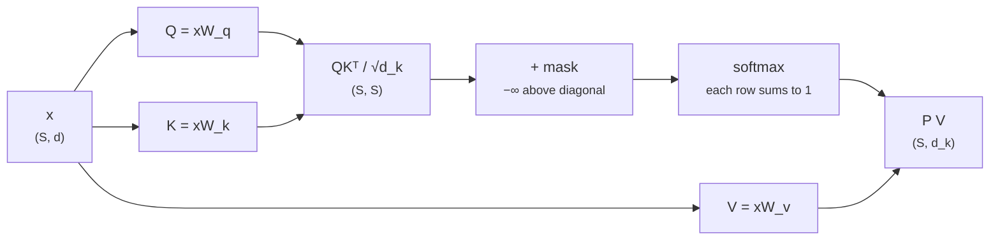
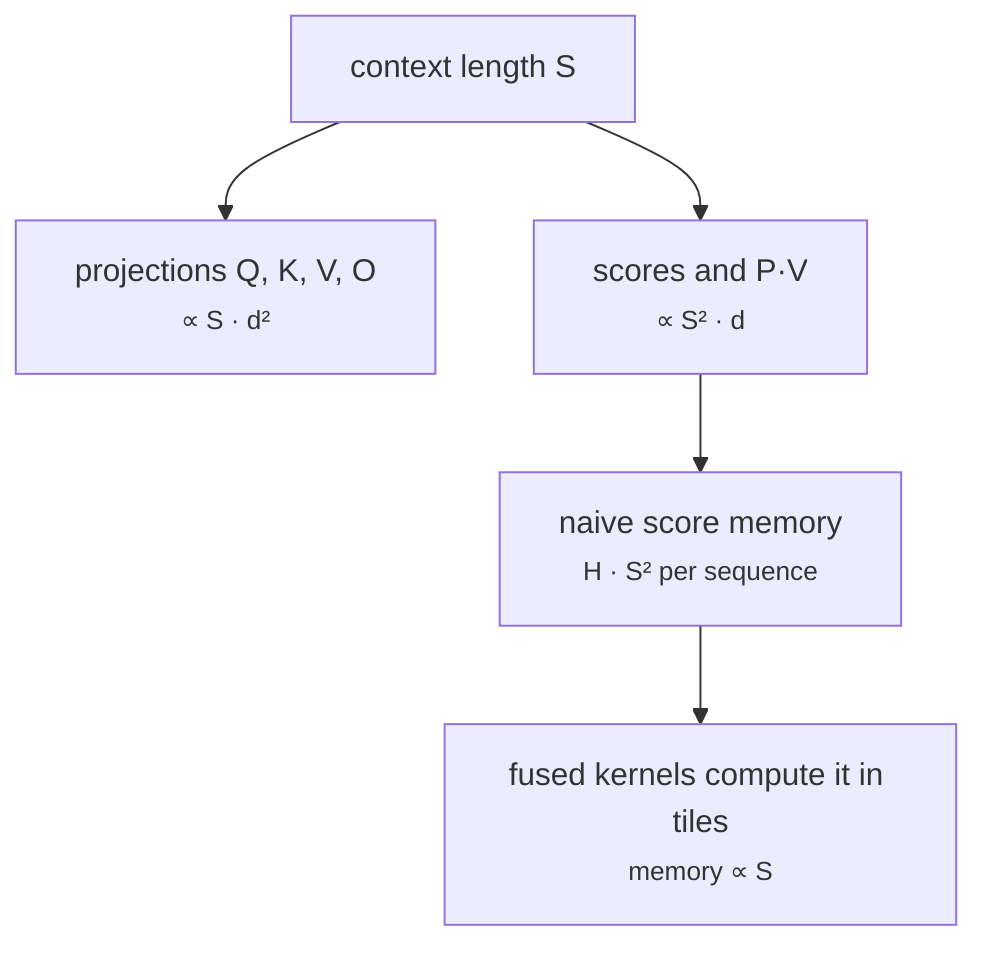

+++
title = 'Attention from scratch'
description = 'Scaled dot-product attention lets each position take a weighted average of every other position, with weights from query-key similarity. Masks enforce causality and ignore padding, the square-root scaling keeps softmax trainable, and the score matrix is why attention cost grows with the square of context.'
question = 'What does attention compute, why are masks and scaling needed, and what does it cost?'
weight = 2
difficulty = 3
prerequisites = ['/notes/machine-learning-systems/transformers/01-embeddings-and-tokenization']
date = 2026-10-30T02:10:00Z
lastmod = 2026-10-30T02:10:00Z
verified = 2026-10-30
+++

## The idea in one minute

Each position in a sequence produces three vectors from its embedding: a
**query** (what am I looking for), a **key** (what do I contain), and a
**value** (what I pass on). Attention scores every query against every key
with a dot product, turns each query's scores into weights with a softmax, and
returns the weighted sum of values (Vaswani et al., 2017):

```text
Attention(Q, K, V) = softmax(Q Kᵀ / √d_k + mask) V
```

Three details make it work in practice:

- **Causal mask.** A language model predicting token `t` must not see tokens
  after `t`. Setting those scores to −∞ before the softmax gives them weight
  exactly 0.
- **Scaling by √d_k.** Dot products of random `d_k`-dimensional vectors have
  standard deviation about `√d_k`. Without the division, softmax saturates and
  its gradients vanish.
- **Stable softmax.** Subtract the row maximum before `exp`, or large scores
  overflow.

The cost: the score matrix is `S × S` per head. Compute and naive memory grow
**quadratically with context**, while everything else in the model grows
linearly.

## A picture



## How it really works

### A soft lookup

Think of a dictionary lookup where the query matches every key partially. The
softmax converts similarities into a probability distribution over positions,
and the output is the expected value under it. Because every operation is
differentiable, the model learns `W_q`, `W_k`, and `W_v` so that useful
positions score high: a verb's query matching its subject's key, a closing
bracket matching its opening one.

### Multi-head attention

One head produces one weighting per position. **Multi-head attention** splits
`d_model` into `H` heads of width `d_k = d_model / H`, runs attention in each
independently, concatenates the outputs, and multiplies by an output
projection `W_o`. Different heads learn different relations at the same cost
as one wide head. Grouped-query attention shares each key and value head
across several query heads to shrink the KV cache; see
[KV cache math](/notes/inference-engineering/inference-mechanics/02-kv-cache-math/).

### Masks

| mask | what it hides | used for |
| --- | --- | --- |
| causal | positions `j > i` | decoder-only language models |
| padding | positions past each sequence's real length | batching sequences of different lengths |
| document / block | positions in other packed documents | packing several documents into one training sequence |
| none | nothing | encoders (BERT), cross-attention |

Masks are added as −∞ (or the dtype's most negative value) before the softmax.
A row in which every position is masked, such as a padding query, has no valid
maximum; implementations must define its output (zeros here) instead of
producing NaN from `0/0`.

Causality also enables two efficiencies. In training, one forward pass
predicts every position of a sequence at once, because the mask stops each
position seeing its answer. In inference, earlier positions' keys and values
never change when new tokens arrive, which is what makes the KV cache valid.

### Why √d_k

If `q` and `k` have independent components with mean 0 and variance 1, then
`q · k` is a sum of `d_k` products each with variance 1, so its variance is
`d_k`. The program measures standard deviations of 4.1, 11.5, and 31.8 at
`d_k` = 16, 128, and 1024, matching `√d_k`. Softmax of scores with standard
deviation 30 puts almost all weight on one position, and the gradient through
it is nearly zero. Dividing by `√d_k` restores unit variance.

### Cost and memory



Per layer, `QKᵀ` and `PV` each cost `2 · S² · d_model` FLOPs for a full
non-causal sequence (half that with a causal mask, if the kernel skips masked
blocks). The projections cost `8 · S · d_model²` with multi-head attention.
Attention scores dominate once `S` is comparable to `d_model`: at
`d_model = 4096`, from a few thousand tokens upward.

Memory is the sharper problem. Materializing `H × S × S` scores at 32 heads
and 32k tokens in BF16 is 64 GiB per sequence per layer. **FlashAttention**
(Dao et al., 2022) never stores the full matrix: it processes keys and values
in tiles, keeping a running maximum and running sum for the softmax (the
"online softmax" of Milakov and Gimelshein, 2018), so memory is linear in `S`
and the result is exact. The GPU performance module builds that kernel.

At inference, decode computes one query row against the cached keys, so
attention per token is linear in context, but it must read the whole KV cache
each step; see
[Why decode is memory-bound](/notes/inference-engineering/inference-mechanics/03-why-decode-is-memory-bound/).

## Code

Attention over five positions with random weights, written with lists. The
program prints causal weights, proves that editing the last token changes no
earlier output, applies a padding mask, shows naive softmax overflowing, and
measures the dot-product spread that motivates √d_k.

```python {title="attention.py"}
"""attention.py: scaled dot-product attention from scratch, with causal and padding masks.

softmax(Q K^T / sqrt(d) + mask) V, written with lists. Checks three properties:
rows sum to 1, a causal mask makes outputs independent of future tokens, and
the max-subtraction trick keeps softmax finite. Standard library only.
"""

from __future__ import annotations

import math
import random

NEG_INF = float("-inf")


def softmax(row: list[float]) -> list[float]:
    m = max(row)
    if m == NEG_INF:  # fully masked row (e.g. a padding query): return zeros, not NaN
        return [0.0] * len(row)
    e = [math.exp(x - m) for x in row]
    s = sum(e)
    return [x / s for x in e]


def attention(Q, K, V, causal: bool, valid: int | None = None):
    d = len(Q[0])
    n = len(K)
    valid = n if valid is None else valid
    out, weights = [], []
    for i, q in enumerate(Q):
        row = []
        for j, k in enumerate(K):
            if (causal and j > i) or j >= valid:
                row.append(NEG_INF)
            else:
                row.append(sum(a * b for a, b in zip(q, k)) / math.sqrt(d))
        w = softmax(row)
        weights.append(w)
        out.append([sum(w[j] * V[j][c] for j in range(n)) for c in range(len(V[0]))])
    return out, weights


def rand(rows: int, cols: int, rng: random.Random) -> list[list[float]]:
    return [[rng.gauss(0, 1) for _ in range(cols)] for _ in range(rows)]


def main() -> None:
    rng = random.Random(3)
    n, d = 5, 8
    X = rand(n, d, rng)
    Wq, Wk, Wv = (rand(d, d, rng) for _ in range(3))
    proj = lambda X, W: [[sum(x[k] * W[k][c] for k in range(d)) / math.sqrt(d) for c in range(d)] for x in X]
    Q, K, V = proj(X, Wq), proj(X, Wk), proj(X, Wv)

    out, w = attention(Q, K, V, causal=True)
    print("causal attention weights (row = query position)")
    for row in w:
        print("  " + " ".join(f"{x:5.2f}" for x in row) + f"   sum={sum(row):.3f}")

    X2 = [r[:] for r in X]
    X2[4] = [x + 5.0 for x in X2[4]]  # change only the last token
    out2, _ = attention(proj(X2, Wq), proj(X2, Wk), proj(X2, Wv), causal=True)
    diff = [max(abs(a - b) for a, b in zip(r1, r2)) for r1, r2 in zip(out, out2)]
    print("max change per position after editing token 4:", " ".join(f"{x:.3f}" for x in diff))

    _, wp = attention(Q, K, V, causal=False, valid=3)
    print("padding mask, 3 real tokens of 5, query 0:", " ".join(f"{x:.2f}" for x in wp[0]))

    big = [1000.0, 999.0, 0.0]
    try:
        naive = [math.exp(x) / sum(math.exp(y) for y in big) for x in big]
    except OverflowError as e:
        naive = f"OverflowError: {e}"
    print("naive softmax of [1000, 999, 0]:", naive)
    print("stable softmax:                 ", [round(x, 4) for x in softmax(big)])

    for dk in (16, 128, 1024):
        r = random.Random(dk)
        dots = [sum(r.gauss(0, 1) * r.gauss(0, 1) for _ in range(dk)) for _ in range(2000)]
        sd = math.sqrt(sum(x * x for x in dots) / len(dots))
        print(f"d_k={dk:<5} sd of q.k = {sd:6.2f}  (sqrt(d_k) = {math.sqrt(dk):5.2f}); after scaling = {sd / math.sqrt(dk):.2f}")


if __name__ == "__main__":
    main()
```

Run it with `python3 attention.py`:

```text
causal attention weights (row = query position)
   1.00  0.00  0.00  0.00  0.00   sum=1.000
   0.40  0.60  0.00  0.00  0.00   sum=1.000
   0.21  0.07  0.72  0.00  0.00   sum=1.000
   0.11  0.10  0.67  0.11  0.00   sum=1.000
   0.19  0.14  0.25  0.22  0.19   sum=1.000
max change per position after editing token 4: 0.000 0.000 0.000 0.000 5.277
padding mask, 3 real tokens of 5, query 0: 0.40 0.13 0.47 0.00 0.00
naive softmax of [1000, 999, 0]: OverflowError: math range error
stable softmax:                  [0.7311, 0.2689, 0.0]
d_k=16    sd of q.k =   4.10  (sqrt(d_k) =  4.00); after scaling = 1.03
d_k=128   sd of q.k =  11.47  (sqrt(d_k) = 11.31); after scaling = 1.01
d_k=1024  sd of q.k =  31.77  (sqrt(d_k) = 32.00); after scaling = 0.99
```

The causal weights are lower-triangular and every row sums to 1. Changing
token 4 changes only position 4's output: positions 0 to 3 are bit-for-bit
unchanged, which is the property that lets a server cache them. With padding,
positions 3 and 4 receive zero weight. The naive softmax raises
`OverflowError` on a score of 1000; the stable one returns the right answer.

## Where it breaks

- **Masking bugs are silent.** An off-by-one causal mask lets each position
  see its own target during training; training loss looks excellent and the
  model is useless at generation. Test that outputs at position `i` do not
  depend on inputs after `i`, as the program does.
- **Padding side matters.** Left-padded and right-padded batches need
  different position IDs and masks; mixing conventions between training and
  serving shifts positions.
- **Low precision.** Scores in FP16 can overflow before the max subtraction,
  and fully masked rows produce NaN if not handled. Kernels accumulate the
  softmax in FP32.
- **Quadratic cost is real at long context.** Sliding windows, sparse
  patterns, and linear-attention or state-space layers trade some quality for
  sub-quadratic cost.

## Remember this

- Attention is a softmax-weighted average of values, weighted by query-key similarity.
- Causal masks set future scores to −∞; a test that later inputs do not change earlier outputs catches mask bugs.
- Dividing by √d_k keeps scores at unit variance so softmax stays trainable.
- Subtract the row max before `exp`; define the output of fully masked rows.
- Scores are `S × S` per head: compute grows quadratically, and fused kernels keep memory linear.

## Try it

1. Remove the √d_k scaling and print the attention weights at `d = 512`. How
   peaked are they?
2. Introduce an off-by-one in the causal mask (`j > i + 1`) and rerun the
   independence check.
3. Implement online softmax: process keys in blocks of 2, keep a running max
   and sum, and check the result equals the full softmax.

## Check yourself

1. Why does a causal model's output at position 3 not change when token 4 changes?

   
   The causal mask gives position 3 zero weight on every later position, so
   token 4's key and value never enter position 3's weighted sum. Without that
   property, the KV cache would be invalid.
   

2. How much memory do naive attention scores take for 32 heads at 8,192 tokens in BF16, for one sequence and one layer?

   
   32 × 8,192 × 8,192 × 2 bytes = 4 GiB.
   

3. What goes wrong without the √d_k divisor at large head width?

   
   Scores have standard deviation about √d_k, so softmax becomes nearly
   one-hot, and its gradient with respect to the scores becomes nearly zero,
   stalling learning.
   

## Sources

- A. Vaswani et al., [Attention Is All You Need](https://arxiv.org/abs/1706.03762), NeurIPS 2017.
- D. Bahdanau, K. Cho, Y. Bengio, [Neural Machine Translation by Jointly Learning to Align and Translate](https://arxiv.org/abs/1409.0473), ICLR 2015.
- M. Milakov, N. Gimelshein, [Online normalizer calculation for softmax](https://arxiv.org/abs/1805.02867), May 2018.
- T. Dao, D. Y. Fu, S. Ermon, A. Rudra, C. Ré, [FlashAttention: Fast and Memory-Efficient Exact Attention with IO-Awareness](https://arxiv.org/abs/2205.14135), NeurIPS 2022.
- J. Ainslie et al., [GQA: Training Generalized Multi-Query Transformer Models from Multi-Head Checkpoints](https://arxiv.org/abs/2305.13245), EMNLP 2023.
