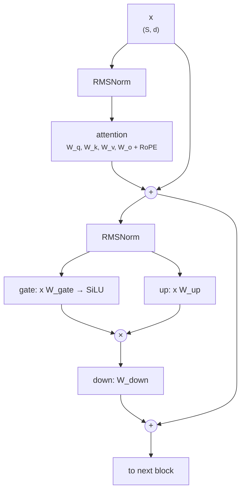
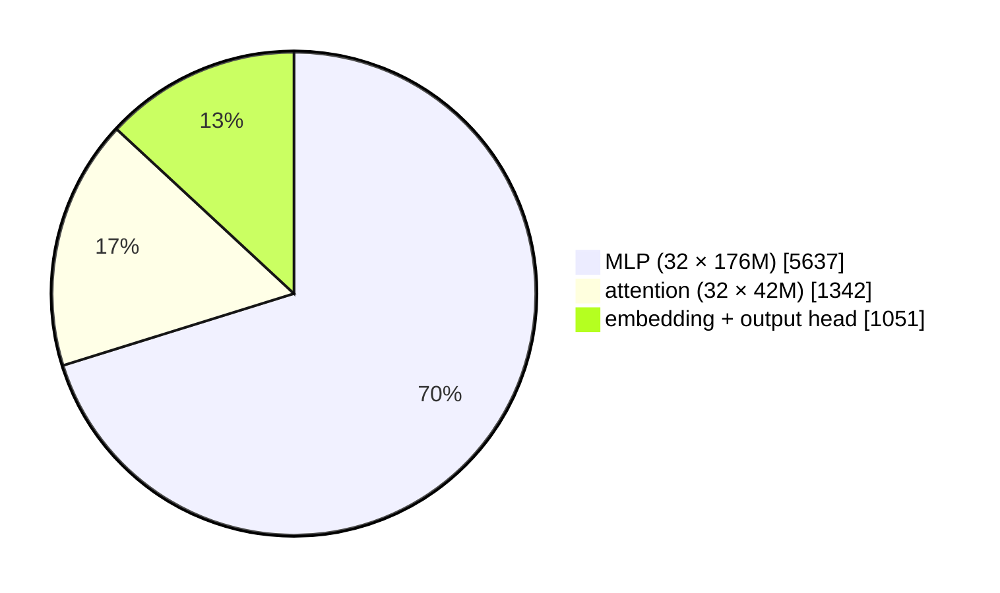

+++
title = 'The transformer block'
description = 'A decoder-only transformer is one block repeated: attention and an MLP, each wrapped in a normalization and a residual connection. Its parameters and per-token FLOPs follow from six config values, and the MLP, not attention, holds most of both at ordinary context lengths.'
question = 'What is inside a transformer block, and how do you count its parameters and FLOPs from a config?'
weight = 3
difficulty = 3
prerequisites = ['/notes/machine-learning-systems/transformers/02-attention-from-scratch']
date = 2026-10-30T02:15:00Z
lastmod = 2026-10-30T02:15:00Z
verified = 2026-10-30
+++

## The idea in one minute

A decoder-only model is an embedding lookup, `L` identical **blocks**, a final
norm, and an output head. Each block in current models (Llama, Qwen, Mistral)
is:

```text
h = x + Attention(RMSNorm(x))
y = h + MLP(RMSNorm(h))
```

The **residual** additions give gradients a direct path through all `L`
blocks. **Pre-normalization** (norm before each sublayer, not after) keeps
deep stacks stable. The **MLP** expands each position to a wider hidden size
and back; with SwiGLU it has three weight matrices.

Count the weights and you can price the model:

- **Parameters** per block ≈ attention projections + MLP matrices. For the
  original architecture that is `12 d²`; for Llama 3 8B it is 218M, of which
  the MLP holds 81%.
- **Forward FLOPs per token** ≈ `2 × parameters` for the weight matmuls, plus
  `4 × L × context × d` for attention scores and value sums.

At 2k context, attention scores are 7% of Llama 3 8B's forward FLOPs. At 128k
they are over 80%. Below a few thousand tokens, **model size sets the cost;
beyond that, context does**.

## A picture



## How it really works

### The pieces

- **Attention** with `H` query heads and `H_kv` key/value heads of width
  `d_h = d/H`. Parameters: `W_q` and `W_o` are `d × d`; `W_k` and `W_v` are
  `d × (H_kv · d_h)`. With grouped-query attention (`H_kv < H`) the K and V
  projections shrink.
- **MLP.** The original transformer uses two matrices, `d → 4d → d`, with a
  ReLU or GELU between: `8 d²` parameters. **SwiGLU** (Shazeer, 2020) uses
  three, `SiLU(x W_gate) ⊙ (x W_up)` then `W_down`, with the hidden width
  reduced to keep parameters comparable (Llama 3 8B: `d_ff = 14,336 = 3.5 d`,
  giving `3 × 4096 × 14336 = 176M`).
- **Normalization.** LayerNorm (Ba et al., 2016) subtracts the mean and
  divides by the standard deviation per position, then scales; **RMSNorm**
  (Zhang and Sennrich, 2019) skips the mean and is slightly cheaper. Each has
  `d` gain parameters, negligible in count but memory-bound to compute.
- **Position.** RoPE rotates queries and keys inside attention and has no
  parameters.

### Counting parameters

For GPT-3 175B (`d = 12288`, 96 layers, MHA, `d_ff = 4d`, tied embeddings):

```text
attention   4 d²  = 604M per layer
MLP         8 d²  = 1,208M per layer
96 layers × 12 d² = 173.95B, plus 0.62B embedding → 174.6B
```

That matches the published 175B. For Llama 3 8B, GQA cuts attention to 42M
per layer, the MLP is 176M, and untied embedding plus head add 1.05B: 8.03B in
total, matching the release.

### Counting FLOPs

Every weight does one multiply-add per token, so the weight matmuls cost `2N`
FLOPs per token minus the embedding lookup (which is a gather, not a matmul)
plus the output head (which is a matmul). Attention adds, per layer and per
token attending to `c` earlier positions, `2 · c · d` for `QKᵀ` and `2 · c · d`
for `PV`. Kaplan et al. (2020) write the forward cost as `2N + 2 L n_ctx d`
because in causal training the average query sees about half the window.

| Llama 3 8B, per token | 2k context | 8k | 128k |
| --- | --- | --- | --- |
| forward GFLOP | 16.1 | 19.3 | 83.7 |
| as a multiple of N | 2.00 | 2.40 | 10.4 |
| attention-score share | 6.7% | 22% | 82% |

The 128k column is a token at the end of a 128k context. For training,
multiply the forward cost by 3 (lesson on
[gradients and backpropagation](/notes/machine-learning-systems/foundations/02-gradients-and-backpropagation/)).

### Memory per block, briefly

Weights in BF16 are `2N` bytes. At inference each block also holds its KV
cache, `2 · H_kv · d_h` values per token; at training it holds saved
activations, roughly `S · d` values for each of a dozen or more intermediate
tensors per block (Korthikanti et al., 2022, give a detailed count). The
counter below covers parameters and FLOPs only.



### Mixture of experts, in one paragraph

A **mixture-of-experts** block replaces the single MLP with `E` expert MLPs
and a router that sends each token to the top `k`. Parameters grow by about
`E×` in the MLP, but FLOPs per token grow only by `k×`. Parameter count then
stops predicting compute: DeepSeek-V3 has 671B parameters and activates 37B
per token (DeepSeek-AI, 2024). Serving consequences are in
[Serving mixture of experts](/notes/inference-engineering/distributed-inference/03-serving-mixture-of-experts/).

## Code

The counter takes a config, returns parameters per component and forward
FLOPs per token at several context lengths, and estimates training compute for
Llama 3 8B on 15T tokens.

```python {title="block_count.py"}
"""block_count.py: parameters and forward FLOPs of a decoder-only transformer, from its config.

Counts every matmul (2 FLOPs per multiply-add). Ignores norms, softmax, RoPE
and activations in the FLOP count; they are a few percent of the matmuls.
Standard library only.
"""

from __future__ import annotations

from dataclasses import dataclass


@dataclass(frozen=True)
class Config:
    name: str
    d: int          # hidden size
    layers: int
    heads: int
    kv_heads: int
    ff: int         # MLP inner width
    vocab: int
    gated: bool     # SwiGLU (3 matrices) vs GELU MLP (2)
    tied: bool      # input embedding shared with output head

    def layer_params(self) -> dict[str, int]:
        hd = self.d // self.heads
        attn = self.d * self.d * 2 + 2 * self.d * self.kv_heads * hd  # Wq, Wo, Wk, Wv
        mlp = (3 if self.gated else 2) * self.d * self.ff
        return {"attention": attn, "mlp": mlp, "norms": 2 * self.d}

    def params(self) -> tuple[int, int]:
        per = sum(self.layer_params().values())
        emb = self.vocab * self.d * (1 if self.tied else 2)
        return self.layers * per + emb + self.d, emb

    def forward_flops_per_token(self, context: int) -> dict[str, float]:
        lp = self.layer_params()
        hd = self.d // self.heads
        return {
            "weight matmuls": 2 * self.layers * (lp["attention"] + lp["mlp"]),
            "attention QK^T and AV": 2 * 2 * self.layers * context * self.heads * hd,
            "output head": 2 * self.vocab * self.d,
        }


CONFIGS = [
    Config("GPT-3 175B", 12288, 96, 96, 96, 4 * 12288, 50257, False, True),
    Config("Llama-3-8B", 4096, 32, 32, 8, 14336, 128256, True, False),
    Config("Llama-3-70B", 8192, 80, 64, 8, 28672, 128256, True, False),
]


def main() -> None:
    for c in CONFIGS:
        total, emb = c.params()
        lp = c.layer_params()
        print(f"{c.name}: {total / 1e9:.2f}B params ({emb / 1e9:.2f}B embedding/head), "
              f"per layer {sum(lp.values()) / 1e6:.0f}M = attn {lp['attention'] / 1e6:.0f}M + mlp {lp['mlp'] / 1e6:.0f}M")
        if not c.gated:
            print(f"  12 * layers * d^2 = {12 * c.layers * c.d ** 2 / 1e9:.2f}B")
        for ctx in (2048, 8192, 131072):
            f = c.forward_flops_per_token(ctx)
            tot = sum(f.values())
            print(f"  context {ctx:>6}: {tot / 1e9:7.1f} GFLOP/token forward = {tot / total:5.2f} x N;"
                  f" attention-score share {100 * f['attention QK^T and AV'] / tot:4.1f}%")
    c = CONFIGS[1]
    total, _ = c.params()
    tokens = 15e12
    print(f"\ntraining {c.name} on {tokens / 1e12:.0f}T tokens at 8k context:")
    # causal training: the average query attends to half of the 8k window
    f = sum(c.forward_flops_per_token(4096).values())
    print(f"  6ND = {6 * total * tokens:.2e} FLOP; counted 3 x forward = {3 * f * tokens:.2e} FLOP")
    for mfu in (0.35, 0.5):
        gpu_days = 3 * f * tokens / (989e12 * mfu) / 86400
        print(f"  H100 dense BF16 989 TFLOP/s at {mfu:.0%} MFU: {gpu_days:,.0f} GPU-days")


if __name__ == "__main__":
    main()
```

Run it with `python3 block_count.py`:

```text
GPT-3 175B: 174.57B params (0.62B embedding/head), per layer 1812M = attn 604M + mlp 1208M
  12 * layers * d^2 = 173.95B
  context   2048:   358.8 GFLOP/token forward =  2.06 x N; attention-score share  2.7%
  context   8192:   387.8 GFLOP/token forward =  2.22 x N; attention-score share 10.0%
  context 131072:   967.6 GFLOP/token forward =  5.54 x N; attention-score share 63.9%
Llama-3-8B: 8.03B params (1.05B embedding/head), per layer 218M = attn 42M + mlp 176M
  context   2048:    16.1 GFLOP/token forward =  2.00 x N; attention-score share  6.7%
  context   8192:    19.3 GFLOP/token forward =  2.40 x N; attention-score share 22.2%
  context 131072:    83.7 GFLOP/token forward = 10.43 x N; attention-score share 82.1%
Llama-3-70B: 70.55B params (2.10B embedding/head), per layer 856M = attn 151M + mlp 705M
  context   2048:   144.4 GFLOP/token forward =  2.05 x N; attention-score share  3.7%
  context   8192:   160.5 GFLOP/token forward =  2.27 x N; attention-score share 13.4%
  context 131072:   482.6 GFLOP/token forward =  6.84 x N; attention-score share 71.2%

training Llama-3-8B on 15T tokens at 8k context:
  6ND = 7.23e+23 FLOP; counted 3 x forward = 7.72e+23 FLOP
  H100 dense BF16 989 TFLOP/s at 35% MFU: 25,815 GPU-days
  H100 dense BF16 989 TFLOP/s at 50% MFU: 18,070 GPU-days
```

The `12 L d²` approximation is within 0.4% of the full count for GPT-3. The
explicit 3× forward count lands within 7% of `6ND`; the difference is attention
at 8k context. The GPU-day figures assume a sustained fraction of H100 peak
dense BF16 throughput (989 TFLOP/s from NVIDIA's datasheet) and no restarts or
lost work; real runs report more.

## Where it breaks

- **FLOPs ignore memory-bound work.** Norms, activations, RoPE, and softmax
  are a few percent of FLOPs but can be a much larger share of time if they
  are not fused into neighboring kernels.
- **Configs vary.** Some models set `head_dim` explicitly, tie embeddings,
  add biases, use sliding-window layers, or mix attention types per layer.
  Read the actual config rather than assuming Llama's layout.
- **Causal skipping depends on the kernel.** The 3× rule and "half the
  context" assume masked blocks are skipped; a kernel that computes and then
  masks does twice the attention work.
- **MFU is an assumption.** Model FLOPs utilization for large runs is commonly
  quoted in the 35–50% range (the PaLM paper reports 46%); it falls with
  communication overhead and failures.

## Remember this

- Block = pre-norm attention + pre-norm MLP, each with a residual.
- Classic transformer: `12 d²` parameters per layer, two thirds in the MLP.
- Forward FLOPs per token ≈ `2N` plus `4 L c d` for attention over `c` positions.
- At short context, model size sets cost; at long context, attention does.
- MoE separates total parameters from per-token compute.

## Try it

1. Add Qwen2.5-7B (`d = 3584`, 28 layers, 28 heads, 4 KV heads,
   `d_ff = 18944`, vocab 152,064, untied) and check against its published
   7.6B.
2. Add an MoE MLP with `E` experts and top-`k` routing; print total and active
   parameters for `E = 64, k = 8`.
3. Change the training estimate to count attention without causal skipping.
   How much does compute rise at 8k context?

## Check yourself

1. Why does `12 d²` per layer approximate a classic transformer?

   
   Attention has four `d × d` projections (`4 d²`) and the MLP has two
   matrices of `d × 4d` (`8 d²`). Norms and biases are negligible.
   

2. At what context does attention-score compute equal the weight matmuls for Llama 3 8B?

   
   Block weights are 32 × 218M ≈ 6.98B and the output head 0.53B, so weight
   matmuls cost about 2 × 7.5e9 = 15 GFLOP per token. Setting
   `4 L c d = 15e9` gives `c ≈ 15e9 / (4 × 32 × 4096) ≈ 29,000` tokens.
   

3. An MoE model has 400B parameters and activates 20B per token. What sets its forward FLOPs and what sets its memory?

   
   FLOPs follow the 20B active parameters (about 40 GFLOP per token). Memory
   must hold all 400B, because any token may route to any expert.
   

## Sources

- A. Vaswani et al., [Attention Is All You Need](https://arxiv.org/abs/1706.03762), NeurIPS 2017.
- T. Brown et al., [Language Models are Few-Shot Learners](https://arxiv.org/abs/2005.14165), NeurIPS 2020 (GPT-3 configurations).
- N. Shazeer, [GLU Variants Improve Transformer](https://arxiv.org/abs/2002.05202), February 2020.
- B. Zhang, R. Sennrich, [Root Mean Square Layer Normalization](https://arxiv.org/abs/1910.07467), NeurIPS 2019.
- J. Kaplan et al., [Scaling Laws for Neural Language Models](https://arxiv.org/abs/2001.08361), January 2020 (FLOP accounting).
- V. Korthikanti et al., [Reducing Activation Recomputation in Large Transformer Models](https://arxiv.org/abs/2205.05198), May 2022.
- A. Chowdhery et al., [PaLM: Scaling Language Modeling with Pathways](https://arxiv.org/abs/2204.02311), April 2022 (model FLOPs utilization).
- A. Grattafiori et al., [The Llama 3 Herd of Models](https://arxiv.org/abs/2407.21783), Meta, July 2024.
- DeepSeek-AI, [DeepSeek-V3 Technical Report](https://arxiv.org/abs/2412.19437), December 2024.
- NVIDIA, [H100 Tensor Core GPU](https://www.nvidia.com/en-us/data-center/h100/), product page, accessed October 2026.
