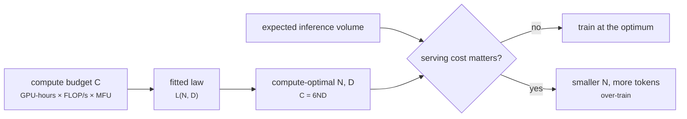
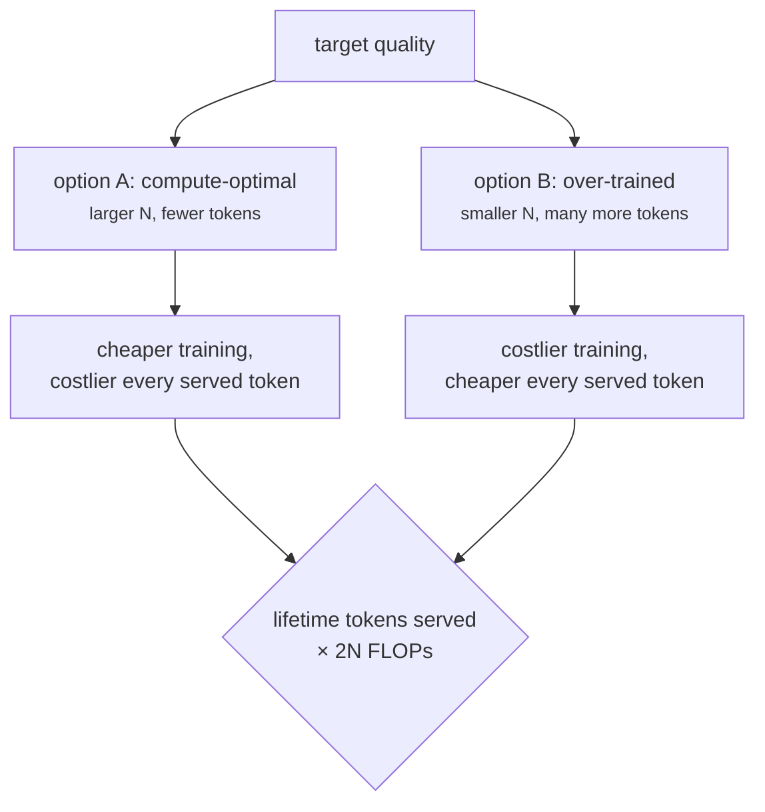

+++
title = 'Scaling laws and compute'
description = 'Loss falls as a power law in parameters and training tokens. Given a compute budget C ≈ 6ND, a fitted law picks the compute-optimal split, about 20 tokens per parameter by the Chinchilla analysis. Production models train far past that point because inference cost depends on parameters, not training tokens.'
question = 'Given a compute budget, how large should the model be and how many tokens should it see?'
weight = 4
difficulty = 3
prerequisites = ['/notes/machine-learning-systems/transformers/03-the-transformer-block']
date = 2026-10-30T02:20:00Z
lastmod = 2026-10-30T02:20:00Z
verified = 2026-10-30
+++

## The idea in one minute

Kaplan et al. (2020) found that language-model loss falls as a smooth **power
law** in parameters `N`, data `D`, and compute `C`, over many orders of
magnitude. That makes model sizing a forecasting problem: fit the law on small
runs, extrapolate, and spend the large budget once.

Training compute is `C ≈ 6ND` (6 FLOPs per parameter per token). For a fixed
`C`, a bigger model sees fewer tokens. Hoffmann et al. (2022), the
**Chinchilla** paper, fit

```text
L(N, D) = E + A / N^α + B / D^β
```

and concluded that `N` and `D` should grow in equal proportion with compute,
at about **20 tokens per parameter**. Their 70B Chinchilla, trained on 1.4T
tokens, beat the 280B Gopher trained with the same compute. Kaplan's earlier
fits had favored much larger models on fewer tokens.

The production twist: compute-optimal means optimal **for training**. Serving
cost per token is about `2N` FLOPs and `2N` bytes of weights, regardless of how
long the model was trained. So models meant to serve heavy traffic are
**over-trained**: Llama 3 8B saw about 15T tokens, nearly 1,900 per parameter,
buying a smaller model for each unit of quality at the price of extra
training compute.

## A picture



## How it really works

### Power laws

Kaplan et al. fit `L(N) ∝ N^−0.076` with data unlimited and
`L(D) ∝ D^−0.095` with model size unlimited, for non-embedding parameters.
Small exponents mean slow but predictable gains: halving loss's reducible part
takes enormous multiples of scale. The Chinchilla form adds an irreducible
term `E`, the entropy of text that no model removes, and makes the two
limitations additive.

Minimizing `L` subject to `6ND = C` gives

```text
N_opt ∝ C^(β/(α+β)),   D_opt ∝ C^(α/(α+β))
```

so the split depends on the ratio of the exponents. Hoffmann et al. reached
`N_opt ∝ C^0.5` by three methods; Kaplan et al. had `N_opt ∝ C^0.73`. Hoffmann
et al. attribute much of the difference to Kaplan's fixed learning-rate
schedule, which penalized the longer runs that small models need.

### A correction to the published fit

The fitted constants in Chinchilla's third method (`E = 1.69`, `A = 406.4`,
`B = 410.7`, `α = 0.34`, `β = 0.28`) are often quoted, but they do not
reproduce the paper's own conclusion. Plugging them in, as the program does,
puts the optimum for Chinchilla's budget at 32B parameters and 92 tokens per
parameter, not 70B and 20. Besiroglu et al. (2024) reconstructed the data from
the paper's figure, refit the model, and got constants (`E = 1.82`,
`A = 482.0`, `B = 2085.4`, `α = 0.348`, `β = 0.366`) that are consistent with
the paper's other two methods and with about 20 tokens per parameter. Use the
refit, or better, fit your own.

### Converting budgets

A training budget usually starts as hardware and time:

```text
C = GPUs × peak FLOP/s × MFU × seconds
```

10,000 H100s at 989 TFLOP/s dense BF16 and 40% MFU for 30 days give
`1e4 × 989e12 × 0.4 × 2.59e6 ≈ 1.0e25` FLOP. By the refit, the
compute-optimal model for that budget is about 310B parameters on 5.3T tokens.
The constraint that binds may be data rather than compute: high-quality
unique tokens are finite, and repeating data has diminishing returns beyond a
few epochs (Muennighoff et al., 2023).

### Why train past the optimum



At Llama 3 8B's training compute (`6 × 8e9 × 15e12 = 7.2e23` FLOP), the refit
optimum is an 81B model on 1.5T tokens, with loss 1.968. The 8B model on 15T
reaches 2.022: slightly worse, at one tenth the per-token inference cost.
Sardana et al. (2024) formalize this, adding inference demand to the
objective; with enough expected traffic the optimum moves to much smaller,
longer-trained models. Grattafiori et al. (2024) report that Llama 3's
models kept improving well beyond the compute-optimal token count.

### What scaling laws do and do not predict

They predict **pretraining loss** on the training distribution. Downstream
abilities track loss on average but individual benchmarks can move abruptly
or plateau, and post-training changes behavior a lot. Laws are also specific
to the data mix, tokenizer, and architecture they were fit on; a new mix needs
new fits. Practitioners fit them on a ladder of small runs (say 10 sizes from
1e18 to 1e21 FLOP) before committing a large budget.

## Code

The program finds the compute-optimal `N` and `D` for four budgets under both
fits, sweeps model sizes at Chinchilla's budget, and evaluates the
over-training trade for an 8B model on 15T tokens.

```python {title="chinchilla.py"}
"""chinchilla.py: compute-optimal model size and token count from a fitted scaling law.

L(N, D) = E + A / N^alpha + B / D^beta, with training compute C = 6 N D.
For each budget C, scan N on a log grid and keep the N that minimizes L.
Two published fits: Hoffmann et al. (2022, approach 3) and the Besiroglu et
al. (2024) refit of the same data. Standard library only.
"""

from __future__ import annotations

import math

FITS = {
    "Hoffmann 2022": (1.69, 406.4, 410.7, 0.34, 0.28),
    "Besiroglu 2024": (1.8172, 482.01, 2085.43, 0.3478, 0.3658),
}


def loss(fit, n: float, d: float) -> float:
    e, a, b, al, be = fit
    return e + a / n ** al + b / d ** be


def optimum(fit, c: float) -> tuple[float, float, float]:
    best = None
    for i in range(4000):
        n = 10 ** (6 + i * 7 / 4000)  # 1e6 .. 1e13 parameters
        d = c / (6 * n)
        l = loss(fit, n, d)
        if best is None or l < best[2]:
            best = (n, d, l)
    return best


def main() -> None:
    for name, fit in FITS.items():
        print(name)
        print(f"  {'C (FLOP)':>9}{'N opt':>10}{'D opt':>10}{'D/N':>7}{'loss':>8}")
        for c in (1e21, 5.76e23, 1e25, 1e26):
            n, d, l = optimum(fit, c)
            print(f"  {c:>9.2e}{n / 1e9:>9.1f}B{d / 1e12:>8.2f}T{d / n:>7.1f}{l:>8.3f}")
    fit = FITS["Besiroglu 2024"]
    print("\nfixed budget 5.76e23 FLOP (Chinchilla's), Besiroglu fit")
    for n in (8e9, 30e9, 70e9, 175e9, 280e9):
        d = 5.76e23 / (6 * n)
        print(f"  N={n / 1e9:>4.0f}B  D={d / 1e12:5.2f}T  D/N={d / n:6.0f}  loss={loss(fit, n, d):.3f}")
    print("\nover-training for inference: 8B params on 15T tokens")
    c = 6 * 8e9 * 15e12
    n, d, l = optimum(fit, c)
    print(f"  C={c:.2e}; optimum {n / 1e9:.0f}B on {d / 1e12:.1f}T, loss {l:.3f}; "
          f"8B on 15T loss {loss(fit, 8e9, 15e12):.3f}")
    print(f"  inference FLOP/token: 2N = {2 * 8e9:.1e} vs {2 * n:.1e} ({n / 8e9:.1f}x)")


if __name__ == "__main__":
    main()
```

Run it with `python3 chinchilla.py`:

```text
Hoffmann 2022
   C (FLOP)     N opt     D opt    D/N    loss
   1.00e+21      1.8B    0.09T   50.3   2.329
   5.76e+23     32.2B    2.98T   92.5   1.931
   1.00e+25    116.9B   14.25T  121.9   1.845
   1.00e+26    330.8B   50.39T  152.4   1.799
Besiroglu 2024
   C (FLOP)     N opt     D opt    D/N    loss
   1.00e+21      2.8B    0.06T   21.6   2.306
   5.76e+23     72.1B    1.33T   18.5   1.974
   1.00e+25    312.6B    5.33T   17.1   1.912
   1.00e+26   1013.9B   16.44T   16.2   1.880

fixed budget 5.76e23 FLOP (Chinchilla's), Besiroglu fit
  N=   8B  D=12.00T  D/N=  1500  loss=2.025
  N=  30B  D= 3.20T  D/N=   107  loss=1.982
  N=  70B  D= 1.37T  D/N=    20  loss=1.974
  N= 175B  D= 0.55T  D/N=     3  loss=1.982
  N= 280B  D= 0.34T  D/N=     1  loss=1.993

over-training for inference: 8B params on 15T tokens
  C=7.20e+23; optimum 81B on 1.5T, loss 1.968; 8B on 15T loss 2.022
  inference FLOP/token: 2N = 1.6e+10 vs 1.6e+11 (10.1x)
```

Under the refit, tokens per parameter stay near 20 (21.6 down to 16.2) across
five orders of magnitude, and Chinchilla's own budget lands on 72B parameters
and 1.33T tokens, close to the 70B on 1.4T actually trained. The originally
published constants give 32B and 92 tokens per parameter for the same budget.
The fixed-budget sweep shows a flat bottom: 30B to 175B all land within 0.01
of the optimum loss, which is why being somewhat off the optimum is cheap and
over-training a small model is an acceptable trade.

## Where it breaks

- **Extrapolation.** A power law fit over three orders of magnitude may bend
  outside them. Fits are only as good as the small runs and their learning-rate
  schedules.
- **Loss is not capability.** Equal loss does not guarantee equal benchmark
  results, and the gap between architectures (MoE, long-context variants) is
  not captured by a dense-model law.
- **`6ND` is approximate.** At long context attention adds compute (see the
  previous lesson), and recomputation and failures add wall-clock cost not in
  `C`.
- **Data is assumed unlimited and fixed-quality.** Filtering, deduplication,
  and synthetic data change the effective `D` and the constants.

## Remember this

- Loss falls as a power law in parameters and tokens; fit small, extrapolate, spend once.
- Training compute ≈ 6ND; for a fixed budget, model size and tokens trade off.
- Chinchilla: scale `N` and `D` together, about 20 tokens per parameter.
- The often-quoted Chinchilla constants contradict the paper's conclusion; the 2024 refit fixes them.
- Serving-heavy models are over-trained, because inference cost depends on `N`, not `D`.

## Try it

1. Compute your own budget from GPUs, days, and an assumed MFU, then find the
   compute-optimal split with the refit.
2. Add an inference term: lifetime served tokens × `2N`. At what served volume
   does the 8B model beat the 81B one on total FLOPs?
3. Constrain `D` to at most 4T unique tokens with up to 4 epochs and find the
   best `N` for `C = 1e25`.

## Check yourself

1. How many FLOPs does it take to train a 70B model on 1.4T tokens?

   
   6 × 70e9 × 1.4e12 ≈ 5.9e23 FLOP, Chinchilla's budget.
   

2. Why do serving-heavy models train on far more than 20 tokens per parameter?

   
   Inference cost per token is about 2N FLOPs and 2N bytes of BF16 weights regardless
   of training length. Spending more on training a smaller model reaches
   similar loss with cheaper serving, which dominates when traffic is large.
   

3. What changed between Kaplan's and Chinchilla's recommendations, and why?

   
   Kaplan found `N_opt ∝ C^0.73` (grow the model faster than data); Chinchilla
   found `N_opt ∝ C^0.5` (grow both equally). Chinchilla attributes the
   difference mainly to Kaplan's learning-rate schedule not being matched to
   each run's length.
   

## Sources

- J. Kaplan et al., [Scaling Laws for Neural Language Models](https://arxiv.org/abs/2001.08361), January 2020.
- J. Hoffmann et al., [Training Compute-Optimal Large Language Models](https://arxiv.org/abs/2203.15556), NeurIPS 2022.
- T. Besiroglu, E. Erdil, M. Barnett, J. You, [Chinchilla Scaling: A replication attempt](https://arxiv.org/abs/2404.10102), April 2024.
- N. Sardana, J. Portes, S. Doubov, J. Frankle, [Beyond Chinchilla-Optimal: Accounting for Inference in Language Model Scaling Laws](https://arxiv.org/abs/2401.00448), ICML 2024.
- N. Muennighoff et al., [Scaling Data-Constrained Language Models](https://arxiv.org/abs/2305.16264), NeurIPS 2023.
- A. Grattafiori et al., [The Llama 3 Herd of Models](https://arxiv.org/abs/2407.21783), Meta, July 2024.
