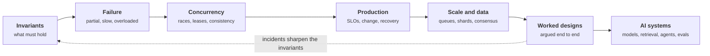

+++
title = 'Systems design'
description = 'Invariants, failure, concurrency, scale, and data, then the same discipline applied to systems built around models: interfaces, retrieval, agents, evaluation, and AI infrastructure.'
weight = 5
tone = 'ochre'
group = 'systems'
status = 'Course'
course = true
+++

A system is a set of promises: this balance never goes negative, this token is
used once, this request finishes or fails within two seconds. Design is the work
of choosing those promises and then keeping them **while requests overlap,
machines fail, and load exceeds the plan**. Security and reliability are the same
discipline seen from two sides: both ask what still holds when something goes
wrong.

The course starts from invariants and state machines, follows the ways systems
fail, works through concurrency, consistency, scale, distributed data, and
observability, and works four complete designs, each argued from its invariants
rather than from a diagram of boxes. The second half applies the same discipline
to systems built around a model, which is slow, expensive per call,
non-deterministic, and wrong some of the time: model interfaces, retrieval,
AI building blocks and infrastructure, agentic systems, evaluation in
production, and five more worked designs.
It assumes you can read Python and have built or operated a web service. It does
**not** assume a distributed-systems background.

## The path

## How each lesson works

1. **The idea in one minute.** The claim, before the detail.
2. **A picture** of the mechanism or the failure.
3. **How it really works**, with the numbers and the named techniques.
4. **Code**: a small Python simulation using only the standard library. Failures,
   clocks, and networks are simulated so every run is reproducible.
5. **Where it breaks.** The assumption that, once violated, defeats the design.
6. **Remember this**, **Try it**, and **Check yourself**.

## What you need

- Python 3.10 or newer and a terminal. Every program runs offline.
- A notebook for capacity math. Most designs fail on arithmetic before they fail
  on architecture.
