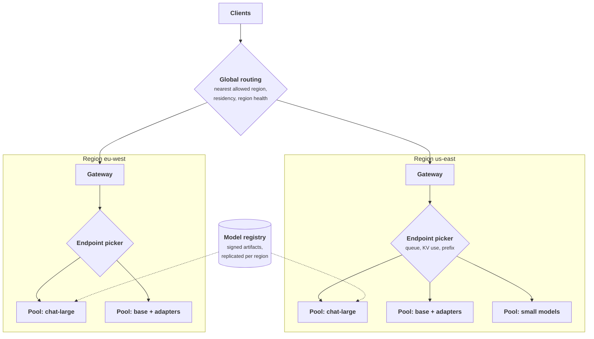

+++
title = 'An inference platform'
description = 'An inference platform serves a portfolio of models in several regions. Its capacity plan is set by KV-cache memory per replica, by how many adapters share a base model, and by the headroom needed to lose a region, which residency rules can nearly double.'
question = 'How do you serve many models in several regions so that losing a region, a replica, or a model version does not take the product down?'
weight = 3
difficulty = 4
prerequisites = ['/notes/systems-design/building-blocks/01-gateways-and-routers', '/notes/systems-design/failure-modes/05-blast-radius-and-cells']
date = 2026-10-30T13:15:00Z
lastmod = 2026-10-30T13:15:00Z
verified = 2026-10-30
+++

## The idea in one minute

A platform rarely serves one model. It serves a few large models with heavy
traffic, dozens of fine-tuned variants, a set of small models (embeddings,
rerankers, classifiers, guardrails), and a long tail used a few times an hour.
It serves them in several regions, for latency and for survival, under rules
about where each tenant's data may be processed.

Three numbers drive the plan. **KV-cache memory per replica** sets how many
sequences a replica can hold, and so its throughput at the latency target.
**Sharing** sets how many models fit on how many GPUs: adapters on a shared
base turn thirty deployments into one pool. **Failure headroom** sets how much
spare capacity each region holds so that the others can absorb a lost one, and
because regional peaks fall at different hours, that headroom is computed hour
by hour, not peak by peak. Residency rules remove failover options and cost the
most capacity of all. The consequence to act on: plan capacity per model tier
and per region against the loss of the largest unit, and price every residency
constraint in GPUs.

## A picture



Global routing chooses a region the tenant is allowed to use; the regional
gateway admits and routes by model; the endpoint picker chooses a replica by
live engine state.

## How it really works

### The model portfolio

| Tier | Examples | Serving pattern | Scaling |
| --- | --- | --- | --- |
| Large, high traffic | Main chat and coding models | Dedicated pools per region, sized individually | Warm spares; scale out fast, in slowly |
| Fine-tuned variants | Per-customer or per-task adapters | LoRA adapters multiplexed on a shared base model | Scale the base pool; load adapters on demand |
| Small models | Embeddings, rerankers, classifiers, guardrails | Packed several per GPU, or on GPU partitions | Autoscale on queue depth |
| Long tail | Rarely used or legacy models | Scale to zero; accept a cold start | Queue requests while loading |

The tier decides the cost of a model more than its size does. A model that
needs its own pool in every region costs at least two replicas per region for
availability, whatever its traffic.

### Replica capacity is KV memory

Take a 70B model with the shape of Llama 3 70B (80 layers, 8 KV heads, head
dimension 128), on one node of 8 × 80 GB GPUs with [tensor parallelism](/notes/inference-engineering/distributed-inference/01-tensor-pipeline-and-expert-parallelism/) across
the node, FP8 weights, and 16-bit KV cache:

```text
HBM                         8 x 80 GB                     = 640 GB
weights, FP8                70e9 x 1 byte                  =  70 GB
runtime overhead, ~10%                                     =  64 GB
KV budget                                                  ~ 506 GB
KV per token                2 x 80 x 8 x 128 x 2 bytes     = 327,680 bytes
tokens in memory            506e9 / 327,680                ~ 1.54 M tokens
at 8,000 tokens of context                                 ~ 190 concurrent sequences
at 32,000                                                  ~  48
```

Throughput at the latency target follows from concurrency and per-sequence
decode speed, which must be measured with your prompt and output lengths. The
point of the arithmetic is the sensitivity: doubling average context halves
concurrency, and a [quantized](/notes/inference-engineering/making-it-cheaper/01-quantization/) KV cache (FP8) doubles it. The [serving engine](/notes/inference-engineering/serving-systems/01-anatomy-of-a-serving-engine/)'s
paging ([PagedAttention](/notes/inference-engineering/batching-and-scheduling/02-paged-kv-memory/), Kwon et al., 2023) is what makes this budget usable
without fragmentation.

### Many models on few GPUs

**Adapters on a shared base.** A LoRA adapter (Hu et al., 2021) adds low-rank
matrices to some layers; at typical ranks it is a small fraction of the base
model's size. Systems such as S-LoRA (Sheng et al., 2024) and Punica (Chen et
al., 2024) batch requests for different adapters together on one base model
with custom kernels and page adapter weights in and out of GPU memory. Thirty
fine-tunes then cost one base pool plus adapter memory, instead of thirty pools.
The costs: some throughput overhead for heterogeneous batches, all variants
share the base model's version, and adapters are tenant data that must only be
loaded for their owner's requests.

**Packing small models.** An embedding model needs a fraction of a GPU. Run
several per GPU, or use hardware partitioning such as NVIDIA Multi-Instance GPU
([MIG](/notes/infrastructure-security/securing-gpu-clusters/01-multi-tenant-gpu-isolation/)), which splits supported GPUs into isolated instances with their own memory
and compute. Time-slicing without partitioning gives no memory isolation and no
latency guarantee.

### Regions: sizing for the loss of one

Multi-region serving buys latency, residency, and survival. Survival is the
expensive part: when a region is lost, its traffic moves to the others, which
must have the headroom ready, because GPU capacity cannot be bought on demand
during someone else's outage too.

Regional demand peaks at local business hours, so the peaks are spread across
the UTC day. The program below computes the headroom hour by hour: at each hour,
each surviving region must carry its own demand plus its share of the lost
region's demand at *that hour*. That is noticeably cheaper than assuming every
peak coincides, and much cheaper than giving each region its own full spare.

Three constraints change the answer:

- **Residency.** If EU tenants' data may only be processed in EU regions, EU
  traffic cannot fail over to the US. The EU needs a second EU region, each
  able to hold the EU peak.
- **Provider quotas.** Hosted routes have per-region quotas. A failover plan
  that moves traffic to a region whose quota cannot absorb it is not a plan.
- **Cold caches.** KV and prefix caches are local to replicas. After failover,
  every moved conversation's prefix is cold, so [prefill](/notes/inference-engineering/inference-mechanics/01-prefill-and-decode/) load and time to first
  token spike in the surviving regions for the first minutes. Size headroom for
  prefill, not only for decode.

### What else must be in every region

- **Weights pre-staged.** Pulling 70 to 140 GB of weights across regions
  during an incident takes minutes per node at realistic bandwidth (140 GB at
  1 GB/s is over two minutes before the engine starts loading). Replicate signed
  artifacts to each region's registry and to node-local storage ahead of time.
- **State.** Sessions, conversation history, and agent task checkpoints must be
  replicated across regions or rebuildable. A stateless serving layer is only
  useful if the state it needs is reachable.
- **Configuration.** Route tables, prompt versions, and quotas deployed to
  every region from one source.

### Rollouts and blast radius

A model, engine, or quantization change is rolled out like code: a signed
artifact from the registry, the evaluation gate, a canary in **one region**,
then region by region, with the previous version kept warm and rollback as a
routing change. Regions are cells in the sense of
[blast radius and cells](/notes/systems-design/failure-modes/05-blast-radius-and-cells/):
a bad version should be able to hurt one region's canary slice, never all
regions at once.

### Autoscaling signals

Scale model pools on queue depth or queue wait, KV-cache utilization, and time
to first token against target, not on GPU utilization, which reads high with
one sequence or with two hundred. Scale out quickly and in slowly, because the
cost of a wrong scale-in is a [cold start](/notes/inference-engineering/production-inference/03-autoscaling-and-model-loading/) measured in minutes.

## Code

The program plans one chat model in three regions with peaks at 18:00, 12:00,
and 07:00 UTC, with replicas of 4 GPUs running at most 70% full. It compares no
failover, failover sized as if peaks coincided, hour-by-hour failover
headroom, and an EU residency rule. Then it compares thirty low-volume
fine-tunes as dedicated deployments against adapters on one base pool.

```python {title="regions.py"}
"""regions.py: GPUs for a multi-region, multi-model inference platform.

Demand for one chat model in three regions follows the local day, so the
regional peaks fall at different UTC hours. Compare sizing policies that
must survive the loss of one whole region, with and without a residency
rule that keeps EU traffic in EU regions. Then compare serving 30 low-volume
fine-tunes as dedicated deployments versus adapters on a shared base.
Arithmetic over a 24-hour demand curve; standard library only.
"""

from __future__ import annotations

import math

GOODPUT = 2_500        # output tokens/s one replica sustains at the latency SLO (measured)
GPUS_PER_REPLICA = 4
OCCUPANCY = 0.7        # plan to run replicas at most this full


def demand(peak: float, peak_hour_utc: int, h: int) -> float:
    """A smooth daily curve: trough is 25% of peak, 12 hours from the peak."""
    x = math.cos(2 * math.pi * (h - peak_hour_utc) / 24)
    return peak * (0.25 + 0.75 * (1 + x) / 2)


REGIONS = {  # name: (peak output tokens/s, UTC hour of local peak)
    "us-east": (90_000, 18),
    "eu-west": (60_000, 12),
    "ap-south": (40_000, 7),
}


def replicas(tok_s: float) -> int:
    return math.ceil(tok_s / (GOODPUT * OCCUPANCY))


def main() -> None:
    curve = {r: [demand(p, ph, h) for h in range(24)] for r, (p, ph) in REGIONS.items()}
    total = [sum(curve[r][h] for r in REGIONS) for h in range(24)]
    sum_of_peaks = sum(max(c) for c in curve.values())
    peak_of_sum = max(total)
    print(f"sum of regional peaks {sum_of_peaks:,.0f} tok/s; peak of the global sum {peak_of_sum:,.0f} tok/s"
          f" (at {total.index(peak_of_sum):02d}:00 UTC)\n")

    rows = []
    # A: each region alone, N+1 replicas, no cross-region failover
    a = sum(replicas(max(c)) + 1 for c in curve.values())
    rows.append(("A  each region for its own peak, N+1, no failover", a, "region loss = outage there"))
    # B: global failover, each region must absorb its share of a lost region at that hour
    b_need = {r: 0.0 for r in REGIONS}
    for lost in REGIONS:
        for h in range(24):
            survivors = [r for r in REGIONS if r != lost]
            extra = curve[lost][h] / len(survivors)  # spread the lost region's traffic evenly
            for r in survivors:
                b_need[r] = max(b_need[r], curve[r][h] + extra)
    b = sum(replicas(v) for v in b_need.values())
    static = sum(replicas(max(curve[r]) + max(max(curve[o]) for o in REGIONS if o != r) / 2) for r in REGIONS)
    rows.append(("B0 global failover, peaks assumed simultaneous", static, "survives any one region"))
    rows.append(("B  global failover, hour-by-hour headroom", b, "survives any one region"))
    # C: EU traffic may only fail over to a second EU region; US and AP back each other up
    c_need = {r: max(curve[r]) for r in ("us-east", "ap-south")}
    for lost, other in (("us-east", "ap-south"), ("ap-south", "us-east")):
        for h in range(24):
            c_need[other] = max(c_need[other], curve[other][h] + curve[lost][h])
    eu_peak = max(curve["eu-west"])
    c = sum(replicas(v) for v in c_need.values()) + 2 * replicas(eu_peak)
    rows.append(("C  EU residency: two EU regions, each holds the EU peak", c, "4 regions; EU pays for its own spare"))
    for label, n, note in rows:
        print(f"{label:<58}{n:>4} replicas = {n*GPUS_PER_REPLICA:>4} GPUs  {note}")

    print("\n30 fine-tuned variants, each averaging 150 tok/s, peak 600 tok/s")
    dedicated = 30 * 2 * GPUS_PER_REPLICA  # 2 replicas each for availability
    pooled = replicas(30 * 150 * 1.8) + 1  # shared base; peaks do not coincide (1.8x mean, assumed)
    print(f"  dedicated deployments, 2 replicas each: {dedicated} GPUs")
    print(f"  adapters on one shared base pool:      {pooled * GPUS_PER_REPLICA} GPUs ({pooled} replicas)")


if __name__ == "__main__":
    main()
```

Run it with `python3 regions.py`:

```text
sum of regional peaks 190,000 tok/s; peak of the global sum 151,228 tok/s (at 14:00 UTC)

A  each region for its own peak, N+1, no failover          113 replicas =  452 GPUs  region loss = outage there
B0 global failover, peaks assumed simultaneous             178 replicas =  712 GPUs  survives any one region
B  global failover, hour-by-hour headroom                  155 replicas =  620 GPUs  survives any one region
C  EU residency: two EU regions, each holds the EU peak    186 replicas =  744 GPUs  4 regions; EU pays for its own spare

30 fine-tuned variants, each averaging 150 tok/s, peak 600 tok/s
  dedicated deployments, 2 replicas each: 240 GPUs
  adapters on one shared base pool:      24 GPUs (6 replicas)
```

The global peak is 151,228 tokens per second, 20% below the 190,000 sum of
regional peaks, because the peaks do not coincide. Surviving the loss of any
region costs 155 replicas against 113 for no failover: 37% more GPUs to turn a
regional outage from "down there" into "slower everywhere". Assuming
simultaneous peaks would buy 178. The **residency rule costs the most**: 186
replicas, because EU traffic can only fail over within the EU, so a second EU
region must hold the full EU peak while US and AP still back each other up.

The adapter comparison is the other large lever: 240 GPUs for thirty dedicated
two-replica deployments against 24 for one shared base pool. The program
assumes adapter batching costs no throughput, which real systems do not
achieve, and that the variants' peaks are 1.8 times their combined mean.

## Where it breaks

- **Demand curves are assumptions.** Launches, incidents, and other regions'
  outages produce demand the daily curve does not. Keep a burst margin on top
  of the failover headroom.
- **Failover is only as good as its last test.** Untested failover discovers
  missing weights, missing quotas, and cold caches during the incident. Shift
  a real fraction of traffic between regions on a schedule.
- **Adapters couple variants.** Upgrading the base model means retraining or
  re-validating every adapter on it, and one adapter's traffic spike slows the
  others on the shared pool.
- **Residency rules are legal, not technical.** Whether a failover to another
  jurisdiction is allowed, even briefly, is decided by contracts and law. The
  platform must enforce the rule, including during incidents.
- **The program is arithmetic.** It treats replicas as fungible units of
  tokens per second and ignores prefill load after failover, adapter overhead,
  and rollout capacity.

## Remember this

- Replica capacity is KV memory: 2 × layers × KV heads × head dimension × bytes per token decides concurrency.
- Tier the portfolio: dedicated pools, adapters on shared bases, packed small models, scale-to-zero long tail.
- Size failover headroom hour by hour against the loss of the largest region; peaks rarely coincide.
- Residency constraints remove failover paths and are the most expensive line in the plan.
- Pre-stage weights and replicate state in every region; expect cold caches after failover.

## Try it

1. In `regions.py`, move all three regional peaks to the same UTC hour. How
   much of the hour-by-hour saving remains?
2. Add a fourth region in South America, peaking at 16:00 UTC with 30,000
   tokens per second. Does it raise or lower the total failover headroom?
3. Redo the KV arithmetic for FP8 KV cache and 16,000-token contexts. How many
   concurrent sequences fit?
4. Write the failover runbook's first five steps for losing `eu-west` under the
   residency rule.

## Check yourself

1. Why does hour-by-hour headroom need fewer GPUs than sizing every region for
   its own peak plus a share of another's peak?

   
   Regional peaks happen at different UTC hours. When a region fails at its
   peak, the others are usually off-peak and have spare capacity. Sizing
   against the actual combined demand at each hour captures that; assuming
   coincident peaks does not.
   

2. Why does a residency rule increase GPU count so much?

   
   Traffic bound to a jurisdiction can only fail over to regions inside it. If
   there is one other region there, it must be able to hold the whole
   jurisdiction's peak by itself, so that jurisdiction pays for a full spare
   instead of sharing headroom with the rest of the world.
   

3. Why do time-to-first-token latencies spike in surviving regions after a
   failover, even with enough decode capacity?

   
   Prefix and KV caches are local to replicas in the failed region. Every
   moved conversation arrives with a cold prefix, so its full prompt must be
   prefilled, which is compute-heavy and bursty. Headroom must cover the
   prefill surge.
   

4. What does serving thirty fine-tunes as adapters on one base model give up?

   
   Independence: all variants share the base model's version and the pool's
   capacity, so a base upgrade affects all of them and one variant's spike
   slows the others. Heterogeneous adapter batching also costs some
   throughput. Adapters are tenant data and must be loaded only for their
   owner.
   

## Sources

- W. Kwon et al., [Efficient Memory Management for Large Language Model Serving with PagedAttention](https://arxiv.org/abs/2309.06180), ACM SOSP, 2023.
- E. J. Hu et al., [LoRA: Low-Rank Adaptation of Large Language Models](https://arxiv.org/abs/2106.09685), 2021.
- Y. Sheng et al., [S-LoRA: Serving Thousands of Concurrent LoRA Adapters](https://arxiv.org/abs/2311.03285), MLSys, 2024.
- L. Chen et al., [Punica: Multi-Tenant LoRA Serving](https://arxiv.org/abs/2310.18547), MLSys, 2024.
- A. Grattafiori et al. (Llama team, Meta), [The Llama 3 Herd of Models](https://arxiv.org/abs/2407.21783), 2024 (model shapes).
- NVIDIA, [Multi-Instance GPU User Guide](https://docs.nvidia.com/datacenter/tesla/mig-user-guide/), read October 2026.
- Kubernetes SIG Network, [Gateway API Inference Extension](https://gateway-api-inference-extension.sigs.k8s.io/), documentation, read October 2026.
