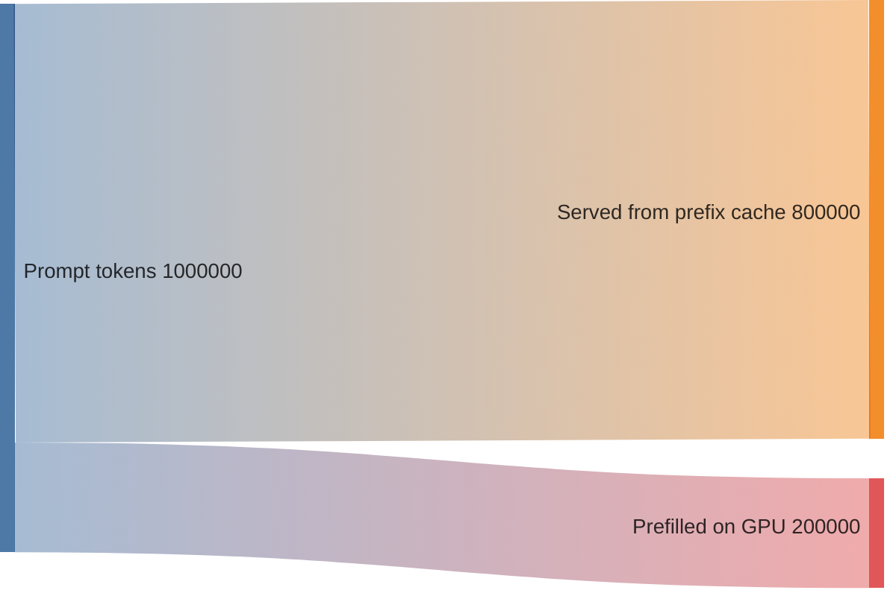
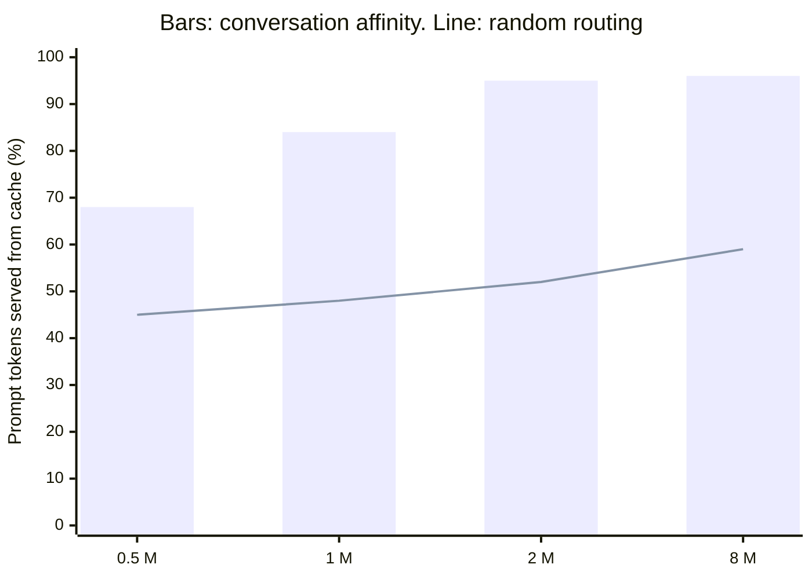

+++
title = 'A chat assistant at scale'
description = 'A self-hosted chat service for 20,000 open conversations at peak. The design is driven by three numbers: prompt tokens outnumber output tokens, most prompt tokens repeat from the last turn, and the history that makes them repeat has to live somewhere.'
question = 'How do you size and build a chat service so that every turn streams quickly, history stays private, and the GPUs are spent on new tokens rather than recomputed ones?'
weight = 1
difficulty = 4
prerequisites = ['/notes/systems-design/worked-designs/04-a-multi-tenant-inference-gateway', '/notes/systems-design/thinking-in-invariants/03-back-of-the-envelope-capacity', '/notes/systems-design/failure-modes/04-overload-and-backpressure']
date = 2026-10-30T16:05:00Z
lastmod = 2026-10-30T16:05:00Z
verified = 2026-10-30
+++

## The idea in one minute

A chat assistant looks like the simplest AI product: a text box, a model, a
stream of words. At scale, three facts shape the whole design. First, **every
turn resends the conversation**, so prompt tokens outnumber output tokens many
times over. Second, almost all of that prompt is **identical to the previous
turn**, so a server that still holds the conversation's key-value (KV) cache
can skip most of the work. Third, users pause for a minute between turns, and
**the cache has to survive that pause on the replica the next turn reaches**.

So the design is less about the model than about where conversation state
lives: durable text in a store, a recomputable KV prefix in accelerator memory
(spilling to host memory), and a router that sends each turn back to the
replica that holds its prefix. The consequence to act on: size the fleet in
uncached prompt tokens and output tokens separately, route by conversation, and
treat the [prefix cache](/notes/inference-engineering/making-it-cheaper/03-prefix-caching/) as user data with the same isolation as the history.

## A picture

```mermaid {title="One chat turn: durable history, context builder, conversation-affine routing"}
flowchart LR
  U["<b>User</b><br/><small>web or app</small>"] --> E["<b>Edge</b><br/><small>TLS, auth, per-user limits</small>"]
  E --> API["<b>Chat API</b><br/><small>stateless</small>"]
  API <--> CS[("<b>Conversation store</b><br/><small>text, summaries</small>")]
  API --> CB["<b>Context builder</b><br/><small>system prompt, history, cap</small>"]
  CB --> MOD["<b>Input check</b><br/><small>small classifier</small>"]
  MOD --> R["<b>Router</b><br/><small>hash conversation ID,<br/>bounded load</small>"]
  R --> P1["<b>Replica A</b><br/><small>engine, KV prefix cache</small>"]
  R --> P2["<b>Replica B</b>"]
  P1 -->|"stream"| OUT["<b>Output check</b><br/><small>streamed chunks</small>"]
  OUT -->|"server-sent events"| U
  OUT --> API
  class U neutral
  class E,MOD,OUT good
  class API,CB compute
  class CS memory
  class R queue
  class P1,P2 compute
```

## How it really works

### Requirements

- **Load:** 20,000 open conversations at peak. While a conversation is active
  the user sends about one turn a minute (reading and typing take the rest).
- **Shape:** the average prompt is 3,000 tokens: a 1,500-token system prompt,
  the history, and a 150-token new message. The average reply is 400 tokens.
- **Latency:** time to first token (TTFT) under 1 s at p95 for prompts up to
  16,000 tokens; inter-token latency (ITL) under 50 ms at p95.
- **Availability:** 99.9% of turns succeed per month.
- **Data:** prompts and history stay inside the company's cloud boundary, so
  the model is self-hosted: a 70-billion-parameter open-weights model with the
  Llama 3.1 70B architecture (80 layers, 8 KV heads, head dimension 128).
- **History:** kept 30 days, deletable by the user at any time, never shown to
  anyone else.
- **Long inputs:** pasted documents up to 128,000 tokens are allowed, but are
  rare (under 1% of turns).

### Invariants

| # | Invariant |
| --- | --- |
| I1 | **History isolation.** A conversation's text, summaries, and KV prefix are reachable only with its owner's identity |
| I2 | **No lost or doubled turns.** A turn is stored exactly once, keyed by a client-generated turn ID; a retried turn never produces a second reply |
| I3 | **Bounded context.** No request exceeds the pool's context limit; older history is summarized, never silently cut mid-message |
| I4 | **Latency for users within limits.** TTFT and ITL targets hold for any user within their per-user limits, whatever others send |
| I5 | **Stop means stop.** A closed stream or a stop button frees the sequence's accelerator memory within one scheduling step |

I2 is the one teams forget. Users press regenerate, mobile clients retry on a
flaky network, and a server that treats each retry as a new turn bills twice
and forks the conversation. The pattern is the idempotency key from
[retries and idempotency](/notes/systems-design/failure-modes/02-retries-and-idempotency/).

### Capacity estimate

Work in tokens per second, split into prompt and output, because they load the
hardware differently. [Prefill](/notes/inference-engineering/inference-mechanics/01-prefill-and-decode/) (processing the prompt) is limited by compute;
decode (one token per step per sequence) is limited by memory bandwidth.

**Traffic.** 20,000 conversations / 60 s per turn = **333 turns per second**.

- Output: 333 × 400 = **133,333 tokens/s**.
- Prompt: 333 × 3,000 = **1,000,000 tokens/s**. If 80% of each prompt is
  already cached (the previous turns), only **200,000 tokens/s** need prefill.

Input is 7.5 times output, and caching cuts the prefill load by a factor of
five. Both numbers have to be in the plan.

**KV cache per token.** 2 (keys and values) × 80 layers × 8 KV heads × 128 ×
1 byte (FP8) = 163,840 bytes = **160 KiB**. With [tensor parallelism](/notes/inference-engineering/distributed-inference/01-tensor-pipeline-and-expert-parallelism/) across 8
GPUs, each GPU holds 20 KiB of it.

**Memory per node.** FP8 weights are 70.6 GB, or 8.8 GB per GPU at TP=8.
Reserving 8 GB per GPU for activations and runtime leaves 63.2 GB for KV
cache: 63.2 × 10⁹ / 20,480 ≈ **3.08 million tokens per node**.

**Decode.** At a batch of 256 sequences of about 3,200 tokens, one step reads
the weights once plus every sequence's KV cache: 8.8 GB + 256 × 3,200 ×
20 KiB = 25.6 GB per GPU. At 3.35 TB/s and an assumed 60% of peak bandwidth,
that is 12.7 ms per step: **79 tokens/s per stream, about 20,100 tokens/s per
node**.

**Prefill.** About 2 × 70.6 × 10⁹ = 141 GFLOP per token, ignoring attention.
Eight GPUs at 1,979 dense FP8 TFLOP/s and an assumed 40% utilization give
**about 44,850 tokens/s per node**.

**Nodes.** 133,333 / 20,098 + 200,000 / 44,850 = 6.6 + 4.5 = **11.1
node-equivalents** of busy time. At a 60% utilization target, plus one spare,
that is **20 nodes, 160 GPUs**. Prefill is 40% of the busy time even with an
80% hit rate; at 0% it would dominate.

**Concurrency.** By [Little's law](/notes/systems-design/scale-and-performance/01-queueing-and-littles-law/), sequences decoding at once = 333 turns/s ×
(400 tokens × 12.7 ms) = **about 1,700**, against 19 × 256 = 4,864 batch
slots. The fleet is not short of slots; it is sized by time.

**The cache problem.** Only 1,700 of the 20,000 conversations are generating
at any moment. The other 18,300 are between turns, and each holds about 3,200
tokens of history that the next turn will want warm: **58.6 million tokens**.
The fleet has 20 × 3.08 M − 1,700 × 3,200 ≈ **56.3 million tokens** of free
KV memory. The idle history barely fits even if it were spread perfectly; in
practice some of it is evicted before the user replies. That gap is what host
memory offload and routing are for.



**Storage.** A stored turn is about 550 tokens of text (message and reply),
roughly 2.2 KB, plus metadata: call it 2.7 KB. If the daily average is 40% of
peak, that is 333 × 0.4 × 86,400 ≈ **11.5 million turns per day**, 31 GB per
day, under 1 TB for 30 days before replication. The conversation store is a
modest, ordinary database problem.

**Chunked prefill and ITL.** A new 16,000-token prompt prefilled in one go
takes 16,000 / 44,850 ≈ 360 ms and stalls every sequence in the batch for that
long. Splitting prefill into chunks interleaved with decode (Sarathi-Serve,
OSDI 2024) bounds the stall: a 512-token chunk adds about 11 ms to a step,
keeping ITL near 25 ms; a 2,048-token chunk adds about 46 ms and breaks the
50 ms target. The chunk size is set by the ITL budget, then tuned by
measurement.

### The design

**Edge.** TLS termination, authentication to a user ID, and per-user limits on
turns per minute, open streams, and prompt tokens per hour, using the token
bucket from [the rate limiter](/notes/systems-design/worked-designs/01-a-rate-limiter/).
The user ID comes from the session, never from a request field.

**Chat API and conversation store.** The API is stateless. Conversations live
in a store partitioned by user ID: messages, a rolling summary, the system
prompt version used, and the turn IDs already answered (I2). A turn that
arrives with a known turn ID returns the stored reply, or attaches to the
stream still in progress.

**Context builder.** It assembles, in a fixed order, the versioned system
prompt, the summary of older turns if any, recent turns verbatim, and the new
message. The order matters for caching: anything that changes per turn (a
timestamp, a retrieved snippet) goes after the stable prefix, or every turn
misses the cache. When history passes 12,000 tokens it is summarized at a turn
boundary by a small model, and the summary is stored, so the same prompt is
rebuilt on the next turn (I3).

**Router.** Each conversation ID hashes to a replica, using [consistent hashing](/notes/systems-design/scale-and-performance/03-partitioning-and-sharding/)
with bounded loads (Mirrokni, Thorup, and Zadimoghaddam, SODA 2018): if the
home replica is over its load bound, the turn spills to the next replica on the
ring, which costs one cache miss but protects latency. Random or least-loaded
routing spreads a conversation's turns across replicas, and the simulation
below shows what that does to the hit rate.

**Engines.** Two pools of the same model:

| Pool | Nodes | Max context | Why |
| --- | --- | --- | --- |
| General | 19 + 1 spare | 16,384 tokens | Small block tables, high batch, tight ITL |
| Long context | 2 | 131,072 tokens | A 128k prompt is 21 GB of KV across the node and at least 2.9 s of prefill; isolating it protects the general pool's tail |

The engine, whose parts are described in
[anatomy of a serving engine](/notes/inference-engineering/serving-systems/01-anatomy-of-a-serving-engine/),
runs [continuous batching](/notes/inference-engineering/batching-and-scheduling/01-continuous-batching/) (Orca, OSDI 2022), [paged KV](/notes/inference-engineering/batching-and-scheduling/02-paged-kv-memory/) memory
(PagedAttention, SOSP 2023), automatic prefix caching, and [chunked prefill](/notes/inference-engineering/batching-and-scheduling/03-chunked-prefill-and-priority/).
Evicted prefix blocks spill to host memory first; an 8-GPU server such as a
DGX H100 has 2 TB of system memory, three times its 640 GB of HBM, which turns
"barely fits" into "fits".

**Moderation.** A small classifier screens the input before the main model
sees it. Output is screened in chunks as it streams, so a policy violation can
stop the stream mid-reply. Both run on a small shared GPU pool.

**Streaming.** Server-sent events carry tokens to the client (the protocol
details are in [streaming APIs](/notes/inference-engineering/serving-systems/03-streaming-apis/)). A closed
connection or a stop request cancels the sequence in the engine (I5); the
partial reply is stored with a "stopped" marker so the next turn's prompt
matches what the user saw.

### One turn, end to end

```mermaid {title="A turn: idempotent by turn ID, cached by conversation, stored once"}
sequenceDiagram
  autonumber
  participant C as Client
  participant A as Chat API
  participant S as Conversation store
  participant R as Router
  participant E as Engine replica
  C->>A: message, conversation ID, turn ID
  A->>S: turn ID seen before?
  S-->>A: no, here is the history and summary
  A->>A: build context: stable prefix first, new message last
  A->>R: route by conversation ID
  R->>E: home replica, under its load bound
  E->>E: prefix cache hit on earlier turns, prefill only the new tokens
  loop each decode step
    E-->>A: token
    A-->>C: server-sent event
  end
  A->>S: store reply under turn ID, once
  A->>A: meter tokens by user
```

### Failure modes

| Failure | What the user sees | Design response |
| --- | --- | --- |
| Replica lost mid-stream | Stream ends with an error event | Client retries with the same turn ID; the API restarts generation on another replica; one cold prefill |
| Rolling deploy | TTFT rises as caches empty | Drain one replica at a time and let its conversations rehash; deploy off-peak; budget the extra prefill |
| Hot spot (one replica over its bound) | Nothing, if the bound works | Spill to the next ring position; alert if spill exceeds a few percent |
| Overload beyond capacity | Slower first tokens, then "try again" | Shed by priority (free tier first), cap output length, refuse new long-context turns; see [overload and backpressure](/notes/systems-design/failure-modes/04-overload-and-backpressure/) |
| Regenerate storm | Many identical requests | Per-user open-stream limit of one or two; regenerate cancels the previous stream |
| Conversation store slow | TTFT rises | Store reads have a 100 ms deadline; reads go to replicas; writes retry asynchronously with the turn ID |
| Moderation pool down | Turns fail | Fail closed for output screening, with its own SLO and capacity; this is a product decision written down, not a default |
| Long prompt in the general pool | ITL spikes for everyone in the batch | Route by prompt length before the engine; chunked prefill as the second line |

Every path out of a turn ends with the sequence's memory freed and the turn
either stored once or not at all.

```mermaid {title="Turn lifecycle: every exit frees KV memory and settles the turn ID"}
stateDiagram-v2
  [*] --> Received
  Received --> Replayed: turn ID already answered
  Received --> Rejected: over per-user limit, 429
  Received --> Queued: limits charged
  Queued --> Prefill: scheduled on home replica
  Prefill --> Decode
  Decode --> Decode: one token per step
  Decode --> Stored: end of reply
  Decode --> Stopped: stop button or disconnect
  Decode --> Failed: replica lost
  Stopped --> Stored: partial reply marked stopped
  Failed --> Queued: client retries same turn ID
  Stored --> [*]: KV freed or kept as prefix cache
  Replayed --> [*]
  Rejected --> [*]
```

### Security review

- **The prefix cache is user data.** A shared prefix cache answers faster on a
  hit, so a user who can measure TTFT can test whether someone else recently
  sent a given prefix; Song et al. (2024) demonstrate such timing side channels
  against LLM serving systems. Scope cached blocks to the conversation's owner,
  and share only prefixes the platform supplies, such as the system prompt
  (I1).
- **Pasted content is untrusted.** Users paste emails, web pages, and
  documents that may carry instructions. This assistant has no tools, so the
  worst outcome of [prompt injection](/notes/ai-security-engineering/how-attacks-work/01-prompt-injection/)
  is a manipulated reply, not an action. Adding tools changes that, and is a
  new design review.
- **Rendering is an exit.** Markdown images and links in a reply can carry data
  to an attacker's server when the client renders them. Render only allowlisted
  hosts and strip image URLs from model output; the full list of exits is in
  [data exfiltration and leakage](/notes/ai-security-engineering/how-attacks-work/02-data-exfiltration-and-leakage/).
- **Logs and traces.** Metering stores token counts, not text. Traces carry
  conversation IDs, not content. Content for abuse review goes to a separate
  store with short retention and audited access.
- **Deletion reaches every copy.** Deleting a conversation removes messages,
  summaries, cached prefix blocks (by evicting the conversation's blocks), and
  any copy in an evaluation or training queue.
- **Account takeover exposes history.** History is as sensitive as an inbox;
  require the same session protections, and re-authenticate before export.
- **Denial of wallet.** Per-user limits on prompt tokens and open streams bound
  what a stolen session can spend; see
  [abuse and resource attacks](/notes/ai-security-engineering/how-attacks-work/04-abuse-and-resource-attacks/).

### Cost

The fleet is sized for peak: 160 GPUs for serving, plus a small pool for
moderation and summaries. At an assumed $3.50 per GPU-hour, serving is
160 × 3.50 × 24 = **$13,440 per day**, or **about $0.0012 per turn** over 11.5
million turns.

For comparison, the same turns on a hosted frontier model at assumed prices of
$3 per million input tokens, $0.30 per million cached input tokens, and $15 per
million output tokens cost 600 × $3 + 2,400 × $0.30 + 400 × $15 per million =
**$0.0085 per turn**, about $98,000 a day. The models are not equivalent in
quality, so the comparison only says where the line is: at steady high volume
with a model that passes evaluation, owned capacity is cheaper; at low or spiky
volume it is not.

The levers, in order: prefix-cache hit rate (the difference between 200,000
and 1,000,000 prefill tokens per second), scaling the general pool down
off-peak (model load time sets how fast), and output length caps.

### Decisions and alternatives rejected

| Decision | Chosen | Rejected, and why |
| --- | --- | --- |
| Model hosting | Self-hosted open weights | Hosted API only: data must stay in the boundary, and at this volume per-token prices cost several times more |
| Precision | FP8 weights and KV cache | BF16: weights double to 17.6 GB per GPU, KV capacity halves, decode steps slow. FP8 is accepted only after the evaluation suite shows no quality regression |
| Parallelism | TP=8, one replica per node | TP=4, two replicas per node: halves KV room per replica, so fewer idle conversations stay warm; worth re-testing if the hit rate is already high |
| Routing | Consistent hash on conversation ID with bounded load | Least-loaded: even load, but turns land on replicas without their prefix. Pure hashing: hot replicas with no spill |
| Long context | Separate pool | One pool with a 128k limit: block tables and the occasional 3 s prefill hurt everyone's tail |
| Prefill and decode | Colocated, chunked prefill | Disaggregated pools (DistServe, OSDI 2024): attractive at 40% prefill share, but adds KV transfer and two pools to size; revisit at 10x |
| History beyond 12k tokens | Summarize at a turn boundary, store the summary | Truncate oldest turns: cheap, but silently drops facts and breaks prefix reuse unpredictably |
| Streaming transport | Server-sent events | WebSockets: bidirectional, but harder through proxies and not needed; stop is a separate request |

### What changes at 10x

At 200,000 open conversations the same arithmetic gives about 200 nodes.

- **Cells and regions.** Split users into cells, each with its own router,
  pools, and conversation store partition, so one bad deploy or hot spot stays
  in one cell; see [blast radius and cells](/notes/systems-design/failure-modes/05-blast-radius-and-cells/).
- **A KV tier outside the node.** Idle history at 10x is 590 million tokens,
  about 97 TB at 160 KiB per token. Some can live in host memory; beyond that,
  recomputing a prefix may be cheaper than fetching it, and the router must
  weigh both.
- **Disaggregation pays.** With prefill and decode on separate pools, each is
  sized and scaled on its own signal, and long prompts no longer stall decode.
- **Speculative decoding** for latency-sensitive tiers, if measured acceptance
  rates justify it on chat traffic.

## Code

The program does two things. Part 1 reproduces the capacity arithmetic above
from its inputs. Part 2 simulates 4,000 conversations of eight turns each on
eight replicas, each replica holding an LRU prefix cache of a given size, and
compares random routing with routing by conversation ID. The shared system
prompt counts as cached everywhere.

```python {title="chat_capacity.py"}
"""chat_capacity.py: size a chat fleet, then test how routing and cache size
change the prefix-cache hit rate.

Part 1 is arithmetic: a 70B-class dense model (80 layers, 8 KV heads, head
dimension 128) in FP8 on 8-GPU nodes, with a roofline estimate of decode step
time and prefill throughput. Part 2 is a simulation of conversations arriving
at replicas that each hold an LRU prefix cache. Standard library only; the
efficiency factors are assumptions, not measurements.
"""

from __future__ import annotations

import heapq
import math
import random
from collections import OrderedDict
from dataclasses import dataclass

# ---- model and hardware (FP8 weights and KV cache, tensor parallel 8) ----
PARAMS = 70.6e9
LAYERS, KV_HEADS, HEAD_DIM = 80, 8, 128
BYTES = 1                                  # FP8
GPUS_PER_NODE = 8
HBM_GB, HBM_BW = 80e9, 3.35e12             # bytes, bytes/s per GPU (H100 SXM)
FP8_DENSE = 1979e12                        # FLOP/s per GPU, dense
DECODE_EFF, PREFILL_MFU = 0.6, 0.4         # assumed achieved fractions
RESERVED = 8e9                             # activations, CUDA graphs, runtime

# ---- workload at peak ----
OPEN_CONVERSATIONS = 20_000
TURN_GAP_S = 60                            # one user turn per minute while active
PROMPT_TOKENS = 3_000                      # system prompt + history + new message
OUTPUT_TOKENS = 400
CACHED_SHARE = 0.80                        # assumed; part 2 tests it
MAX_BATCH = 256                            # largest batch per node that meets the ITL target


def part1() -> int:
    kv_token = 2 * LAYERS * KV_HEADS * HEAD_DIM * BYTES
    kv_token_gpu = kv_token / GPUS_PER_NODE
    weights_gpu = PARAMS * BYTES / GPUS_PER_NODE
    kv_room_gpu = HBM_GB - weights_gpu - RESERVED
    tokens_node = kv_room_gpu / kv_token_gpu

    req_s = OPEN_CONVERSATIONS / TURN_GAP_S
    out_s = req_s * OUTPUT_TOKENS
    in_s = req_s * PROMPT_TOKENS
    uncached_s = in_s * (1 - CACHED_SHARE)

    ctx = PROMPT_TOKENS + OUTPUT_TOKENS / 2
    step_s = (weights_gpu + MAX_BATCH * ctx * kv_token_gpu) / HBM_BW / DECODE_EFF
    decode_node = MAX_BATCH / step_s          # decode tokens/s per node when saturated
    prefill_node = GPUS_PER_NODE * FP8_DENSE * PREFILL_MFU / (2 * PARAMS)

    busy = out_s / decode_node + uncached_s / prefill_node
    nodes = math.ceil(busy / 0.6) + 1         # 60% target utilization, plus one spare
    in_flight = req_s * OUTPUT_TOKENS * step_s  # Little's law, at the saturated step time
    print("part 1: arithmetic")
    print(f"  KV cache per token          {kv_token / 1024:.0f} KiB ({kv_token_gpu / 1024:.0f} KiB per GPU at TP=8)")
    print(f"  weights per GPU             {weights_gpu / 1e9:.1f} GB; KV room {kv_room_gpu / 1e9:.1f} GB")
    print(f"  KV capacity per node        {tokens_node / 1e6:.2f} M tokens")
    print(f"  requests/s                  {req_s:.0f}")
    print(f"  output tokens/s             {out_s:,.0f}")
    print(f"  prompt tokens/s             {in_s:,.0f} ({uncached_s:,.0f} uncached at {CACHED_SHARE:.0%} hits)")
    print(f"  decode step at batch {MAX_BATCH}   {step_s * 1e3:.1f} ms -> {1 / step_s:.0f} tok/s per stream")
    print(f"  per node: decode {decode_node:,.0f} tok/s, prefill {prefill_node:,.0f} tok/s")
    print(f"  node-equivalents busy       {busy:.1f}; at 60% target + 1 spare: {nodes} nodes ({nodes * 8} GPUs)")
    print(f"  sequences decoding at once  {in_flight:,.0f} (Little's law: {req_s:.0f}/s x {OUTPUT_TOKENS * step_s:.1f} s)"
          f" vs {(nodes - 1) * MAX_BATCH:,} slots")
    free = nodes * tokens_node - in_flight * ctx
    idle_tokens = (OPEN_CONVERSATIONS - in_flight) * ctx
    print(f"  idle history to keep warm   {idle_tokens / 1e6:.1f} M tokens vs {free / 1e6:.1f} M free in HBM fleet-wide")
    return nodes


@dataclass
class Replica:
    capacity: int
    cache: OrderedDict          # conversation id -> cached prefix length
    used: int = 0

    def lookup(self, conv: int) -> int:
        if conv in self.cache:
            self.cache.move_to_end(conv)
            return self.cache[conv]
        return 0

    def store(self, conv: int, length: int) -> None:
        self.used += length - self.cache.pop(conv, 0)
        self.cache[conv] = length
        while self.used > self.capacity and self.cache:
            _, n = self.cache.popitem(last=False)
            self.used -= n


def simulate(routing: str, replicas: int, cap_tokens: int, convs: int = 4000,
             turns: int = 8, seed: int = 1) -> float:
    rng = random.Random(seed)
    pool = [Replica(cap_tokens, OrderedDict()) for _ in range(replicas)]
    system, new_msg, reply = 1_500, 150, OUTPUT_TOKENS
    events = [(rng.uniform(0, 600), c, 0) for c in range(convs)]
    heapq.heapify(events)
    history = [system] * convs
    cached = total = 0
    while events:
        t, c, turn = heapq.heappop(events)
        prompt = history[c] + new_msg
        r = pool[c % replicas] if routing == "affinity" else pool[rng.randrange(replicas)]
        hit = max(r.lookup(c), system)          # the shared system prompt is always warm
        cached += min(hit, prompt)
        total += prompt
        history[c] = prompt + reply
        r.store(c, history[c])
        if turn + 1 < turns:
            heapq.heappush(events, (t + rng.expovariate(1 / TURN_GAP_S), c, turn + 1))
    return cached / total


def part2() -> None:
    print("\npart 2: prefix-cache hit rate, 4,000 conversations x 8 turns on 8 replicas")
    print(f"  {'cache per replica':<22}{'random routing':>16}{'conversation affinity':>24}")
    for label, cap in [("0.5 M tokens", 500_000), ("1 M tokens", 1_000_000),
                       ("2 M tokens", 2_000_000), ("8 M tokens (+host RAM)", 8_000_000)]:
        rnd = simulate("random", 8, cap)
        aff = simulate("affinity", 8, cap)
        print(f"  {label:<22}{rnd:>16.0%}{aff:>24.0%}")


if __name__ == "__main__":
    part1()
    part2()
```

Run it with `python3 chat_capacity.py`:

```text
part 1: arithmetic
  KV cache per token          160 KiB (20 KiB per GPU at TP=8)
  weights per GPU             8.8 GB; KV room 63.2 GB
  KV capacity per node        3.08 M tokens
  requests/s                  333
  output tokens/s             133,333
  prompt tokens/s             1,000,000 (200,000 uncached at 80% hits)
  decode step at batch 256   12.7 ms -> 79 tok/s per stream
  per node: decode 20,098 tok/s, prefill 44,850 tok/s
  node-equivalents busy       11.1; at 60% target + 1 spare: 20 nodes (160 GPUs)
  sequences decoding at once  1,698 (Little's law: 333/s x 5.1 s) vs 4,864 slots
  idle history to keep warm   58.6 M tokens vs 56.3 M free in HBM fleet-wide

part 2: prefix-cache hit rate, 4,000 conversations x 8 turns on 8 replicas
  cache per replica       random routing   conversation affinity
  0.5 M tokens                       45%                     68%
  1 M tokens                         48%                     84%
  2 M tokens                         52%                     95%
  8 M tokens (+host RAM)             59%                     96%
```

Each replica in part 2 serves 500 conversations whose history averages about
3,700 tokens, so it needs roughly 1.9 million tokens of cache to keep them all.
With **random routing**, a turn reaches the replica holding its history one
time in eight, and more cache barely helps: the hit rate stays near the floor
set by the shared system prompt. With **conversation affinity**, the hit rate
climbs with cache size until the working set fits, then flattens at 95%, which
is about as high as it gets when the first turn of each conversation is always
a miss. The 80% the capacity plan assumed is reachable only with both affinity
and enough cache, which is why host-memory offload is in the design.



## Where it breaks

- **The capacity numbers are a roofline, not a benchmark.** The 60% bandwidth
  and 40% compute efficiencies are assumptions. Real engines lose time to
  scheduling, sampling, and communication between GPUs; measure [goodput](/notes/inference-engineering/production-inference/01-latency-slos-and-goodput/) at the
  SLO with your prompts before buying hardware.
- **The duty cycle is the most fragile input.** One turn per minute per open
  conversation sets everything. If users send a turn every 20 seconds, the
  fleet triples. Measure it from real sessions.
- **Affinity fights load balance.** A replica that holds popular conversations
  gets more work. Bounded-load hashing caps that, at the cost of some misses,
  and the simulation does not model the spill.
- **The simulation counts tokens, not time.** It has no batching, no queueing,
  and no eviction cost; it shows how routing and capacity set the hit rate, not
  what TTFT a real engine achieves.
- **FP8 is a quality decision.** The arithmetic assumes it; the evaluation
  suite has to allow it.

## Remember this

- Size in prompt and output tokens per second separately; chat prompts
  outnumber outputs several times over.
- Most prompt tokens repeat from the last turn. The prefix-cache hit rate is
  the biggest cost and latency lever.
- High hit rates need both conversation-affine routing and enough cache to
  hold idle conversations through the user's pause.
- A client-generated turn ID makes retries and regenerates safe.
- A prefix cache is user data: scope it per owner, and delete it with the
  history.

## Try it

1. Set `TURN_GAP_S = 20` in `chat_capacity.py`. How many nodes does the fleet
   need, and how does the idle-history line change?
2. Set `CACHED_SHARE = 0.5`. What share of busy time is now prefill, and does
   disaggregating prefill look more attractive?
3. Change the routing in `simulate` so that 10% of turns spill to a random
   replica (bounded load). How much hit rate does the spill cost?
4. Redo the KV arithmetic for BF16 instead of FP8. How many tokens fit per
   node, and how many nodes would keep all idle history in HBM?

## Check yourself

1. Why does a chat service need to size prefill and decode separately?

   
   Prefill is limited by compute and scales with uncached prompt tokens;
   decode is limited by memory bandwidth and scales with output tokens and
   batch size. A chat turn sends thousands of prompt tokens for a few hundred
   output tokens, and caching changes the prompt side by a large factor, so
   one combined "tokens per second" number hides which resource runs out.
   

2. In the simulation, why does adding cache barely help random routing?

   
   With eight replicas, a turn lands on the replica holding its history only
   one time in eight. A bigger cache keeps more history, but almost always on
   the wrong replica. Routing has to bring the turn to the cache before cache
   size matters.
   

3. How many tokens of KV cache fit on an 8-GPU node in this design, and what
   sets that number?

   
   About 3.08 million. Each GPU has 80 GB minus 8.8 GB of FP8 weights and 8 GB
   of reserve, leaving 63.2 GB; each token takes 20 KiB per GPU at TP=8
   (160 KiB in total for 80 layers, 8 KV heads, head dimension 128, 1 byte).
   

4. A mobile client retries a turn after a timeout, but the first attempt is
   still streaming. What should happen?

   
   The retry carries the same turn ID, so the API recognizes it and attaches
   the client to the stream in progress, or returns the stored reply if it has
   finished. It must not start a second generation, which would bill twice and
   fork the conversation (I2).
   

5. Why must prefix caches be scoped per user even though they only speed
   things up?

   
   Speed is observable. If cache hits are shared across users, one user can
   probe whether a prefix was recently sent by someone else by measuring time
   to first token. Scoping per owner, and sharing only platform-supplied
   prefixes, removes the cross-user signal.
   

## Sources

- W. Kwon et al., [Efficient Memory Management for Large Language Model Serving with PagedAttention](https://arxiv.org/abs/2309.06180), ACM SOSP, 2023.
- G.-I. Yu et al., [Orca: A Distributed Serving System for Transformer-Based Generative Models](https://www.usenix.org/conference/osdi22/presentation/yu), USENIX OSDI, 2022.
- A. Agrawal et al., [Taming Throughput-Latency Tradeoff in LLM Inference with Sarathi-Serve](https://arxiv.org/abs/2403.02310), USENIX OSDI, 2024.
- Y. Zhong et al., [DistServe: Disaggregating Prefill and Decoding for Goodput-optimized Large Language Model Serving](https://arxiv.org/abs/2401.09670), USENIX OSDI, 2024.
- L. Zheng et al., [SGLang: Efficient Execution of Structured Language Model Programs](https://arxiv.org/abs/2312.07104), 2023 (RadixAttention prefix reuse).
- V. Mirrokni, M. Thorup, M. Zadimoghaddam, [Consistent Hashing with Bounded Loads](https://arxiv.org/abs/1608.01350), ACM-SIAM SODA, 2018.
- L. Song et al., [The Early Bird Catches the Leak: Unveiling Timing Side Channels in LLM Serving Systems](https://arxiv.org/abs/2409.20002), 2024.
- Llama Team, Meta, [The Llama 3 Herd of Models](https://arxiv.org/abs/2407.21783), 2024 (70B architecture: 80 layers, 8 KV heads).
- NVIDIA, [H100 Tensor Core GPU](https://www.nvidia.com/en-us/data-center/h100/) datasheet (80 GB HBM3, 3.35 TB/s, 1,979 dense FP8 TFLOPS for SXM).
- J. D. C. Little, A Proof for the Queuing Formula L = λW, Operations Research 9(3), 1961.
- WHATWG, [HTML Living Standard: Server-sent events](https://html.spec.whatwg.org/multipage/server-sent-events.html).
