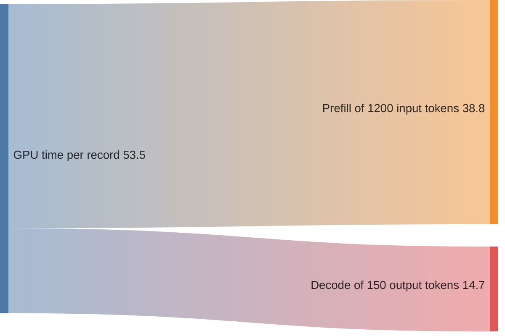

+++
title = 'A batch inference pipeline'
description = 'An offline job that runs a model over 50 million records before a deadline. No user waits on any one item, so the design trades latency for throughput and cheap, preemptible capacity, and spends its effort on leases, idempotent results, and an atomic publish.'
question = 'How do you run a model over tens of millions of records on interruptible capacity, finish before the deadline, and publish exactly one result per record?'
weight = 4
difficulty = 4
prerequisites = ['/notes/systems-design/ai-worked-designs/01-a-chat-assistant-at-scale', '/notes/systems-design/concurrency-and-consistency/02-locks-leases-and-fencing', '/notes/systems-design/failure-modes/02-retries-and-idempotency']
date = 2026-10-30T16:20:00Z
lastmod = 2026-10-30T16:20:00Z
verified = 2026-10-30
+++

## The idea in one minute

Much of the inference a company runs has no user waiting on it: classifying a
backlog of support tickets, summarizing documents for search, extracting
fields from contracts, embedding a corpus, generating test data, running an
evaluation suite. These are **batch jobs**. The service level is not time to
first token but **a deadline for the whole job and a cost per item**.

That changes almost every choice. Batches can be as large as memory allows,
because nobody feels the latency. The job can run on interruptible capacity:
spot instances, or the interactive fleet's idle hours. In exchange, workers
die mid-shard, stall and come back, and hit records that crash them. So the
design work is in the bookkeeping: shards leased from a queue, a result
written once per record under a key, a dead-letter set for poison records, and
a publish step that makes the whole job visible at once. The consequence to
act on: key every result by record and job version, size shards from the
interruption rate, and never let downstream read a half-finished job.

## A picture

```mermaid {title="A batch job: plan, lease shards, write keyed results, validate, publish atomically"}
flowchart LR
  SPEC["<b>Job spec</b><br/><small>snapshot, model digest,<br/>prompt version, params</small>"] --> PLAN["<b>Planner</b><br/><small>shards of 5,000 records</small>"]
  PLAN --> Q[["<b>Shard table</b><br/><small>leases, attempts</small>"]]
  Q --> W1["<b>GPU worker</b><br/><small>preemptible</small>"]
  Q --> W2["<b>GPU worker</b>"]
  IN[("<b>Input snapshot</b><br/><small>read-only</small>")] --> W1
  IN --> W2
  W1 --> ST[("<b>Staging results</b><br/><small>key: job version, record ID</small>")]
  W2 --> ST
  W1 -.->|"3 failures"| DL[("<b>Dead letters</b>")]
  ST --> VAL["<b>Validator</b><br/><small>schema, coverage, drift</small>"]
  VAL -->|"pass"| PUB["<b>Publish</b><br/><small>switch the pointer</small>"]
  PUB --> DOWN["<b>Downstream tables</b>"]
  class SPEC,PLAN compute
  class Q queue
  class W1,W2 compute
  class IN,ST,DL memory
  class VAL,PUB good
  class DOWN io
```

## How it really works

### Requirements

- **Job:** classify and summarize 50 million support records (a backfill),
  then a few million changed records each night. Each record is about 1,200
  input tokens (a 500-token instruction prefix and about 700 tokens of record)
  and produces about 150 output tokens of JSON: a category, a short summary,
  and extracted entities.
- **Deadline:** the backfill finishes within 20 hours; nightly runs within 6.
- **Model:** a self-hosted 8B-class model (Llama 3.1 8B architecture: 32 layers,
  8 KV heads, head dimension 128) in BF16, chosen because evaluation showed it
  matches a larger model on this task.
- **Output:** one row per record in a warehouse table, valid against the
  schema, consumed by dashboards and by the retrieval index.
- **Data:** records contain customer text and personal data; they stay inside
  the company's cloud unless a record class is cleared for a hosted batch API.
- **Coexistence:** the job may use the interactive fleet's idle capacity at
  night but must never degrade interactive latency.

### Invariants

| # | Invariant |
| --- | --- |
| I1 | **One result per record per job version.** Retries, replays, and late writers never produce a second row |
| I2 | **A job is pinned.** Every record in a job version is processed with the same model weights digest, prompt version, and decoding parameters |
| I3 | **Atomic publish.** Downstream sees all of a job version's results or none of them |
| I4 | **Bounded poison.** A record that fails three times goes to a dead-letter set with its error; the job completes without it and reports the count |
| I5 | **Interactive first.** Batch work on shared GPUs is preempted before any interactive SLO is at risk |

I2 is what makes a batch result mean something. If the prompt is edited
halfway through, half the table answers one question and half another, and no
one can tell which rows are which. A change of model, prompt, or parameters is
a new job version, never an update to a running one.

### Capacity estimate

**Tokens.** 50 M × 1,200 = **60 billion input tokens**; 50 M × 150 = **7.5
billion output tokens**.

**Per GPU.** For an 8B model in BF16 on one H100:

- [Prefill](/notes/inference-engineering/inference-mechanics/01-prefill-and-decode/): 2 × 8 × 10⁹ = 16 GFLOP per token; at 50% of 989 dense BF16
  TFLOP/s, about **30,900 tokens/s**.
- Decode: KV cache per token is 2 × 32 × 8 × 128 × 2 bytes = 128 KiB. At a
  batch of 256 sequences averaging 1,275 tokens, a step reads 16 GB of weights
  plus 256 × 1,275 × 128 KiB = 42.8 GB of KV, 58.8 GB in all; at 70% of
  3.35 TB/s that is 25 ms, so about **10,200 output tokens/s**. Offline jobs
  can run the batch this large because no one is waiting on any one sequence.
- Per record: 1,200 / 30,906 + 150 / 10,213 = 38.8 + 14.7 = **53.5 ms**, or
  **18.7 records per second per GPU**.

**The job.** 50 M × 53.5 ms = **743 GPU-hours**. Finishing in 20 hours needs
37 GPUs running flat out. The simulation below shows interruptions adding
about 20% to the makespan, so plan for **about 45 GPUs**.

**Prefix caching helps here too.** The 500-token instruction prefix is the
same for every record. With it cached, each record prefills about 700 tokens:
700 / 30,906 + 150 / 10,213 = 37.3 ms, **26.8 records per second per GPU**,
43% more throughput for keeping the shared prefix first and unchanged.

**Input and output volume.** 50 M records at about 5 KB each is 250 GB read
once; 50 M results at about 1 KB is 50 GB written. At 45 GPUs × 18.7 records/s
the workers write about 840 rows per second: batch the writes, but any store
handles it.

**Free capacity.** The chat fleet in
[a chat assistant at scale](/notes/systems-design/ai-worked-designs/01-a-chat-assistant-at-scale/)
is sized for its daytime peak of 160 GPUs. If its overnight load is a fifth of
peak, more than 100 GPUs sit idle for several hours each night. The 8B model
fits on one GPU, so each idle node runs eight batch workers, which is the
reason for I5.



### The design

**Job spec and planner.** A job spec names an immutable input snapshot (a
table snapshot or a manifest of object keys), the model by weights digest, the
prompt by version, decoding parameters (temperature 0, a maximum output
length), the output schema, and the output location. The planner splits the
snapshot into shards of 5,000 records (about 4.5 minutes of work on one GPU),
drops records over the input-length cap into the dead-letter set immediately,
and writes the shard table.

**Shard table with leases.** Each shard row has a state, a lease owner, a
lease expiry, an attempt count, and a lease epoch. A worker claims a shard
with a conditional update, renews the lease every 30 seconds, and releases it
when done. A lease that expires puts the shard back in the queue, which is
how a dead worker's shard gets redone. The epoch is a fencing token: a worker
that comes back after its lease expired holds a stale epoch, and the shard
table refuses its completion. The mechanism is the one in
[locks, leases, and fencing](/notes/systems-design/concurrency-and-consistency/02-locks-leases-and-fencing/).

**Workers.** Each worker loads the pinned model, verifies the weights digest,
and runs an offline engine with a large batch. It pulls records from its
shard, submits them all, and writes each result as it completes. Structured
output decoding ([structured output and tool calls](/notes/systems-design/model-interfaces/02-structured-output-and-tool-calls/))
constrains generation to the schema, and the worker still
validates every result; a result that fails validation counts as a failed
attempt for that record.

**Keyed results.** Every result is written to the staging store with the key
(job version, record ID), using a conditional put that succeeds only if the key
is absent. A second writer for the same record, whether a retry, a replacement
worker, or a stalled worker coming back, finds the key present and moves on
(I1). When a shard is re-leased, the new worker first lists the keys already
present and skips those records, so an interruption loses only the records in
flight, not the shard.

**Preemption notices.** Spot capacity gives notice before reclaiming a
machine: two minutes on AWS, about 30 seconds on Google Cloud. A worker that
receives notice stops taking new records, lets in-flight ones finish if they
can, and releases its lease so the shard is requeued immediately instead of
after the lease timeout.

**Dead letters.** A record that fails three attempts (an engine error, an
out-of-memory on an unusual input, an unparseable result) is written to the
dead-letter set with the error and skipped (I4). The job reports the count;
the owner decides whether it blocks the publish.

**Validator and publish.** When every shard is done, the validator checks
coverage (results plus dead letters equal the snapshot), schema validity, and
drift: the distribution of categories against the previous job version, and a
sample of a few hundred results graded by an evaluation suite. If it passes,
publish switches a pointer (a view, a table alias, a manifest) from the old
job version to the new one in one operation (I3). Rollback switches it back.

**Sharing the interactive fleet.** Batch workers on interactive nodes run at
the lowest scheduling priority, and a queue-based scheduler (Kueue on
Kubernetes is one) preempts them when interactive demand rises. Preemption is
cheap because of keyed results: a preempted worker loses only its in-flight
records.

### One shard, end to end

```mermaid {title="A shard: lease, skip what is done, write keyed results, release"}
sequenceDiagram
  autonumber
  participant W as Worker
  participant Q as Shard table
  participant S as Staging results
  participant E as Engine
  W->>Q: claim a ready shard (conditional update)
  Q-->>W: shard 4,117, epoch 3, lease 10 min
  W->>S: which record IDs in this shard are done?
  S-->>W: 1,840 of 5,000
  W->>E: submit the other 3,160 records
  loop as results complete
    E-->>W: JSON result
    W->>W: validate against schema
    W->>S: put if absent: (job version, record ID)
    W->>Q: renew lease every 30 s (epoch 3)
  end
  W->>Q: complete shard 4,117, epoch 3
  Q-->>W: accepted
```

```mermaid {title="A record's lifecycle: every path ends in one stored result or one dead letter"}
stateDiagram-v2
  [*] --> Pending
  Pending --> DeadLetter: over input cap at planning
  Pending --> InFlight: shard leased
  InFlight --> Stored: valid result, put if absent
  InFlight --> Pending: worker preempted or lease expired
  InFlight --> Failed: engine error or invalid result
  Failed --> Pending: attempts below 3
  Failed --> DeadLetter: third failure
  Stored --> [*]
  DeadLetter --> [*]
```

### Failure modes

| Failure | What happens | Design response |
| --- | --- | --- |
| Worker preempted | In-flight records lost | Lease released on notice, or expires; the next worker skips stored records |
| Worker stalls and returns | Two workers on one shard | Conditional puts make duplicate results harmless; the stale epoch's completion is refused |
| Poison record | Crashes or out-of-memory, again and again | Input-length cap at planning; three attempts, then dead letter |
| Model load storm | Dozens of workers pull 16 GB of weights at once | Node-local weight cache, staggered starts, a pull rate limit on the registry |
| Deadline at risk | ETA (records left / current rate) passes the deadline | Add on-demand capacity for the remainder; alert early, not at the deadline |
| Bad prompt found mid-run | Results so far are wrong | Stop the job; fix; start a new job version. Never edit a running version (I2) |
| Silent quality drift | Categories shift from last run | Validator's distribution check and graded sample block the publish |
| Hosted batch API expires items | Some requests not completed in its window | Requeue the expired records as a new submission; results keyed the same way |

### Security review

- **Records are untrusted input.** Customers wrote the ticket text, and some of
  it will be instructions aimed at the model. The output is schema-constrained
  data with no tools, so injection can at most mislabel a record or put
  attacker-chosen words in a summary. But those summaries flow into
  dashboards, search, and later prompts: **derived text is still untrusted**,
  and downstream systems must treat it that way; see
  [prompt injection](/notes/ai-security-engineering/how-attacks-work/01-prompt-injection/).
- **Outputs inherit classification.** A summary of a restricted record is
  restricted. Results carry the source record's ACL into the output table, or
  the retrieval index in
  [retrieval over private documents](/notes/systems-design/ai-worked-designs/02-retrieval-over-private-documents/)
  will serve them to the wrong people.
- **Narrow worker credentials.** A worker can read one input snapshot and
  write one staging prefix, nothing else. A worker that runs on a shared
  interactive node must not be able to read the interactive engine's memory or
  logs.
- **Pinned artifacts.** The model is loaded by digest from the internal
  registry and verified at load; the prompt by version from version control.
  A swapped model or prompt would change every result silently; see
  [models and supply chain](/notes/ai-security-engineering/securing-each-stage/03-models-and-supply-chain/).
- **Hosted batch APIs keep data for a while.** Input and output files are
  stored at the provider for a period after the batch; that has to fit the
  data agreement before any record class is sent.

### Cost

| Option | Cost for the 50 M backfill | Notes |
| --- | --- | --- |
| On-demand GPUs at an assumed $3.50/GPU-hour | 743 × $3.50 ≈ **$2,600**, about $3,100 with interruption overhead | Full control; data stays in the boundary |
| Spot GPUs at an assumed 60% discount | about **$1,250** with overhead | Needs every mechanism in this lesson |
| The interactive fleet's idle nights | close to **$0** marginal | Bounded by idle hours; preempted by day |
| Hosted batch API, small model at assumed $0.15 / $0.60 per million tokens with the 50% batch discount | 60 B × $0.075 + 7.5 B × $0.30 per million ≈ **$6,750** | No fleet to run; data leaves the boundary; a 24-hour completion window and per-batch request limits |

As of 2025 documentation, both OpenAI's Batch API and Anthropic's Message
Batches API priced batch requests at half the synchronous rate with results
within 24 hours; check current limits before planning around them. The levers
for self-hosted runs are the cached instruction prefix (+43% throughput), a
shorter output schema (decode is 27% of the time per record), and the
interruption overhead (shard size and keyed results).

### Decisions and alternatives rejected

| Decision | Chosen | Rejected, and why |
| --- | --- | --- |
| Work distribution | Shard table with leases and fencing epochs | A log with consumer groups: offsets commit in order, so one poison record blocks its partition, and every preemption triggers a rebalance. A data-parallel framework (Spark, Ray Data) is a fine alternative where one is already operated |
| Result writes | Per record, keyed, put if absent | Append per shard: duplicates whenever a stalled worker returns (the simulation shows 44,000 duplicate rows at 5,000-record shards). Commit per shard: no duplicates, but a preemption loses the whole shard |
| Shard size | 5,000 records, about 4.5 minutes | 500: per-shard overhead and polling dominate. 25,000: a preemption or stall loses more in-flight work and the tail of the job waits on a few large shards |
| Publish | Pointer switch after validation | Write straight into the downstream table: readers see a mix of old and new versions, and rollback means a second backfill |
| Model | 8B, after evaluation against a 70B | 70B for everything: about 9 times the GPU-hours for no measured gain on this task |
| Decoding | Temperature 0, pinned parameters | Default sampling: results vary between attempts, which makes duplicates disagree and drift checks noisy. Temperature 0 does not make GPU inference bit-for-bit deterministic, so keys, not determinism, guarantee I1 |

### What changes at 10x

At 500 million records, 7,400 GPU-hours:

- **Multiple clusters and regions**, with the input snapshot replicated near
  each, and shards assigned by data locality.
- **The shard table becomes hot.** Hundreds of workers renewing leases every
  30 seconds is thousands of writes a minute; partition the table by job and
  shard range, or move leases to a coordination service.
- **Output writes batch.** About 9,000 rows per second; write per-shard files
  of keyed rows and merge, with the same put-if-absent rule at the merge.
- **The cost decision flips more often.** At this size, a few points of
  throughput or price are worth an engineer's week; rerun the comparison.

## Code

Part 1 reproduces the per-GPU arithmetic. Part 2 is a discrete-event
simulation of 2 million records on 20 preemptible workers at 18.7 records per
second, with an interruption every hour per worker on average. One
interruption in five is a stall: the worker comes back after its lease has
expired and still writes what it computed. A replacement for a dead worker
spends 3 minutes loading the model; each shard costs 3 seconds of overhead.
Three write strategies are compared at three shard sizes, averaged over five
seeds.

```python {title="batch_pipeline.py"}
"""batch_pipeline.py: size an offline inference job, then run it on preemptible
workers with leases and compare commit strategies.

Part 1 is arithmetic for an 8B-class dense model (32 layers, 8 KV heads, head
dimension 128, BF16) on one GPU per worker. Part 2 is a discrete-event
simulation, scaled down to 2,000,000 items on 20 workers, of shards leased from a
queue. Workers are preempted at random; a preempted worker's lease expires, and
a replacement must load the model before it can work. Standard library only.
"""

from __future__ import annotations

import heapq
import random

# ---- part 1: model, hardware, job ----
PARAMS, LAYERS, KV_HEADS, HEAD_DIM, BYTES = 8.0e9, 32, 8, 128, 2
BF16_DENSE, HBM_BW = 989e12, 3.35e12
PREFILL_MFU, DECODE_EFF, BATCH = 0.5, 0.7, 256
ITEMS, TOK_IN, TOK_OUT = 50_000_000, 1_200, 150
WINDOW_H, GPU_HOUR = 20, 3.50


def part1() -> float:
    kv_token = 2 * LAYERS * KV_HEADS * HEAD_DIM * BYTES
    prefill = BF16_DENSE * PREFILL_MFU / (2 * PARAMS)
    ctx = TOK_IN + TOK_OUT / 2
    step_bytes = PARAMS * BYTES + BATCH * ctx * kv_token
    decode = BATCH / (step_bytes / HBM_BW / DECODE_EFF)
    per_item = TOK_IN / prefill + TOK_OUT / decode
    gpu_hours = ITEMS * per_item / 3600
    print("part 1: arithmetic")
    print(f"  tokens: {ITEMS * TOK_IN / 1e9:.0f} B in, {ITEMS * TOK_OUT / 1e9:.1f} B out")
    print(f"  per GPU: prefill {prefill:,.0f} tok/s; decode at batch {BATCH} "
          f"({step_bytes / 1e9:.1f} GB per step) {decode:,.0f} tok/s")
    print(f"  {per_item * 1e3:.1f} ms of GPU per item -> {1 / per_item:.1f} items/s per GPU")
    print(f"  {gpu_hours:,.0f} GPU-hours; {gpu_hours / WINDOW_H:.0f} GPUs to finish in {WINDOW_H} h;"
          f" ${gpu_hours * GPU_HOUR:,.0f} at ${GPU_HOUR:.2f}/GPU-hour")
    return 1 / per_item


def part2(rate: float, shard: int, mode: str, seed: int = 3) -> tuple[float, float, int]:
    """Return (makespan h, GPU-hours lost to interruptions, duplicate rows).

    mode "shard-append": results appended when a whole shard finishes.
    mode "shard-keyed":  results written per shard, keyed by item id.
    mode "item-keyed":   each result written as it is produced, keyed by item id;
                         a re-leased shard skips items already written.
    One interruption in five is a stall, not a death: the worker comes back
    after its lease has expired and still writes what it computed.
    """
    rng = random.Random(seed)
    items, workers = 2_000_000, 20
    mtbp = 1 * 3600            # mean time between interruptions per worker, seconds
    load, lease = 180, 600     # model load time, lease timeout
    overhead = 3               # per shard: lease, read input, write manifest
    shards = [list(range(s, min(s + shard, items))) for s in range(0, items, shard)]
    done: set[int] = set()     # item ids with a stored result
    rows = 0                   # rows physically written
    wasted = 0.0
    ready = list(range(len(shards)))
    events: list[tuple[float, int, str, int, list[int]]] = []
    seq = 0

    def push(at: float, kind: str, w: int, payload: list[int]) -> None:
        nonlocal seq
        seq += 1
        heapq.heappush(events, (at, seq, kind, w, payload))

    def write(batch: list[int]) -> None:
        nonlocal rows
        if mode == "shard-append":
            rows += len(batch)
            done.update(batch)
        else:
            new = [i for i in batch if i not in done]
            rows += len(new)
            done.update(new)

    for w in range(workers):
        push(load, "idle", w, [])
    t, makespan = 0.0, 0.0
    while events:
        t, _, kind, w, payload = heapq.heappop(events)
        if len(done) >= items and not makespan:
            makespan = t
        if kind == "requeue":
            ready.append(payload[0])
        elif kind == "late_write":
            write(payload)
        elif kind == "idle":
            if not ready:
                if len(done) < items:
                    push(t + 30, "idle", w, [])
                continue
            s = ready.pop(0)
            todo = [i for i in shards[s] if i not in done] if mode == "item-keyed" else shards[s]
            work = overhead + len(todo) / rate
            stop = rng.expovariate(1 / mtbp)
            if stop >= work:
                push(t + work, "idle", w, [])
                if mode == "item-keyed":
                    write(todo)
                else:
                    push(t + work, "late_write", w, todo)
                continue
            finished = todo[: max(0, int((stop - overhead) * rate))]
            push(t + stop + lease, "requeue", w, [s])
            if rng.random() < 0.2:                       # stall: comes back after the lease
                if mode == "item-keyed":
                    write(finished)                      # written before the stall
                push(t + work + lease + 300, "late_write", w, todo)
                push(t + work + lease + 300, "idle", w, [])
                redone = len(todo) - (len(finished) if mode == "item-keyed" else 0)
                wasted += (lease + 300 + redone / rate) / 3600    # idle stall + duplicate compute
            else:                                        # dead: replacement loads the model
                if mode == "item-keyed":
                    write(finished)
                else:
                    wasted += stop / 3600                # the partial shard is redone
                wasted += load / 3600
                push(t + stop + load, "idle", w, [])
    return (makespan or t) / 3600, wasted, rows - len(done)


if __name__ == "__main__":
    rate = part1()
    print(f"\npart 2: 2,000,000 items, 20 preemptible workers at {rate:.1f} items/s,"
          " an interruption every hour per worker on average; mean of 5 runs")
    print(f"  {'mode':<14}{'shard':>8}{'makespan h':>12}{'lost GPU-h':>14}{'duplicate rows':>16}")
    for mode in ("shard-append", "shard-keyed", "item-keyed"):
        for shard in (500, 5_000, 25_000):
            runs = [part2(rate, shard, mode, seed) for seed in range(5)]
            m, wst, dup_rows = (sum(r[k] for r in runs) / len(runs) for k in range(3))
            print(f"  {mode:<14}{shard:>8,}{m:>12.2f}{wst:>14.1f}{dup_rows:>16,.0f}")
```

Run it with `python3 batch_pipeline.py`:

```text
part 1: arithmetic
  tokens: 60 B in, 7.5 B out
  per GPU: prefill 30,906 tok/s; decode at batch 256 (58.8 GB per step) 10,213 tok/s
  53.5 ms of GPU per item -> 18.7 items/s per GPU
  743 GPU-hours; 37 GPUs to finish in 20 h; $2,601 at $3.50/GPU-hour

part 2: 2,000,000 items, 20 preemptible workers at 18.7 items/s, an interruption every hour per worker on average; mean of 5 runs
  mode             shard  makespan h    lost GPU-h  duplicate rows
  shard-append       500        2.02           4.0           5,100
  shard-append     5,000        1.94           4.7          44,000
  shard-append    25,000        2.56          10.3         165,000
  shard-keyed        500        2.02           4.0               0
  shard-keyed      5,000        1.94           4.7               0
  shard-keyed     25,000        2.56          10.3               0
  item-keyed         500        2.01           3.9               0
  item-keyed       5,000        1.81           3.6               0
  item-keyed      25,000        1.88           3.7               0
```

The ideal makespan, with no interruptions, is 2,000,000 / (20 × 18.7) =
5,350 s = 1.49 hours, plus 3 minutes of [model loading](/notes/inference-engineering/production-inference/03-autoscaling-and-model-loading/). **Appending per shard**
writes duplicate rows every time a stalled worker returns, and the larger the
shard, the more rows each stall duplicates: 165,000 at 25,000-record shards.
**Keyed writes per shard** remove the duplicates but still redo whole shards:
the same lost GPU-hours and makespan as appending. **Keyed writes per record**
lose only in-flight records, which brings makespan to 1.81 hours at 5,000-record
shards, about 18% over ideal. Very small shards cost more in per-shard overhead
than they save; very large ones leave the end of the job waiting on a few long
shards.

## Where it breaks

- **The roofline numbers are estimates.** Offline engines often get closer to
  peak than interactive ones, but measure records per second per GPU with real
  records before buying or reserving capacity.
- **The simulation is simplified.** Interruptions are independent and
  exponentially distributed; real spot reclaims come in waves when a zone runs
  short, which can take out half the workers at once.
- **Keys guarantee one row, not one answer.** Two attempts at the same record
  can produce different results, and the first writer wins. If the choice
  matters, the job must say which attempt is authoritative.
- **Dead letters can hide a real problem.** If 2% of records fail, it may be a
  class of input the prompt cannot handle; the dead-letter count belongs in
  the publish gate.
- **Idle interactive capacity is not guaranteed.** A product launch can eat
  the nights the batch plan counted on; keep a paid fallback for deadlines.

## Remember this

- Batch inference has a deadline and a cost per item, not a latency target;
  use large batches and interruptible capacity.
- Key every result by job version and record ID, and write it with put if
  absent.
- Commit per record, so an interruption loses only what was in flight.
- Pin model, prompt, and parameters per job version; publish by switching a
  pointer after validation.
- Records are untrusted input, and summaries of them are still untrusted
  output.

## Try it

1. In `batch_pipeline.py`, change `mtbp` to 20 minutes. Which shard size is
   best now for item-keyed writes?
2. Make the stall probability 0.5. How many duplicate rows does shard-append
   produce at 5,000-record shards?
3. Add the preemption notice: on a death, requeue the shard immediately
   instead of after the lease. How much makespan does that save?
4. Recompute part 1 with a 70B model on 8-GPU nodes. How many GPU-hours does
   the backfill take, and when would the hosted batch API be cheaper?

## Check yourself

1. Why does appending results per shard produce duplicates, and why do keyed
   writes not?

   
   When a worker stalls past its lease, the shard is given to another worker.
   Both eventually finish and both append their rows, so the shard's records
   appear twice. With a put-if-absent write keyed by job version and record
   ID, the second writer finds each key already present and writes nothing.
   

2. Why is a change of prompt a new job version rather than an update to the
   running job?

   
   Results from the old and new prompts answer different questions. Mixing
   them in one version makes the table inconsistent in a way no one can see
   or undo. A new version gets its own keys, its own validation, and is
   published as a whole (I2, I3).
   

3. How many records per second does one H100 process for the 8B model in this
   lesson, and what dominates the time?

   
   About 18.7: 38.8 ms of prefill for 1,200 input tokens and 14.7 ms of decode
   for 150 output tokens per record. Prefill dominates, which is why caching
   the shared 500-token instruction prefix raises throughput to about 26.8.
   

4. What does the lease epoch protect against that the keyed write does not?

   
   Keyed writes keep result rows unique, but shard state is separate. A worker
   that returns after its lease expired could mark the shard complete while
   the new owner is still working on it, or after a requeue. The epoch lets the
   shard table refuse a completion from anyone but the current leaseholder.
   

5. Why can batch work share the interactive fleet without harming it?

   
   Batch workers run at the lowest priority and are preempted when interactive
   demand rises. Because results are written per record with keys, a
   preempted worker loses only its in-flight records, so preemption is cheap
   enough to do as often as the interactive load requires.
   

## Sources

- C. Gray, D. Cheriton, [Leases: An Efficient Fault-Tolerant Mechanism for Distributed File Cache Consistency](https://dl.acm.org/doi/10.1145/74850.74870), ACM SOSP, 1989.
- M. Kleppmann, [How to do distributed locking](https://martin.kleppmann.com/2016/02/08/how-to-do-distributed-locking.html), February 2016 (fencing tokens).
- W. Kwon et al., [Efficient Memory Management for Large Language Model Serving with PagedAttention](https://arxiv.org/abs/2309.06180), ACM SOSP, 2023.
- Llama Team, Meta, [The Llama 3 Herd of Models](https://arxiv.org/abs/2407.21783), 2024 (8B architecture).
- OpenAI, [Batch API guide](https://platform.openai.com/docs/guides/batch).
- Anthropic, [Message Batches API](https://docs.anthropic.com/en/docs/build-with-claude/batch-processing).
- Amazon Web Services, [Spot Instance interruption notices](https://docs.aws.amazon.com/AWSEC2/latest/UserGuide/spot-instance-termination-notices.html).
- Google Cloud, [Spot VMs](https://cloud.google.com/compute/docs/instances/spot) (preemption notice).
- Kubernetes SIGs, [Kueue documentation](https://kueue.sigs.k8s.io/docs/).
- NVIDIA, [H100 Tensor Core GPU](https://www.nvidia.com/en-us/data-center/h100/) datasheet.
