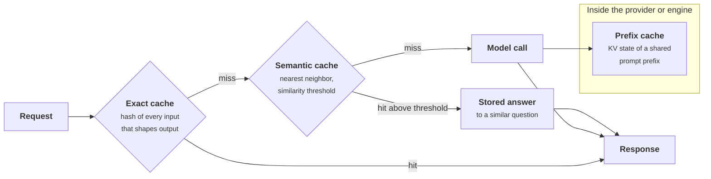

+++
title = 'Caches'
description = 'AI systems have four caches with very different risks. Prefix caches save money without changing answers; exact response caches are safe only with a complete key; semantic caches answer questions nobody asked unless they are scoped and measured.'
question = 'Which caches belong in an AI system, what must each key contain, and when does a cache hit return a wrong answer?'
weight = 2
difficulty = 3
prerequisites = ['/notes/systems-design/building-blocks/01-gateways-and-routers']
date = 2026-10-30T12:10:00Z
lastmod = 2026-10-30T12:10:00Z
verified = 2026-10-30
+++

## The idea in one minute

An ordinary cache is correct when its key captures everything the value
depends on and it is invalidated when that changes. AI systems have four caches,
and they differ in one question: **can a hit change the answer?**

A **prefix cache**, at the provider or in your own inference engine, reuses the
attention state of a prompt prefix. It changes cost and latency, not the
output distribution, so it is the safest large saving there is. An **exact
response cache** returns a stored completion for an identical request. It is
safe when the key includes every input that shapes the output, including model
version, system prompt version, tools, and the caller's scope. A **semantic
cache** returns a stored answer for a *similar* request. It is the only one of
the four whose hit can be a confident answer to a different question, and its
correctness has to be measured, not assumed.

The consequence to act on: take every prefix-caching saving you can by laying
out prompts carefully, build exact-match keys from a complete list of inputs,
and treat a semantic cache as a classifier with a false-positive rate, scoped
to one tenant.

## A picture



A prefix-cache hit only makes the model call cheaper. An exact hit is safe if
its key is complete. A semantic hit can be a different question's answer.

## How it really works

### The four caches side by side

| Cache | Stores | Key | Can a hit change the answer? | Main risk |
| --- | --- | --- | --- | --- |
| Provider prompt cache | Processed state of a prompt prefix, minutes | Exact prefix bytes, per account or organization | No | Prefix layout defeats it; timing leaks if shared |
| Engine KV prefix cache | KV blocks on your GPUs | Hash chain of token blocks | No | Uses GPU memory; needs prefix-aware routing |
| Exact response cache | Whole completions | Hash of every output-shaping input | Only if the key is incomplete | Stale or cross-scope hits |
| Semantic cache | Completions keyed by an embedding | Nearest neighbor above a threshold | Yes, by design | False hits, poisoning, leakage |

### Prefix caching: the safe saving

[Prefill](/notes/inference-engineering/inference-mechanics/01-prefill-and-decode/) computes keys and values for every prompt token in every layer. If a
new request starts with the same tokens as an earlier one, that state can be
reused and prefill skipped for the shared part. In vLLM, automatic prefix
caching divides the KV cache into fixed-size blocks and identifies each block
by a hash of its tokens together with the hash of the block before it, so a
lookup walks the chain until the first mismatch. SGLang's RadixAttention keeps
the same information in a radix tree. Either way, **one changed token
invalidates everything after it**.

Hosted APIs expose the same idea as prompt caching. As of October 2026,
Anthropic's API marks cacheable prefixes explicitly and bills cache reads at
0.1 times the base input price and 5-minute cache writes at 1.25 times;
OpenAI's API caches prompts of 1,024 tokens or more automatically, with a
discount that varies by model. Check the current pricing pages before relying
on either.

Work an agent step with a hypothetical model at $3 per million input tokens. The
prompt is 40,000 tokens; 34,000 of them (system prompt, tool definitions,
earlier turns) are unchanged since the last step and 6,000 are new.

```text
no caching        40,000 x $3.00 / M                         = $0.1200 per step
with caching      34,000 x $0.30 / M   (read at 0.1x)        = $0.0102
                +  6,000 x $3.75 / M   (written at 1.25x)    = $0.0225
                                                               $0.0327 per step   (73% less)
```

Over a 30-step task that is $3.60 against $0.98 of input, for identical
answers. The saving depends entirely on **prompt layout**:

- Static content first: system prompt, tool schemas, long reference
  documents, few-shot examples.
- Dynamic content last: the user's message, retrieved chunks, the current
  time.
- Nothing per-request in the prefix: no timestamps, request IDs, or user names
  in the system prompt. A date at the top of the prompt makes every request a
  miss.
- Stable serialization: tool schemas emitted in a fixed order, JSON with
  sorted keys. A dictionary that serializes differently across processes
  silently disables caching.

On your own GPUs the cache costs memory. For a model with 80 layers, 8 KV
heads, head dimension 128, and 16-bit values (the shape of Llama 3 70B), one
token of KV state is 2 × 80 × 8 × 128 × 2 = 327,680 bytes, so a 32,000-token
shared prefix holds about 10.5 GB of HBM. Engines evict least recently used
blocks, and a prefix only helps when the request reaches the replica that holds
it, which is why routers score replicas on prefix affinity.

### Exact response caches: the key is the contract

An exact cache is correct if and only if the key includes every input that can
change the output. The list is longer than "the prompt":

| Key field | Why |
| --- | --- |
| Model and pinned version | An upgrade must not serve the old model's answers |
| System prompt and template version | A prompt change is a behavior change |
| Full message list, normalized | The obvious part |
| Tool definitions and response schema | They change what the model produces |
| Sampling parameters | Temperature, top-p, max tokens, stop sequences |
| Retrieval index version, or the retrieved chunk IDs | The answer depends on the context it was given |
| Scope: tenant, and user when output depends on permissions | Prevents one caller receiving another's answer |

Versions in the key make invalidation free: a new prompt version is a new key
space, and the old entries expire by TTL. Three further rules:

- **Do not cache failures**: errors, refusals caused by transient policy
  checks, and responses cut off by `max_tokens` (finish reason `length`).
- **Caching sampled output removes diversity.** At temperature above zero a
  cache returns the same sample forever. That is fine for classification and
  extraction and wrong for "suggest five titles".
- **Temperature zero is not a determinism guarantee.** Batched inference can
  produce different outputs for the same input as batch composition changes.
  He and Thinking Machines Lab (2025) trace this to kernels that are not
  batch-invariant. A cache makes repeated answers identical, which is
  sometimes the point.

Exact caches pay off where identical requests recur: batch classification,
extraction re-runs, evaluation suites, popular fixed queries. For chat, exact
hit rates are low.

### Semantic caches: a classifier with a false-positive rate

A semantic cache embeds the incoming request, finds the nearest stored request,
and returns its answer if similarity exceeds a threshold. Similarity measures
how close two texts are in an embedding space. It does not measure whether they
have the same correct answer, and the cases where those diverge are the
dangerous ones:

| Near miss | Example | Why the answer differs |
| --- | --- | --- |
| Negation | "refund my order" / "do not refund my order" | Opposite instruction, one word apart |
| Scope | "is the API down" / "is the API down for tenant acme" | A narrower question |
| Act versus ask | "cancel my order" / "can I cancel my order" | One is a command, one a question |
| Personalization | "what is my balance" from two users | Identical text, different correct answers |
| Time | "what is the latest release" today and next month | The world changed |
| Qualifier | "opening hours" / "opening hours on holidays" | An exception the cached answer omits |

On top of correctness there are two security problems. **Leakage**: a cache
shared across users or tenants returns one caller's answer, possibly containing
their data, to another. **Poisoning**: if any caller can cause an answer to be
stored, an attacker can seed a malicious answer for a common question and let
the cache serve it to everyone.

Controls, in order of importance:

1. **Scope** the cache to a tenant, and to a user for anything personalized.
2. **Exclude** intents that act, that depend on permissions, or that depend on
   time; an intent classifier in front of the cache decides eligibility.
3. **Measure** the false-hit rate on a labeled sample of real traffic at the
   chosen threshold, and re-measure when the embedding model changes.
4. **Version** entries with the model, prompt, and source-document versions
   that produced them, and invalidate on change.
5. **Prefer assist over replace**: pass the nearest cached answer to the model
   as context, or show it as a suggestion, rather than returning it as final.

The economics are an inequality. With hit rate `h`, model cost `c`, lookup
cost `l`, false-hit rate `f` (among hits), and an expected cost per wrong
answer `w`:

```text
worth it when   h x c   >   l  +  h x f x w
```

For a support bot where a wrong refund answer costs a human escalation, `w` is
large, and a 2% false-hit rate can erase the saving.

### Timing side channels

Any shared cache makes a hit faster than a miss. If two tenants share a prefix
cache, one can measure time to first token to learn whether someone else
recently sent a given prefix. Gu et al. (2025) used exactly this timing signal
to audit API providers' prompt caching and reported that some shared caches
across users. Scope prefix caches per tenant, or share only prefixes the
platform itself supplies, such as a common system prompt.

## Code

The program has two parts. The first replays a model upgrade and a second
tenant against an exact cache keyed only on prompt and temperature, and against
one with a complete key. The second sweeps a semantic cache's threshold over 24
labeled pairs: 12 paraphrases that should hit and 12 near misses that must not.
The embedding is a bag of words, far cruder than a real embedding model.

```python {title="cache.py"}
"""cache.py: exact-match keys and a semantic cache threshold sweep.

Part 1 shows what an exact-match key must contain, by replaying a model
upgrade and a second tenant against an under-specified key.
Part 2 sweeps the similarity threshold of a semantic cache over labeled
pairs of questions (same intent or not) and reports hits and false hits.
Embeddings are bag-of-words vectors, a crude stand-in for a real embedding
model; the shape of the tradeoff, not the numbers, is the point.
"""

from __future__ import annotations

import hashlib
import json
import math
import re
from collections import Counter

# ---------- part 1: exact-match keys ----------


def key(fields: dict) -> str:
    return hashlib.sha256(json.dumps(fields, sort_keys=True).encode()).hexdigest()[:12]


def exact_demo() -> None:
    req = {"prompt": "Summarize ticket 4411", "temperature": 0}
    naive: dict[str, str] = {}
    full: dict[str, str] = {}

    def lookup(store: dict, fields: dict, produce: str) -> str:
        k = key(fields)
        if k in store:
            return f"HIT  {store[k]}"
        store[k] = produce
        return f"miss {produce}"

    events = [
        ("tenant A, model v1", "A", "m-2026-06", "v1 summary for A"),
        ("tenant A, model v1", "A", "m-2026-06", "v1 summary for A"),
        ("tenant A, model v2", "A", "m-2026-09", "v2 summary for A"),
        ("tenant B, model v2", "B", "m-2026-09", "v2 summary for B"),
    ]
    print("exact-match cache: key = prompt + temperature  vs  full key")
    for label, tenant, model, answer in events:
        n = lookup(naive, req, answer)
        f = lookup(full, {**req, "tenant": tenant, "model": model,
                          "system_prompt": "sp-14", "tools": "t-3"}, answer)
        print(f"  {label:<20} naive: {n:<24} full: {f}")


# ---------- part 2: semantic cache ----------

STOP = {"a", "an", "the", "my", "i", "to", "do", "is", "it", "you", "me", "please", "for", "of", "in", "on"}

PAIRS = [  # (cached question, new question, same intent?)
    ("how do i reset my password", "how can i reset my password", True),
    ("how do i reset my password", "password reset steps", True),
    ("what are your opening hours", "when are you open", True),
    ("what are your opening hours", "opening hours today", True),
    ("how long does shipping take", "how many days for shipping", True),
    ("how long does shipping take", "shipping time to canada", True),
    ("what is the refund policy", "can i get a refund what is the policy", True),
    ("what is the refund policy", "refund policy details", True),
    ("how do i export my data", "export data to csv how", True),
    ("does the plan include support", "is support included in the plan", True),
    ("how do i change my email address", "change the email on my account", True),
    ("where is my invoice", "find my invoice", True),
    ("cancel my order", "can i cancel my order", False),           # act vs ask
    ("how do i delete my account", "how do i delete my data but keep my account", False),
    ("is the api down", "is the api down for tenant acme", False),  # scope
    ("what is my account balance", "what is my account balance", False),  # same words, other user
    ("refund my last order", "do not refund my last order", False),
    ("upgrade to the pro plan", "what does the pro plan cost", False),
    ("reset my password", "reset my api key", False),
    ("how long does shipping take", "how long does a refund take", False),
    ("what are your opening hours", "what are your opening hours on holidays", False),
    ("export my data to csv", "import my data from csv", False),
    ("is support included in the plan", "is support included in the free plan", False),
    ("change my email address", "change my mailing address", False),
]


def vec(text: str) -> Counter:
    words = [w for w in re.findall(r"[a-z]+", text.lower()) if w not in STOP]
    return Counter(words)


def cosine(a: Counter, b: Counter) -> float:
    dot = sum(a[w] * b[w] for w in a)
    na = math.sqrt(sum(v * v for v in a.values()))
    nb = math.sqrt(sum(v * v for v in b.values()))
    return dot / (na * nb) if na and nb else 0.0


def sweep() -> None:
    same = [cosine(vec(a), vec(b)) for a, b, s in PAIRS if s]
    diff = [cosine(vec(a), vec(b)) for a, b, s in PAIRS if not s]
    print(f"\nsemantic cache: {len(same)} same-intent pairs, {len(diff)} different-intent pairs")
    print(f"  {'threshold':>9}  {'hits on same intent':>20}  {'false hits':>11}  {'precision':>9}")
    for th in (0.3, 0.4, 0.5, 0.6, 0.7, 0.8, 0.9, 0.99):
        tp = sum(s >= th for s in same)
        fp = sum(s >= th for s in diff)
        prec = tp / (tp + fp) if tp + fp else 1.0
        print(f"  {th:>9.2f}  {tp:>11}/{len(same)} ({tp/len(same):4.0%})  {fp:>5}/{len(diff)}  {prec:>9.0%}")
    print("\nnearest different-intent pairs:")
    worst = sorted(((cosine(vec(a), vec(b)), a, b) for a, b, s in PAIRS if not s), reverse=True)[:4]
    for s, a, b in worst:
        print(f"  {s:.2f}  '{a}'  ->  '{b}'")


if __name__ == "__main__":
    exact_demo()
    sweep()
```

Run it with `python3 cache.py`:

```text
exact-match cache: key = prompt + temperature  vs  full key
  tenant A, model v1   naive: miss v1 summary for A    full: miss v1 summary for A
  tenant A, model v1   naive: HIT  v1 summary for A    full: HIT  v1 summary for A
  tenant A, model v2   naive: HIT  v1 summary for A    full: miss v2 summary for A
  tenant B, model v2   naive: HIT  v1 summary for A    full: miss v2 summary for B

semantic cache: 12 same-intent pairs, 12 different-intent pairs
  threshold   hits on same intent   false hits  precision
       0.30           10/12 ( 83%)     12/12        45%
       0.40           10/12 ( 83%)     12/12        45%
       0.50            8/12 ( 67%)     11/12        42%
       0.60            5/12 ( 42%)      9/12        36%
       0.70            3/12 ( 25%)      8/12        27%
       0.80            2/12 ( 17%)      5/12        29%
       0.90            0/12 (  0%)      2/12         0%
       0.99            0/12 (  0%)      1/12         0%

nearest different-intent pairs:
  1.00  'what is my account balance'  ->  'what is my account balance'
  0.91  'what are your opening hours'  ->  'what are your opening hours on holidays'
  0.87  'refund my last order'  ->  'do not refund my last order'
  0.87  'is support included in the plan'  ->  'is support included in the free plan'
```

The naive key serves the old model's summary after the upgrade and serves
tenant A's summary to tenant B: two silent correctness failures, the second
one a data leak. The full key misses where it should.

The sweep shows the semantic problem plainly. At no threshold does precision
reach 50%, because the near misses were chosen to be adversarial: "what is my
account balance" from another user is a *perfect* match, and a negation scores
0.87 while honest paraphrases score far lower. A real embedding model separates
paraphrases much better than word counts, but it has the same structural
weakness: negation, scope, and identity are small textual changes with large
semantic effects. The pair set here is a stress test, not a traffic sample;
your false-hit rate has to be measured on your traffic.

## Where it breaks

- **Prefix caches are only as good as the prompt layout.** A teammate adding
  the date to the system prompt can halve your hit rate with no functional
  change. Track cached-token share per route as a metric and alert on drops.
- **Exact keys drift from reality.** A new output-shaping input, such as a
  feature flag read by the prompt template, has to be added to the key. Derive
  the key from the same structure that builds the request, not from a separate
  list maintained by hand.
- **Semantic thresholds do not transfer.** A threshold tuned for one embedding
  model, language, or product area is wrong for another.
- **Caches change load shape.** A cache that absorbs 40% of traffic means a
  cache outage or flush sends 1.7 times the usual load to the model. Size for
  the cold-cache case, or warm the cache before cutover.
- **The program's embeddings are word counts.** It demonstrates why similarity
  and correctness diverge, not what hit or false-hit rates a production
  semantic cache achieves.

## Remember this

- Ask of every cache: can a hit change the answer?
- [Prefix caching](/notes/inference-engineering/making-it-cheaper/03-prefix-caching/) changes cost, not output: static content first, nothing per-request in the prefix.
- An exact cache key includes model version, prompt version, tools, sampling parameters, context version, and scope.
- A semantic cache is a classifier with a false-hit rate; scope it per tenant, exclude actions and personalized answers, and measure it.
- Any shared cache is a timing channel between the parties that share it.

## Try it

1. Recompute the agent-step example for 60 steps, with the prompt growing by
   1,500 tokens per step and every earlier token cached. What fraction of total
   input cost is cache writes?
2. In `cache.py`, add a field to the full key that the naive key also lacks,
   such as the retrieval index version, and add an event where it changes.
3. Add five honest paraphrase pairs and five near misses from your own product
   to `PAIRS`. Where does the threshold have to sit to keep false hits at zero,
   and what hit rate is left?
4. Find a prompt you maintain and list every byte in its first 1,000 tokens
   that can differ between two requests from different users.

## Check yourself

1. Why is a prefix cache safe in a way a semantic cache is not?

   
   A prefix-cache hit reuses computed attention state for tokens that are
   byte-identical, so the model still generates the response for this exact
   request. Only cost and latency change. A semantic hit returns an answer that
   was generated for a different request, which may need a different answer.
   

2. A team keys its response cache on the prompt and temperature. Name two ways
   this returns a wrong answer.

   
   After a model or system-prompt upgrade it returns answers from the old
   version. Across tenants or users it returns one caller's answer to another,
   which is a data leak when the answer depends on permissions or private
   context. Tool definitions, sampling parameters, and the retrieval index
   version are further missing fields.
   

3. Why does putting the current time at the top of a system prompt raise cost?

   
   Prefix caches match from the first token. A value that changes every request
   at the top makes every request diverge immediately, so nothing after it can
   be reused, and the whole prompt is prefilled and billed at the uncached
   price.
   

4. When is a semantic cache worth deploying?

   
   When the saving from hits exceeds the lookup cost plus the expected cost of
   false hits: h × c > l + h × f × w. That favors high-volume, low-stakes,
   non-personalized questions, scoped to a tenant, with a measured false-hit
   rate. It rules out actions and permission-dependent answers.
   

5. How can a shared prefix cache leak information between tenants?

   
   A cache hit makes the first token arrive sooner. A tenant who sends a
   candidate prefix and measures time to first token can infer whether another
   tenant recently sent the same prefix. Scoping caches per tenant removes the
   signal.
   

## Sources

- W. Kwon et al., [Efficient Memory Management for Large Language Model Serving with PagedAttention](https://arxiv.org/abs/2309.06180), ACM SOSP, 2023.
- vLLM project, [Automatic prefix caching](https://docs.vllm.ai/en/latest/design/prefix_caching.html), design documentation, read October 2026.
- L. Zheng et al., [SGLang: Efficient Execution of Structured Language Model Programs](https://arxiv.org/abs/2312.07104) (RadixAttention), 2023.
- Anthropic, [Prompt caching](https://platform.claude.com/docs/en/build-with-claude/prompt-caching), API documentation, read October 2026.
- OpenAI, [Prompt caching](https://platform.openai.com/docs/guides/prompt-caching), API documentation, read October 2026.
- C. Gu et al., [Auditing Prompt Caching in Language Model APIs](https://arxiv.org/abs/2502.07776), 2025.
- H. He and Thinking Machines Lab, [Defeating Nondeterminism in LLM Inference](https://thinkingmachines.ai/blog/defeating-nondeterminism-in-llm-inference/), September 2025.
- A. Grattafiori et al. (Llama team, Meta), [The Llama 3 Herd of Models](https://arxiv.org/abs/2407.21783), 2024 (model shapes used for KV arithmetic).
