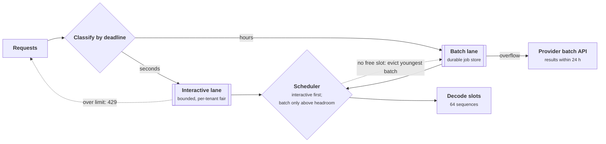

+++
title = 'Queues and batch lanes'
description = 'Interactive and batch work can share GPUs only if the scheduler keeps headroom or preempts. Priority alone fails when long batch jobs hold every slot, and preemption without limits thrashes. Lanes are defined by deadline.'
question = 'How do interactive and batch work share one GPU fleet without interactive users waiting behind batch jobs or batch never finishing?'
weight = 3
difficulty = 3
prerequisites = ['/notes/systems-design/building-blocks/01-gateways-and-routers', '/notes/systems-design/failure-modes/04-overload-and-backpressure']
date = 2026-10-30T12:15:00Z
lastmod = 2026-10-30T12:15:00Z
verified = 2026-10-30
+++

## The idea in one minute

An AI platform has two kinds of demand. **Interactive** requests have a user
waiting and a deadline in seconds. **Batch** work (evaluations, document
processing, embeddings, overnight agents, synthetic data) has a deadline in
hours and is happy to use whatever capacity is idle. Running them on separate
fleets wastes the interactive fleet's troughs; running them together risks
users waiting behind batch.

The intuitive fix, "interactive goes first", does not work by itself. A GPU
serves a fixed number of sequences at once, and a batch job that started a
minute ago holds its slot until it finishes. Priority decides who gets the
**next** free slot, not whether a slot is free. Protecting interactive latency
takes either **headroom** (batch may only start while some slots stay free) or
**preemption** (evict batch to make room), and preemption costs recomputed
work and can thrash. The consequence to act on: define lanes by deadline,
give each lane an admission rule and an overload behavior, keep headroom sized
to how fast interactive demand can rise, and preempt only as a backstop.

## A picture



The scheduler admits interactive work first, starts batch only while headroom
remains, and evicts batch as a last resort.

## How it really works

### Lanes are defined by deadline

A lane is a queue with its own deadline, admission rule, and overload behavior.
Define lanes by what the caller can tolerate, not by which team owns the
work.

| Lane | Deadline | Examples | Admission | On overload |
| --- | --- | --- | --- | --- |
| Interactive | TTFT in seconds | Chat, copilots, agent steps a user watches | Token budget per tenant, bounded queue | Reject early with 429 and `Retry-After` |
| Near-line | Minutes | Notifications, webhooks, background agent steps | Bounded queue with deadline | Delay, then drop expired items |
| Batch | Hours | Evaluations, ingestion, embeddings, synthetic data | Durable job store, quota per tenant | Wait; overflow to a provider batch API |
| Best effort | None | Backfills, experiments | Only idle capacity | Preempted first |

A request in the wrong lane is the most common bug. An evaluation suite sent
through the interactive API consumes the tenant's interactive budget and
competes with its users; a user-facing summary put on the batch lane misses its
deadline silently.

### Slots, Little's law, and the peak

A serving replica runs a bounded number of sequences at once, limited by KV
cache memory and the engine's batch limit. Call each one a **slot**. Little's
law (Little, 1961) says the average number of busy slots equals the arrival
rate times the time each request holds a slot:

```text
interactive at peak    5 requests/s  x  8 s held    =  40 slots busy on average
interactive at trough  2 requests/s  x  8 s held    =  16 slots
batch job              holds one slot for 60 to 180 s
```

With 64 slots, interactive work alone leaves between 24 and 48 slots idle over
the day. That idle capacity is what a batch lane is for. Because arrivals are
random, the number of busy interactive slots fluctuates around its mean: for
Poisson arrivals with many independent requests in service, the count is
approximately Poisson too, so at a mean of 40 a burst to 50 is routine.

### Why priority alone fails

With **non-preemptive priority**, an arriving interactive request takes the
next slot that frees up, ahead of any queued batch job. When batch has filled
every slot, the next free slot appears only when some batch job finishes. With
64 batch jobs averaging 120 s each, one finishes about every 1.9 s on average,
and a burst of interactive arrivals queues behind that trickle. The program
below shows interactive p99 wait reaching 22 s under strict priority.

### Headroom

A **headroom** rule says batch may start only while at least `R` slots would
remain free afterwards. Those free slots absorb interactive bursts
immediately. The cost is idle capacity: on average, `R` slots do nothing. Size
`R` for how far interactive demand can rise during the time it takes batch
slots to drain naturally, which is roughly one batch job's duration. Long batch
jobs need more headroom; short, chunked batch jobs need less. That is a strong
argument for **chunking batch work into short requests**: a 1,000-document job
should be 1,000 requests, not one long one.

### Preemption, and what it costs

**Preemption** evicts a running batch sequence to give its slot to interactive
work. Inference engines do this already for memory: vLLM, when it runs out of
KV-cache blocks, preempts sequences and later recomputes their state.
Preemption is never free:

- **Recompute.** The evicted sequence must redo its [prefill](/notes/inference-engineering/inference-mechanics/01-prefill-and-decode/) (and any decode
  state not kept) when it resumes, or its KV blocks must be swapped to host
  memory and back.
- **Thrash.** If interactive load stays high, the same batch work is evicted,
  restarted, and evicted again, burning capacity on work that is thrown away.
- **Victim choice.** Evicting the youngest job loses the least progress;
  evicting the job with the most remaining work frees the slot for longest.
  Either way, set a minimum run time so a job that just started is not evicted
  at once.

The robust design combines both: a small headroom handles routine bursts
without eviction, and preemption is the backstop for the rare large burst.

### Starvation and aging

Strict priority can starve batch indefinitely on a busy day. Batch has
deadlines too, so give it either a **floor** (a minimum share of slots it keeps
even under interactive load) or **aging** (a job's priority rises with its
wait). Report batch completion against deadline as a first-class metric, next
to interactive latency.

### Inside the lane

Within a lane, the rules from ordinary overload control still apply:

- **Bound the queue** and reject at the front, not after a timeout.
- **Drop work whose deadline has passed** before starting it.
- **Fair-share across tenants**, so one tenant's flood waits behind itself,
  as in [a multi-tenant inference gateway](/notes/systems-design/worked-designs/04-a-multi-tenant-inference-gateway/).
- Under sustained overload, serving the **newest** interactive requests first
  (adaptive LIFO) keeps some users fast instead of making every user slow;
  Maurer's "Fail at Scale" (2015) describes this together with CoDel-style
  queue timeouts.

### The batch lane as a product

A batch lane is a durable job system, not a low-priority flag on the
interactive API:

| Part | Design |
| --- | --- |
| Job store | Jobs and items in a database; each item has an ID and a state |
| Idempotent outputs | Results written keyed by item ID, so a retried item overwrites rather than duplicates |
| Chunking | Items are short requests, so headroom stays small and preemption loses little |
| Engine profile | Throughput-tuned replicas (large batch limits) separate from latency-tuned ones, where volume allows |
| Overflow | Provider batch APIs: as of October 2026, both OpenAI's Batch API and Anthropic's Message Batches API price batch requests at a 50% discount, with results within 24 hours |
| Accounting | Batch tokens attributed per tenant, with their own quota |

A complete design of such a lane is worked through in
[a batch inference pipeline](/notes/systems-design/ai-worked-designs/04-a-batch-inference-pipeline/).

### What to watch

- Interactive queue wait and TTFT, per tenant tier.
- Batch items completed per hour and the fraction finished by deadline.
- Preemptions per minute and recomputed tokens: the cost of protecting
  interactive work.
- Slot occupancy over the day: the trough is the batch lane's budget.

## Code

The simulation runs six hours of a 64-slot pool. Interactive requests arrive at
2 to 5 per second on a daily curve and hold a slot for 4 to 12 s. A backlog of
10,000 batch jobs, each holding a slot for 60 to 180 s, is available from the
start. Each policy is run on the same random seed.

```python {title="lanes.py"}
"""lanes.py: interactive and batch traffic on one pool of decode slots.

A pool has 64 concurrent sequence slots. Interactive requests arrive at a
diurnal rate and hold a slot for 4 to 12 s. A batch backlog of 10,000 jobs,
each holding a slot for 60 to 180 s, is available from t = 0. Policies:

  fifo           one queue in arrival order (batch was submitted first)
  priority       interactive always dequeued first, no preemption
  reserve R      priority, and batch starts only while R slots stay free
  preempt        priority; an interactive arrival with no free slot evicts
                 the youngest batch job, which goes back to the queue head
                 (it keeps its progress but redoes PREEMPT_COST seconds on resume)
  reserve 8+pre  keep 8 slots free of batch, and preempt only when those run out

One tick is one second; 6 simulated hours. Simulated, standard library only.
"""

from __future__ import annotations

import math
import random
from collections import deque

SLOTS = 64
HOURS = 6
T = HOURS * 3600
BATCH_JOBS = 10000
PREEMPT_COST = 15  # seconds of work redone after an eviction (prefill, warmup)


def rate(t: int) -> float:
    """Interactive arrivals per second: a 6-hour slice of a day, trough to peak."""
    return 2.0 + 3.0 * (1 - math.cos(2 * math.pi * t / T)) / 2  # 2/s .. 5/s


def simulate(policy: str, reserve: int = 0, seed: int = 3) -> dict:
    rng = random.Random(seed)
    inter_q: deque[tuple[int, int]] = deque()  # (arrival, service)
    batch_q: deque[list[int]] = deque([[0, rng.randint(60, 180)] for _ in range(BATCH_JOBS)])
    running: list[list] = []  # [kind, remaining, arrival_or_job, start]
    waits: list[int] = []
    batch_done = batch_preempted = busy = 0
    for t in range(T):
        # arrivals (Poisson, by thinning a per-second Bernoulli count)
        lam = rate(t)
        k = 0
        p = math.exp(-lam)
        u, cum, term = rng.random(), p, p
        while u > cum:
            k += 1
            term *= lam / k
            cum += term
        for _ in range(k):
            inter_q.append((t, rng.randint(4, 12)))
        # complete work
        for r in running:
            r[1] -= 1
        for r in running:
            if r[1] <= 0 and r[0] == "batch":
                batch_done += 1
        running = [r for r in running if r[1] > 0]
        # preemption: make room for waiting interactive work
        if policy in ("preempt", "hybrid"):
            need = len(inter_q) - (SLOTS - len(running))
            victims = sorted((r for r in running if r[0] == "batch"), key=lambda r: -r[3])
            for v in victims[:max(0, need)]:  # youngest first: least work lost
                running.remove(v)
                batch_q.appendleft([0, v[1] + PREEMPT_COST])  # recompute on resume
                batch_preempted += 1
        # admit
        free = SLOTS - len(running)
        if policy == "fifo":
            # batch was submitted before any interactive request
            while free and (batch_q or inter_q):
                if batch_q:
                    j = batch_q.popleft()
                    running.append(["batch", j[1], 0, t])
                else:
                    a, s = inter_q.popleft()
                    waits.append(t - a)
                    running.append(["inter", s, a, t])
                free -= 1
        else:
            while free and inter_q:
                a, s = inter_q.popleft()
                waits.append(t - a)
                running.append(["inter", s, a, t])
                free -= 1
            headroom = reserve if policy in ("reserve", "hybrid") else 0
            while free > headroom and batch_q:  # batch starts only above the headroom
                j = batch_q.popleft()
                running.append(["batch", j[1], 0, t])
                free -= 1
        busy += len(running)
    waits.sort()
    pct = lambda q: waits[min(len(waits) - 1, int(q * len(waits)))] if waits else -1
    return {"n": len(waits), "p50": pct(0.5), "p99": pct(0.99), "max": waits[-1] if waits else -1,
            "late": sum(w > 2 for w in waits) / max(1, len(waits)), "batch": batch_done,
            "pre": batch_preempted, "util": busy / (T * SLOTS)}


def main() -> None:
    print(f"{SLOTS} slots, {HOURS} h, interactive 2-5 req/s x 4-12 s, batch backlog {BATCH_JOBS} x 60-180 s\n")
    print(f"{'policy':<14}{'inter p50':>10}{'p99':>7}{'max':>7}{'wait>2s':>9}{'batch done':>12}{'preempted':>11}{'slot use':>10}")
    for label, pol, r in [("fifo", "fifo", 0), ("priority", "priority", 0),
                          ("reserve 4", "reserve", 4), ("reserve 8", "reserve", 8), ("reserve 16", "reserve", 16),
                          ("preempt", "preempt", 0), ("reserve 8+pre", "hybrid", 8)]:
        s = simulate(pol, r)
        print(f"{label:<14}{s['p50']:>9}s{s['p99']:>6}s{s['max']:>6}s{s['late']:>9.1%}"
              f"{s['batch']:>12,}{s['pre']:>11,}{s['util']:>10.0%}")


if __name__ == "__main__":
    main()
```

Run it with `python3 lanes.py`:

```text
64 slots, 6 h, interactive 2-5 req/s x 4-12 s, batch backlog 10000 x 60-180 s

policy         inter p50    p99    max  wait>2s  batch done  preempted  slot use
fifo              15368s 18576s 18623s   100.0%      10,000          0      100%
priority              2s    22s    54s    47.4%       6,501          0      100%
reserve 4             1s    15s    36s    29.1%       6,284          0       98%
reserve 8             0s     7s    19s    11.1%       5,859          0       94%
reserve 16            0s     2s     5s     0.4%       4,670          0       84%
preempt               0s     0s     0s     0.0%       3,944     20,474      100%
reserve 8+pre         0s     0s     0s     0.0%       5,139      3,951       92%
```

**FIFO** is a disaster: batch was submitted first, so interactive users wait
hours. **Strict priority** fixes the median but not the tail: p99 is 22 s and
47% of interactive requests wait more than 2 s, because batch holds every
slot. **Headroom** trades batch throughput for interactive latency smoothly:
keeping 16 slots free brings p99 to 2 s, at the cost of 28% fewer batch jobs
than strict priority. **Preemption** gives interactive zero wait, but evicts
batch 20,474 times, and with 15 s of recomputation per eviction it finishes
only 3,944 batch jobs, fewer than any headroom setting. **A small headroom plus
preemption** keeps interactive at zero wait with a fifth of the evictions and
30% more batch output than preemption alone.

## Where it breaks

- **Slots are not uniform.** A slot here is a fixed unit. In a real engine a
  long-context batch sequence holds far more KV memory than a short chat, and
  a larger batch slows every sequence's decode. Headroom should be expressed
  in KV blocks and tokens per second, not only in sequence counts.
- **Prefill interferes.** A batch job's long prompt prefill stalls decoding for
  interactive sequences in the same batch. [Chunked prefill](/notes/inference-engineering/batching-and-scheduling/03-chunked-prefill-and-priority/) and separate
  prefill capacity limit that; lanes alone do not.
- **Preemption cost varies.** Swapping KV to host memory, recomputing, or
  restarting from a checkpoint have very different costs. The program uses a
  flat 15 s.
- **Separate fleets are sometimes right.** If batch volume is large and
  steady, a throughput-tuned fleet on cheaper or preemptible capacity can beat
  sharing. Sharing wins when the interactive trough is large.
- **It is a simulation.** Arrival and service distributions are invented. It
  shows the shape of the tradeoffs, not your numbers.

## Remember this

- Lanes are defined by deadline: interactive, near-line, batch, best effort.
- Priority decides who gets the next free slot, not whether one is free.
- Headroom buys interactive latency with idle slots; size it for how fast interactive demand rises while batch drains.
- Preemption is a backstop: it costs recomputation and thrashes without limits.
- Chunk batch work into short, idempotent items with their own quota and deadline.

## Try it

1. In `lanes.py`, halve batch job durations (30 to 90 s). How much headroom do
   you need now for interactive p99 under 2 s?
2. Set `PREEMPT_COST = 60`. Which policy produces the most batch work while
   keeping interactive p99 under 5 s?
3. Add a batch floor: batch keeps at least 8 slots even under interactive
   load. What happens to interactive latency at the daily peak?
4. Add aging: a batch job that has waited more than an hour is never
   preempted. Measure preemptions and interactive p99.

## Check yourself

1. Why does strict non-preemptive priority still leave interactive requests
   waiting?

   
   Priority only orders the queue for the next free slot. When long batch jobs
   occupy every slot, a slot frees only when one of them finishes, so
   interactive requests wait for batch completions even though they are at the
   front of the queue.
   

2. Use [Little's law](/notes/systems-design/scale-and-performance/01-queueing-and-littles-law/): 3 interactive requests per second, each holding a slot
   for 10 s. How many slots are busy on average?

   
   L = λW = 3 × 10 = 30 slots on average. Bursts will exceed that, so the
   interactive share needs margin above 30.
   

3. Why does chunking batch work into short requests reduce the headroom you
   need?

   
   Headroom must cover the rise in interactive demand during the time it takes
   batch slots to free naturally. Short batch items free slots often, so the
   scheduler can stop starting batch and recover capacity quickly without
   preemption. They also lose less work when preempted.
   

4. In the simulation, preemption gave the best interactive latency. Why did it
   produce the least batch output?

   
   Every eviction cost 15 s of recomputation, and with no headroom almost every
   interactive arrival at a full pool caused one. Batch work was repeatedly
   evicted and restarted, so a large share of capacity went to redoing work.
   

5. Why should an evaluation suite not run through the interactive lane?

   
   It has an hours-scale deadline but would consume interactive token budgets
   and slots and compete with users for latency. In the batch lane it uses idle
   capacity, can be preempted, and can overflow to a discounted batch API.
   

## Sources

- J. D. C. Little, [A Proof for the Queuing Formula: L = λW](https://doi.org/10.1287/opre.9.3.383), Operations Research, 1961.
- M. Harchol-Balter, Performance Modeling and Design of Computer Systems: Queueing Theory in Action, Cambridge University Press, 2013.
- B. Maurer, [Fail at Scale](https://queue.acm.org/detail.cfm?id=2839461), ACM Queue, 2015.
- W. Kwon et al., [Efficient Memory Management for Large Language Model Serving with PagedAttention](https://arxiv.org/abs/2309.06180), ACM SOSP, 2023 (preemption by recomputation and swapping).
- OpenAI, [Batch API](https://platform.openai.com/docs/guides/batch), documentation, read October 2026.
- Anthropic, [Batch processing](https://platform.claude.com/docs/en/build-with-claude/batch-processing), documentation, read October 2026.
- A. Agrawal et al., [Taming Throughput-Latency Tradeoff in LLM Inference with Sarathi-Serve](https://arxiv.org/abs/2403.02310) (chunked prefill), USENIX OSDI, 2024.
