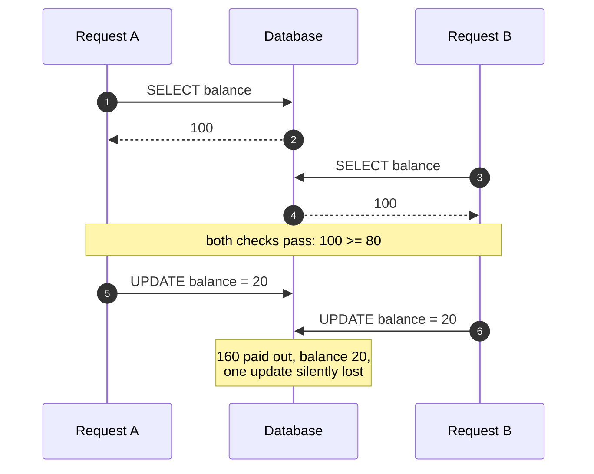
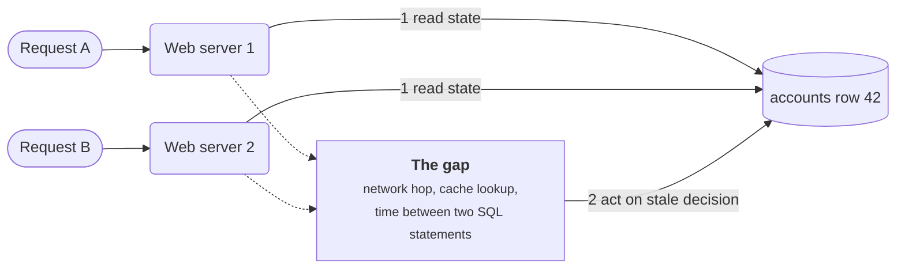
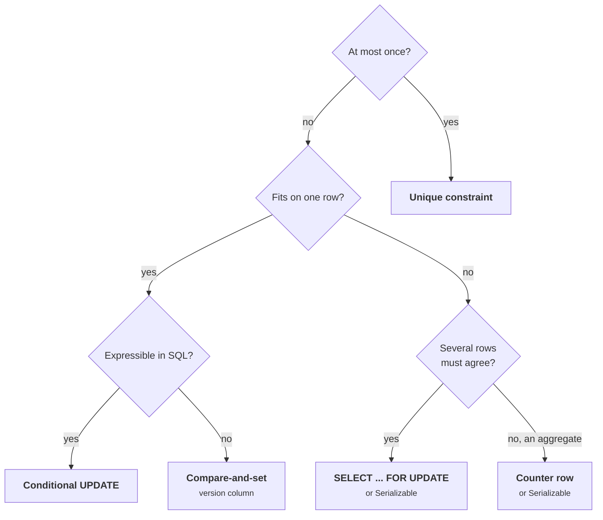
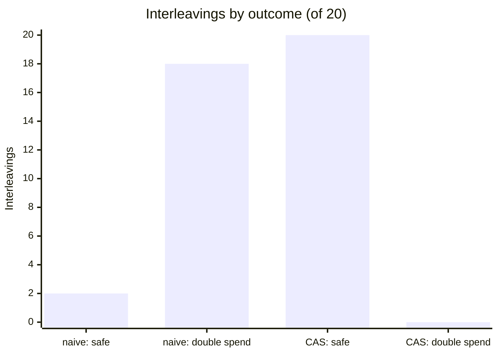

+++
title = 'Races and check-then-act'
description = 'A check and the action it guards are two steps. Anything that runs between them can break the invariant, so the check has to move into the write itself.'
question = 'Why do checks that pass in testing fail under concurrent requests, and how do you make them atomic?'
weight = 1
difficulty = 3
prerequisites = ['/notes/systems-design/thinking-in-invariants/01-what-a-design-promises', '/notes/systems-design/thinking-in-invariants/02-state-machines-and-transitions']
date = 2026-09-30
lastmod = 2026-10-30
verified = 2026-09-30
+++

## The idea in one minute

Most business rules are written as a check followed by an action: *if the
balance covers the withdrawal, subtract it*; *if the coupon is unused, apply it
and mark it used*; *if the user has fewer than three trial accounts, create
another*. In code that runs one request at a time, this is correct. In a
service that handles requests concurrently, the check and the action are two
separate steps, and another request can run between them. Both requests see
the old state, both pass the check, and both act. The balance goes negative,
the coupon is used twice, the limit is exceeded.

This is a **race condition**, and this particular shape is called
**time-of-check to time-of-use (TOCTOU)**. It is a security bug, not only a
reliability bug, because the attacker controls the timing: they can send fifty
identical requests in the same few microseconds and win the race on purpose.

The fix is never "check more carefully". It is to make the check and the act a
single atomic step, executed by the one component that serializes writes to that
state, usually the database. **An invariant that depends on current state must be
enforced at the moment of the write, not before it.**

## A picture



Each request is individually correct. The bug exists only in the interleaving.

## How it really works

### What a race is

A **race condition** is a bug whose outcome depends on the relative timing of
concurrent operations on shared state. CWE-362 names the general class and
CWE-367 the TOCTOU form. Two points are often misunderstood.

First, races do not need threads or shared memory. Two web servers, each
single-threaded, sharing one database row, race just as well as two threads
sharing a variable. Most races in web services are **logical races** between
processes, invisible to any thread sanitizer.

Second, a race needs only two things: a decision based on state that can change,
and a gap before the action based on that decision. The gap may be a network
round trip, a call to a payment provider, a cache lookup, or just the
milliseconds between two SQL statements.

Look for the gap: no threads anywhere, just two processes and one shared row.



### Two shapes: check-then-act and read-modify-write

| Shape | Pattern | What goes wrong |
| --- | --- | --- |
| **Check-then-act** | read state, decide, act | Two actors pass the same check. A single-use thing is used twice; a limit is exceeded. |
| **Read-modify-write** | read a value, compute a new one, write it back | Two writers start from the same old value; the second write overwrites the first. This is the **lost update**. |

The withdrawal in the picture is both at once: the check (`balance >= 80`) lets
both requests through, and the write (`balance = seen - 80`) loses one update.
The total paid out exceeds what the account ever held.

### Why it is a security bug

| Feature | Invariant | The race |
| --- | --- | --- |
| Wallet or gift-card balance | Paid out never exceeds funded | Parallel withdrawals or transfers spend the same funds twice |
| Single-use coupon or invite | Redeemed at most once | Parallel redemptions all see "unused" |
| Per-user limit (trials, votes, free credits) | At most *k* per user | Parallel creates each count *k − 1* existing rows |
| Login attempt counter | Lock out after *n* failures | Parallel guesses each read the same counter |
| Password reset or MFA code | Code consumed on first use | The same code is accepted on several parallel requests |
| Unique username or email | One account per identifier | Two sign-ups pass the "is it taken?" check |

Attackers widen the window deliberately. A script can open many connections
and release requests together. James Kettle's 2023 research on web race
conditions showed how to complete many HTTP/2 requests within one TCP packet,
which removes most network jitter and lets an attacker land dozens of requests
inside a window a few milliseconds wide. A race that "would never happen in
practice" because traffic is light is exactly the one an attacker can trigger.

The attacker does not wait for a lucky collision. They line requests up and
release them together, so every check runs before any write:

```mermaid {title="A single-packet burst lands every check inside the window"}
sequenceDiagram
  autonumber
  actor X as Attacker
  participant API as Coupon API
  participant DB as Database
  X->>API: open one HTTP/2 connection, send 20 nearly complete requests
  X->>API: final bytes of all 20 in one TCP packet
  rect rgb(249, 226, 233)
    loop 20 handlers in parallel
      API->>DB: SELECT used FROM coupons WHERE code = 'SAVE50'
      DB-->>API: false
    end
    Note over API,DB: race window, a few milliseconds, every check already passed
  end
  loop 20 handlers
    API->>DB: apply discount, then UPDATE coupons SET used = true
  end
  Note over X,DB: one coupon, 20 discounts
```

> [!IMPORTANT]
> Rate limiting does not fix a race. It caps how many attempts arrive per
> second, but twenty requests are enough to redeem one coupon twenty times.

### Fix 1: the atomic conditional update

Put the check in the `WHERE` clause and let the database evaluate it while it
holds the row:

```sql {title="check and act in one statement"}
UPDATE accounts
SET    balance = balance - 80
WHERE  id = 42 AND balance >= 80;
-- affected rows = 1: withdrawal happened
-- affected rows = 0: insufficient funds (or no such account)
```

The application must read the affected-row count; ignoring it turns this back
into a silent failure. In PostgreSQL this is safe even at the default Read
Committed level: when two transactions update the same row, the second waits
for the first to commit and then **re-evaluates the `WHERE` clause against the
new row version**, as the transaction isolation chapter of its documentation
describes. The second withdrawal finds 20 and matches no row. Note
`balance = balance - 80` rather than `balance = 20`: the new value is computed
from the row the database holds, not from what the application read earlier.

Replay the opening race with the check inside the `UPDATE`, and watch what B does
after it stops waiting:

```mermaid {title="The second update re-evaluates WHERE against the committed row"}
sequenceDiagram
  autonumber
  participant A as Request A
  participant DB as PostgreSQL
  participant B as Request B
  A->>DB: UPDATE ... SET balance = balance - 80 WHERE balance >= 80
  Note over DB: A holds the row lock
  B->>DB: same UPDATE
  Note over B,DB: B blocks on the row lock
  DB-->>A: 1 row, balance 20
  A->>DB: COMMIT
  Note over DB: B wakes and re-checks WHERE on the new version, 20 >= 80 is false
  DB-->>B: 0 rows, insufficient funds
```

Conditional updates handle any invariant that fits on one row: a balance, a
counter with a ceiling, a status transition (`SET status = 'redeemed' WHERE
status = 'issued'`). The last form is how state machines from
[earlier in the course](/notes/systems-design/thinking-in-invariants/02-state-machines-and-transitions/)
are enforced: a transition succeeds only from the expected state.

### Fix 2: compare-and-set

When the new value needs logic the database cannot express (a recomputed
document, a call to a rules engine), read the row with a **version number**,
compute in the application, and write back only if the version is unchanged:

```sql {title="optimistic concurrency with a version column"}
UPDATE accounts
SET    balance = :new_balance, version = version + 1
WHERE  id = 42 AND version = :version_i_read;
-- 0 rows: someone else wrote first. Re-read and retry, or give up.
```

This is **compare-and-set (CAS)**, also called optimistic concurrency control.
Nobody holds a lock while thinking; conflicts are detected at write time and
the loser retries. Each request runs this loop until it either commits or
rejects:

```mermaid {title="Compare-and-set: a conflict sends the loser back to read"}
stateDiagram-v2
  direction LR
  [*] --> Read: read balance and version
  Read --> Compute: check passes
  Read --> Rejected: check fails
  Compute --> Write: UPDATE ... WHERE version = v
  Write --> Committed: 1 row affected
  Write --> Read: 0 rows, someone wrote first
  Committed --> [*]
  Rejected --> [*]
```

The same primitive appears everywhere: HTTP conditional
requests (`If-Match` with an ETag, answered with `412 Precondition Failed`, per
RFC 9110), condition expressions in key-value stores, and transactions in etcd
that compare a key's revision before writing. CAS works well when conflicts are
rare. Under heavy contention on one row, retries pile up and a lock is cheaper.

### Fix 3: lock the row

`SELECT ... FOR UPDATE` inside a transaction takes a row lock that blocks other
writers and other `FOR UPDATE` readers of that row until commit:

```sql {title="pessimistic locking"}
BEGIN;
SELECT balance FROM accounts WHERE id = 42 FOR UPDATE;  -- blocks the second request here
-- application checks balance >= 80, maybe calls a rules engine
UPDATE accounts SET balance = balance - 80 WHERE id = 42;
COMMIT;
```

Locks are the right tool when the critical section reads several rows that
must stay consistent with each other, or when contention is high enough that
optimistic retries waste work. The costs: a slow critical section blocks every
other request for that row, and transactions that lock rows in different
orders can deadlock (the database detects this and aborts one). PostgreSQL also
offers `NOWAIT`, to fail instead of waiting, and `SKIP LOCKED`, which is how
job queues let workers claim different rows without contending. Never hold a
row lock across a call to another service; a slow dependency then becomes a
lock outage.

### Fix 4: unique constraints

For "at most once" invariants the strongest tool is often a **unique
constraint**, because it holds no matter which code path performs the insert:

```sql {title="a coupon can be redeemed once per user"}
CREATE TABLE redemptions (
  coupon_id  bigint NOT NULL,
  user_id    bigint NOT NULL,
  order_id   bigint NOT NULL,
  UNIQUE (coupon_id, user_id)        -- UNIQUE (coupon_id) for a single-use code
);

INSERT INTO redemptions (coupon_id, user_id, order_id)
VALUES (7, 1001, 555)
ON CONFLICT DO NOTHING;              -- 0 rows inserted: already redeemed
```

The database's index enforces uniqueness across all concurrent transactions.
The same idea underlies idempotency keys from
[the retries lesson](/notes/systems-design/failure-modes/02-retries-and-idempotency/):
the key is a unique column, and the second insert of the same key fails. A
unique constraint turns a check-then-act ("has this been used?") into an act
that fails if the check would have failed.

### Choosing a fix

| Invariant | Best tool | Why |
| --- | --- | --- |
| One row, expressible in SQL | Conditional `UPDATE ... WHERE` | One statement, no retry loop, no lock held by the application |
| One row, logic in the application | Compare-and-set on a version | No locks held while computing; retry on conflict |
| Several rows that must agree | `SELECT ... FOR UPDATE` in a transaction, or Serializable isolation | Holds everything still while deciding |
| At most once | Unique constraint | Enforced by the index for every writer, including future code |
| Aggregate over many rows ("at most 3 active") | A counter row updated conditionally, or Serializable isolation | A per-row condition cannot see sibling rows |

The same table as a decision path, starting from the shape of the invariant:



Isolation levels are the other route, and they are subtle enough to need
[their own lesson](/notes/systems-design/concurrency-and-consistency/03-consistency-models/).
The short version: wrapping the read and the write in `BEGIN ... COMMIT` does
**not** by itself prevent the lost update at Read Committed, the default in
PostgreSQL. A transaction is not a lock.

## Code

The program replays the withdrawal race without threads. Each request is a
Python generator that yields after every step, and a scheduler chooses who runs
next. Because the schedule is data, the race happens on every run, and the
program can enumerate every possible interleaving instead of hoping the right
one occurs.

```python {title="races.py"}
"""races.py: a check-then-act race, replayed deterministically.

Two requests each try to withdraw 80 from a balance of 100. Each request is a
generator that yields between steps; a scheduler decides who runs next. The
same schedule always produces the same result, so the race is reproducible.
Standard library only; no threads, no timing.
"""

from __future__ import annotations

from collections import Counter
from dataclasses import dataclass
from typing import Callable, Generator

Steps = Generator[str, None, None]


@dataclass
class Account:
    balance: int = 100
    version: int = 0
    paid_out: int = 0

    def compare_and_set(self, expected_version: int, new_balance: int) -> bool:
        """One atomic step, like
        UPDATE accounts SET balance = :new, version = version + 1
        WHERE id = :id AND version = :expected"""
        if self.version != expected_version:
            return False
        self.balance, self.version = new_balance, self.version + 1
        return True


def naive(acct: Account, name: str, amount: int) -> Steps:
    seen = acct.balance  # time of check
    yield f"{name} reads balance={seen}"
    if seen < amount:
        yield f"{name} rejects: insufficient funds"
        return
    yield f"{name} check passes"
    acct.balance = seen - amount  # time of use, based on a stale read
    acct.paid_out += amount
    yield f"{name} writes balance={acct.balance}, pays {amount}"


def with_cas(acct: Account, name: str, amount: int) -> Steps:
    while True:
        seen, ver = acct.balance, acct.version
        yield f"{name} reads balance={seen} (v{ver})"
        if seen < amount:
            yield f"{name} rejects: insufficient funds"
            return
        yield f"{name} check passes"
        if acct.compare_and_set(ver, seen - amount):
            acct.paid_out += amount
            yield f"{name} CAS v{ver}->v{acct.version} ok, balance={acct.balance}, pays {amount}"
            return
        yield f"{name} CAS expected v{ver}, found v{acct.version}: retry"


Withdraw = Callable[[Account, str, int], Steps]


def explore(withdraw: Withdraw) -> list[list[str]]:
    """Every complete interleaving of A and B, found by replaying prefixes."""
    done: list[list[str]] = []

    def can_run(prefix: list[str], who: str) -> bool:
        acct = Account()
        procs = {n: withdraw(acct, n, 80) for n in ("A", "B")}
        try:
            for step in prefix + [who]:
                next(procs[step])
        except StopIteration:
            return False
        return True

    def walk(prefix: list[str]) -> None:
        nxt = [w for w in ("A", "B") if can_run(prefix, w)]
        if not nxt:
            done.append(prefix)
        for w in nxt:
            walk(prefix + [w])

    walk([])
    return done


def run(withdraw: Withdraw, choices: list[str]) -> tuple[Account, list[str]]:
    acct = Account()
    procs = {n: withdraw(acct, n, 80) for n in ("A", "B")}
    return acct, [next(procs[who]) for who in choices]


def show(title: str, withdraw: Withdraw, choices: list[str]) -> None:
    acct, trace = run(withdraw, choices)
    print(title)
    for line in trace:
        print("  " + line)
    ok = acct.paid_out <= 100 and acct.balance == 100 - acct.paid_out
    print(f"  => balance={acct.balance} paid_out={acct.paid_out} "
          f"invariant {'holds' if ok else 'BROKEN'}\n")


if __name__ == "__main__":
    show("naive, schedule A B A B A B", naive, list("ABABAB"))
    show("CAS, same opening A B A B A B ...", with_cas, list("ABABABBB"))

    for label, fn in (("naive", naive), ("CAS", with_cas)):
        outcomes: Counter[tuple[int, int]] = Counter()
        for sched in explore(fn):
            acct, _ = run(fn, sched)
            outcomes[(acct.balance, acct.paid_out)] += 1
        total = sum(outcomes.values())
        bad = sum(n for (bal, paid), n in outcomes.items() if paid > 100)
        detail = ", ".join(f"balance={b} paid={p}: {n}" for (b, p), n in sorted(outcomes.items()))
        print(f"{label:<6} {total:>3} interleavings, {bad:>2} double spends  [{detail}]")
```

Run it with `python3 races.py`:

```text
naive, schedule A B A B A B
  A reads balance=100
  B reads balance=100
  A check passes
  B check passes
  A writes balance=20, pays 80
  B writes balance=20, pays 80
  => balance=20 paid_out=160 invariant BROKEN

CAS, same opening A B A B A B ...
  A reads balance=100 (v0)
  B reads balance=100 (v0)
  A check passes
  B check passes
  A CAS v0->v1 ok, balance=20, pays 80
  B CAS expected v0, found v1: retry
  B reads balance=20 (v1)
  B rejects: insufficient funds
  => balance=20 paid_out=80 invariant holds

naive   20 interleavings, 18 double spends  [balance=20 paid=80: 2, balance=20 paid=160: 18]
CAS     20 interleavings,  0 double spends  [balance=20 paid=80: 20]
```

The naive version is wrong in 18 of the 20 possible interleavings; only the two
fully serial orders are safe. That ratio is the real lesson. Under concurrency
the bad interleavings are the common case, and testing one request at a time
explores only the two good ones. The same counts as bars:



The CAS version is correct in all 20 because
the version check and the write are one atomic step: whichever request writes
second finds the version changed, re-reads 20, and rejects.

Exhaustive interleaving is a real technique, not a teaching toy. Model
checkers such as TLC, for TLA+ specifications, explore every reachable state of
a model, and
deterministic simulation testing runs a whole system under a seeded scheduler
for the same reason: rare schedules become reproducible.

## Where it breaks

- **The check reads a replica or a cache.** A conditional update on the primary
  is safe, but if the application first checks eligibility against a read
  replica or a cache and then performs an unconditional write, the race is back,
  with a much wider window. The authoritative check must happen where the write
  happens.

  The stale path is the dashed one: the decision comes from a copy, the write goes to the primary.

  ```mermaid {title="Checking a replica and writing the primary reopens the race"}
  flowchart LR
    App("App")
    R("Cache or replica")
    P[("Primary")]
    Chk["Eligible?<br/><small>answered from a lagging copy</small>"]
    W["Unconditional write"]
    App -.-> R
    R -.-> Chk
    Chk --> W
    W --> P
    P -. "replication lag" .-> R
    class Chk,W warn
  ```

- **The invariant spans rows.** "At most three active sessions per user" is a
  count over rows. Two inserts each see two rows and each add one. A per-row
  `WHERE` clause cannot see sibling rows. Use a counter row with a conditional
  update, a lock on a parent row, or Serializable isolation.
- **There is an external side effect in the gap.** If the code checks the
  balance, calls the card network, and then writes, no database trick protects
  the external call. Model it as a state machine: reserve the funds atomically
  (`available → held`), make the external call with an idempotency key, then
  settle or release.
- **The check is in the file system.** The classic TOCTOU bug is `access()`
  followed by `open()` on a path an attacker can swap for a symlink between the
  two calls. The fix is the same idea: open once, then check and use the file
  descriptor (`fstat`, `openat`, `O_NOFOLLOW`), never the name.
- **What the simulation does not show.** It models two requests and three steps
  each. Real databases add more interleaving points, and real systems have more
  than two actors. The program shows why serial testing misses races; it does
  not prove any production code is race-free.

## Remember this

- A check and the action it guards are two steps; another request can run between them.
- Races are security bugs because attackers choose the timing.
- Move the check into the write: conditional update, compare-and-set, row lock, or unique constraint.
- Always read the affected-row count; zero means the check failed.
- A transaction at Read Committed is not a lock; it does not prevent lost updates by itself.
- The component that serializes writes is the only place a state-dependent check is reliable.

## Try it

1. Run `races.py`. Change the starting balance to 160, so both withdrawals
   should succeed. Predict which invariant still breaks in the naive version,
   and in how many of the 20 interleavings, before you run it.
2. Add a third request `C` to both versions and count the interleavings. How
   does the fraction of unsafe schedules change?
3. Write a `conditional` withdrawal that mimics `UPDATE ... SET balance =
   balance - :amt WHERE balance >= :amt` as one step, with no version column.
   Confirm it is also correct in every interleaving.
4. In a service you know, find one check-then-act on a security decision
   (coupon, invite, quota, attempt counter). Which of the four fixes applies?

## Check yourself

1. Why does a race need no threads in a typical web service?

   
   The shared state lives in the database, not in process memory. Two
   single-threaded server processes handling two requests interleave their SQL
   statements just as two threads would interleave memory accesses. The race is
   between requests, not between threads.
   

2. A developer wraps `SELECT balance` and `UPDATE balance = :new` in one
   transaction at Read Committed. Is the lost update fixed?

   
   No. Read Committed lets both transactions read 100 before either writes; the
   second `UPDATE` waits for the first to commit and then overwrites its result,
   because the new value was computed in the application from a stale read.
   Use `balance = balance - 80 WHERE balance >= 80`, a version check, `SELECT
   ... FOR UPDATE`, or a stronger isolation level.
   

3. When is compare-and-set a better choice than `SELECT ... FOR UPDATE`?

   
   When conflicts are rare and the computation between read and write is
   expensive or involves the application. CAS holds no lock while computing, so
   it does not block other requests, and it only pays the retry cost when a
   conflict actually happens. Under heavy contention on one row, locking wastes
   less work, and an uncapped CAS retry loop can spin.
   

4. Why is a unique constraint stronger than an application check for "redeem at
   most once"?

   
   The database index enforces it for every concurrent transaction and every
   code path, including a batch job or an admin tool written later. An
   application check protects only the code that remembers to perform it, and
   is itself a check-then-act.
   

5. Why doesn't rate limiting prevent coupon reuse through a race?

   
   The race needs only a handful of requests inside a window of a few
   milliseconds. A rate limit of, say, ten requests per second still admits
   ten, and each can pass the "unused" check before any of them marks the
   coupon used.
   

## Sources

- MITRE, [CWE-367: Time-of-check Time-of-use (TOCTOU) Race Condition](https://cwe.mitre.org/data/definitions/367.html) and [CWE-362: Concurrent Execution using Shared Resource with Improper Synchronization](https://cwe.mitre.org/data/definitions/362.html).
- M. Bishop, M. Dilger, "Checking for Race Conditions in File Accesses", *Computing Systems* 9(2), 1996.
- PostgreSQL Global Development Group, [Transaction Isolation](https://www.postgresql.org/docs/current/transaction-iso.html), [Explicit Locking](https://www.postgresql.org/docs/current/explicit-locking.html), and [INSERT (ON CONFLICT)](https://www.postgresql.org/docs/current/sql-insert.html), PostgreSQL documentation (current version).
- R. Fielding, M. Nottingham, J. Reschke, [RFC 9110: HTTP Semantics](https://www.rfc-editor.org/rfc/rfc9110), section 13 (conditional requests), IETF, June 2022.
- J. Kettle, [Smashing the state machine: the true potential of web race conditions](https://portswigger.net/research/smashing-the-state-machine), PortSwigger Research, August 2023.
