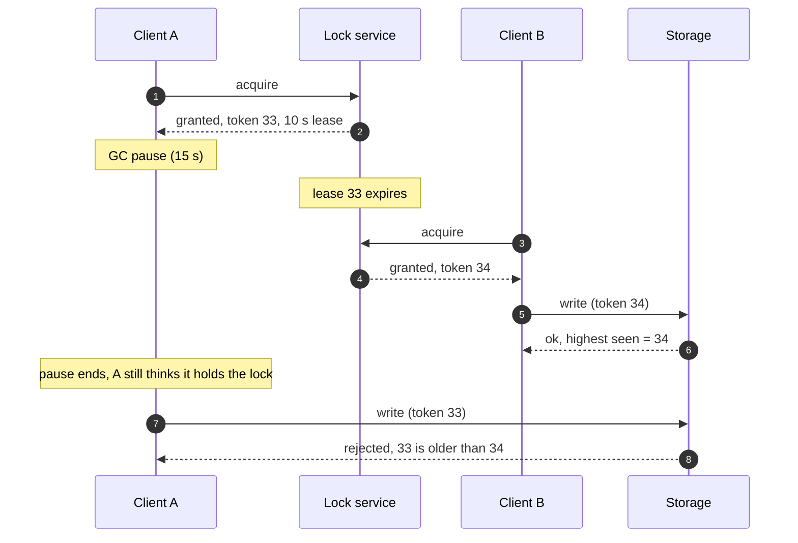
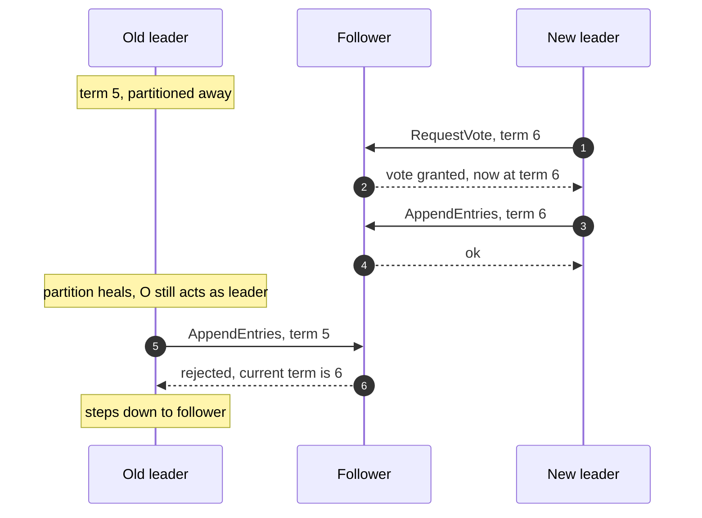

+++
title = 'Locks, leases, and fencing'
description = 'A distributed lock is a lease that can expire while its holder is paused. Mutual exclusion holds only if the protected resource itself rejects writes from stale holders.'
question = 'Why can two clients both believe they hold a distributed lock, and what makes that harmless?'
weight = 2
difficulty = 4
prerequisites = ['/notes/systems-design/concurrency-and-consistency/01-races-and-check-then-act', '/notes/systems-design/failure-modes/01-partial-failure-and-timeouts']
date = 2026-10-02
lastmod = 2026-10-30
verified = 2026-10-02
+++

## The idea in one minute

On one machine a mutex is simple: the operating system knows which thread holds
it, and if the process dies, the lock dies with it. Across machines there is no
such referee. A lock service cannot tell a crashed holder from a slow one, so
every practical distributed lock is a **lease**: it is granted for a fixed time
and expires unless renewed. Expiry is what keeps a crashed client from locking
everyone out forever.

Expiry is also the problem. A client can acquire a lease, check that it still
has eight seconds left, and then stop for fifteen seconds in a garbage-collection
pause, a VM migration, or a page fault. The lease expires, another client
acquires the lock and writes, and then the first client wakes up and writes too,
convinced it still holds the lock. Nothing in the client can prevent this,
because the pause can happen between any two instructions, including between
"check the lease" and "write".

The fix is to make the **resource** enforce exclusion. Each lease grant carries
a **fencing token**, a number that increases with every grant. The storage
system remembers the highest token it has seen and rejects writes with a lower
one. **A lock tells clients who should write; only the resource can stop a
client who should not.**

## A picture



This is the scenario Martin Kleppmann used in his 2016 analysis of distributed
locking, down to the token numbers.

## How it really works

### Why a distributed lock must expire

Suppose the lock service grants locks that last until released. The holder
crashes, or is partitioned away, and never releases. Every other client now
waits forever. The service cannot safely revoke the lock either, because it
cannot distinguish "crashed" from "slow" or "unreachable"; that is the basic
uncertainty of [partial failure](/notes/systems-design/failure-modes/01-partial-failure-and-timeouts/).

Gray and Cheriton's 1989 paper on leases gave the standard answer: grant the
right for a bounded term. If the holder is alive it renews; if not, the right
lapses on its own and the service can grant it again without talking to the
lost holder. The lock is traded for a timing assumption.

From the service's side, a lease has a short lifecycle; note that the expiry edge
needs nothing from the holder:

```mermaid {title="A lease lapses on its own, so the service never waits on a lost holder"}
stateDiagram-v2
  direction LR
  [*] --> Free
  Free --> Held: acquire, new token n
  Held --> Held: renew before expiry
  Held --> Free: holder releases
  Held --> Expired: term runs out
  Expired --> Free: no contact with holder needed
  note right of Expired
    The holder may still be alive
    and still believe it holds the lock
  end note
```

### What a lease assumes

A lease is safe only if the holder stops acting on it before the service
considers it expired. That requires three bounded quantities:

| Assumption | What violates it |
| --- | --- |
| **Clock rate**: holder and service measure the term at about the same speed | A misbehaving clock source, a VM whose clock drifts after migration, or code that measures durations with a wall clock that jumps |
| **Message delay**: the grant reaches the holder quickly | A network delay that eats much of the term before the holder starts counting |
| **Process pauses**: the holder checks its lease often enough | Stop-the-world garbage collection, VM suspension or live migration, swapping, `SIGSTOP`, CPU throttling of a container |

Careful implementations measure from the moment they *sent* the request (so
network delay shortens the lease rather than extending it), use a monotonic
clock for durations, and stop work some margin before expiry. All of that
narrows the window. None of it closes it, because a pause can occur after the
last check and before the side effect.

On a time axis, the overlap is plain: A's belief outlives A's lease, and runs
straight into B's.

```mermaid {title="A believes it holds the lock long after its lease ended"}
gantt
  dateFormat X
  axisFormat %S s
  section Lock service
  Lease 33 for A          :l1, 0, 10
  Lease 34 for B          :l2, 11, 21
  section Client A
  Working                 :a1, 0, 2
  GC pause                :crit, a2, 2, 15
  Stale write             :crit, a3, 15, 16
  section Client B
  Read and write          :b1, 12, 14
```

### The pause is a check-then-act

The lease check and the write are a
[check-then-act](/notes/systems-design/concurrency-and-consistency/01-races-and-check-then-act/)
in disguise:

```python {title="the unfixable client-side check"}
if lease.remaining() > SAFETY_MARGIN:   # check: 8 s left
    # a 15 s GC pause can happen here, and the client cannot detect it
    storage.write(data)                  # act: the lease expired 7 s ago
```

In the single-database case, the fix was to move the check into the write. The
same applies here, except the check cannot be "is my lease valid?", because
validity is a fact about time that the storage cannot verify. It can verify
order: a token is either the newest one or it is not.

Pauses of many seconds are not theoretical. Garbage-collected runtimes document
stop-the-world phases, hypervisors pause guests to migrate them, and an
overloaded host can deschedule a process for long stretches. Kleppmann's post
describes the GC case; any design that would be unsafe if a process stopped
for a minute is unsafe.

### Fencing tokens

A **fencing token** is a number issued with each lock grant that is strictly
greater than every number issued before. The client sends it with every write.
The resource keeps the highest token it has accepted and rejects any write that
carries a lower one:

```sql {title="a fenced write in SQL"}
UPDATE files
SET    content = :content, fence = :token
WHERE  id = :id AND fence <= :token;
-- 0 rows: a newer lock holder has already written. Stop.
```

The check lives at the resource, and the only state it needs is one number:

```mermaid {title="The resource, not the client, decides whether a write is stale"}
flowchart LR
  L("Lock service")
  A("Client A, token 33")
  B("Client B, token 34")
  X@{ shape: diam, label: "token >= highest?" }
  S[("Storage, highest = 34")]
  R["<b>Rejected</b><br/><small>stale holder</small>"]
  L -. "grant 33" .-> A
  L -. "grant 34" .-> B
  A -- "write, 33" --> X
  B -- "write, 34" --> X
  X -- yes --> S
  X -- no --> R
  class X,R good
```

Real coordination services already provide such numbers:

| System | Monotonic number usable as a token |
| --- | --- |
| Chubby (Google) | A **sequencer** with the lock's generation number; servers can check it (Burrows, 2006) |
| ZooKeeper | The transaction ID (zxid) or znode version of the lock node |
| etcd | The revision at which the lock key was created; revisions increase cluster-wide |
| Raft-based systems | The **term** number, which every message carries and every node checks |

Fencing turns a timing assumption into an ordering check, which is why it
survives pauses, clock jumps, and slow networks. The lock service still matters:
it decides who *should* be working, so that two clients do not waste effort. The
token makes it harmless when that decision is out of date.

### Efficiency locks and correctness locks

Kleppmann's distinction is the most useful question to ask about any lock:

| | Efficiency lock | Correctness lock |
| --- | --- | --- |
| **Purpose** | Avoid doing the same work twice | Protect an invariant |
| **If two holders overlap** | Some wasted work, a duplicate email | Corrupted data, a double payout, a lost update |
| **Requirements** | A single Redis instance with a TTL is often fine | Consensus-backed lock service *and* fencing at the resource |

His post argued that the Redlock algorithm, which acquires a lock on a majority
of independent Redis nodes, is too heavy for efficiency and unsafe for
correctness, because it depends on bounded pauses and clock behavior and
provides no fencing token. Salvatore Sanfilippo, Redis's author, published a
response defending Redlock's timing assumptions as reasonable in practice. The
disagreement is instructive: both sides agree that without fencing, safety rests
on timing; they disagree on whether timing can be trusted. For a lock that
guards money or permissions, design so that you do not have to settle the
argument.

Place a lock on two questions: how bad is an overlap, and can the resource check a token?

```mermaid {title="Overlap harm and resource support decide what a lock needs"}
quadrantChart
  title Which lock design fits
  x-axis Low harm from overlap --> High harm from overlap
  y-axis Resource cannot check tokens --> Resource checks tokens
  quadrant-1 Fence at the resource
  quadrant-2 Fencing optional
  quadrant-3 Single Redis TTL is fine
  quadrant-4 Use resource CAS or a proxy
  Cache warm-up job: [0.2, 0.25]
  Daily digest email: [0.35, 0.15]
  Report regeneration: [0.3, 0.7]
  Shared file write: [0.75, 0.8]
  Ledger payout: [0.9, 0.9]
  Third-party API charge: [0.85, 0.2]
```

### When the resource cannot check a token

Fencing works only if the resource participates. A third-party API, a legacy
file share, or an email server will not compare tokens. Options, from best to
worst:

1. **Use the resource's own concurrency control.** A conditional write, a
   version or ETag, a unique key. If the resource has compare-and-set, you may
   not need the lock at all.
2. **Put a fencing proxy in front.** One component that owns all writes to the
   resource and checks tokens. It becomes the serialization point.
3. **Make the operation idempotent and commutative**, so a duplicate or
   reordered write is harmless.
4. **Accept the risk explicitly**, with a margin between lease expiry and
   reassignment, and monitoring for overlap. This is an efficiency lock, and the
   design should say so.

Option 2 looks like this: the proxy is the only path to the resource, so it can
fence on the resource's behalf.

```mermaid {title="A fencing proxy checks tokens for a resource that cannot"}
flowchart LR
  A("Client A, token 33")
  B("Client B, token 34")
  P("Fencing proxy")
  subgraph T["Cannot compare tokens"]
    E("Third-party API")
  end
  A -- "33, rejected" --> P
  B -- "34, accepted" --> P
  P -- "forwards only the newest holder" --> E
```

### Leader election is the same problem

A leader is a lock holder with a fancier name. A deposed leader that was paused
or partitioned will keep acting as leader until it learns otherwise. Consensus
protocols fence it with **epochs** or **terms**: every request carries the
sender's term, and a node that has seen a higher term rejects it. Storage
systems that are not part of the consensus group need the same check, or a
leader that lost its lease can still write to shared disks. Older clusters used
STONITH ("shoot the other node in the head"), cutting power to the old leader;
fencing tokens do the same thing with less violence.

Here the term plays the token's part for a leader that was partitioned during
an election:



## Code

The program scripts the paused-holder scenario on a simulated clock, so the pause
lands at the same moment on every run. The lock service enforces leases
correctly; the only difference between the two runs is whether storage checks
the token.

```python {title="fencing.py"}
"""fencing.py: a paused lock holder, with and without fencing tokens.

Time is a simulated integer clock, so the pause happens on every run. The lock
service grants leases that expire after TTL seconds and hands out a token that
increases with every grant. Standard library only; offline.
"""

from __future__ import annotations

from dataclasses import dataclass, field

TTL = 10


@dataclass
class LockService:
    holder: str | None = None
    expires: int = 0
    last_token: int = 32  # tokens 33 and 34, as in Kleppmann (2016)

    def acquire(self, who: str, now: int) -> int | None:
        if self.holder is not None and now < self.expires:
            return None  # someone else holds a live lease
        self.last_token += 1
        self.holder, self.expires = who, now + TTL
        return self.last_token


@dataclass
class Storage:
    fenced: bool
    data: list[str] = field(default_factory=lambda: ["v0"])
    highest_token: int = 0

    def read(self) -> list[str]:
        return list(self.data)

    def write(self, value: list[str], token: int) -> str:
        if self.fenced:
            if token < self.highest_token:
                return f"REJECTED (token {token} < {self.highest_token})"
            self.highest_token = token
        self.data = value
        return f"accepted, data={value}"


def scenario(fenced: bool) -> list[str]:
    locks, store = LockService(), Storage(fenced)
    log: list[str] = []

    def say(t: int, who: str, what: str) -> None:
        log.append(f"t={t:>2}  {who:<7} {what}")

    tok_a = locks.acquire("A", now=0)
    say(0, "A", f"acquires lease, token {tok_a}, expires t={locks.expires}")
    snap_a = store.read()
    say(1, "A", f"reads {snap_a}")
    say(2, "A", f"checks lease: {locks.expires - 2}s left, safe to write")
    say(2, "A", "stop-the-world GC pause begins")

    refused = locks.acquire("C", now=5) is None
    say(5, "C", "tries to acquire: " + ("refused, lease still live" if refused else "granted"))
    say(10, "lock", "lease A expires; A does not know")
    tok_b = locks.acquire("B", now=11)
    say(11, "B", f"acquires lease, token {tok_b}, expires t={locks.expires}")
    snap_b = store.read()
    say(12, "B", f"reads {snap_b}")
    say(13, "B", "writes -> " + store.write(snap_b + ["B"], tok_b))

    say(15, "A", "pause ends; A still believes it holds the lock")
    say(15, "A", "writes -> " + store.write(snap_a + ["A"], tok_a))
    lost = "B" not in store.data
    say(16, "result", f"data={store.data}" + ("  B's update is LOST" if lost else "  B's update survives"))
    return log


if __name__ == "__main__":
    for fenced in (False, True):
        print("storage WITH fencing" if fenced else "storage WITHOUT fencing")
        for line in scenario(fenced):
            print("  " + line)
        print()
```

Run it with `python3 fencing.py`:

```text
storage WITHOUT fencing
  t= 0  A       acquires lease, token 33, expires t=10
  t= 1  A       reads ['v0']
  t= 2  A       checks lease: 8s left, safe to write
  t= 2  A       stop-the-world GC pause begins
  t= 5  C       tries to acquire: refused, lease still live
  t=10  lock    lease A expires; A does not know
  t=11  B       acquires lease, token 34, expires t=21
  t=12  B       reads ['v0']
  t=13  B       writes -> accepted, data=['v0', 'B']
  t=15  A       pause ends; A still believes it holds the lock
  t=15  A       writes -> accepted, data=['v0', 'A']
  t=16  result  data=['v0', 'A']  B's update is LOST

storage WITH fencing
  t= 0  A       acquires lease, token 33, expires t=10
  t= 1  A       reads ['v0']
  t= 2  A       checks lease: 8s left, safe to write
  t= 2  A       stop-the-world GC pause begins
  t= 5  C       tries to acquire: refused, lease still live
  t=10  lock    lease A expires; A does not know
  t=11  B       acquires lease, token 34, expires t=21
  t=12  B       reads ['v0']
  t=13  B       writes -> accepted, data=['v0', 'B']
  t=15  A       pause ends; A still believes it holds the lock
  t=15  A       writes -> REJECTED (token 33 < 34)
  t=16  result  data=['v0', 'B']  B's update survives
```

Every component behaves correctly in the first run. The lock service refused
client C while A's lease was live and granted B only after it expired. A checked
its lease before writing. B's update is lost anyway. In the second run, the only
added logic is two lines in `Storage.write`, and the stale write is refused. Note
that client A in the fenced run does not need to know anything about the pause;
the rejection tells it to stop.

## Where it breaks

- **Tokens must be monotonic across lock-service failover.** If the lock service
  is a single node that restarts with its counter reset, or a replicated store
  with asynchronous failover, it can issue token 34 twice. The counter must live
  in a consensus-backed store.
- **Every write path must check.** A fenced write API and an unfenced batch job
  writing the same table is an unfenced system.
- **Several resources.** If a lock holder writes to a database and an object
  store, each must check the token. Fencing one and not the other gives partial
  updates from stale holders.
- **Fencing rejects; it does not undo.** If A wrote half its changes before B
  acquired the lock, those changes stay. Writes from a lock holder should be
  atomic or idempotent at the resource.
- **Reads are not fenced.** A paused holder can read stale data and act on it
  elsewhere (send an email, call an API). Only side effects that pass through a
  fenced resource are protected.
- **The simulation is scripted.** It shows one pause at one moment. It does not
  model network delay, clock drift, or a lock service that fails over; those
  only make the unfenced case worse.

## Remember this

- A distributed lock is a lease, and a lease can expire while its holder is paused.
- Checking the lease before writing is still a check-then-act; the pause can fall after the check.
- Fencing tokens increase with every grant; the resource rejects any token lower than one it has seen.
- Ask whether a lock is for efficiency or correctness; only the second needs fencing.
- If the resource cannot check tokens, use its own compare-and-set or put a fencing proxy in front.
- Leader election is locking: terms and epochs are fencing tokens.

## Try it

1. Run `fencing.py`. Shorten the pause so A resumes at t=9 and confirm both
   versions behave correctly. Then explain why that proves nothing about safety.
2. Add a second resource, an audit log that does not check tokens, which both
   clients append to. What does the log say happened in the fenced run?
3. Make the lock service "restart" at t=12 with `last_token` reset to 32 and
   let a third client acquire the lock. What breaks, and where must the counter
   live to prevent it?
4. For a scheduled job in a system you know that uses a lock to "run on only one
   node", decide whether it is an efficiency or a correctness lock.

## Check yourself

1. Why can't a lock service simply wait for a holder to release a lock, with no
   expiry?

   
   A holder that crashes or is partitioned away never releases it, and the
   service cannot tell a dead holder from a slow one. Without expiry every other
   client waits forever. A lease trades that availability problem for a timing
   assumption.
   

2. A client checks that its lease has eight seconds left immediately before
   each write. Why is that not enough?

   
   The check and the write are separate steps. A garbage-collection pause, VM
   suspension, or scheduling delay can occur between them and last longer than
   the remaining eight seconds. The client cannot detect a pause that happens
   after its last check.
   

3. What property must fencing tokens have, and who checks them?

   
   Each token must be strictly greater than every token issued before it,
   including across lock-service restarts and failovers. The protected resource
   checks them: it remembers the highest token it has accepted and rejects any
   write with a lower one.
   

4. When is a single Redis instance with a TTL an acceptable lock?

   
   When the lock is for efficiency: overlapping holders cause duplicate work or
   a duplicate notification, not a violated invariant. If overlap could corrupt
   data or spend money twice, it needs a consensus-backed lock service and
   fencing at the resource.
   

5. How does a Raft term act as a fencing token?

   
   Every message carries the sender's term, and terms only increase with each
   election. A node that has seen a higher term rejects requests from an old
   leader, so a leader that was paused or partitioned cannot overwrite decisions
   made after it was replaced.
   

## Sources

- M. Kleppmann, [How to do distributed locking](https://martin.kleppmann.com/2016/02/08/how-to-do-distributed-locking.html), February 2016.
- S. Sanfilippo, [Is Redlock safe?](http://antirez.com/news/101), February 2016.
- C. Gray, D. Cheriton, "Leases: An Efficient Fault-Tolerant Mechanism for Distributed File Cache Consistency", *SOSP*, 1989.
- M. Burrows, [The Chubby lock service for loosely-coupled distributed systems](https://research.google/pubs/the-chubby-lock-service-for-loosely-coupled-distributed-systems/), *OSDI*, 2006.
- P. Hunt, M. Konar, F. Junqueira, B. Reed, [ZooKeeper: Wait-free coordination for Internet-scale systems](https://www.usenix.org/conference/usenix-atc-10/zookeeper-wait-free-coordination-internet-scale-systems), *USENIX ATC*, 2010.
- D. Ongaro, J. Ousterhout, [In Search of an Understandable Consensus Algorithm](https://raft.github.io/raft.pdf), *USENIX ATC*, 2014 (terms).
- M. Kleppmann, *Designing Data-Intensive Applications*, O'Reilly, 2017, chapter 8.
