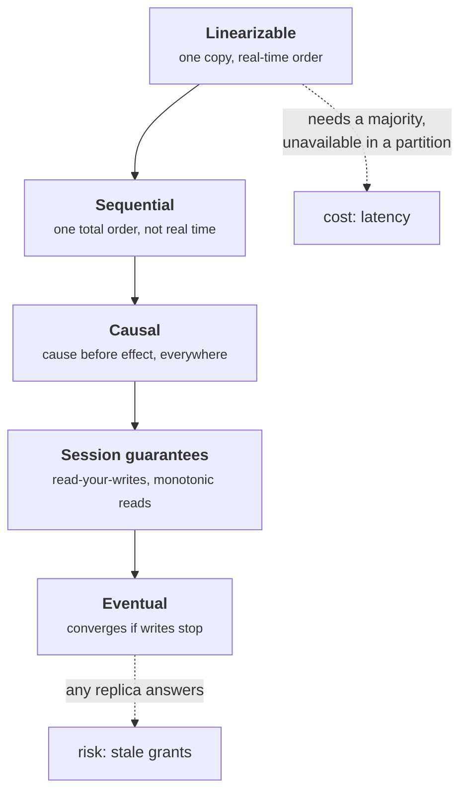
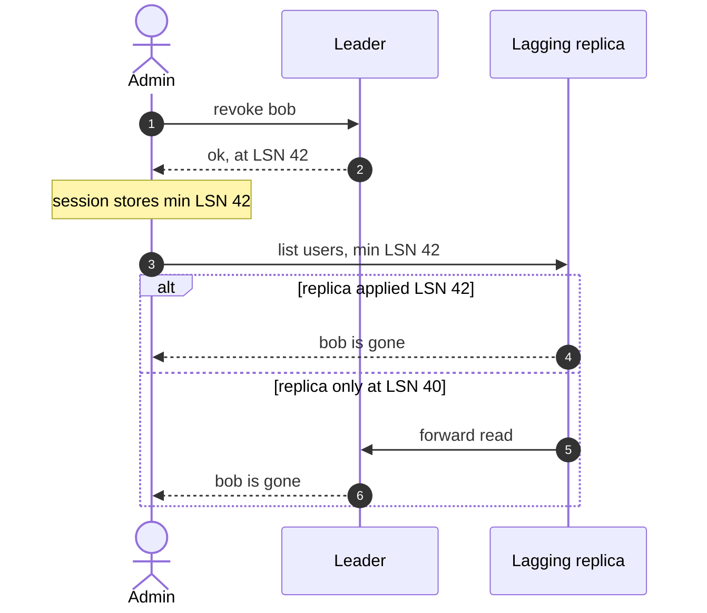
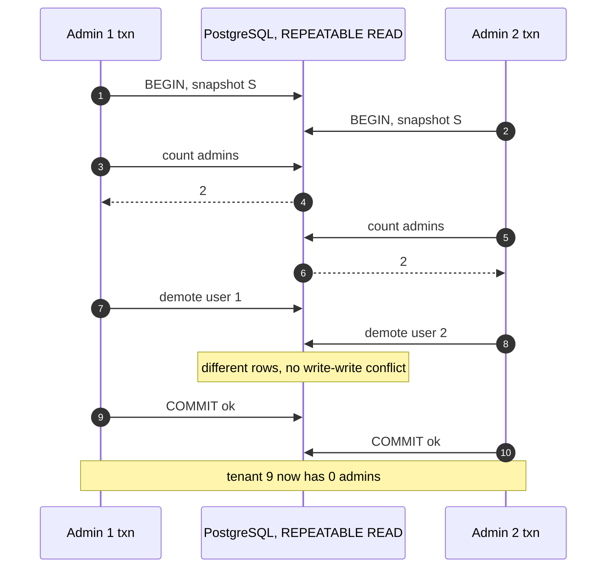
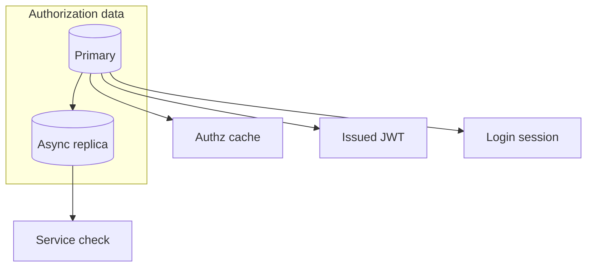

+++
title = 'Consistency models'
description = 'A consistency model is the contract for what a read may return while writes and replication are in flight. For security, it decides how long a revoked permission keeps working.'
question = 'What can a read return when data is replicated or transactions overlap, and which guarantees do security checks need?'
weight = 3
difficulty = 4
prerequisites = ['/notes/systems-design/concurrency-and-consistency/01-races-and-check-then-act']
date = 2026-10-04
lastmod = 2026-10-04
verified = 2026-10-04
+++

## The idea in one minute

When data lives in one place and requests run one at a time, a read returns the
last write. Add replicas, caches, and concurrent transactions and that sentence
stops being automatically true. A **consistency model** is the contract a
system offers instead: which writes a read is guaranteed to see, and in what
order. The strongest models behave like a single copy. The weakest promise only
that replicas will agree eventually, if writes stop.

There are two families. **Consistency models** in the distributed-systems sense
describe single operations against replicated data: linearizable, sequential,
causal, session guarantees such as read-your-writes, and eventual.
**Isolation levels** describe how multi-statement transactions inside a
database may interfere: Read Committed, Snapshot Isolation, Serializable, and
the anomalies each allows.

Both families have a security reading. Under eventual consistency, a
permission revoked on the primary is still granted by a replica that has not
caught up, for as long as it lags. Under Snapshot Isolation, two concurrent
transactions can each preserve an invariant and together break it. **Every
security check reads state, so every security check inherits the consistency
model of the store it reads.**

## A picture



Each arrow points to a weaker model: every behavior allowed above is allowed
below, plus more.

## How it really works

### Linearizability

Herlihy and Wing defined **linearizability** in 1990: every operation appears to
take effect at a single instant between its invocation and its response, and
those instants respect real time. If a write completes before a read begins,
the read sees that write or a later one. The system behaves as if there were one
copy and one clock.

This is what most people assume without saying so, and what a security check
usually needs: once `revoke(alice)` returns, no later check grants alice access.
The price is coordination. A linearizable read in a replicated system must
confirm, typically with a majority of replicas, that it is not stale. Gilbert
and Lynch's 2002 proof of the CAP conjecture shows that a system cannot be both
linearizable and available to every request during a network partition.

The coordination is visible in the message flow: the check after the revoke
cannot be answered from local state alone.

```mermaid {title="A linearizable read confirms freshness with a majority"}
sequenceDiagram
  autonumber
  actor Adm as Admin
  participant L as Leader
  participant F1 as Follower 1
  participant F2 as Follower 2
  actor Al as Alice
  Adm->>L: revoke(alice)
  L->>F1: replicate
  F1-->>L: ack
  L-->>Adm: done, majority has it
  Al->>L: check(alice)
  L->>F1: am I still leader?
  F1-->>L: yes
  Note over L: read is now known to be fresh
  L-->>Al: deny
```

### Sequential consistency

Lamport's 1979 **sequential consistency** requires that all operations appear in
one total order that respects each client's own program order, but not real
time. Client B may still see a world from before client A's completed write, as
long as every client sees the same history in the same order. For a revocation,
that means "eventually and in order", not "immediately".

### Causal consistency

**Causal consistency** orders only operations that are causally related. If one
operation could have influenced another (the same client did both, or one
client read the result of the other's write), every replica shows them in that
order. Concurrent, unrelated operations may appear in different orders on
different replicas. Causal consistency can be provided without waiting for a
majority, which is why it is attractive for geo-replicated systems, and it
prevents an important class of security bugs: if an admin removes Bob from a
document's ACL and *then* adds a secret paragraph, no replica may show Bob the
paragraph under the old ACL.

Compare the two replicas below: the same two writes, applied in two orders.

```mermaid {title="Causal order keeps an ACL change ahead of the content it protects"}
flowchart LR
  W1["<b>1. Remove Bob</b><br/><small>from the ACL</small>"] -- "causes" --> W2["<b>2. Add secret</b><br/><small>paragraph</small>"]
  subgraph RX["Replica X, causal order"]
    X1["apply 1"] --> X2["apply 2"] --> XB["Bob denied"]
  end
  subgraph RY["Replica Y, order not kept"]
    Y2["apply 2"] --> YB["Bob reads the secret"] --> Y1["apply 1"]
  end
  W2 --> X1
  W2 --> Y2
  class XB good
  class YB warn
```

### Session guarantees

Terry and colleagues defined four guarantees in 1994 for a single client's
session against weakly consistent replicas:

| Guarantee | Promise | Bug it prevents |
| --- | --- | --- |
| **Read-your-writes** | A client sees its own earlier writes | An admin revokes a user, refreshes the page, and sees the user still listed |
| **Monotonic reads** | A client never sees an older state after a newer one | A permission that disappears and reappears as requests hit different replicas |
| **Monotonic writes** | A client's writes apply in the order issued | A "disable account" applied before the "enable account" that preceded it |
| **Writes follow reads** | A write is ordered after the writes the client had read | A reply visible on a replica that does not yet have the message it answers |

These are cheap: the client carries a token, such as the log position of its
last write, and a replica serves the request only if it has caught up to it.

Follow the token: it travels with the session, and the lagging replica hands the
read off instead of answering stale.



### Eventual consistency

**Eventual consistency** promises only that if no new writes arrive, all
replicas will converge to the same value. It says nothing about how long that
takes or what reads return meanwhile. Werner Vogels's 2009 article describes the
model and its variants. Eventual consistency is the honest description of
asynchronous replicas, caches with a TTL, CDNs, and self-contained tokens that
stay valid until they expire.

### Isolation levels and their anomalies

Inside a database, the question is how concurrent transactions may interleave.
The ANSI SQL standard defines isolation levels by three phenomena (dirty read,
non-repeatable read, phantom). Berenson, Bernstein, Gray, Melton, O'Neil, and
O'Neil's 1995 *A Critique of ANSI SQL Isolation Levels* showed those definitions
were ambiguous and incomplete. It added dirty write and **lost update**,
defined **Snapshot Isolation**, and named **read skew** and **write skew**.
Snapshot Isolation prevents all three ANSI phenomena and read skew, yet still
allows write skew.

| Anomaly | What happens | Read Committed | Snapshot Isolation | Serializable |
| --- | --- | --- | --- | --- |
| Dirty read | See another transaction's uncommitted write | Prevented | Prevented | Prevented |
| Lost update | Two read-modify-writes; one overwrites the other | **Possible** | Prevented | Prevented |
| Non-repeatable read, read skew | Two reads in one transaction see different committed states | **Possible** | Prevented | Prevented |
| Write skew | Two transactions read overlapping data, write different rows, and together break an invariant | **Possible** | **Possible** | Prevented |

Product names do not map cleanly onto these levels. In PostgreSQL, `REPEATABLE
READ` is implemented as Snapshot Isolation, and `SERIALIZABLE` uses Serializable
Snapshot Isolation (Cahill, Röhm, and Fekete, 2008), which aborts transactions
whose pattern could produce write skew. PostgreSQL's default is Read Committed.
Some other products have used the name `SERIALIZABLE` for what is really
Snapshot Isolation. Read your database's documentation for the level you
actually run, and assume nothing from the name.

### Write skew as a security bug

The classic example has two doctors on call, each going off call after checking
that the other is still on. A security version: a policy requires at least one
administrator for every tenant. Two admins, each wanting to leave, run the same
transaction at the same time under Snapshot Isolation:

```sql {title="each transaction preserves the invariant on its own"}
BEGIN ISOLATION LEVEL REPEATABLE READ;      -- Snapshot Isolation in PostgreSQL
SELECT count(*) FROM members WHERE tenant = 9 AND role = 'admin';  -- sees 2
UPDATE members SET role = 'member' WHERE tenant = 9 AND user_id = :me;
COMMIT;                                      -- both commit: zero admins
```

Each transaction sees two admins in its snapshot and demotes a *different* row,
so there is no write-write conflict to detect. Both commit.

Side by side, nothing either transaction does looks wrong:



The tenant now has
no administrator, which may be a lockout, or a gap that a support process fills
with something less careful. Fixes: run the transaction at Serializable, lock
the rows being counted with `SELECT ... FOR UPDATE`, or materialize the
invariant as a row that both transactions must update (an `admin_count` column
with a `CHECK (admin_count >= 1)` constraint).

### Revocation is a consistency problem

Every place a permission is copied is a replica with its own lag:

| Copy | How stale it can be |
| --- | --- |
| Asynchronous database replica | Replication lag: usually small, unbounded under load or failure |
| Authorization cache in a service | Its TTL, plus the time to notice an invalidation message, if there is one |
| A self-contained token (JWT) | Until it expires; the issuer cannot recall it without an extra check |
| A session that cached roles at login | Until the session ends |

Drawn as a deployment, each arrow out of the primary is a separate lag that a
revocation has to outrun:



Google's Zanzibar paper (Pang et al., 2019) names the ordering failure the **new
enemy problem**: an ACL change and a content change applied out of order, so a
user who was just removed sees content added after the removal, or an old ACL
is applied to new content. Zanzibar's answer is a consistency token called a
**zookie**: a content change records the snapshot at which its ACL was checked,
and later checks must be evaluated at a snapshot at least that fresh.

The design responses, roughly from strongest to weakest:

1. **Route security-critical reads to a linearizable source**: the leader, or a
   consensus read (Raft's read-index mechanism exists for this).
2. **Carry a freshness token**: a replica may answer only if it has applied at
   least the log position the token names. This is read-your-writes,
   generalized to "at least as fresh as the last revocation".
3. **Bound staleness and fail closed**: replicas report their lag, and a replica
   lagging more than a threshold refuses authorization checks.
4. **Short lifetimes plus push invalidation**: brief cache TTLs and token
   lifetimes cap the window; an invalidation message usually closes it sooner.

## Code

A leader holds the permission table and ships its change log to two replicas
with different lag. An admin revokes alice at t=10, and alice keeps sending one
request per tick. The program compares three ways of routing her authorization
checks.

```python {title="stale_read.py"}
"""stale_read.py: a revoked user keeps access through a lagging replica.

A leader holds the permission table and ships its change log to two replicas.
Each replica applies an entry a fixed number of ticks after the leader commits
it. An admin revokes alice at t=10; alice keeps sending requests. Three ways of
routing the authorization check are compared. Simulated clock; deterministic.
"""

from __future__ import annotations

from dataclasses import dataclass, field


@dataclass
class Entry:
    lsn: int  # log sequence number: position in the leader's log
    committed_at: int
    user: str
    role: str | None  # None means "no access"


@dataclass
class Leader:
    log: list[Entry] = field(default_factory=list)

    def write(self, now: int, user: str, role: str | None) -> int:
        lsn = len(self.log) + 1
        self.log.append(Entry(lsn, now, user, role))
        return lsn

    def applied_lsn(self, now: int) -> int:
        return max((e.lsn for e in self.log if e.committed_at <= now), default=0)

    def revocation_watermark(self, now: int) -> int:
        """Newest committed LSN that removed access. Published to every checker."""
        return max((e.lsn for e in self.log if e.role is None and e.committed_at <= now),
                   default=0)


@dataclass
class Replica:
    name: str
    lag: int  # ticks between commit on the leader and apply here
    leader: Leader

    def applied_lsn(self, now: int) -> int:
        return max((e.lsn for e in self.leader.log if e.committed_at + self.lag <= now), default=0)


def role_at(leader: Leader, upto_lsn: int, user: str) -> str | None:
    role = None
    for e in leader.log[:upto_lsn]:
        if e.user == user:
            role = e.role
    return role


def check(node: Leader | Replica, leader: Leader, now: int) -> tuple[str, bool]:
    applied = node.applied_lsn(now)
    name = getattr(node, "name", "leader")
    return name, role_at(leader, applied, "alice") == "editor"


if __name__ == "__main__":
    leader = Leader()
    replicas = [Replica("r1", lag=1, leader=leader), Replica("r2", lag=6, leader=leader)]
    leader.write(now=0, user="alice", role="editor")
    revoked = leader.write(now=10, user="alice", role=None)  # scheduled for t=10
    print(f"alice is an editor from t=0; an admin revokes her at t=10 (LSN {revoked})")
    print("replica r1 lags 1 tick, r2 lags 6 ticks; alice sends one request per tick\n")

    def any_replica(now: int) -> Leader | Replica:
        return replicas[now % 2]  # round-robin load balancing

    def leader_only(now: int) -> Leader | Replica:
        return leader

    def watermark(now: int) -> Leader | Replica:
        node = replicas[now % 2]  # use the replica only if it has every revocation
        return node if node.applied_lsn(now) >= leader.revocation_watermark(now) else leader

    strategies = {"any replica": any_replica, "leader only": leader_only,
                  "revocation watermark": watermark}
    header = "".join(f"{name:<24}" for name in strategies)
    print(f"{'time':<6}{header}".rstrip())
    stale = dict.fromkeys(strategies, 0)
    leader_reads = dict.fromkeys(strategies, 0)
    for now in range(9, 18):
        cells = []
        for name, route in strategies.items():
            node, allowed = check(route(now), leader, now)
            if allowed and now >= 10:
                stale[name] += 1
            leader_reads[name] += node == "leader"
            cells.append(f"{node:<7}{'ALLOW' if allowed else 'deny':<17}")
        print((f"t={now:<4}" + "".join(cells)).rstrip())
    print()
    for name in strategies:
        print(f"{name:<22} requests allowed after revocation: {stale[name]}, "
              f"leader reads: {leader_reads[name]}/9")
```

Run it with `python3 stale_read.py`:

```text
alice is an editor from t=0; an admin revokes her at t=10 (LSN 2)
replica r1 lags 1 tick, r2 lags 6 ticks; alice sends one request per tick

time  any replica             leader only             revocation watermark
t=9   r2     ALLOW            leader ALLOW            r2     ALLOW
t=10  r1     ALLOW            leader deny             leader deny
t=11  r2     ALLOW            leader deny             leader deny
t=12  r1     deny             leader deny             r1     deny
t=13  r2     ALLOW            leader deny             leader deny
t=14  r1     deny             leader deny             r1     deny
t=15  r2     ALLOW            leader deny             leader deny
t=16  r1     deny             leader deny             r1     deny
t=17  r2     deny             leader deny             r2     deny

any replica            requests allowed after revocation: 4, leader reads: 0/9
leader only            requests allowed after revocation: 0, leader reads: 9/9
revocation watermark   requests allowed after revocation: 0, leader reads: 4/9
```

With round-robin routing, alice is allowed four times after her revocation,
and the pattern is worse than the count suggests: she is denied at t=12, allowed
at t=13, denied at t=14. That is a monotonic-reads violation, and it makes the
incident look random when someone investigates. Leader-only routing is correct
but sends every check to one node. The watermark strategy is also correct and
uses replicas whenever they have applied every revocation, falling back to the
leader only while a revocation is still in flight.

The summary lines as a chart, safety next to leader load:

```mermaid {title="The watermark is as safe as leader-only at under half the leader load"}
xychart-beta
  title "Nine requests from t=9 to t=17"
  x-axis ["any replica", "leader only", "revocation watermark"]
  y-axis "Requests" 0 --> 9
  bar [4, 0, 0]
  bar [0, 9, 4]
```

The first bar in each group counts stale grants after revocation; the second
counts checks sent to the leader.

## Where it breaks

- **The watermark is itself replicated.** The program publishes the revocation
  watermark to every checker instantly. In a real system it travels over a
  network and has its own lag. Systems that do this well attach the freshness
  token to the request or derive it from a source that is itself linearizable.
- **The leader may be stale.** A leader that has been replaced but does not know
  it can serve old reads. Linearizable reads need a quorum check or a leader
  lease, which brings back the timing assumptions of the
  [previous lesson](/notes/systems-design/concurrency-and-consistency/02-locks-leases-and-fencing/).
- **Tokens already issued.** No database setting recalls a JWT. A revocation must
  also reach every service that validates tokens locally, through short
  lifetimes, a deny list, or introspection on sensitive actions.
- **Isolation defaults surprise people.** Many applications run at Read
  Committed and assume they have Serializable. The anomalies above are not edge
  cases; the races lesson showed they are the common interleavings.
- **What the simulation does not show.** One key, two replicas, fixed lag, no
  failures, no caches. Real lag varies and spikes under load, exactly when an
  incident responder is revoking access.

## Remember this

- A consistency model is the contract for which writes a read must see.
- Linearizable means one copy in real time; eventual means converges someday.
- Session guarantees (read-your-writes, monotonic reads) are cheap and prevent confusing security bugs.
- Snapshot Isolation prevents lost updates but allows write skew; check what your database's level names mean.
- Every cache, replica, and self-contained token is a copy of a permission with its own staleness.
- For revocation, route checks to a fresh source or require a freshness token, and fail closed when stale.

## Try it

1. Run `stale_read.py`. Raise r2's lag to 20 ticks and extend the loop to t=35.
   How many stale grants does round-robin produce, and how does the watermark
   strategy's leader load change?
2. Add a monotonic-reads strategy: remember the highest LSN alice's session has
   seen and never route her to a replica behind it. Does it stop all stale
   grants? Why not?
3. Reproduce the zero-admins write skew with two sessions of PostgreSQL at
   `REPEATABLE READ`, then at `SERIALIZABLE`. What error does the second commit
   get at Serializable?
4. List every copy of permissions in a system you know (replicas, caches,
   tokens, sessions) and write down the worst-case staleness of each.

## Check yourself

1. What does linearizability guarantee that sequential consistency does not?

   
   Real-time order. Under linearizability, an operation that completes before
   another begins is ordered before it, so a read that starts after a write
   finishes sees it. Sequential consistency requires one total order consistent
   with each client's program order, but may place a completed write after a
   later read by another client.
   

2. An admin revokes a user and immediately reloads the user list, which still
   shows the user. Which guarantee is missing, and what is the cheap fix?

   
   Read-your-writes. The reload hit a replica that had not applied the admin's
   write. The fix is to carry the log position of the admin's last write in the
   session and serve reads only from replicas that have applied it, or route
   that session's reads to the leader for a short time after a write.
   

3. Why does Snapshot Isolation allow write skew?

   
   Each transaction reads from its own consistent snapshot, and Snapshot
   Isolation detects conflicts only when two transactions write the same row.
   In write skew both read the same data but write different rows, so no
   conflict is detected, yet the combined result breaks an invariant that each
   checked.
   

4. What is the new enemy problem?

   
   An authorization failure caused by applying ACL changes and content changes
   out of order: a user removed from an ACL can see content added after the
   removal, or an outdated ACL is used to check new content. The Zanzibar paper
   names it and prevents it with consistency tokens (zookies) that force checks
   to use a sufficiently fresh snapshot.
   

5. Why is a JWT a consistency problem as well as a cryptography one?

   
   A self-contained token is a copy of the user's permissions taken at issue
   time. Services validate it locally without asking the issuer, so a
   revocation does not reach them until the token expires. It is an
   eventually consistent replica whose lag equals its remaining lifetime.
   

## Sources

- M. Herlihy, J. Wing, "Linearizability: A Correctness Condition for Concurrent Objects", *ACM Transactions on Programming Languages and Systems* 12(3), 1990.
- L. Lamport, "How to Make a Multiprocessor Computer That Correctly Executes Multiprocess Programs", *IEEE Transactions on Computers* C-28(9), 1979.
- D. Terry et al., "Session Guarantees for Weakly Consistent Replicated Data", *PDIS*, 1994.
- W. Vogels, "Eventually Consistent", *Communications of the ACM* 52(1), January 2009.
- S. Gilbert, N. Lynch, "Brewer's Conjecture and the Feasibility of Consistent, Available, Partition-Tolerant Web Services", *ACM SIGACT News* 33(2), 2002.
- H. Berenson, P. Bernstein, J. Gray, J. Melton, E. O'Neil, P. O'Neil, [A Critique of ANSI SQL Isolation Levels](https://arxiv.org/abs/cs/0701157), *SIGMOD*, 1995.
- M. Cahill, U. Röhm, A. Fekete, "Serializable Isolation for Snapshot Databases", *SIGMOD*, 2008.
- PostgreSQL Global Development Group, [Transaction Isolation](https://www.postgresql.org/docs/current/transaction-iso.html), PostgreSQL documentation (current version).
- R. Pang et al., [Zanzibar: Google's Consistent, Global Authorization System](https://www.usenix.org/conference/atc19/presentation/pang), *USENIX ATC*, 2019.
- P. Viotti, M. Vukolić, "Consistency in Non-Transactional Distributed Storage Systems", *ACM Computing Surveys* 49(1), 2016.
