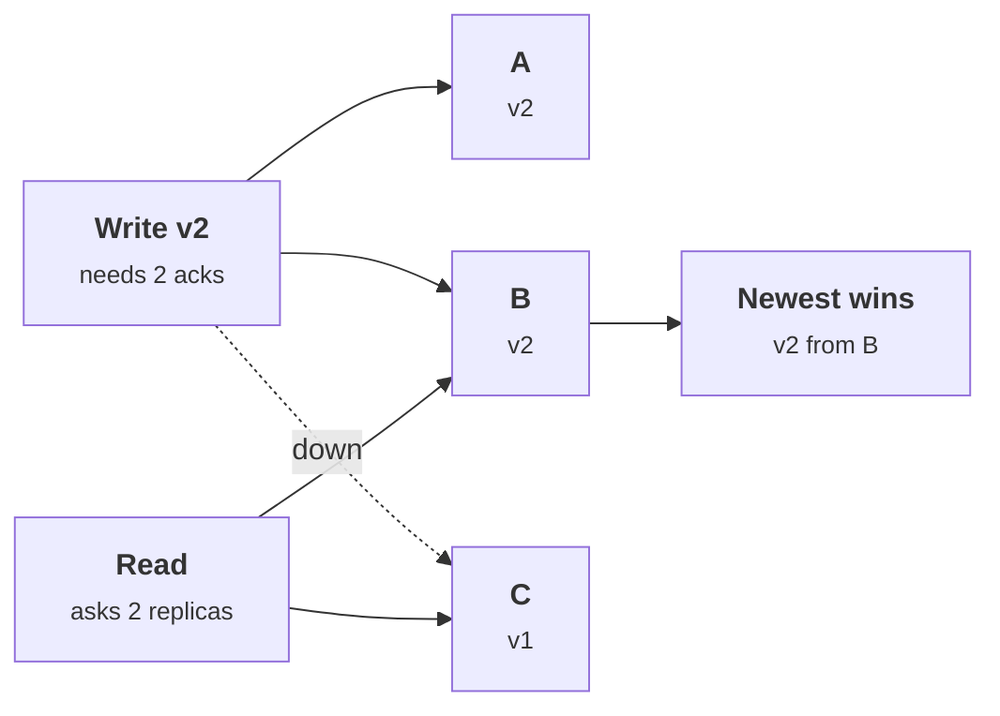
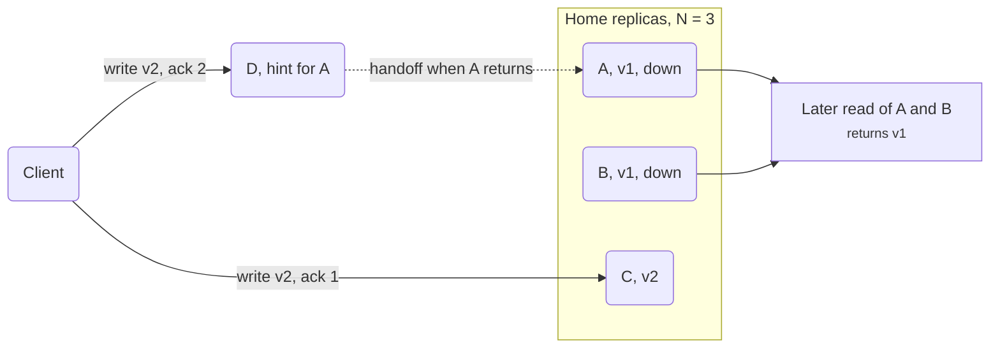

+++
title = 'Replication and quorums'
description = 'Replication topology decides who may accept a write and where conflicts come from. Quorums guarantee overlap only when R + W > N over a fixed set of replicas, and consensus makes failover safe.'
question = 'How do leader, multi-leader, and leaderless replication differ, and when does a quorum actually guarantee a fresh read?'
weight = 4
difficulty = 4
prerequisites = ['/notes/systems-design/concurrency-and-consistency/02-locks-leases-and-fencing', '/notes/systems-design/concurrency-and-consistency/03-consistency-models']
date = 2026-10-06
lastmod = 2026-10-06
verified = 2026-10-06
+++

## The idea in one minute

Replication keeps several copies of the same data so that losing a machine loses
neither the data nor the service. The hard part is not copying; it is deciding
**who may accept a write**, because that decides where conflicts come from and
what happens during a failure.

There are three answers. **Leader-follower**: one replica accepts writes and
streams them to the others; simple, but failover is dangerous. **Multi-leader**:
several replicas accept writes and exchange them; available in every region,
but concurrent writes conflict. **Leaderless**: the client writes to and reads
from several replicas directly and relies on **quorums**: with N replicas, if
each write is acknowledged by W and each read consults R, and R + W > N, every
read set overlaps every write set, so at least one replica in the read has the
latest acknowledged write.

That overlap is a counting argument over a *fixed* set of N replicas. Sloppy
quorums, which accept writes on substitute nodes during a failure, keep the
system available and quietly break the count. Consensus protocols such as Raft
use majorities and terms to make leader failover safe, at the cost of
availability when a majority is unreachable. **Know which replicas count toward
your quorum and what the system does when it cannot reach them.**

## A picture



Two acknowledgments plus two replies is four slots across three replicas, so at
least one replica must be in both sets.

## How it really works

### Why replicate

Replication serves four goals, and they pull in different directions:
**durability** (the data survives a disk or a machine), **availability** (the
service answers when a node is down), **read scale** (more copies serve more
reads), and **latency** (a copy near the user). Durability and availability
argue for waiting on more replicas; latency argues for waiting on fewer. Every
replication setting is a position on that tradeoff.

### Leader-follower

One node, the leader, accepts all writes for a piece of data and sends a log of
changes to followers. Reads may go to the leader or to followers.

| Choice | Effect |
| --- | --- |
| **Synchronous** replication to followers | A write is acknowledged only after followers have it. No acknowledged write is lost on failover, but one slow follower stalls writes. |
| **Asynchronous** replication | Writes are fast; followers lag. If the leader dies, writes it acknowledged but had not yet shipped are **lost** on failover. |
| **Semi-synchronous**: wait for one follower | A common middle ground: at least two copies of every acknowledged write. |

Follower reads are where the [consistency anomalies](/notes/systems-design/concurrency-and-consistency/03-consistency-models/)
come from: read-your-writes violations, non-monotonic reads, stale permission
checks.

With asynchronous replication, watch the gap between step 2 (the client is told
yes) and step 3 (the leader dies before shipping):

```mermaid {title="Asynchronous failover loses a write the client was told succeeded"}
sequenceDiagram
  autonumber
  actor C as Client
  participant L as Leader
  participant F as Follower
  C->>L: write x = 7
  L-->>C: ok
  Note over L: crashes before shipping x = 7
  Note over F: timeout, promoted to leader
  C->>F: read x
  F-->>C: old value, x = 7 is gone
```

Failover is where leader-follower systems get hurt. Something must detect that
the leader is dead (a timeout, so it may be only slow), choose a new leader
(ideally the most up-to-date follower), and redirect clients. If the old leader
was only partitioned, it may keep accepting writes. Two leaders accepting writes
for the same data is **split brain**, and the writes accepted by the losing side
usually have to be discarded or reconciled by hand.

### Multi-leader

Several nodes, often one per region, accept writes and replicate to each other
asynchronously. This survives a whole region failing and keeps write latency
local. The cost is **conflicts**: two leaders accept different writes to the
same record in the same moment, and neither knows until replication catches up.

Conflict resolution strategies, with their failure modes:

- **Last write wins (LWW)** by timestamp: simple, and silently discards the
  other write. With clock skew, "last" is whichever node's clock runs fast.
- **Merge functions and CRDTs** (conflict-free replicated data types): data
  structures whose concurrent updates always merge deterministically, such as
  counters and sets. Correct by construction for the operations they support.
- **Application resolution**: keep both versions and let code or a person
  decide.

Conflicts in permission data are a security problem. If an admin in one region
revokes a grant while an automated job in another region re-grants it, LWW
picks a winner by clock. A revoked user can come back.

Both regions below accept writes to the same grant, and the link between them is
asynchronous:

```mermaid {title="Two leaders accept conflicting writes to the same grant"}
flowchart TB
  subgraph g_east["Region east"]
    n_admin["Admin revokes"]
    n_dbe[("Leader east")]
  end
  subgraph g_west["Region west"]
    n_job["Job re-grants"]
    n_dbw[("Leader west")]
  end
  n_admin --> n_dbe
  n_job --> n_dbw
  n_dbe <--> n_dbw
```

For security-critical
data, route all writes for a given record to one leader, even in a multi-leader
system, or make revocation win on conflict by design.

### Leaderless replication and quorums

Amazon's Dynamo paper (DeCandia et al., 2007) popularized the leaderless style
that Cassandra and Riak followed. Each key is stored on N replicas. A client, or
a coordinator node acting for it, sends every write to all N and waits for W
acknowledgments; it sends every read to replicas and waits for R replies,
returning the newest version among them. Versions are tracked with timestamps or
version vectors.

The overlap argument goes back to Gifford's 1979 weighted voting: if R + W > N,
any R replicas and any W replicas share at least one member. Common settings:

| N | W | R | Tolerates for writes | Tolerates for reads | Notes |
| --- | --- | --- | --- | --- | --- |
| 3 | 2 | 2 | 1 node down | 1 node down | Balanced, the usual default |
| 3 | 3 | 1 | 0 nodes down | 2 nodes down | Fast reads, fragile writes |
| 3 | 1 | 3 | 2 nodes down | 0 nodes down | Fast writes, fragile reads |
| 3 | 1 | 1 | 2 nodes down | 2 nodes down | R + W = 2: no overlap guarantee |
| 5 | 3 | 3 | 2 nodes down | 2 nodes down | Majority quorums on five nodes |

Stale replicas are repaired two ways: **read repair**, where a read that sees an
old version on one replica writes the newer version back, and **anti-entropy**,
a background process that compares replicas (Dynamo used Merkle trees) and
copies missing data.

### What R + W > N does not give you

The overlap guarantees that a read *contacts* a replica holding the latest
acknowledged write. It does not by itself make the system linearizable:

- **A write in flight** may have reached one replica but not yet W. A read that
  contacts that replica returns the new value; a read a moment later that
  misses it returns the old one. Readers see time go backward. The ABD
  algorithm (Attiya, Bar-Noy, and Dolev, 1995) fixes this by making every read
  write the value it returns back to a quorum before answering.
- **A failed write is not rolled back.** If only one of W replicas stored the
  write, the client is told it failed, yet later reads that reach that replica
  return it.
- **Last-write-wins with clock skew** can order two writes the wrong way and
  drop the one that really came last.
- **Concurrent writes** to the same key both "succeed" and need conflict
  resolution, just as in multi-leader.

### Sloppy quorums and hinted handoff

Dynamo added a deliberate weakening. If some of a key's N home replicas are
unreachable, the coordinator writes to other healthy nodes instead, each holding
the data with a **hint** naming the home replica it belongs to. When the home
replica returns, the hint is handed off. The write counts as W acknowledgments,
so the client sees success.

This keeps writes available during failures, and it breaks the overlap
argument: the W acknowledgments came partly from nodes outside the N that reads
consult. Until handoff completes, a read from R home replicas can miss an
acknowledged write entirely, even with R + W > N.

Trace the write and the read: they touch no replica in common.



Some systems make the choice
configurable; know which mode yours runs in.

### Raft in one page

Consensus solves the leader-follower failover problem properly. Raft (Ongaro and
Ousterhout, 2014) was designed to be understandable, and the core fits in a few
rules:

1. **Terms.** Time is divided into numbered terms. Each term has at most one
   leader. Every message carries the sender's term; a node that sees a higher
   term steps down and adopts it.
2. **Election.** A follower that hears nothing from a leader for a randomized
   election timeout becomes a candidate, increments the term, and asks for
   votes. Each node votes at most once per term. A candidate needs a majority.
   Randomized timeouts make split votes rare.
3. **Election restriction.** A node refuses to vote for a candidate whose log is
   less up to date than its own, so a new leader always has every committed
   entry.
4. **Log replication.** The leader appends client commands to its log and
   replicates them. An entry is **committed** once stored on a majority, and
   only then applied and acknowledged.
5. **Majorities intersect.** Any two majorities of the same cluster share a
   node, so an entry committed in one term is present in any majority that
   elects a later leader.

Rules 1 to 3 define the role each node is in, and every transition below is
driven by a timeout, a vote count, or a term number:

```mermaid {title="Raft roles: a higher term always sends a node back to follower"}
stateDiagram-v2
  [*] --> Follower
  Follower --> Candidate: election timeout, term + 1
  Candidate --> Candidate: split vote, new term
  Candidate --> Leader: majority of votes
  Candidate --> Follower: sees higher term or a leader
  Leader --> Follower: sees higher term
```

A cluster of 2f + 1 nodes tolerates f failures: three nodes survive one, five
survive two. With no majority reachable, Raft stops accepting writes rather than
risk split brain. A deposed leader cannot commit anything, because it cannot
gather a majority in its old term, and its term number acts as the
[fencing token](/notes/systems-design/concurrency-and-consistency/02-locks-leases-and-fencing/)
that other nodes check. Reads need care too: a leader that has been replaced but
does not know it can serve stale data, so linearizable reads either confirm
leadership with a majority (read index) or rely on a time-based leader lease.
etcd and Consul are built on Raft.

### Choosing a topology

| | Leader-follower | Multi-leader | Leaderless (quorum) | Consensus (Raft) |
| --- | --- | --- | --- | --- |
| Who accepts writes | One leader | Several leaders | Any replica | Elected leader, committed by majority |
| Write conflicts | None while one leader exists | Yes, must be resolved | Yes, concurrent writes | None |
| Failover risk | Lost writes, split brain | Little; conflicts instead | Little; staleness instead | Unavailable without a majority |
| Strongest reads | From the leader | Local, eventually consistent | Overlapping quorums | Linearizable via the leader |
| Fits | Most OLTP databases | Multi-region, offline clients | High write availability | Metadata, locks, configuration, permissions |

Roughly placed on the two axes the table trades against each other:

```mermaid {title="Each topology buys write availability or read freshness"}
quadrantChart
  title Replication topologies
  x-axis Low write availability --> High write availability
  y-axis Stale reads likely --> Fresh reads possible
  quadrant-1 Available and fresh, rarely both
  quadrant-2 Fresh, stops under failure
  quadrant-3 Neither
  quadrant-4 Available, reads may be stale
  Raft: [0.25, 0.9]
  Leader-follower: [0.4, 0.7]
  Strict quorum: [0.65, 0.6]
  Sloppy quorum: [0.9, 0.3]
  Multi-leader: [0.85, 0.2]
```

## Code

Part 1 counts, for N = 3, every pair of write set and read set and how many fail
to overlap. Part 2 replays a partition: the client can reach only C, D, and E,
and writes `v2` with W = 2, first with a strict quorum and then with a sloppy
one.

```python {title="quorum.py"}
"""quorum.py: when R + W > N guarantees a fresh read, and when it does not.

Part 1 enumerates every write set and read set for N = 3 and counts the pairs
that do not overlap. Part 2 replays a partition with a strict quorum and with a
sloppy quorum plus hinted handoff. Deterministic; standard library only.
"""

from __future__ import annotations

from dataclasses import dataclass, field
from itertools import combinations

HOME = ("A", "B", "C")  # the N = 3 replicas responsible for the key
SPARE = ("D", "E")  # other nodes in the cluster


def overlap_table() -> None:
    print("N=3   W  R  R+W>N  read/write pairs  pairs that miss the write")
    for w, r in [(1, 1), (2, 1), (1, 2), (2, 2), (3, 1), (1, 3)]:
        pairs = misses = 0
        for ws in combinations(HOME, w):
            for rs in combinations(HOME, r):
                pairs += 1
                misses += not set(ws) & set(rs)
        print(f"      {w}  {r}  {'yes' if r + w > 3 else 'no ':<5}  {pairs:>16}  {misses:>25}")


@dataclass
class Node:
    name: str
    up: bool = True
    value: tuple[int, str] = (1, "v1")  # (version, data)
    hints: list[tuple[str, tuple[int, str]]] = field(default_factory=list)


def write(nodes: dict[str, Node], w: int, item: tuple[int, str], sloppy: bool) -> str:
    acks = []
    for name in HOME:
        if nodes[name].up:
            nodes[name].value = item  # a replica that is up stores it, quorum or not
            acks.append(name)
    missing = [n for n in HOME if not nodes[n].up]
    if sloppy:
        for spare in (n for n in SPARE if nodes[n].up):
            if len(acks) >= w or not missing:
                break
            nodes[spare].hints.append((missing.pop(0), item))
            acks.append(f"{spare}(hint)")
    status = "ok" if len(acks) >= w else "FAILED, client told error"
    return f"write {item[1]} W={w}: acks={acks} -> {status}"


def read(nodes: dict[str, Node], replicas: tuple[str, ...]) -> str:
    answers = {n: nodes[n].value for n in replicas if nodes[n].up}
    newest = max(answers.values())
    return f"read R={len(replicas)} from {list(replicas)}: {answers} -> {newest[1]}"


def handoff(nodes: dict[str, Node]) -> str:
    moved = []
    for spare in SPARE:
        for target, item in nodes[spare].hints:
            if nodes[target].up and item > nodes[target].value:
                nodes[target].value = item
                moved.append(f"{spare}->{target}")
        nodes[spare].hints.clear()
    return f"hinted handoff: {moved}"


def scenario(sloppy: bool) -> None:
    nodes = {n: Node(n) for n in HOME + SPARE}
    print(("sloppy" if sloppy else "strict") + " quorum, N=3 W=2 R=2")
    for name in ("A", "B"):
        nodes[name].up = False  # partition: the client reaches only C, D, E
    print("  partition: A and B unreachable")
    print("  " + write(nodes, 2, (2, "v2"), sloppy))
    for name in ("A", "B"):
        nodes[name].up = True
    print("  partition heals")
    print("  " + read(nodes, ("A", "B")))
    print("  " + read(nodes, ("B", "C")))
    if sloppy:
        print("  " + handoff(nodes))
        print("  " + read(nodes, ("A", "B")))
    print()


if __name__ == "__main__":
    overlap_table()
    print()
    scenario(sloppy=False)
    scenario(sloppy=True)
```

Run it with `python3 quorum.py`:

```text
N=3   W  R  R+W>N  read/write pairs  pairs that miss the write
      1  1  no                    9                          6
      2  1  no                    9                          3
      1  2  no                    9                          3
      2  2  yes                   9                          0
      3  1  yes                   3                          0
      1  3  yes                   3                          0

strict quorum, N=3 W=2 R=2
  partition: A and B unreachable
  write v2 W=2: acks=['C'] -> FAILED, client told error
  partition heals
  read R=2 from ['A', 'B']: {'A': (1, 'v1'), 'B': (1, 'v1')} -> v1
  read R=2 from ['B', 'C']: {'B': (1, 'v1'), 'C': (2, 'v2')} -> v2

sloppy quorum, N=3 W=2 R=2
  partition: A and B unreachable
  write v2 W=2: acks=['C', 'D(hint)'] -> ok
  partition heals
  read R=2 from ['A', 'B']: {'A': (1, 'v1'), 'B': (1, 'v1')} -> v1
  read R=2 from ['B', 'C']: {'B': (1, 'v1'), 'C': (2, 'v2')} -> v2
  hinted handoff: ['D->A']
  read R=2 from ['A', 'B']: {'A': (2, 'v2'), 'B': (1, 'v1')} -> v2
```

The table is the counting argument made concrete: every configuration with
R + W > N has zero non-overlapping pairs, and every configuration without it
has some. Part 2 shows two different failures.

Plotted from Part 1, the misses drop to zero exactly where R + W crosses N:

```mermaid {title="Read/write pairs that miss the write, of 9 or 3, for N = 3"}
xychart-beta
  title "Non-overlapping pairs by (W, R)"
  x-axis ["W1 R1", "W2 R1", "W1 R2", "W2 R2", "W3 R1", "W1 R3"]
  y-axis "Pairs that miss" 0 --> 6
  bar [6, 3, 3, 0, 0, 0]
```

Under the strict quorum the write
is reported as failed, yet C stored it, so a later read of B and C returns
`v2`: a "failed" write became visible. Under the sloppy quorum the write is
reported as successful, yet a read of A and B returns `v1` until hinted handoff
runs: an acknowledged write was invisible to a quorum read.

## Where it breaks

- **Quorums count replicas, not correctness.** R + W > N guarantees contact with
  a fresh replica, not linearizability, not conflict-free writes, and not
  rollback of failed writes.
- **Membership changes.** Adding or removing replicas changes N. If old and new
  configurations are used at once, two disjoint "majorities" can exist. Raft
  handles this with a specific membership-change procedure; ad hoc changes are a
  common source of split brain.
- **Correlated failures.** Three replicas in one rack, one availability zone, or
  one software version fail together. Placement matters as much as the count.
- **Timeouts decide failover.** Leader election starts on a timeout, and a
  timeout cannot tell a dead leader from a slow one. Too short, and the cluster
  flaps between leaders; too long, and writes stall.
- **What the simulation does not show.** No concurrency between reads and
  writes, no clocks, no read repair, no membership change. It shows the overlap
  arithmetic and the two partial-failure outcomes, nothing more.

## Remember this

- Replication topology decides who accepts writes, and so where conflicts and failover risk come from.
- Asynchronous failover can lose acknowledged writes; two leaders at once is split brain.
- R + W > N makes every read set meet every write set, over a fixed set of N replicas.
- Sloppy quorums keep writes available and break the overlap until hinted handoff completes.
- Raft commits on a majority and fences old leaders with terms; without a majority it stops.
- For permission data, prefer one writer per record and reads that cannot be stale.

## Try it

1. Run `quorum.py`. Extend the table to N = 5 and confirm which (W, R) pairs
   have zero misses.
2. In the strict scenario, make the client retry the failed write after the
   partition heals. What value does every read return now, and was the retry
   safe without an idempotency key?
3. Add read repair to `read`: after picking the newest version, write it back to
   every contacted replica that had an older one. Re-run the sloppy scenario.
   Which stale read does it fix, and which can it not fix?
4. For a database you operate, find its replication mode, its failover trigger,
   and whether a failover can lose acknowledged writes.

## Check yourself

1. Why does R + W > N guarantee overlap?

   
   A write set has W members and a read set has R members, both chosen from the
   same N replicas. If R + W > N, the two sets together have more members than
   there are replicas, so by the pigeonhole principle at least one replica is
   in both.
   

2. A strict quorum write is reported as failed. Can a later read return its
   value?

   
   Yes. Replicas that were reachable stored the value even though fewer than W
   acknowledged. Nothing rolls them back, so a later read whose quorum includes
   one of them returns the "failed" write as the newest version.
   

3. How does a sloppy quorum break the overlap guarantee?

   
   Some of the W acknowledgments come from substitute nodes outside the key's N
   home replicas. Reads consult only home replicas, so a read quorum can consist
   entirely of replicas that never received the write. The guarantee returns
   only after hinted handoff copies the data home.
   

4. Why can't Raft elect two leaders in the same term?

   
   Each node votes at most once per term, and a leader needs a majority of
   votes. Two majorities of the same cluster always share a node, so two
   candidates cannot both win the same term. A stale leader from an older term
   cannot commit because its messages are rejected by any node that has seen
   the newer term.
   

5. Why is last-write-wins dangerous for permission data in a multi-leader
   system?

   
   A revoke and a concurrent re-grant on different leaders are resolved by
   timestamp, so the winner depends on clock skew rather than intent. The
   re-grant can win and silently restore access. Single-writer routing for each
   record, or a rule that revocation wins conflicts, avoids it.
   

## Sources

- D. Ongaro, J. Ousterhout, [In Search of an Understandable Consensus Algorithm](https://raft.github.io/raft.pdf), *USENIX ATC*, 2014.
- D. Ongaro, *Consensus: Bridging Theory and Practice*, PhD dissertation, Stanford University, 2014 (read index, leader leases, membership changes).
- G. DeCandia et al., "Dynamo: Amazon's Highly Available Key-value Store", *SOSP*, 2007.
- D. Gifford, "Weighted Voting for Replicated Data", *SOSP*, 1979.
- H. Attiya, A. Bar-Noy, D. Dolev, "Sharing Memory Robustly in Message-Passing Systems", *Journal of the ACM* 42(1), 1995.
- M. Shapiro, N. Preguiça, C. Baquero, M. Zawirski, "Conflict-free Replicated Data Types", *SSS*, 2011.
- M. Kleppmann, *Designing Data-Intensive Applications*, O'Reilly, 2017, chapters 5 and 9.
