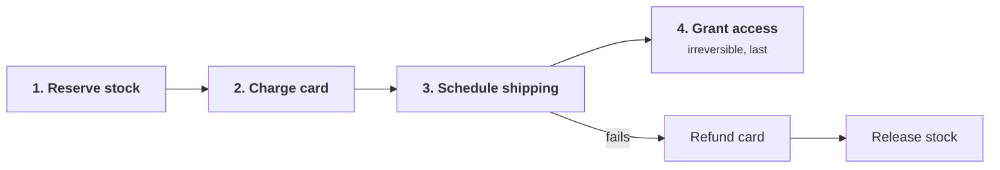

+++
title = 'Exactly-once and the outbox'
description = 'Messages can be delivered at most once or at least once, never exactly once. Exactly-once effects come from at-least-once delivery, a transactional outbox, and consumers that deduplicate.'
question = 'How do you make a database change and the message announcing it happen together, and each effect happen once?'
weight = 5
difficulty = 4
prerequisites = ['/notes/systems-design/failure-modes/02-retries-and-idempotency', '/notes/systems-design/concurrency-and-consistency/01-races-and-check-then-act']
date = 2026-10-08
lastmod = 2026-10-08
verified = 2026-10-08
+++

## The idea in one minute

A sender that gets no acknowledgment cannot tell whether the message was lost
or the acknowledgment was. It can resend, risking a duplicate, or not resend,
risking a loss. So every messaging system offers **at-most-once** or
**at-least-once** delivery. What people mean by "exactly once" is an **effect**
that happens once: at-least-once delivery combined with a consumer that
recognizes and discards duplicates.

The harder half of the problem is upstream. A service that writes to its
database and then publishes an event has made two writes to two systems with no
shared transaction. A crash between them leaves the order committed with no
event, or the event published for an order that was never committed. This is
the **dual-write problem**, and retries cannot fix it, because after the crash
nothing remembers that the second write is owed.

The **transactional outbox** fixes it by making one write: the business row and
the outgoing message are inserted in the same database transaction, and a
separate relay publishes from the outbox table, at least once. On the receiving
side an **inbox** records each processed message ID in the same transaction as
the effect. **Make every message durable before you send it, and make every
effect idempotent before you receive it.**

## A picture

```mermaid {title="Outbox on the producer, inbox on the consumer"}
flowchart LR
  API["<b>Order service</b>"] --> TX["<b>One transaction</b><br/><small>insert order + outbox row</small>"]
  TX --> DB[("<b>Orders DB</b><br/><small>orders, outbox</small>")]
  DB --> RL["<b>Relay</b><br/><small>poll or CDC, at least once</small>"]
  RL --> BR["<b>Broker</b><br/><small>may redeliver</small>"]
  BR --> CON["<b>Payments consumer</b>"]
  CON --> TX2["<b>One transaction</b><br/><small>skip if msg_id seen,<br/>charge + insert msg_id</small>"]
  TX2 --> DB2[("<b>Payments DB</b><br/><small>charges, inbox</small>")]
  class API,CON compute
  class TX,TX2 good
  class DB,DB2 memory
  class RL io
  class BR queue
```



The two green boxes are the only places where atomicity is needed, and each is
a single local transaction.

## How it really works

### Three delivery guarantees

| Guarantee | How it is built | Failure outcome | Use when |
| --- | --- | --- | --- |
| **At most once** | Send once; or acknowledge before processing | Messages lost on crash | Losing some is fine: metrics samples, best-effort notifications |
| **At least once** | Retry until acknowledged; acknowledge after processing | Duplicates on crash or timeout | The default for anything that matters |
| **Effectively once** | At-least-once plus idempotent or deduplicating processing | Duplicates arrive and are discarded | Payments, credits, provisioning, permission changes |

The impossibility of exactly-once *delivery* is the uncertainty at the heart of
[partial failure](/notes/systems-design/failure-modes/01-partial-failure-and-timeouts/):
a timeout means "unknown", never "did not happen". The Two Generals problem,
described by Akkoyunlu, Ekanadham, and Huber in 1975 and named by Jim Gray in
1978, shows that no finite exchange of messages over a lossy channel lets both
sides be certain of agreement. The engineering answer is to stop trying to
deliver once and instead make the second delivery harmless.

From the sender's side, the two failures below are indistinguishable, and the
resend is what turns the second one into a duplicate:

```mermaid {title="A lost ack and a lost message look the same to the sender"}
sequenceDiagram
  autonumber
  participant S as Sender
  participant R as Receiver
  alt message lost
    S-xR: msg m-1
    Note over S: timeout, no ack
  else ack lost
    S->>R: msg m-1
    Note over R: effect applied
    R-xS: ack
    Note over S: timeout, no ack
  end
  S->>R: resend m-1
  Note over R: second copy, harmless only if R dedupes on m-1
```

### The dual-write problem

Any handler that writes to two systems has it:

| Writes | Crash between them leaves |
| --- | --- |
| Database, then broker | An order nobody ships, a user nobody welcomes, a revocation no downstream service hears about |
| Broker, then database | A charge for an order that does not exist, an email about an action that was rolled back |
| Database, then cache invalidation | A cache serving the old value until TTL, including old permissions |
| Database, then search index | Records that exist but cannot be found, or deleted records still searchable |

Either order has a crash point where one write has happened and nothing
remembers the other is owed:

```mermaid {title="A crash between two writes leaves the systems disagreeing"}
flowchart LR
  H("Order handler")
  DB[("Orders DB")]
  K("Broker")
  X1["<b>Crash</b><br/><small>order with no event</small>"]
  X2["<b>Crash</b><br/><small>event with no order</small>"]
  H -- "commit first" --> DB
  DB --> X1
  X1 -. "publish never runs" .-> K
  H -- "publish first" --> K
  K --> X2
  X2 -. "commit never runs" .-> DB
  class X1,X2 warn
```

Reordering only changes which inconsistency you get. Wrapping both in a
distributed transaction (two-phase commit, XA) is possible when both systems
support it, but the coordinator becomes a blocking point: if it fails between
the phases, participants hold locks until it returns. Many brokers and most
HTTP APIs do not participate in 2PC at all. Pat Helland's *Life beyond
Distributed Transactions* (2007) argues that large systems should assume no
distributed transactions and build on local transactions plus messaging, which
is the pattern this lesson describes.

### The transactional outbox

The outbox turns two writes into one:

```sql {title="the producer: one local transaction"}
BEGIN;
INSERT INTO orders (id, customer, amount) VALUES ('o-1', 77, 40);
INSERT INTO outbox (msg_id, topic, payload)
VALUES ('m-1', 'order.placed', '{"order":"o-1","amount":40}');
COMMIT;   -- both rows exist, or neither does
```

A **relay** process then moves outbox rows to the broker. Two common designs:

- **Polling**: select unsent rows in order, publish, mark them sent. Simple, and
  adds query load and some latency. Multiple relay instances need
  `SELECT ... FOR UPDATE SKIP LOCKED` or a single active relay to avoid
  publishing the same row in parallel.
- **Change data capture (CDC)**: a connector reads the database's write-ahead
  log and publishes inserts into the outbox table. Debezium ships an outbox
  event router for this. Lower latency and no polling, at the cost of operating
  the connector.

As a deployment, the relay is a separate process between the database and the
broker, and either relay design fills that slot:

```mermaid {title="The relay is the only path from the outbox table to the broker"}
flowchart TB
  subgraph g_producer["Order service"]
    n_api["Handler"]
    n_db[("orders and outbox")]
    n_relay["Relay, poll or CDC"]
  end
  n_broker["Broker"]
  n_consumer["Payments consumer"]
  n_api --> n_db
  n_db --> n_relay
  n_relay --> n_broker
  n_broker --> n_consumer
```

Either way the relay is **at least once**: it can publish and crash before
recording that it did. That is the right trade. A duplicate is detectable
downstream; a missing message is not.

Each outbox row moves through a few states; the crash edge loops back and is the
source of every duplicate:

```mermaid {title="A relay crash after publishing sends the row around again"}
stateDiagram-v2
  direction LR
  [*] --> Unsent: committed with the order
  Unsent --> Published: relay publishes
  Published --> Unsent: relay crashes before marking
  Published --> Sent: relay marks sent
  Sent --> Archived: cleanup job
  Archived --> [*]
```

Details that matter:

- **The message ID is created with the business change**, inside the
  transaction, and stays the same across every resend. An ID generated by the
  relay at publish time defeats deduplication.
- **Ordering.** Publish rows in commit order per aggregate (per order, per
  account) and use that aggregate as the partition key, so consumers see
  `order.placed` before `order.cancelled`.
- **Cleanup.** Delete or archive sent rows on a schedule, or the outbox becomes
  the largest table in the database.

### The inbox: idempotent consumers

The consumer must make a redelivered message a no-op. The general pattern is an
**inbox** (or processed-messages) table with the message ID as a unique key,
written in the **same transaction** as the effect:

```sql {title="the consumer: effect and dedupe record commit together"}
BEGIN;
INSERT INTO inbox (msg_id) VALUES ('m-1');   -- unique key: a duplicate fails here
INSERT INTO charges (order_id, amount) VALUES ('o-1', 40);
COMMIT;
-- on unique violation: roll back, acknowledge the message, move on
```

Here is a redelivery hitting that consumer; the unique key, not a prior lookup,
is what stops the second charge:

```mermaid {title="The inbox key turns a redelivered message into a no-op"}
sequenceDiagram
  autonumber
  participant BR as Broker
  participant C as Payments consumer
  participant DB as Payments DB
  BR->>C: m-1
  C->>DB: BEGIN, insert inbox m-1, insert charge, COMMIT
  DB-->>C: ok
  C-->>BR: ack lost
  BR->>C: m-1 again
  C->>DB: BEGIN, insert inbox m-1
  DB-->>C: unique violation
  C->>DB: ROLLBACK
  C-->>BR: ack
  Note over DB: one charge, one inbox row
```

This is the [unique-constraint fix](/notes/systems-design/concurrency-and-consistency/01-races-and-check-then-act/)
applied to messages. Checking the inbox first and inserting afterward, in
separate transactions, would reintroduce a check-then-act race when two
consumers receive the same message at once.

Alternatives when they fit:

- **Naturally idempotent operations.** `SET status = 'shipped'` is safe to
  repeat; `balance = balance + 40` is not. Prefer state assignments and
  conditional transitions to increments.
- **Idempotency keys at the next hop.** If the effect is an external API call,
  such as charging a card, the inbox cannot share a transaction with it. Pass
  the message ID as the provider's idempotency key, so the provider
  deduplicates, as described in
  [the retries lesson](/notes/systems-design/failure-modes/02-retries-and-idempotency/).
- **Version checks.** Apply an update only if its version is newer than the one
  stored, which also handles reordering.

### What streaming platforms mean by exactly once

Apache Kafka's exactly-once semantics, introduced through KIP-98, combine an
idempotent producer (the broker discards a producer's retried duplicates using
sequence numbers) with transactions that atomically write output messages and
consumer offsets. That gives exactly-once processing for read-process-write
pipelines whose input and output are both in Kafka. It does not extend to side
effects outside Kafka: a consumer that sends an email or calls a payment API
still needs its own deduplication.

### Sagas and compensation

When a business operation spans services (reserve stock, charge the card,
schedule shipping), there is no transaction across all of them. Garcia-Molina
and Salem's 1987 paper defined a **saga**: a sequence of local transactions,
each with a **compensating transaction** that semantically undoes it. If step
three fails, the saga runs the compensations for steps two and one.

Forward steps run left to right; a failure at step three walks back through the
compensations, and the privileged step sits last so it never needs one:



| | Orchestration | Choreography |
| --- | --- | --- |
| Control | A coordinator tells each service what to do next | Each service reacts to the previous service's events |
| Visibility | One place shows the saga's state | State is spread across services and topics |
| Coupling | Services depend on the coordinator | Services depend on each other's events |

Each step is still a local transaction plus an outbox message, so everything
above applies. Three properties need deliberate design:

- **Compensation is not rollback.** A refund is not an un-charge: the customer
  sees both lines on a statement. An email cannot be unsent.
- **No isolation.** Other requests see intermediate states, such as stock
  reserved for an order that will fail. Model those as explicit states
  (`pending`, `reserved`) that other code respects.
- **Order steps by risk.** Put steps that grant something irreversible or
  privileged **last**, after every step that can fail. A saga that provisions
  access first and revokes it on a later failure leaves a window in which the
  access works, and a compensation that itself fails leaves it working
  indefinitely.

## Code

The program injects crashes at fixed points. First it shows both orders of the
dual write. Then it uses an outbox whose relay crashes after publishing and
before marking the row sent, so the restarted relay publishes the message
again, and compares a consumer without deduplication to one with an inbox.

```python {title="outbox.py"}
"""outbox.py: the dual-write problem, then a transactional outbox and an inbox.

A service records an order and must tell the payments consumer to charge the
card. Crashes are injected at named points, so every run fails the same way.
The database commits a transaction all at once or not at all. Offline.
"""

from __future__ import annotations

from dataclasses import dataclass, field


class Crash(Exception):
    pass


@dataclass
class Database:
    """Producer and consumer tables share one object here for brevity; in a real
    system each service has its own database."""

    orders: dict[str, int] = field(default_factory=dict)
    outbox: dict[str, dict] = field(default_factory=dict)  # msg_id -> row
    charges: list[str] = field(default_factory=list)  # consumer side effects
    inbox: set[str] = field(default_factory=set)  # msg_ids already processed

    def transaction(self, **changes) -> None:
        """Apply all changes or none; a crash before this call loses all of them."""
        self.orders.update(changes.get("orders", {}))
        self.outbox.update(changes.get("outbox", {}))
        self.charges.extend(changes.get("charges", []))
        self.inbox.update(changes.get("inbox", set()))


def dual_write(db: Database, broker: list[dict], publish_first: bool) -> None:
    """Two systems, two writes, no shared transaction. Crash between them."""
    msg = {"id": "m-1", "order": "o-1", "amount": 40}
    if publish_first:
        broker.append(msg)
        raise Crash  # the order is never committed
    db.transaction(orders={"o-1": 40})
    raise Crash  # the event is never published


def place_order_with_outbox(db: Database) -> None:
    msg = {"id": "m-1", "order": "o-1", "amount": 40, "sent": False}
    db.transaction(orders={"o-1": 40}, outbox={"m-1": msg})  # one atomic commit


def relay(db: Database, broker: list[dict], crash_at: str | None) -> None:
    """Poll the outbox, publish, then mark sent. At-least-once by construction."""
    for row in db.outbox.values():
        if row["sent"]:
            continue
        broker.append({k: v for k, v in row.items() if k != "sent"})
        if crash_at == "after-publish":
            raise Crash  # published, but not yet marked as sent
        row["sent"] = True


def consume(db: Database, broker: list[dict], dedupe: bool) -> None:
    for msg in broker:
        if dedupe and msg["id"] in db.inbox:
            continue  # seen before: acknowledge and drop
        # the effect and the inbox record commit together
        db.transaction(charges=[f"charge {msg['order']} ${msg['amount']}"],
                       inbox={msg["id"]} if dedupe else set())


def report(label: str, db: Database, broker: list[dict]) -> None:
    print(f"{label:<38} orders={len(db.orders)} published={len(broker)} "
          f"charges={len(db.charges)}")


if __name__ == "__main__":
    for publish_first in (False, True):
        db, broker = Database(), []
        try:
            dual_write(db, broker, publish_first)
        except Crash:
            pass
        consume(db, broker, dedupe=False)
        order = "publish, crash, commit" if publish_first else "commit, crash, publish"
        report(f"dual write: {order}", db, broker)

    for dedupe in (False, True):
        db, broker = Database(), []
        place_order_with_outbox(db)
        try:
            relay(db, broker, crash_at="after-publish")
        except Crash:
            pass
        relay(db, broker, crash_at=None)  # the relay restarts and resends
        consume(db, broker, dedupe=dedupe)
        label = "outbox, relay crash, " + ("inbox dedupe" if dedupe else "no dedupe")
        report(label, db, broker)
        if dedupe:
            consume(db, broker, dedupe=True)  # the broker redelivers everything
            report("  ...and the broker redelivers all", db, broker)
            print(f"  charges: {db.charges}, inbox: {sorted(db.inbox)}")
```

Run it with `python3 outbox.py`:

```text
dual write: commit, crash, publish     orders=1 published=0 charges=0
dual write: publish, crash, commit     orders=0 published=1 charges=1
outbox, relay crash, no dedupe         orders=1 published=2 charges=2
outbox, relay crash, inbox dedupe      orders=1 published=2 charges=1
  ...and the broker redelivers all     orders=1 published=2 charges=1
  charges: ['charge o-1 $40'], inbox: ['m-1']
```

The first line is an order nobody will charge; the second is a charge for an
order that does not exist. With the outbox, the order and the message can no
longer disagree, and the relay crash produces exactly the failure at-least-once
promises: two copies of `m-1`. Without deduplication the customer is charged
twice. With the inbox, the second copy is discarded, and even a full
redelivery of the topic changes nothing.

The charge counts per run, against the one charge each order should produce:

```mermaid {title="Only the outbox plus inbox gives exactly one charge for one order"}
xychart-beta
  title "Charges per scenario, one order placed or attempted"
  x-axis ["dual: commit first", "dual: publish first", "outbox, no dedupe", "outbox + inbox", "+ full redelivery"]
  y-axis "Charges" 0 --> 2
  bar [0, 1, 2, 1, 1]
```

## Where it breaks

- **Message IDs minted per attempt.** If the producer generates a fresh ID each
  time it retries the *business operation*, the outbox faithfully records two
  different messages. Idempotency has to start at the API boundary, with a
  client-supplied key.
- **The inbox forgets.** Dedupe records are often expired to save space. If the
  broker can redeliver, or an operator can replay a topic, older than the
  retention window, duplicates get through. Retain IDs at least as long as any
  replay is possible.
- **Effects outside the transaction.** The inbox protects effects in the same
  database. For external calls, the downstream service must deduplicate on
  the key you pass; if it does not, you cannot get exactly-once effects from it.
- **Poison messages.** A message that always fails processing is redelivered
  forever and blocks its partition. Cap attempts and move it to a dead-letter
  queue with an alert.
- **Deduplication is not authentication.** A message ID stops accidental
  duplicates, not an attacker who can publish to the topic with fresh IDs.
  Authorize producers on the broker, and sign messages where topics cross trust
  boundaries.
- **What the simulation does not show.** One message, one consumer, no
  concurrency between consumers, no reordering. It shows the crash windows; it
  does not show ordering bugs or relay lag.

## Remember this

- Delivery is at most once or at least once; exactly once is an effect, not a delivery.
- Writing to a database and a broker in one handler is a dual write; a crash between them loses one.
- The outbox puts the message in the same local transaction as the business change.
- The relay is at least once by design; consumers must deduplicate.
- Record the message ID and the effect in one transaction, enforced by a unique key.
- Sagas compensate instead of rolling back; put irreversible and privilege-granting steps last.

## Try it

1. Run `outbox.py`. Move the relay's crash to *before* the publish. What do
   the counters show, and why is that case harmless?
2. Change `consume` so it checks the inbox in one step and records the message
   ID in a separate, later step. Construct an interleaving of two consumers
   that charges twice.
3. Replace the charge with an increment to a `credits` balance, then with a
   `SET status = 'paid'`. Which one is safe without the inbox?
4. Find a handler in a system you know that writes to a database and then
   publishes, invalidates a cache, or calls another service. What happens if
   the process dies between the two lines?

## Check yourself

1. Why is exactly-once delivery impossible, while exactly-once effects are
   achievable?

   
   A sender that sees no acknowledgment cannot distinguish a lost message from
   a lost acknowledgment, so it must choose between possibly losing the message
   and possibly duplicating it. Effects can still happen once if the sender
   chooses to resend and the receiver recognizes duplicates by ID and discards
   them.
   

2. Why doesn't publishing the event before the database commit fix the dual
   write?

   
   It only changes which inconsistency a crash produces. If the process dies
   after publishing and before committing, consumers act on an event for a
   change that never happened, such as charging for an order that does not
   exist.
   

3. Why is the outbox relay allowed to publish duplicates?

   
   Publishing and marking the row sent are two separate steps, so a crash
   between them is unavoidable; the only choice is whether that crash produces
   a duplicate or a loss. A duplicate carries the same message ID and can be
   detected downstream. A loss cannot be detected at all.
   

4. Why must the inbox record and the effect commit in the same transaction?

   
   If the effect commits first and the process crashes before recording the
   ID, the redelivered message is processed again. If the ID is recorded first
   and the process crashes before the effect, the message is skipped forever.
   One transaction makes both happen or neither.
   

5. A saga creates a user account with admin rights in step one and charges for
   the plan in step two. What is wrong with that order?

   
   The privilege is granted before the step most likely to fail. If the charge
   fails, the account works as an admin until the compensation runs, and if the
   compensation fails, it keeps working. Charge first, or create the account
   in a pending state, and grant admin rights as the final step.
   

## Sources

- H. Garcia-Molina, K. Salem, "Sagas", *SIGMOD*, 1987.
- P. Helland, "Life beyond Distributed Transactions: an Apostate's Opinion", *CIDR*, 2007.
- E. Akkoyunlu, K. Ekanadham, R. Huber, "Some Constraints and Tradeoffs in the Design of Network Communications", *SOSP*, 1975.
- J. Gray, "Notes on Data Base Operating Systems", in *Operating Systems: An Advanced Course*, Springer, 1978.
- Apache Kafka, [KIP-98: Exactly Once Delivery and Transactional Messaging](https://cwiki.apache.org/confluence/display/KAFKA/KIP-98+-+Exactly+Once+Delivery+and+Transactional+Messaging).
- Debezium, [Outbox Event Router](https://debezium.io/documentation/reference/stable/transformations/outbox-event-router.html), Debezium documentation (stable).
- PostgreSQL Global Development Group, [SELECT: the locking clause](https://www.postgresql.org/docs/current/sql-select.html), PostgreSQL documentation (current version).
- M. Kleppmann, *Designing Data-Intensive Applications*, O'Reilly, 2017, chapters 9 and 11.
