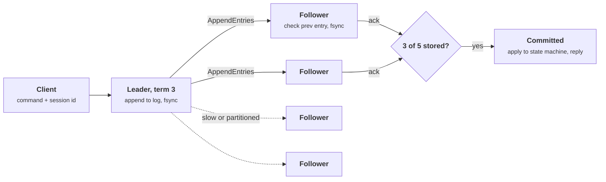

+++
title = 'Consensus and Raft'
description = 'Consensus lets a group of machines act as one state machine that survives failures. Raft gets there with terms, majority votes, a log consistency check, and one easily missed commit rule.'
question = 'How does Raft keep one agreed log through crashes and partitions, and what does each committed write cost?'
weight = 1
difficulty = 4
prerequisites = ['/notes/systems-design/concurrency-and-consistency/04-replication-and-quorums', '/notes/systems-design/concurrency-and-consistency/02-locks-leases-and-fencing']
date = 2026-10-30T07:05:00Z
lastmod = 2026-10-30T07:05:00Z
verified = 2026-10-30
+++

## The idea in one minute

**Consensus** is agreement on a sequence of values by a group of machines,
any minority of which may crash or be cut off. Agree on a log of commands, feed
the same commands in the same order to a deterministic state machine on every
node, and the group behaves like one machine that does not lose data when a
node dies. This is **state machine replication**. It is how etcd, Consul,
ZooKeeper, the Kafka controller quorum, and the per-range replication in
CockroachDB and TiKV work.

Raft splits the problem into three parts. **Leader election** picks one node
per numbered term with a majority vote. **Log replication** has that leader
append entries and copy them to followers, with a check that repairs any
follower whose log diverged. **Safety** comes from two restrictions: a node
votes only for candidates whose log is at least as up to date as its own, and a
leader counts replicas to commit **only entries from its own term**. A
committed write costs one majority round trip plus a durable disk write on
each node in that majority. **Size the cluster for the failures you must
survive, place it for the latency you can afford, and never let anything but
a majority decide.**

## A picture



The leader does not wait for the slowest followers. Two acknowledgments plus
its own copy make three of five, and any later majority must include at least
one of those three.

## How it really works

### Why consensus is hard, and how Raft gets around it

Fischer, Lynch, and Paterson proved in 1985 that in a fully asynchronous
system, where messages can be delayed without bound, no deterministic protocol
can guarantee that consensus terminates if even one process may crash. A
crashed node and a slow one look the same. Practical protocols, Paxos, Viewstamped
Replication, Zab, and Raft, accept this result by **separating safety from
liveness**. Safety (no two nodes ever decide different values) holds no matter
how messages are delayed. Liveness (a decision is eventually made) holds only
when the network behaves well for long enough, the partial-synchrony model of
Dwork, Lynch, and Stockmeyer. When the network misbehaves, Raft stops making
progress rather than doing anything wrong.

The [replication lesson](/notes/systems-design/concurrency-and-consistency/04-replication-and-quorums/)
gave Raft's rules in one page: terms, randomized election timeouts, one vote per
term, majority commit. Here is what each rule protects and how the pieces fit.

### Five properties the protocol maintains

The Raft paper states five invariants. Everything in the protocol exists to
keep them true:

| Property | Statement | Kept by |
| --- | --- | --- |
| **Election safety** | At most one leader per term | One vote per node per term, majority to win |
| **Leader append-only** | A leader never overwrites or deletes its own entries | Only followers truncate |
| **Log matching** | If two logs have an entry with the same index and term, the logs are identical up to that index | The AppendEntries consistency check |
| **Leader completeness** | A committed entry is in the log of every later leader | The voting restriction and the commit rule |
| **State machine safety** | No two nodes apply different commands at the same index | Follows from the four above |

### Elections and the voting restriction

A follower that hears nothing for an **election timeout** increments its term,
votes for itself, and sends RequestVote to everyone. The request carries the
index and term of the candidate's last log entry. A voter grants its vote only
if it has not voted in this term and the candidate's log is **at least as up to
date** as its own, compared by last term first and then by last index:

```text
candidate up to date  ⇔  (cand_last_term, cand_last_index) >= (my_last_term, my_last_index)
```

A committed entry is stored on a majority. A winning candidate needs votes
from a majority. Those two majorities share at least one node, and that node
refuses any candidate that lacks the entry. So **only nodes holding every
committed entry can become leader**, and leaders never need to fetch missing
committed entries from followers.

Timeouts are randomized so that one node usually times out first and wins
before the others start. The paper's timing requirement is

```text
broadcast time  <<  election timeout  <<  mean time between failures
```

with broadcast times of 0.5 to 20 ms and election timeouts of 10 to 500 ms
given as typical. etcd's defaults are a 100 ms heartbeat and a 1,000 ms
election timeout, and its tuning guide suggests a heartbeat near the round-trip
time between members and an election timeout of about ten round trips.
Cross-region clusters need longer timeouts, so they also take longer to notice
a dead leader.

### Replication and the consistency check

The leader sends AppendEntries with new entries, the index and term of the
entry **just before** them (`prevLogIndex`, `prevLogTerm`), and its commit
index. A follower accepts only if its own log has an entry at `prevLogIndex`
with term `prevLogTerm`. If not, it refuses, and the leader retries one entry
earlier until the two logs agree. The follower then deletes everything after
the match point and appends the leader's entries. That induction step is the
log matching property: agreement at one index implies agreement on everything
before it.

```mermaid {title="A diverged follower is repaired by backing up until the logs match"}
sequenceDiagram
  autonumber
  participant L as Leader, term 3
  participant F as Follower, stale term 1 entries
  L->>F: AppendEntries prev=(5, t3) entries=[6]
  F-->>L: refuse, no (5, t3) here
  L->>F: AppendEntries prev=(4, t3) entries=[5, 6]
  F-->>L: refuse
  L->>F: AppendEntries prev=(3, t1) entries=[4, 5, 6]
  Note over F: index 3 term 1 matches
  Note over F: delete own 4, 5 (term 1), append leader's 4, 5, 6
  F-->>L: ok, match index 6
```

Backing up one entry per round trip is slow for a follower that is far
behind. Implementations skip back a whole term per round trip using a
conflict hint in the reply, and send a snapshot (InstallSnapshot) when the
needed entries have already been compacted away.

### The commit rule everyone gets wrong once

A leader may advance its commit index to N when a majority has stored N
**and the entry at N is from the leader's current term**. Entries from earlier
terms become committed only indirectly, when a current-term entry after them
commits.

The paper's Figure 8 shows why counting replicas is not enough for an old
entry. A leader in term 2 replicates an entry to a minority and crashes. A
leader in term 3 writes a different entry at the same index on another node
and crashes. The term-2 leader returns, wins term 4, and copies its term-2
entry to a majority. If it treated that as committed and then crashed, the
term-3 node could still win an election (its last term, 3, beats 2) and
overwrite the "committed" entry. Requiring a current-term entry on a majority
closes that window, because any later candidate must now be at least as up to
date as term 4. In practice a new leader appends a **no-op entry** at the
start of its term to commit everything before it quickly.

### Reads are not free

A leader that has been deposed without knowing it can serve stale data. Raft
offers three ways to read:

| Read | How | Cost | Assumes |
| --- | --- | --- | --- |
| **Log read** | Put the read through the log like a write | Full commit latency | Nothing |
| **ReadIndex** | Record the commit index, confirm leadership with one heartbeat round to a majority, wait until applied, then read | One round trip, no disk write | Nothing |
| **Lease read** | Serve locally while a leader lease, renewed by heartbeats, is valid | None | Bounded clock drift |

Lease reads are the [lease problem](/notes/systems-design/concurrency-and-consistency/02-locks-leases-and-fencing/)
again: if a pause or a clock running fast stretches the lease, two nodes can
both believe they lead and one serves stale reads. etcd serves linearizable
reads with ReadIndex by default and offers serializable reads, which any
member answers from its local state, as an explicit opt-out.

### Clients, duplicates, and exactly-once commands

If a leader commits a command and crashes before replying, the client retries
against the new leader and the command runs twice. Ongaro's dissertation
handles this the same way the
[idempotency lesson](/notes/systems-design/failure-modes/02-retries-and-idempotency/)
does: each client has a session ID and numbers its requests, and the state
machine remembers the last sequence number and response per session, so a
duplicate gets the cached answer instead of a second effect. Consensus orders
commands; it does not deduplicate them by itself.

### Changing membership

Switching directly from an old set of nodes to a new one can create two
disjoint majorities during the transition. The paper uses **joint consensus**:
an intermediate configuration in which decisions need a majority of the old
set **and** a majority of the new set. The dissertation later recommends a
simpler rule, adding or removing **one server at a time**, since any majority
of N and any majority of N + 1 always overlap. Two refinements from the
dissertation matter in production. **Pre-vote** has a candidate first ask
whether it could win before incrementing its term, so a node returning from a
partition does not force a needless election. **Check-quorum** has a leader
step down when it has not heard from a majority recently. etcd implements both
as options.

### What a commit costs

The latency of one committed write is the leader's fsync in parallel with the
time for the fastest majority of followers to receive, fsync, and answer:

```text
commit latency  ≈  max(leader fsync,  RTT to the k-th fastest follower + follower fsync)
                   k = majority − 1
```

| Placement, 5 nodes | Majority reached through | Commit latency, roughly |
| --- | --- | --- |
| One zone, RTT 0.2 ms, fsync 0.5 ms | Any 2 followers | about 1 ms |
| Three zones, 2-2-1, RTT 1 to 2 ms | Same-zone follower + nearest other zone | 2 to 3 ms |
| Three regions, 2-2-1, RTT 30 to 70 ms | Nearest other region | one inter-region RTT plus fsync |

Every member's disk sits on the commit path, so a slow disk on enough nodes
slows every write, and a leader whose fsync stalls stops renewing its
followers' timers. etcd exposes `etcd_disk_wal_fsync_duration_seconds` for this
reason. Throughput comes from **batching** (one fsync and one AppendEntries
carry many entries) and **pipelining** (the next batch is sent before the
previous one is acknowledged). A single Raft group is still bounded by one
leader's disk and network. Systems that need more write throughput split the
key space into many small groups, each with its own leader; CockroachDB calls
them ranges, TiKV calls them regions.

Fault tolerance is set by the cluster size, not the replica count you can
afford:

| Nodes | Majority | Failures tolerated | Note |
| --- | --- | --- | --- |
| 3 | 2 | 1 | The usual minimum |
| 4 | 3 | 1 | Same tolerance as 3, one more disk on the commit path |
| 5 | 3 | 2 | Survives a failure during maintenance |
| 7 | 4 | 3 | Slower commits; rarely worth it |

### Consensus in AI infrastructure

Large training and inference platforms run on control planes built on
consensus: Kubernetes stores every object in etcd, schedulers keep job and
lease state in it, and checkpoint coordinators and model registries often use
it for leader election. Two limits matter at that scale. etcd's default
storage quota is 2 GiB, and the request size limit is 1.5 MiB, which caps the
size of any one object. The Kubernetes project's published scalability
thresholds are about 5,000 nodes and 150,000 pods per cluster. At 8 GPUs per
node, 5,000 nodes is 40,000 GPUs, so fleets beyond that are split across
clusters, and the split is often set by the consensus store, not by the
network. Keep high-churn data such as per-step training metrics, heartbeats
from every rank, and request logs **out** of the consensus store; it is built
to order a small amount of critical state, not to absorb a firehose.

## Code

The program is a discrete-event simulation of five Raft nodes with 1 to 5 ms
message delays. Part 1 replays a history: election, replication, a partition
that leaves the old leader with one follower, a new election on the majority
side, and the repair after healing. Part 2 runs 2,000 cold-start elections for
each of four timeout ranges.

```python {title="raft.py"}
"""raft.py: Raft leader election and log replication in a simulated network.

Five nodes exchange RequestVote and AppendEntries messages over a network with
1-5 ms delays and injectable partitions. Part 1 replays one history: an
election, replication, a partition that strands the old leader with a
minority, and the repair after it heals. Part 2 measures how randomized
election timeouts prevent split votes. Discrete-event simulation with a seeded
random generator; standard library only. It omits persistence, snapshots,
membership changes, and client retries.
"""

from __future__ import annotations

import heapq
import random
from dataclasses import dataclass, field

HEARTBEAT_MS = 50


@dataclass
class Entry:
    term: int
    cmd: str


@dataclass
class Node:
    nid: int
    peers: list[int]
    term: int = 0
    voted_for: int | None = None
    log: list[Entry] = field(default_factory=list)  # index 1 is log[0]
    commit: int = 0
    role: str = "follower"
    votes: set[int] = field(default_factory=set)
    next_index: dict[int, int] = field(default_factory=dict)
    match_index: dict[int, int] = field(default_factory=dict)
    timer_version: int = 0

    def last(self) -> tuple[int, int]:
        """(last log term, last log index), the 'up to date' comparison key."""
        return (self.log[-1].term if self.log else 0, len(self.log))

    def term_at(self, index: int) -> int:
        return self.log[index - 1].term if index > 0 else 0


class Cluster:
    def __init__(self, n: int, seed: int, timeout_ms: tuple[int, int], quiet: bool = False):
        self.rng = random.Random(seed)
        self.timeout_ms = timeout_ms
        self.nodes = {i: Node(i, [j for j in range(n) if j != i]) for i in range(n)}
        self.events: list = []
        self.seq = 0
        self.now = 0
        self.blocked: set[frozenset[int]] = set()
        self.down: set[int] = set()
        self.quiet = quiet
        self.first_leader_at: int | None = None
        for node in self.nodes.values():
            self.reset_timer(node)

    # ---- plumbing -------------------------------------------------------
    def schedule(self, at: int, kind: str, *args) -> None:
        self.seq += 1
        heapq.heappush(self.events, (at, self.seq, kind, args))

    def send(self, src: int, dst: int, msg: dict) -> None:
        self.schedule(self.now + self.rng.randint(1, 5), "deliver", src, dst, msg)

    def reset_timer(self, node: Node) -> None:
        node.timer_version += 1
        lo, hi = self.timeout_ms
        self.schedule(self.now + self.rng.randint(lo, hi), "timeout", node.nid, node.timer_version)

    def log_event(self, text: str) -> None:
        if not self.quiet:
            print(f"  t={self.now:>5} ms  {text}")

    def partition(self, side_a: set[int], side_b: set[int]) -> None:
        self.blocked = {frozenset((a, b)) for a in side_a for b in side_b}

    def run_until(self, t_end: int) -> None:
        while self.events and self.events[0][0] <= t_end:
            self.now, _, kind, args = heapq.heappop(self.events)
            getattr(self, "on_" + kind)(*args)
        self.now = t_end

    # ---- term handling --------------------------------------------------
    def observe_term(self, node: Node, term: int) -> None:
        if term > node.term:
            if node.role == "leader":
                self.log_event(f"n{node.nid} sees term {term}, steps down from leader of term {node.term}")
            node.term, node.voted_for, node.role = term, None, "follower"

    # ---- events -----------------------------------------------------------
    def on_timeout(self, nid: int, version: int) -> None:
        node = self.nodes[nid]
        if version != node.timer_version or nid in self.down:
            return
        if node.role == "leader":  # leaders use the timer as the heartbeat clock
            self.broadcast_append(node)
            node.timer_version += 1
            self.schedule(self.now + HEARTBEAT_MS, "timeout", nid, node.timer_version)
            return
        node.term += 1
        node.role, node.voted_for, node.votes = "candidate", nid, {nid}
        self.log_event(f"n{nid} times out, becomes candidate for term {node.term}")
        last_term, last_index = node.last()
        for p in node.peers:
            self.send(nid, p, {"type": "vote_req", "term": node.term,
                               "last_term": last_term, "last_index": last_index})
        self.reset_timer(node)

    def on_deliver(self, src: int, dst: int, msg: dict) -> None:
        if dst in self.down or frozenset((src, dst)) in self.blocked:
            return  # lost in the partition
        node = self.nodes[dst]
        self.observe_term(node, msg["term"])
        getattr(self, "handle_" + msg["type"])(node, src, msg)

    def handle_vote_req(self, node: Node, src: int, msg: dict) -> None:
        up_to_date = (msg["last_term"], msg["last_index"]) >= node.last()
        grant = (msg["term"] == node.term and node.voted_for in (None, src) and up_to_date)
        if grant:
            node.voted_for = src
            self.reset_timer(node)
        self.send(node.nid, src, {"type": "vote_resp", "term": node.term, "granted": grant})

    def handle_vote_resp(self, node: Node, src: int, msg: dict) -> None:
        if node.role != "candidate" or msg["term"] != node.term or not msg["granted"]:
            return
        node.votes.add(src)
        if len(node.votes) > len(self.nodes) // 2:
            node.role = "leader"
            if self.first_leader_at is None:
                self.first_leader_at = self.now
            self.log_event(f"n{node.nid} wins term {node.term} with votes {sorted(node.votes)}")
            for p in node.peers:
                node.next_index[p] = len(node.log) + 1
                node.match_index[p] = 0
            self.broadcast_append(node)
            node.timer_version += 1
            self.schedule(self.now + HEARTBEAT_MS, "timeout", node.nid, node.timer_version)

    def broadcast_append(self, leader: Node) -> None:
        for p in leader.peers:
            prev = leader.next_index[p] - 1
            self.send(leader.nid, p, {
                "type": "append", "term": leader.term, "prev_index": prev,
                "prev_term": leader.term_at(prev), "entries": leader.log[prev:],
                "leader_commit": leader.commit})

    def handle_append(self, node: Node, src: int, msg: dict) -> None:
        if msg["term"] < node.term:
            self.send(node.nid, src, {"type": "append_resp", "term": node.term,
                                      "ok": False, "match": 0})
            return
        node.role = "follower"
        self.reset_timer(node)
        prev = msg["prev_index"]
        if prev > len(node.log) or node.term_at(prev) != msg["prev_term"]:
            self.send(node.nid, src, {"type": "append_resp", "term": node.term,
                                      "ok": False, "match": 0})
            return  # consistency check failed; the leader backs up one entry
        for i, entry in enumerate(msg["entries"], start=prev + 1):
            if i <= len(node.log) and node.log[i - 1].term != entry.term:
                dropped = [e.cmd for e in node.log[i - 1:]]
                self.log_event(f"n{node.nid} truncates conflicting entries {dropped}")
                del node.log[i - 1:]
            if i > len(node.log):
                node.log.append(entry)
        match = prev + len(msg["entries"])
        node.commit = max(node.commit, min(msg["leader_commit"], match))
        self.send(node.nid, src, {"type": "append_resp", "term": node.term, "ok": True,
                                  "match": match})

    def handle_append_resp(self, node: Node, src: int, msg: dict) -> None:
        if node.role != "leader" or msg["term"] != node.term:
            return
        if not msg["ok"]:
            node.next_index[src] = max(1, node.next_index[src] - 1)
            return
        node.match_index[src] = max(node.match_index[src], msg["match"])
        node.next_index[src] = node.match_index[src] + 1
        # Commit rule: a majority stores index n AND the entry is from the current term.
        for n in range(len(node.log), node.commit, -1):
            replicas = 1 + sum(m >= n for m in node.match_index.values())
            if replicas > len(self.nodes) // 2 and node.log[n - 1].term == node.term:
                self.log_event(f"n{node.nid} commits up to index {n} "
                               f"({replicas}/{len(self.nodes)} replicas)")
                node.commit = n
                break

    # ---- client -----------------------------------------------------------
    def submit(self, nid: int, cmd: str) -> None:
        node = self.nodes[nid]
        assert node.role == "leader", f"n{nid} is not a leader"
        node.log.append(Entry(node.term, cmd))

    def leaders(self) -> list[int]:
        return [n.nid for n in self.nodes.values() if n.role == "leader"]

    def show(self) -> None:
        for n in self.nodes.values():
            entries = " ".join(f"{e.cmd}@t{e.term}" for e in n.log)
            print(f"    n{n.nid} {n.role:<9} term {n.term}  commit {n.commit}  log [{entries}]")


def history() -> None:
    print("part 1: one history, 5 nodes, election timeout 150-300 ms, heartbeat 50 ms")
    c = Cluster(5, seed=7, timeout_ms=(150, 300))
    c.run_until(400)
    old = c.leaders()[0]
    for cmd in ("x=1", "x=2", "x=3"):
        c.submit(old, cmd)
    c.run_until(500)
    print("  after replicating three commands:")
    c.show()
    buddy = (old + 1) % 5
    minority, majority = {old, buddy}, set(range(5)) - {old, buddy}
    c.partition(minority, majority)
    print(f"  t=  500 ms  partition: {sorted(minority)} | {sorted(majority)}")
    for cmd in ("x=4", "x=5"):
        c.submit(old, cmd)  # the old leader still believes it leads
    t = 500
    while not [n for n in c.leaders() if n in majority]:
        t += 10
        c.run_until(t)  # wait for the majority side to elect a leader
    new = [n for n in c.leaders() if n in majority][0]
    for cmd in ("x=6", "x=7"):
        c.submit(new, cmd)
    c.run_until(t + 200)
    print("  during the partition, two nodes think they lead; only one can commit:")
    c.show()
    c.blocked = set()
    print(f"  t={c.now:>5} ms  partition heals")
    c.run_until(c.now + 300)
    print("  after healing:")
    c.show()


def election_stats() -> None:
    print("\npart 2: time to elect a leader from a cold start, 2,000 trials each")
    print("  timeout range     elected  median ms  p99 ms  trials needing >1 term")
    for lo, hi in ((150, 150), (150, 155), (150, 200), (150, 300)):
        times, multi, failed = [], 0, 0
        for seed in range(2000):
            c = Cluster(5, seed=seed, timeout_ms=(lo, hi), quiet=True)
            c.run_until(5000)
            if c.first_leader_at is None:
                failed += 1
                continue
            times.append(c.first_leader_at)
            multi += max(n.term for n in c.nodes.values()) > 1
        times.sort()
        if times:
            med, p99 = times[len(times) // 2], times[int(0.99 * len(times)) - 1]
            print(f"  {lo}-{hi} ms".ljust(18) + f"{len(times):>7}  {med:>9}  {p99:>6}  {multi:>10}")
        else:
            print(f"  {lo}-{hi} ms".ljust(18) + f"{0:>7}  {'-':>9}  {'-':>6}  "
                  f"{'all ' + str(failed) + ' split forever':>10}")


if __name__ == "__main__":
    history()
    election_stats()
```

Run it with `python3 raft.py`:

```text
part 1: one history, 5 nodes, election timeout 150-300 ms, heartbeat 50 ms
  t=  162 ms  n3 times out, becomes candidate for term 1
  t=  166 ms  n3 wins term 1 with votes [1, 2, 3]
  t=  422 ms  n3 commits up to index 3 (3/5 replicas)
  after replicating three commands:
    n0 follower  term 1  commit 3  log [x=1@t1 x=2@t1 x=3@t1]
    n1 follower  term 1  commit 3  log [x=1@t1 x=2@t1 x=3@t1]
    n2 follower  term 1  commit 3  log [x=1@t1 x=2@t1 x=3@t1]
    n3 leader    term 1  commit 3  log [x=1@t1 x=2@t1 x=3@t1]
    n4 follower  term 1  commit 3  log [x=1@t1 x=2@t1 x=3@t1]
  t=  500 ms  partition: [3, 4] | [0, 1, 2]
  t=  636 ms  n1 times out, becomes candidate for term 2
  t=  637 ms  n2 times out, becomes candidate for term 2
  t=  897 ms  n2 times out, becomes candidate for term 3
  t=  905 ms  n2 wins term 3 with votes [0, 1, 2]
  t=  964 ms  n2 commits up to index 5 (3/5 replicas)
  during the partition, two nodes think they lead; only one can commit:
    n0 follower  term 3  commit 5  log [x=1@t1 x=2@t1 x=3@t1 x=6@t3 x=7@t3]
    n1 follower  term 3  commit 5  log [x=1@t1 x=2@t1 x=3@t1 x=6@t3 x=7@t3]
    n2 leader    term 3  commit 5  log [x=1@t1 x=2@t1 x=3@t1 x=6@t3 x=7@t3]
    n3 leader    term 1  commit 3  log [x=1@t1 x=2@t1 x=3@t1 x=4@t1 x=5@t1]
    n4 follower  term 1  commit 3  log [x=1@t1 x=2@t1 x=3@t1 x=4@t1 x=5@t1]
  t= 1110 ms  partition heals
  t= 1123 ms  n3 sees term 3, steps down from leader of term 1
  t= 1158 ms  n4 truncates conflicting entries ['x=4', 'x=5']
  t= 1159 ms  n3 truncates conflicting entries ['x=4', 'x=5']
  after healing:
    n0 follower  term 3  commit 5  log [x=1@t1 x=2@t1 x=3@t1 x=6@t3 x=7@t3]
    n1 follower  term 3  commit 5  log [x=1@t1 x=2@t1 x=3@t1 x=6@t3 x=7@t3]
    n2 leader    term 3  commit 5  log [x=1@t1 x=2@t1 x=3@t1 x=6@t3 x=7@t3]
    n3 follower  term 3  commit 5  log [x=1@t1 x=2@t1 x=3@t1 x=6@t3 x=7@t3]
    n4 follower  term 3  commit 5  log [x=1@t1 x=2@t1 x=3@t1 x=6@t3 x=7@t3]

part 2: time to elect a leader from a cold start, 2,000 trials each
  timeout range     elected  median ms  p99 ms  trials needing >1 term
  150-150 ms            0          -       -  all 2000 split forever
  150-155 ms         2000        307    1071        1264
  150-200 ms         2000        162     323          31
  150-300 ms         2000        175     248           2
```

What it shows:

- **The commit rule and majorities.** During the partition, n3 still believes
  it leads term 1 and accepts `x=4` and `x=5`, but with two of five copies it
  never commits them, and its commit index stays at 3. The majority side
  commits `x=6` and `x=7` in term 3.
- **A split vote happens in the run.** n1 and n2 time out 1 ms apart in term 2,
  split the three available votes, and nobody wins. The randomized timeouts
  make n2 time out again first, and it wins term 3.
- **Repair is truncation.** On healing, n3 sees term 3 and steps down. The
  consistency check fails at index 4 on n3 and n4, both delete their
  uncommitted `x=4` and `x=5`, and every log ends identical. A client that sent
  `x=4` to n3 never got a success response, so nothing acknowledged was lost.
- **Randomization is what makes elections finish.** With identical timeouts,
  every node becomes a candidate at the same instant, votes for itself, and
  the cluster splits forever. With only 5 ms of spread, most trials need more
  than one term and the p99 is over a second. A 150 ms spread, as the paper
  used, elects a leader in about one timeout almost every time.

The partition history from part 1, as the terms advance:

```mermaid {title="The partition in part 1: two leaders, one able to commit"}
flowchart LR
  T1["<b>Term 1</b><br/><small>n3 leads, commits x=1..3</small>"] --> P["<b>Partition</b><br/><small>n3, n4 | n0, n1, n2</small>"]
  P --> M["<b>Minority</b><br/><small>n3 appends x=4, x=5<br/>2 of 5: never committed</small>"]
  P --> S["<b>Term 2</b><br/><small>n1, n2 split the vote</small>"]
  S --> T3["<b>Term 3</b><br/><small>n2 leads, commits x=6, x=7</small>"]
  M --> H["<b>Heal</b><br/><small>n3 sees term 3, steps down</small>"]
  T3 --> H
  H --> R["<b>Repaired</b><br/><small>x=4, x=5 truncated; logs identical</small>"]
  class T1,T3 compute
  class P,S queue
  class M warn
  class H neutral
  class R good
```

## Where it breaks

- **No majority, no progress.** Lose three of five nodes, or partition them so
  no side has three, and writes stop. That is the design: Raft gives up
  availability to avoid split brain. Plan placement so one zone or region
  failure leaves a majority.
- **Gray failure.** A leader that answers heartbeats but whose disk takes
  seconds per fsync keeps its leadership and stalls every write. Check-quorum
  does not help, because heartbeats still flow. Alert on fsync and commit
  latency, not only on leader changes.
- **Leader churn from timeouts that are too short.** A garbage collection
  pause, a CPU-starved container, or a cross-region latency spike longer than
  the election timeout triggers an election, and frequent elections are an
  outage of their own. Measure the real round-trip distribution before
  choosing timeouts.
- **Byzantine faults are out of scope.** Raft assumes nodes fail by stopping.
  A node with a corrupted disk that returns a wrong log, or a compromised node
  that lies, can break every guarantee. Use checksums on log entries and
  snapshots, and authenticate peers with mutual TLS so an outside party cannot
  join the cluster or vote.
- **What the simulation leaves out.** No persistence or restart, no
  snapshots, no membership change, no pre-vote, and a leader that backs up one
  entry per round trip. Message loss happens only through the partition. It
  shows elections, the consistency check, and the commit rule, nothing more.

## Remember this

- Consensus orders commands; a deterministic state machine on each node turns that order into identical state.
- Raft is safe under any message delays and makes progress only when the network is well-behaved enough.
- The voting restriction means only a node holding every committed entry can win an election.
- A leader commits by counting replicas only for entries from its own term.
- A commit costs one round trip to the nearest majority plus an fsync on each node in it.
- Keep consensus stores small and critical; 3 or 5 nodes, placed so one zone loss leaves a majority.

## Try it

1. Run `raft.py`. In part 1, partition the leader alone instead of with a
   follower. Does the majority side behave differently? Then partition into
   {2 nodes} and {2 nodes} with a fifth node down. What happens to writes?
2. Change the commit rule in `handle_append_resp` to drop the
   `log[n - 1].term == node.term` condition. It does not break this history.
   Sketch the sequence of crashes from the paper's Figure 8 that it would
   break.
3. Add pre-vote: before incrementing its term, a candidate asks peers whether
   they would vote for it, and proceeds only on a majority of yes answers. Use
   it to stop a node that was isolated, and has a high term, from deposing a
   healthy leader when it returns.
4. For an etcd or Consul cluster you operate, find the election timeout, the
   member placement across zones, and the p99 fsync latency. Compute the
   commit latency from the formula above and compare it with the measured
   one.

## Check yourself

1. Why can two candidates not both win the same term?

   
   Each node grants at most one vote per term, and winning requires votes from
   a majority. Any two majorities of the same cluster share a node, and that
   node voted only once, so at most one candidate can reach a majority in a
   given term.
   

2. A follower's log has extra entries that the leader does not. What happens
   to them?

   
   They were never committed, because a committed entry is on a majority and
   the leader, which won an election, has every committed entry. The leader's
   AppendEntries consistency check fails at the point of divergence; the
   leader backs up until the logs match, and the follower deletes everything
   after that point and appends the leader's entries.
   

3. Why may a new leader not declare an entry from an earlier term committed
   just because it now sits on a majority?

   
   A node holding a conflicting entry with a higher term at that index could
   still win a later election, since the up-to-date comparison looks at the
   last term first, and it would overwrite the entry. Once an entry from the
   leader's current term is on a majority, any future leader must have it and
   everything before it, so committing current-term entries commits earlier
   ones safely.
   

4. A five-node cluster spans three regions as 2-2-1. One region is lost. Can
   it still commit writes, and how fast?

   
   If the lost region held two nodes, three remain, which is a majority, so
   writes continue. Commit latency becomes at least one round trip between the
   two surviving regions, since a majority now needs nodes from both. If the
   lost region held one node, four remain and latency barely changes.
   

5. What does a lease read assume that a ReadIndex read does not?

   
   A bounded clock drift and bounded pauses. The leader serves reads locally
   while its lease is valid, trusting that no other node could have become
   leader within that time. If the leader's clock runs slow or the process
   pauses past the lease, a new leader may already be accepting writes and the
   old one serves stale data. ReadIndex confirms leadership with a majority on
   every read, so it assumes nothing about time.
   

## Sources

- D. Ongaro, J. Ousterhout, [In Search of an Understandable Consensus Algorithm](https://raft.github.io/raft.pdf), *USENIX ATC*, 2014.
- D. Ongaro, [Consensus: Bridging Theory and Practice](https://github.com/ongardie/dissertation), PhD dissertation, Stanford University, 2014 (membership changes, client sessions, pre-vote, ReadIndex and leases).
- M. Fischer, N. Lynch, M. Paterson, "Impossibility of Distributed Consensus with One Faulty Process", *Journal of the ACM* 32(2), 1985.
- C. Dwork, N. Lynch, L. Stockmeyer, "Consensus in the Presence of Partial Synchrony", *Journal of the ACM* 35(2), 1988.
- L. Lamport, "The Part-Time Parliament", *ACM TOCS* 16(2), 1998, and "Paxos Made Simple", *ACM SIGACT News*, 2001.
- B. Oki, B. Liskov, "Viewstamped Replication", *PODC*, 1988.
- T. Chandra, R. Griesemer, J. Redstone, "Paxos Made Live: An Engineering Perspective", *PODC*, 2007.
- etcd, [Tuning](https://etcd.io/docs/v3.5/tuning/) and [System limits](https://etcd.io/docs/v3.5/dev-guide/limit/), etcd documentation, v3.5.
- Kubernetes, [Considerations for large clusters](https://kubernetes.io/docs/setup/best-practices/cluster-large/), Kubernetes documentation.
