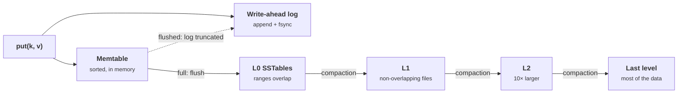
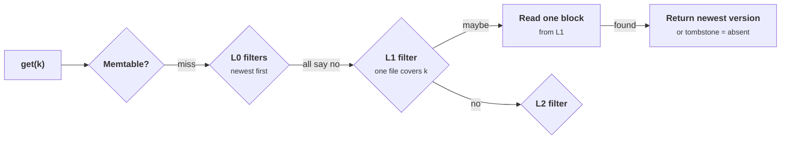

+++
title = 'Storage engines'
description = 'B-trees update pages in place; LSM-trees append and merge later. Each design trades write, read, and space amplification differently, and those ratios decide disk wear, latency, and cost.'
question = 'What happens to a write between the API call and the disk, and why do B-trees and LSM-trees age so differently?'
weight = 2
difficulty = 4
prerequisites = ['/notes/systems-design/distributed-data/01-consensus-and-raft']
date = 2026-10-30T07:10:00Z
lastmod = 2026-10-30T07:10:00Z
verified = 2026-10-30
+++

## The idea in one minute

A storage engine turns `put(key, value)` into bytes on a disk that survive a
crash, and `get(key)` into as few disk reads as possible. Two designs dominate.
A **B-tree** keeps keys sorted in fixed-size pages and updates pages in place,
with a write-ahead log for crash safety. A **log-structured merge-tree (LSM)**
never updates in place. It logs each write, buffers it in a sorted in-memory
**memtable**, flushes that as an immutable sorted file (an **SSTable**), and
merges files later in the background, which is **compaction**.

Neither design is faster in general. Each makes one of three costs worse to
make another better: **write amplification** (bytes written to disk per byte
the application wrote), **read amplification** (disk reads per lookup), and
**space amplification** (bytes on disk per byte of live data). B-trees pay on
writes when updates are small and scattered. LSM-trees pay on reads and on
background I/O, and they hide the read cost with Bloom filters. **Choose the
engine by measuring these three ratios for your workload, then tune
compaction, because compaction is where an LSM-tree's latency and disk wear
come from.**

## A picture



Every byte the application writes is written once to the log, once at flush,
and again each time compaction moves it down a level.

## How it really works

### What durability actually requires

A write is durable once its bytes are on stable storage, which on Linux means
after `fsync` or `fdatasync` returns, or after a write with `O_DSYNC`. Data in
the page cache is lost on power failure. Both designs therefore write a
**write-ahead log (WAL)** first and acknowledge only after it is synced. The
data structure itself, pages or SSTables, can be written lazily and rebuilt
from the log after a crash.

The cost of a sync dominates small writes. Group commit amortizes it: many
concurrent transactions share one fsync. A device with power-loss protection
can acknowledge a flush from its capacitor-backed cache in tens of
microseconds; one without it may take milliseconds, or may acknowledge
without persisting, which turns a power cut into lost or torn writes.

### B-trees: update in place

Bayer and McCreight's B-tree (1972) stores sorted keys in pages, typically
4 to 16 KiB: 8 KiB in PostgreSQL and 16 KiB in InnoDB. Interior pages hold keys
and child pointers; with hundreds of keys per page, a tree of three or four
levels indexes billions of rows, and the upper levels stay in memory. A point
lookup costs about one disk read.

An update modifies one leaf page in the buffer pool and appends a log record.
The page is written back later, at a checkpoint or on eviction. That is where
the write amplification comes from: changing a 100-byte row eventually
rewrites an 8 KiB page. If ten updates to the same page are absorbed before
it is written, the cost is shared; if updates are random across a table much
larger than memory, almost every update costs a full page write.

Two more costs hide in real engines:

- **Torn-page protection.** A crash in the middle of writing a page can leave
  half old and half new bytes. PostgreSQL writes a full image of each page to
  the WAL the first time it is modified after a checkpoint (`full_page_writes`);
  InnoDB writes pages twice through a doublewrite buffer. Both roughly double
  page-write traffic for pages touched once per checkpoint.
- **Fragmentation and multiversioning.** Page splits leave pages partly empty.
  PostgreSQL's MVCC writes a new row version for every update and leaves the
  old one for `VACUUM` to reclaim, so update-heavy tables grow until vacuum
  catches up.

### LSM-trees: append, then merge

O'Neil, Cheng, Gawlick, and O'Neil described the LSM-tree in 1996 for
workloads with far more inserts than reads. Google's Bigtable (2006) made the
modern form common: a commit log, a memtable, immutable SSTables, minor
compactions that flush the memtable, merging compactions, and a major
compaction that rewrites everything and drops deleted data. LevelDB, RocksDB,
Cassandra, HBase, ScyllaDB, and the storage layers of CockroachDB (Pebble) and
TiKV follow the same shape.

- **Writes** are a log append plus an in-memory insert. No reads, no random
  I/O, no page rewrite. Throughput is bounded by sequential bandwidth.
- **Deletes are writes.** A delete inserts a **tombstone** that shadows older
  values. The space is reclaimed only when compaction merges the tombstone
  with every older version of the key and can drop both.
- **Reads** check the memtable, then SSTables from newest to oldest, stopping
  at the first version found. A miss may check every table that could hold
  the key.

### Bloom filters make reads cheap again

Each SSTable carries a **Bloom filter**: a bit array plus k hash functions.
Inserting a key sets k bits; a lookup that finds any of its bits clear means
the key is **definitely absent**, so the table is skipped without a disk read.
False positives are possible, false negatives are not. With m bits for n keys
and the optimal k ≈ (m/n) ln 2, the false-positive rate is about

```text
p ≈ (1 − e^(−k·n/m))^k        10 bits per key, k = 7  →  p ≈ 0.8%
```

Ten bits per key, 1.25 bytes, is a common default; RocksDB's
`bits_per_key = 10` gives about 1%. A billion keys need about 1.2 GB of filter,
which must stay in memory to be useful. Filters help point lookups only. A
range scan must merge iterators from every level that overlaps the range,
which is why LSM range scans are slower than B-tree scans over the same data.



### Compaction strategies

Compaction decides the shape of the tree, and the shape decides all three
amplifications.

| | Leveled (LevelDB, RocksDB default) | Size-tiered (Cassandra STCS, RocksDB universal) |
| --- | --- | --- |
| Shape | L0, then levels each about 10× the previous; inside a level, files do not overlap | Groups of similar-size files merged into one larger file |
| Write amplification | High: a byte is rewritten about fanout times per level it descends | Low: a byte is rewritten about once per tier |
| Read amplification | Low: L0 files plus at most one file per level | Higher: every tier may hold the key |
| Space amplification | Low, about 1.1× at steady state, since about 90% of data is in the last level | High: duplicates persist across tiers, and a full merge needs free space equal to the data |
| Fits | Read-heavy and update-heavy workloads, space-constrained disks | Write-heavy, append-mostly workloads |

For leveled compaction with fanout f and L levels, the upper bound on write
amplification is roughly `1 (WAL) + 1 (flush) + f × (L − 1)`. Measured values
are lower, because not every merge touches a full fanout of overlapping data,
but they grow with the number of levels and so with data size. RocksDB prints
per-level write amplification in its compaction statistics; read them rather
than estimating. Cassandra also offers time-window compaction for data written
once in time order and expired by TTL, and its unified compaction strategy
moves between leveled and tiered behavior with one parameter.

Athanassoulis and colleagues named the underlying constraint the **RUM
conjecture** (2016): an access method that optimizes two of read, update, and
memory (space) overhead must pay in the third. WiscKey (2016) is a standard
example of moving the tradeoff: it keeps only keys and pointers in the
LSM-tree and values in a separate log, cutting write amplification for large
values at the cost of an extra read and a separate garbage collector.

### What to watch in production

- **Compaction debt.** If writes arrive faster than compaction can merge
  them, L0 files accumulate, reads slow down, and RocksDB eventually **slows
  down then stops writes** (its `level0_slowdown_writes_trigger` and
  `level0_stop_writes_trigger` settings, with a pending-compaction-bytes limit
  as well). A write stall is [backpressure](/notes/systems-design/failure-modes/04-overload-and-backpressure/)
  from the storage engine, and it shows up as p99 write latency jumping from
  milliseconds to seconds.
- **Tombstone build-up.** Workloads that delete heavily, such as queues stored
  in a key-value store or TTL'd sessions, can leave reads scanning many
  tombstones. Cassandra warns and eventually fails queries that scan too many.
- **Device wear.** SSD endurance is rated in drive writes per day. Engine
  write amplification multiplies with the SSD's own internal write
  amplification, so an engine writing 20 bytes per user byte can exhaust a
  drive rated for one write per day at a small fraction of its capacity in
  user writes.
- **Space headroom.** A tiered major compaction, or an LSM-tree recovering
  from a backlog, can briefly need as much free space as the data itself.
  Disks that are 80% full can fail compaction and stop writes.

### Where you meet these engines in AI systems

Time-series databases are LSM-like. Prometheus's TSDB keeps the most recent
samples in an in-memory head block protected by a WAL and writes immutable
two-hour blocks that are compacted into larger ones; the
[observability module](/notes/systems-design/observability/01-metrics-cardinality-and-histograms/)
covers why series count, not sample count, drives its memory. Request and
usage logs, feature stores, and evaluation-result stores are write-heavy and
often sit on RocksDB-style engines. Billing, quota, and permission tables are
read-modify-write and fit B-tree databases. Vector indexes add their own
structures, but most persist segments immutably and merge them in the
background, which is the same compaction tradeoff in another form.

## Code

The program implements a small LSM-tree with a WAL, a memtable, SSTables with
real Bloom filters, and two compaction strategies, then writes 200,000 updates
and deletes over 40,000 keys. It verifies every lookup against a plain
dictionary, then counts the three amplifications. Sizes are scaled down so it
runs in seconds; the tree has only three levels.

```python {title="lsm.py"}
"""lsm.py: an LSM-tree's write, read, and compaction paths, counted.

Writes go to a write-ahead log and an in-memory memtable, which is flushed to
immutable sorted tables (SSTables). Compaction merges tables in the background,
either leveled (LevelDB, RocksDB default) or size-tiered (Cassandra's default
in older versions). The program counts bytes written per user byte (write
amplification), tables probed per lookup (read amplification), and bytes on
disk per live byte (space amplification), with and without Bloom filters.
Standard library only; deterministic. Sizes are scaled down; ratios are the point.
"""

from __future__ import annotations

import hashlib
import random
from dataclasses import dataclass

RECORD = 100  # bytes per key-value record
MEMTABLE_ENTRIES = 1_000
FILE_ENTRIES = 2_000  # target SSTable size for leveled compaction
FANOUT = 10
L0_TRIGGER = 4
BLOOM_BITS_PER_KEY = 10
TOMBSTONE = None


class Bloom:
    def __init__(self, keys: list[int], bits_per_key: int):
        self.m = max(64, len(keys) * bits_per_key)
        self.k = max(1, round(bits_per_key * 0.69))  # optimal k = (m/n) ln 2
        self.bits = bytearray(self.m // 8 + 1)
        for key in keys:
            for pos in self._positions(key):
                self.bits[pos // 8] |= 1 << (pos % 8)

    def _positions(self, key: int):
        digest = hashlib.blake2b(key.to_bytes(8, "big"), digest_size=16).digest()
        h1, h2 = int.from_bytes(digest[:8], "big"), int.from_bytes(digest[8:], "big")
        return ((h1 + i * h2) % self.m for i in range(self.k))  # double hashing

    def may_contain(self, key: int) -> bool:
        return all(self.bits[p // 8] >> (p % 8) & 1 for p in self._positions(key))


@dataclass
class SSTable:
    rows: list[tuple[int, int, str | None]]  # (key, seq, value or tombstone), sorted by key
    bloom: Bloom

    @classmethod
    def build(cls, rows: list[tuple[int, int, str | None]]) -> "SSTable":
        return cls(rows, Bloom([r[0] for r in rows], BLOOM_BITS_PER_KEY))

    @property
    def lo(self) -> int:
        return self.rows[0][0]

    @property
    def hi(self) -> int:
        return self.rows[-1][0]

    def get(self, key: int):
        lo, hi = 0, len(self.rows)
        while lo < hi:
            mid = (lo + hi) // 2
            if self.rows[mid][0] < key:
                lo = mid + 1
            else:
                hi = mid
        if lo < len(self.rows) and self.rows[lo][0] == key:
            return True, self.rows[lo][2]
        return False, None


def merge(tables: list[SSTable], drop_tombstones: bool) -> list[tuple[int, int, str | None]]:
    newest: dict[int, tuple[int, str | None]] = {}
    for t in tables:
        for key, seq, val in t.rows:
            if key not in newest or seq > newest[key][0]:
                newest[key] = (seq, val)
    return [(k, s, v) for k, (s, v) in sorted(newest.items())
            if not (drop_tombstones and v is TOMBSTONE)]


class LSM:
    def __init__(self, strategy: str):
        self.strategy = strategy
        self.memtable: dict[int, tuple[int, str | None]] = {}
        self.levels: list[list[SSTable]] = [[] for _ in range(6)]  # leveled: L0..L5
        self.tiers: list[SSTable] = []  # size-tiered: one flat list, newest last
        self.cursor = [0] * 6
        self.seq = 0
        self.user_bytes = self.wal_bytes = self.flush_bytes = self.compact_bytes = 0

    # ---- write path ---------------------------------------------------
    def put(self, key: int, value: str | None) -> None:
        self.seq += 1
        self.user_bytes += RECORD
        self.wal_bytes += RECORD  # appended and fsynced before the write is acknowledged
        self.memtable[key] = (self.seq, value)
        if len(self.memtable) >= MEMTABLE_ENTRIES:
            self.flush()

    def flush(self) -> None:
        rows = [(k, s, v) for k, (s, v) in sorted(self.memtable.items())]
        self.memtable.clear()
        self.flush_bytes += len(rows) * RECORD
        table = SSTable.build(rows)
        if self.strategy == "leveled":
            self.levels[0].append(table)
            self.compact_leveled()
        else:
            self.tiers.append(table)
            self.compact_tiered()

    def write_out(self, rows) -> list[SSTable]:
        self.compact_bytes += len(rows) * RECORD
        return [SSTable.build(rows[i:i + FILE_ENTRIES]) for i in range(0, len(rows), FILE_ENTRIES)]

    def deepest(self) -> int:
        return max((i for i, lvl in enumerate(self.levels) if lvl), default=0)

    def compact_leveled(self) -> None:
        if len(self.levels[0]) >= L0_TRIGGER:  # L0 files overlap: merge them all into L1
            inputs = self.levels[0] + self.overlapping(1, self.levels[0])
            self.replace(1, inputs)
            self.levels[0] = []
        for i in range(1, 5):
            target = FILE_ENTRIES * FANOUT ** i
            while sum(len(t.rows) for t in self.levels[i]) > target:
                files = sorted(self.levels[i], key=lambda t: t.lo)
                pick = next((t for t in files if t.lo >= self.cursor[i]), files[0])
                self.cursor[i] = pick.hi + 1  # round-robin through the key space
                inputs = [pick] + self.overlapping(i + 1, [pick])
                self.levels[i].remove(pick)
                self.replace(i + 1, inputs)

    def overlapping(self, level: int, tables: list[SSTable]) -> list[SSTable]:
        lo, hi = min(t.lo for t in tables), max(t.hi for t in tables)
        return [t for t in self.levels[level] if t.hi >= lo and t.lo <= hi]

    def replace(self, level: int, inputs: list[SSTable]) -> None:
        drop = level >= self.deepest()  # nothing older below: tombstones can go
        rows = merge(inputs, drop_tombstones=drop)
        self.levels[level] = [t for t in self.levels[level] if t not in inputs]
        self.levels[level] += self.write_out(rows)

    def compact_tiered(self) -> None:
        while True:
            tiers: dict[int, list[SSTable]] = {}
            for t in self.tiers:
                tier = (len(t.rows) // MEMTABLE_ENTRIES).bit_length() // 2  # about log4(size)
                tiers.setdefault(tier, []).append(t)
            full = next((g for g in tiers.values() if len(g) >= 4), None)
            if not full:
                return
            drop = len(full) == len(self.tiers)  # only a merge of everything may drop tombstones
            rows = merge(full, drop_tombstones=drop)
            self.compact_bytes += len(rows) * RECORD
            self.tiers = [t for t in self.tiers if t not in full] + [SSTable.build(rows)]

    # ---- read path ----------------------------------------------------
    def tables_newest_first(self, key: int) -> list[SSTable]:
        if self.strategy == "leveled":
            out = list(reversed(self.levels[0]))
            for lvl in self.levels[1:]:  # within L1+ ranges do not overlap: at most one file
                out += [t for t in lvl if t.lo <= key <= t.hi]
            return out
        return [t for t in reversed(self.tiers) if t.lo <= key <= t.hi]

    def get(self, key: int, use_bloom: bool) -> tuple[str | None, int]:
        if key in self.memtable:
            return self.memtable[key][1], 0
        probes = 0
        for t in self.tables_newest_first(key):
            if use_bloom and not t.bloom.may_contain(key):
                continue  # filter says definitely absent: no disk read
            probes += 1
            found, val = t.get(key)
            if found:
                return val, probes
        return None, probes

    # ---- accounting ---------------------------------------------------
    def tables(self) -> list[SSTable]:
        return [t for lvl in self.levels for t in lvl] if self.strategy == "leveled" else self.tiers

    def disk_rows(self) -> int:
        return sum(len(t.rows) for t in self.tables())

    def tombstones(self) -> int:
        return sum(v is TOMBSTONE for t in self.tables() for _, _, v in t.rows)


def run(strategy: str, writes: int, keyspace: int, seed: int) -> None:
    rng = random.Random(seed)
    db, truth = LSM(strategy), {}
    for _ in range(writes):
        key = 2 * rng.randrange(keyspace)  # even keys only
        value = TOMBSTONE if rng.random() < 0.05 else f"v{rng.randrange(10**6)}"
        db.put(key, value)
        truth[key] = value
    live = sum(v is not TOMBSTONE for v in truth.values())
    present = [k for k, v in truth.items() if v is not TOMBSTONE][:5_000]
    missing = [2 * k + 1 for k in range(5_000)]  # odd keys: inside every table's range, never written
    # correctness check: every lookup agrees with a plain dict
    assert all(db.get(k, use_bloom=True)[0] == truth[k] for k in list(truth)[:5_000])
    wa_total = (db.wal_bytes + db.flush_bytes + db.compact_bytes) / db.user_bytes
    wa_tables = (db.flush_bytes + db.compact_bytes) / db.user_bytes
    print(f"{strategy}:")
    print(f"  write amplification  {wa_total:5.1f}x including WAL, {wa_tables:5.1f}x to SSTables")
    if strategy == "leveled":
        shape = ", ".join(f"L{i}={len(l)}" for i, l in enumerate(db.levels) if l)
    else:
        shape = f"{len(db.tiers)} tables, sizes " + ", ".join(str(len(t.rows)) for t in db.tiers)
    print(f"  shape                {shape}")
    print(f"  space amplification  {db.disk_rows() / live:5.2f}x "
          f"({db.disk_rows():,} rows on disk for {live:,} live keys, {db.tombstones():,} tombstones)")
    for label, keys in (("present keys", present), ("missing keys", missing)):
        for bloom in (False, True):
            probes = sum(db.get(k, use_bloom=bloom)[1] for k in keys) / len(keys)
            print(f"  {label}, bloom {'on ' if bloom else 'off'}  {probes:5.2f} table reads per lookup")


def bloom_check() -> None:
    keys = list(range(100_000))
    for bits in (5, 10, 16):
        bloom = Bloom(keys, bits)
        fp = sum(bloom.may_contain(k) for k in range(10**6, 10**6 + 100_000)) / 100_000
        print(f"  {bits:>2} bits/key, k={bloom.k}: false-positive rate {fp:.2%}")


if __name__ == "__main__":
    print("200,000 writes over 40,000 keys, 5% deletes, 100-byte records\n")
    for strategy in ("leveled", "size-tiered"):
        run(strategy, writes=200_000, keyspace=40_000, seed=3)
    print("\nBloom filter false-positive rate, 100,000 keys")
    bloom_check()
    print("\nB-tree comparison: one 100-byte update dirties one 8 KiB page")
    for per_page in (1, 10, 80):
        print(f"  {per_page:>2} updates absorbed per page write: "
              f"{(8192 / per_page + RECORD) / RECORD:5.1f}x write amplification (page + WAL)")
```

Run it with `python3 lsm.py`:

```text
200,000 writes over 40,000 keys, 5% deletes, 100-byte records

leveled:
  write amplification    7.6x including WAL,   6.6x to SSTables
  shape                L0=1, L1=10, L2=22
  space amplification   1.46x (55,049 rows on disk for 37,799 live keys, 997 tombstones)
  present keys, bloom off   2.36 table reads per lookup
  present keys, bloom on    1.00 table reads per lookup
  missing keys, bloom off   2.82 table reads per lookup
  missing keys, bloom on    0.03 table reads per lookup
size-tiered:
  write amplification    4.2x including WAL,   3.2x to SSTables
  shape                5 tables, sizes 35675, 32074, 13311, 3854, 1000
  space amplification   2.27x (85,914 rows on disk for 37,799 live keys, 2,471 tombstones)
  present keys, bloom off   3.50 table reads per lookup
  present keys, bloom on    1.01 table reads per lookup
  missing keys, bloom off   4.98 table reads per lookup
  missing keys, bloom on    0.04 table reads per lookup

Bloom filter false-positive rate, 100,000 keys
   5 bits/key, k=3: false-positive rate 9.14%
  10 bits/key, k=7: false-positive rate 0.80%
  16 bits/key, k=11: false-positive rate 0.04%

B-tree comparison: one 100-byte update dirties one 8 KiB page
   1 updates absorbed per page write:  82.9x write amplification (page + WAL)
  10 updates absorbed per page write:   9.2x write amplification (page + WAL)
  80 updates absorbed per page write:   2.0x write amplification (page + WAL)
```

What it shows:

- **The tradeoff in both directions.** Leveled compaction wrote 6.6 bytes to
  SSTables per user byte and needs 1.46× the live data on disk; size-tiered
  wrote 3.2 bytes per user byte and needs 2.27×, with 2.5 times as many
  tombstones still on disk. Leveled space amplification is higher than the
  1.1× steady-state figure because this tree is only three levels deep, so
  the last level does not yet hold 90% of the data.
- **Bloom filters erase most of the read cost.** Without filters, a lookup of
  a key that does not exist reads 2.8 tables under leveled and 5.0 under
  size-tiered. With 10 bits per key, both drop to about 0.03, close to the
  0.8% false-positive rate times the number of tables checked.
- **The filter formula holds.** The measured false-positive rates, 9.1%, 0.8%,
  and 0.04%, match `(1 − e^(−kn/m))^k` for 5, 10, and 16 bits per key.
- **B-tree write amplification depends on locality.** One 100-byte update per
  8 KiB page write is 83× amplification; if 80 updates land on a page before
  it is written, it falls to 2×. The LSM numbers do not depend on which keys
  are updated; the B-tree numbers depend almost entirely on it.

The three ratios side by side from the run:

| Strategy | Write amp. (SSTables) | Space amp. | Reads per miss, no filter | Reads per miss, filter |
| --- | --- | --- | --- | --- |
| Leveled | 6.6× | 1.46× | 2.82 | 0.03 |
| Size-tiered | 3.2× | 2.27× | 4.98 | 0.04 |

## Where it breaks

- **Workload shape changes the winner.** A B-tree with a hot working set that
  fits in memory absorbs many updates per page and beats an LSM-tree on write
  amplification. An LSM-tree with uniform random updates over a large table
  beats a B-tree. Benchmarks with the wrong key distribution choose the wrong
  engine.
- **Background work is still work.** Compaction competes with foreground
  requests for disk bandwidth and CPU. Rate-limit it and watch it, or p99
  latency will follow the compaction schedule.
- **Durability settings are part of the engine.** An engine configured not to
  fsync on each commit (common for speed) can lose the last few hundred
  milliseconds of acknowledged writes on power loss. With replication,
  that may be acceptable if a replica has them; know which guarantee you
  picked.
- **Deletes are not immediate.** A tombstone hides data, but the bytes remain
  on disk until compaction drops them, and in old SSTables, snapshots, and
  backups after that. Deletion for privacy or legal reasons needs a
  compaction, and a retention plan for backups, to be complete.
- **What the simulation leaves out.** No block cache, no range scans, no
  concurrency, whole-key Bloom filters only, and SSTables that are lists in
  memory. It counts bytes and table reads; it does not measure time.

## Remember this

- Durability means the WAL is synced; everything else can be rebuilt from it.
- B-trees rewrite a page for a small update; locality decides their write amplification.
- LSM-trees append and merge later; compaction decides their write, read, and space amplification.
- Leveled compaction favors reads and space; size-tiered favors writes.
- Bloom filters cut point-lookup misses to about 1% of a read per table, and do nothing for range scans.
- Compaction debt causes write stalls; watch L0 file count and pending compaction bytes.

## Try it

1. Run `lsm.py`. Change `FANOUT` to 4 and then to 20. How do leveled write and
   space amplification move?
2. Make the workload skewed: pick keys so that 90% of writes hit 1% of the
   keys. Which strategy's write amplification changes more, and why?
3. Set `BLOOM_BITS_PER_KEY` to 4 and then 20. How do table reads per missing
   key change? Then estimate the memory needed for 10-bit filters over
   2 billion keys.
4. For a database you run, find the WAL sync setting, the compaction strategy
   or vacuum settings, and the SSD's rated drive writes per day. Estimate how
   many years the drives last at the current write rate times the engine's
   write amplification.

## Check yourself

1. Why does an LSM-tree have low write cost but nonzero write amplification?

   
   Each write is only a sequential log append and an in-memory insert, so the
   foreground cost is low. But the same bytes are written again at flush and
   again every time compaction merges them into a lower level. Total bytes
   written per user byte can be many times one, even though no write ever
   waits for a random I/O.
   

2. A lookup for a key that does not exist is the worst case for an LSM-tree.
   Why, and what fixes it?

   
   The engine cannot stop at the first match, because there is none, so it
   must check every table whose key range covers the key. Per-table Bloom
   filters answer "definitely absent" for almost all of them from memory, so
   only false positives, about 1% per table at 10 bits per key, cost a disk
   read.
   

3. Why does leveled compaction have lower space amplification than
   size-tiered?

   
   Within each level, files do not overlap, and each level is about ten times
   the previous one, so roughly 90% of the data is in the last level, which
   holds one version per key. Size-tiered keeps several similar-size files
   that can each hold a version of the same key, and a merge of large tiers
   needs temporary space equal to their size.
   

4. A B-tree database shows write amplification near 80 on an update-heavy
   table. What does that tell you about the workload?

   
   Updates are small and scattered: nearly every update dirties a page that
   is written out before another update lands on it. The working set is
   larger than the buffer pool, or checkpoints are frequent enough that full
   page images dominate. Clustering related rows, a larger buffer pool, or an
   LSM engine would lower it.
   

5. A user asks for their data to be deleted. The application issues deletes,
   and the rows disappear from queries. Is the data gone?

   
   Not yet. In an LSM-tree, deletes write tombstones, and the old values stay
   in SSTables until compaction merges them with the tombstones. In a B-tree
   with MVCC, old row versions remain until vacuum. Both may also survive in
   WAL archives, snapshots, replicas, and backups. Complete deletion needs a
   forced compaction or vacuum and a backup retention policy.
   

## Sources

- P. O'Neil, E. Cheng, D. Gawlick, E. O'Neil, "The Log-Structured Merge-Tree (LSM-Tree)", *Acta Informatica* 33(4), 1996.
- F. Chang et al., [Bigtable: A Distributed Storage System for Structured Data](https://research.google/pubs/pub27898/), *OSDI*, 2006.
- R. Bayer, E. McCreight, "Organization and Maintenance of Large Ordered Indexes", *Acta Informatica* 1(3), 1972.
- D. Comer, "The Ubiquitous B-Tree", *ACM Computing Surveys* 11(2), 1979.
- B. Bloom, "Space/Time Trade-offs in Hash Coding with Allowable Errors", *Communications of the ACM* 13(7), 1970.
- M. Athanassoulis et al., "Designing Access Methods: The RUM Conjecture", *EDBT*, 2016.
- L. Lu, T. Pillai, A. Arpaci-Dusseau, R. Arpaci-Dusseau, "WiscKey: Separating Keys from Values in SSD-Conscious Storage", *USENIX FAST*, 2016.
- RocksDB, [Leveled Compaction](https://github.com/facebook/rocksdb/wiki/Leveled-Compaction), [RocksDB Bloom Filter](https://github.com/facebook/rocksdb/wiki/RocksDB-Bloom-Filter), and [Write Stalls](https://github.com/facebook/rocksdb/wiki/Write-Stalls), RocksDB wiki.
- PostgreSQL Global Development Group, [Write-Ahead Logging](https://www.postgresql.org/docs/current/wal-intro.html) and [WAL configuration: full_page_writes](https://www.postgresql.org/docs/current/runtime-config-wal.html), PostgreSQL documentation (current version).
- Prometheus, [Storage](https://prometheus.io/docs/prometheus/latest/storage/), Prometheus documentation.
