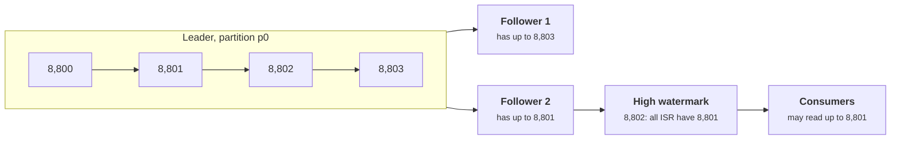
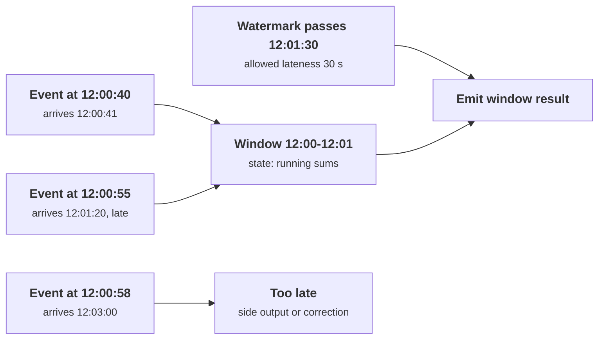

+++
title = 'Logs and stream processing'
description = 'A partitioned, replicated log decouples producers from consumers and lets any consumer replay history. Where a consumer commits its offset decides whether a crash loses events, duplicates them, or neither.'
question = 'How does a partitioned log carry data between systems, and how do consumers process it effectively once despite crashes?'
weight = 3
difficulty = 4
prerequisites = ['/notes/systems-design/concurrency-and-consistency/05-exactly-once-and-the-outbox', '/notes/systems-design/distributed-data/01-consensus-and-raft']
date = 2026-10-30T07:15:00Z
lastmod = 2026-10-30T07:15:00Z
verified = 2026-10-30
+++

## The idea in one minute

A **log** is an append-only, totally ordered sequence of records, each with a
position called its **offset**. Split it into **partitions** for parallelism,
replicate each partition for durability, and keep records for days instead of
deleting them on delivery, and you have Apache Kafka and the systems modeled
on it. Producers append. Each consumer group tracks its own offset per
partition and can rewind it to replay history. Ordering holds only within a
partition, so records that must stay ordered share a partition key.

A consumer's correctness comes down to one choice: **when it records its
offset relative to its side effects**. Commit before processing and a crash
loses events. Commit after and a crash replays them. Getting each event's
effect exactly once needs the effect and the offset to commit together, or
an effect that ignores duplicates. Stream processors add a second question,
**which time an event belongs to**: event time, when it happened, or
processing time, when it arrived. **Key partitions by what must stay ordered,
store offsets with your results, and window by event time with an explicit
policy for late data.**

## A picture

```mermaid {title="One log, many independent readers at their own offsets"}
flowchart LR
  P1["<b>Gateway</b><br/><small>usage events, key = tenant</small>"] --> T
  P2["<b>Batch jobs</b>"] --> T
  subgraph T["Topic usage, 3 partitions, replicated 3×"]
    direction TB
    p0["<b>p0</b><br/><small>offsets 0 .. 8,812</small>"]
    p1["<b>p1</b><br/><small>0 .. 9,040</small>"]
    p2["<b>p2</b><br/><small>0 .. 8,977</small>"]
  end
  T --> B["<b>Billing</b><br/><small>group offsets p0=8,800 ...</small>"]
  T --> E["<b>Eval dataset builder</b><br/><small>hours behind, replays freely</small>"]
  T --> A["<b>Abuse detection</b><br/><small>seconds behind</small>"]
  class P1,P2 compute
  class p0,p1,p2 queue
  class B,E,A io
```

Consumers do not remove records. Each group keeps its own position, so a slow
or newly added consumer does not affect the others.

## How it really works

### The log as an integration point

Jay Kreps's essay "The Log" (2013) argues that a durable, ordered log is the
natural way to connect data systems: every change is written once, in order,
and each downstream system (a cache, a search index, a warehouse, a model
feature store) reads it at its own pace and derives its own view. The database
replication logs in the [Raft lesson](/notes/systems-design/distributed-data/01-consensus-and-raft/)
and the [storage engines lesson](/notes/systems-design/distributed-data/02-storage-engines/)
are the same idea inside one system. The
[transactional outbox](/notes/systems-design/concurrency-and-consistency/05-exactly-once-and-the-outbox/)
is how a service feeds such a log without a dual write.

Kafka's original design (Kreps, Narkhede, and Rao, 2011) made three choices
that still define the category:

- **Sequential I/O and the page cache.** A partition is a set of segment files
  appended at the end. Reads at the tail are served from the operating
  system's page cache, and transfers to consumers can use zero-copy
  `sendfile`.
- **Consumers pull and own their position.** The broker does not track per-message
  acknowledgments, only one offset per group per partition. That makes replay
  free: set the offset back.
- **Retention by time or size, not by consumption.** Records stay for, say,
  seven days whether or not anyone read them. **Log compaction** is the other
  mode: keep at least the latest record per key, so a compacted topic is a
  replayable table of current values. A null value is a tombstone that deletes
  the key after a grace period.

### Partitions, keys, and ordering

Records with the same key go to the same partition, by a hash of the key, and
are read in the order they were written. Records in different partitions have
no defined order relative to each other. Consequences:

- Choose the key by **what must stay ordered**: per account, per order, per
  conversation. Ordering per tenant for billing is natural; global ordering
  across tenants would require a single partition, and a single consumer.
- **A hot key is a hot partition.** One tenant producing half the traffic puts
  half the load on one partition and one consumer, however many you add.
- **Adding partitions remaps keys.** The default partitioner hashes modulo the
  partition count, so increasing it sends some keys to new partitions, and
  for a while their old and new records can be consumed out of order.
- **Parallelism is capped by partitions.** A consumer group spreads partitions
  across its members; members beyond the partition count sit idle.

### Replication: ISR and the high watermark

Each partition has a leader and followers. Followers that are caught up form
the **in-sync replica set (ISR)**. The **high watermark** is the offset up to
which every ISR member has the data, and consumers can read only below it, so
nobody reads a record that a leader failover could lose.

| Setting | Effect |
| --- | --- |
| `acks=all` (the producer default since Kafka 3.0) | The leader acknowledges after every ISR member has the record |
| `min.insync.replicas=2` with replication factor 3 | Writes are refused when fewer than two replicas are in sync, instead of being acknowledged by the leader alone |
| `enable.idempotence=true` (default since 3.0) | The broker discards a producer's retried duplicates using producer ID and sequence numbers |
| `unclean.leader.election.enable=false` (default) | An out-of-sync replica may not become leader, trading availability for not losing acknowledged records |

Kafka's metadata is now managed by its own Raft-based controller quorum,
KRaft, introduced by KIP-500. Kafka 4.0, released in 2025, removed ZooKeeper
support entirely. Note that, by default, Kafka acknowledges a write once
replicas have it **in memory**, not after fsync. It relies on replication
across failure domains for durability rather than on each broker's disk.



### Where the offset is committed decides the guarantee

Consumer offsets are themselves records, in Kafka's internal compacted
`__consumer_offsets` topic. The consumer chooses when to write them:

| Strategy | Crash between the two steps | Result |
| --- | --- | --- |
| **Commit, then process** | Offset says done, effect never happened | Events lost: at most once |
| **Process, then commit** | Effect happened, offset not recorded | Events replayed: at least once |
| **Process idempotently, then commit** | Replay hits a deduplication check | Effectively once, if the dedupe state is durable and atomic with the effect |
| **Commit offset and effect in one transaction** | Both or neither | Effectively once, without per-event dedupe state |

The Java client's auto-commit, on by default, commits the offsets returned by
the previous `poll()` on the next poll. If processing finishes inside the
poll loop, that is at least once; if the loop hands records to another thread
and polls again, offsets can be committed for records that were never
processed.

```mermaid {title="Process, then commit: a crash in between replays the batch"}
sequenceDiagram
  autonumber
  participant K as Log, p0
  participant C as Billing consumer
  participant DB as Billing DB
  K->>C: poll from offset 8,800: 100 records
  C->>DB: add tokens for 8,800 .. 8,899
  DB-->>C: committed
  Note over C: crash before committing offset 8,900
  C->>K: restart: last committed offset is 8,800
  K->>C: the same 100 records again
  C->>DB: add tokens again: double billing
```

The two effectively-once options generalize the inbox from the
[outbox lesson](/notes/systems-design/concurrency-and-consistency/05-exactly-once-and-the-outbox/):

- **Store the offset in the sink.** Write the aggregate and the partition's
  next offset in the same database transaction, and on startup read the
  offset from the database, not from the broker. Nothing else needs to be
  remembered.
- **Kafka transactions** (KIP-98) atomically write output records to Kafka
  topics and the consumer's offsets, and consumers reading with
  `isolation.level=read_committed` see only committed output. Kafka Streams
  wraps this as `processing.guarantee=exactly_once_v2`. It covers
  Kafka-to-Kafka pipelines. An external database or API still needs one of the
  options above.

### Stream processing: event time, windows, and watermarks

A stream processor (Kafka Streams, Apache Flink, Spark Structured Streaming,
Google Cloud Dataflow) runs continuous computations over logs: filters, joins,
and aggregations in windows. The Dataflow model paper (Akidau et al., 2015)
separates the questions such a computation must answer:

- **Event time versus processing time.** Mobile clients go offline, gateways
  retry, and partitions lag, so events arrive late and out of order. A
  per-minute token count computed in processing time changes every time a
  consumer falls behind; computed in event time, it is a property of the data.
- **Watermarks.** A watermark is the processor's estimate that no events
  older than time T are still to come. When it passes the end of a window, the
  window can be emitted. It is a heuristic: events older than the watermark
  can still arrive.
- **Late data policy.** Drop late events, emit an updated result (a
  retraction or correction), or hold windows open for an allowed lateness at
  the cost of state. For billing, updated results are usually required; for a
  dashboard, dropping may be fine.



### State and checkpoints

Windows and joins keep state, and state must survive crashes consistently with
offsets. Flink takes **asynchronous barrier snapshots** (Carbone et al.,
2015), a variant of the Chandy-Lamport snapshot algorithm (1985): barriers
flow through the dataflow with the records, and each operator snapshots its
state when a barrier passes, so a checkpoint is a consistent cut of input
offsets and all operator state. On failure, the job restores the last
checkpoint and rewinds its sources to the offsets recorded in it. Output to
external systems is made exactly once with transactional sinks that commit
only when a checkpoint completes, which is two-phase commit, covered in
[the next lesson](/notes/systems-design/distributed-data/04-distributed-transactions/).

### Lag and capacity

**Consumer lag** is the distance between the latest offset and the group's
committed offset, per partition. Measured in records, it says little; measured
in time (how old the oldest unprocessed record is) it says how stale every
derived view is, and it is the number to alert on. Capacity follows from
[queueing](/notes/systems-design/scale-and-performance/01-queueing-and-littles-law/):
with produce rate λ and total consume capacity μ, a backlog B drains in
`B / (μ − λ)`, and that time explodes as utilization λ/μ approaches 1. A
consumer group that keeps up at 94% utilization takes hours to recover from a
ten-minute outage.

### Logs in AI systems

- **Usage metering and billing.** Token counts per request flow from gateways
  to a log and then to billing. Lost events are lost revenue, duplicates are
  overcharges. This is the effectively-once case.
- **Datasets from production traffic.** Request and response logs feed
  evaluation sets and training data. Replay lets you rebuild a dataset with a
  new filter, and retention limits how far back you can go. Deletion requests
  must propagate into every derived dataset, which is much easier if datasets
  are rebuilt from a log that honors deletions (compacted topics with
  tombstones) than if they are copied once.
- **Features and embeddings.** Change data capture from operational databases
  into a log keeps feature stores and vector indexes current. Training on
  features joined in processing time, rather than in event time as of each
  label's timestamp, leaks future information into training and causes skew
  between training and serving.

## Code

The program builds a 20,000-event usage log partitioned by tenant and runs a
billing consumer that crashes in 2% of batches at a random point and
restarts from its last offset. Each of four strategies runs 100 times with
different crash patterns, and the totals are compared with the truth. Part 2
is the drain-time arithmetic for a ten-minute consumer outage.

```python {title="offsets.py"}
"""offsets.py: consumer offsets, crashes, and effectively-once processing.

A topic of token-usage events, partitioned by tenant, feeds a billing consumer
that sums tokens per tenant. The consumer crashes at random points and
restarts from its last committed offset. Four strategies for when the offset
is committed are compared against the true totals. Then a small capacity
calculation for partitions and lag. Simulated log and sink; standard library
only; deterministic.
"""

from __future__ import annotations

import random
import zlib
from dataclasses import dataclass, field

PARTITIONS = 4
BATCH = 100


@dataclass(frozen=True)
class Event:
    event_id: str
    tenant: str
    tokens: int


def build_log(n: int, seed: int) -> list[list[Event]]:
    rng = random.Random(seed)
    log: list[list[Event]] = [[] for _ in range(PARTITIONS)]
    for i in range(n):
        tenant = f"t{rng.randrange(50):02d}"
        p = zlib.crc32(tenant.encode()) % PARTITIONS  # same tenant, same partition, in order
        log[p].append(Event(f"e{i}", tenant, rng.randint(50, 4_000)))
    return log


@dataclass
class Sink:
    """The billing database. `transaction` applies all of its changes or none."""

    totals: dict[str, int] = field(default_factory=dict)
    seen: set[str] = field(default_factory=set)
    offsets: dict[int, int] = field(default_factory=dict)  # used by 'transactional' only
    applied: int = 0

    def add(self, e: Event) -> None:
        self.totals[e.tenant] = self.totals.get(e.tenant, 0) + e.tokens
        self.applied += 1


class Crash(Exception):
    pass


def consume(log: list[list[Event]], strategy: str, rng: random.Random, crash_p: float) -> Sink:
    sink = Sink()
    committed = {p: 0 for p in range(PARTITIONS)}  # the broker's stored consumer offsets
    while True:
        start = sink.offsets if strategy == "transactional" else committed
        if all(start.get(p, 0) >= len(log[p]) for p in range(PARTITIONS)):
            return sink
        try:
            for p in range(PARTITIONS):
                pos = start.get(p, 0)
                while pos < len(log[p]):
                    batch = log[p][pos:pos + BATCH]
                    crash_after = rng.randrange(len(batch) + 1) if rng.random() < crash_p else None
                    if strategy == "commit-first":
                        committed[p] = pos + len(batch)  # at most once
                        apply(sink, batch, crash_after, dedupe=False)
                    elif strategy == "commit-after":
                        apply(sink, batch, crash_after, dedupe=False)
                        committed[p] = pos + len(batch)  # at least once
                    elif strategy == "commit-after+dedupe":
                        apply(sink, batch, crash_after, dedupe=True)
                        committed[p] = pos + len(batch)
                    else:  # transactional: results and offset commit together
                        if crash_after is not None:
                            raise Crash  # the open transaction is rolled back, nothing applied
                        for e in batch:
                            sink.add(e)
                        sink.offsets[p] = pos + len(batch)
                    pos += len(batch)
        except Crash:
            continue  # restart: read the offsets again and resume


def apply(sink: Sink, batch: list[Event], crash_after: int | None, dedupe: bool) -> None:
    for i, e in enumerate(batch):
        if crash_after is not None and i == crash_after:
            raise Crash
        if dedupe:
            if e.event_id in sink.seen:
                continue  # in a real sink: the id and the effect commit in one transaction
            sink.seen.add(e.event_id)
        sink.add(e)
    if crash_after == len(batch):
        raise Crash  # everything applied, crash before the offset commit


def main() -> None:
    log = build_log(20_000, seed=1)
    truth: dict[str, int] = {}
    for part in log:
        for e in part:
            truth[e.tenant] = truth.get(e.tenant, 0) + e.tokens
    total = sum(truth.values())
    print(f"20,000 usage events, {PARTITIONS} partitions, {total:,} tokens; "
          f"consumer crashes in 2% of batches; 100 runs per strategy\n")
    print("strategy              events applied   tokens billed vs true   tenants wrong   extra state")
    for strategy in ("commit-first", "commit-after", "commit-after+dedupe", "transactional"):
        applied, err, wrong, state = [], [], [], 0
        for run in range(100):
            sink = consume(log, strategy, random.Random(run), crash_p=0.02)
            applied.append(sink.applied)
            err.append(sum(sink.totals.values()) - total)
            wrong.append(sum(sink.totals.get(t, 0) != v for t, v in truth.items()))
            state = max(state, len(sink.seen))
        lo, hi = min(err), max(err)
        extra = f"{state:,} ids kept" if state else ("offsets in sink" if strategy == "transactional" else "-")
        print(f"{strategy:<21} {min(applied):>6,}-{max(applied):<7,} "
              f"{lo / total:+7.2%} to {hi / total:+7.2%}   {max(wrong):>6}/50     {extra}")

    print("\nsizing: 30,000 events/s produced; one consumer handles 4,000 events/s per partition")
    produce, per_partition = 30_000, 4_000
    for partitions in (8, 12, 16):
        capacity = partitions * per_partition
        backlog = produce * 600  # a 10-minute consumer outage
        drain = backlog / (capacity - produce) if capacity > produce else float("inf")
        print(f"  {partitions:>2} partitions: capacity {capacity:>6,}/s, utilization "
              f"{produce / capacity:5.1%}, 10-minute outage drains in "
              + (f"{drain / 60:5.1f} min" if drain != float("inf") else "never"))


if __name__ == "__main__":
    main()
```

Run it with `python3 offsets.py`:

```text
20,000 usage events, 4 partitions, 40,298,184 tokens; consumer crashes in 2% of batches; 100 runs per strategy

strategy              events applied   tokens billed vs true   tenants wrong   extra state
commit-first          19,516-20,000   -2.42% to  +0.00%       50/50     -
commit-after          20,000-20,491   +0.00% to  +2.58%       50/50     -
commit-after+dedupe   20,000-20,000   +0.00% to  +0.00%        0/50     20,000 ids kept
transactional         20,000-20,000   +0.00% to  +0.00%        0/50     offsets in sink

sizing: 30,000 events/s produced; one consumer handles 4,000 events/s per partition
   8 partitions: capacity 32,000/s, utilization 93.8%, 10-minute outage drains in 150.0 min
  12 partitions: capacity 48,000/s, utilization 62.5%, 10-minute outage drains in  16.7 min
  16 partitions: capacity 64,000/s, utilization 46.9%, 10-minute outage drains in   8.8 min
```

What it shows:

- **Commit first loses, commit after duplicates.** Across 100 runs, committing
  before processing under-billed by up to 2.4%; committing after processing
  over-billed by up to 2.6%. In the worst run of each, every one of the 50
  tenants got a wrong bill. Neither strategy is wrong code; each is a choice of
  failure.
- **Two ways to exactly-once effects.** Deduplicating by event ID fixes the
  totals, but the consumer must keep every event ID it has seen for as long as
  replay is possible, 20,000 here and billions in production. Storing the
  offset in the same transaction as the totals fixes them with four integers
  of extra state.
- **Utilization decides recovery.** At 30,000 events per second, eight
  partitions keep up at 94% utilization, but a ten-minute outage then takes
  150 minutes to drain. Twelve partitions bring that to 17 minutes. Size
  partitions and consumers for recovery, not just for steady state.

## Where it breaks

- **Offsets in the sink need a single sink.** The transactional trick works
  when results and offsets go to one database. A consumer that writes to two
  systems has the dual-write problem again and needs an outbox, Kafka
  transactions, or idempotent writes to each.
- **Replays meet changed code.** Rewinding a consumer group runs today's code
  on last week's events. Effects that were idempotent under the old schema may
  not be under the new one, and side effects like emails are not idempotent at
  all. Mark consumers that are safe to replay, and separate pure derivations
  from side effects.
- **Retention is a promise to the slowest consumer.** If a consumer falls
  behind by more than the retention period, records are deleted before it
  reads them and it must restart from the earliest available offset or a
  snapshot. Alert on lag in time against retention.
- **Topics are an access-control boundary.** Anyone who can produce to a topic
  can inject events that every consumer trusts, and anyone who can read it
  sees every event. Authenticate producers and consumers, authorize per topic,
  and treat prompts and responses in logs as sensitive data with retention
  limits.
- **What the simulation leaves out.** No broker failures, no rebalancing,
  one consumer, no event-time windows, and a sink that is a dictionary with
  atomic transactions. It shows the crash windows around offset commits and
  the drain arithmetic, nothing more.

## Remember this

- A log is ordered within a partition only; key by what must stay ordered.
- Consumers own their offsets, so replay is free and every consumer is independent.
- Commit before processing loses events; commit after duplicates them.
- Effectively once means the offset and the effect commit together, or the effect ignores duplicates.
- Window by event time, with watermarks and an explicit late-data policy.
- Alert on lag in time, against retention, and size for drain time after an outage.

## Try it

1. Run `offsets.py`. Raise `crash_p` to 0.10. How do the error ranges of the
   first two strategies change, and do the last two stay exact?
2. Make the dedupe strategy forget IDs older than 5,000 events (a bounded
   inbox), and add a replay of the whole log after a crash. How many
   duplicates get through?
3. Change the partition key from tenant to a random value per event. Which
   strategies still work, and what ordering guarantee did you lose?
4. For a consumer you run, find where it commits offsets relative to its side
   effects, and its retention period against its worst historical lag.

## Check yourself

1. Why can a consumer group not use more members than there are partitions?

   
   A partition is consumed by exactly one member of a group at a time, which
   is what preserves its ordering. With more members than partitions, the
   extra members have no partition assigned and sit idle. Parallelism is set
   by the partition count.
   

2. What does the high watermark protect against?

   
   A consumer reading a record that only the leader has. If that leader then
   failed, a new leader from the in-sync set might not have the record, and the
   consumer would have acted on data that no longer exists. Exposing only
   records that every in-sync replica holds means a failover cannot take back
   anything a consumer has seen.
   

3. A consumer processes a batch, writes results to PostgreSQL, and then
   commits offsets to Kafka. What happens if it crashes in between, and how do
   you fix it without keeping every event ID?

   
   On restart it reads the old offset from Kafka and reprocesses the batch, so
   results are applied twice. Store the next offset per partition in a
   PostgreSQL table, updated in the same transaction as the results, and on
   startup seek to the offsets in that table instead of the ones in Kafka.
   

4. Why do Kafka transactions not make an email-sending consumer exactly once?

   
   They make writes to Kafka topics and the offset commit atomic. Sending an
   email is an effect outside Kafka, so a crash after sending and before the
   transaction commits causes the email to be sent again on retry. The email
   step needs its own idempotency, such as a provider idempotency key or a
   record of sent message IDs.
   

5. Why compute a per-minute token count in event time rather than processing
   time?

   
   In processing time, the count for a minute depends on when events happened
   to arrive, so it changes with consumer lag, retries, and replays, and two
   runs over the same data disagree. In event time, the count belongs to when
   the usage happened, and it is the same however the data is delivered, at
   the cost of deciding how long to wait for late events.
   

## Sources

- J. Kreps, [The Log: What every software engineer should know about real-time data's unifying abstraction](https://engineering.linkedin.com/distributed-systems/log-what-every-software-engineer-should-know-about-real-time-datas-unifying), LinkedIn Engineering, December 2013.
- J. Kreps, N. Narkhede, J. Rao, "Kafka: a Distributed Messaging System for Log Processing", *NetDB*, 2011.
- Apache Kafka, [Documentation: design, replication, and configuration](https://kafka.apache.org/documentation/).
- Apache Kafka, [KIP-98: Exactly Once Delivery and Transactional Messaging](https://cwiki.apache.org/confluence/display/KAFKA/KIP-98+-+Exactly+Once+Delivery+and+Transactional+Messaging), [KIP-500: Replace ZooKeeper with a Self-Managed Metadata Quorum](https://cwiki.apache.org/confluence/display/KAFKA/KIP-500%3A+Replace+ZooKeeper+with+a+Self-Managed+Metadata+Quorum), and [KIP-679: Producer will enable the strongest delivery guarantee by default](https://cwiki.apache.org/confluence/display/KAFKA/KIP-679%3A+Producer+will+enable+the+strongest+delivery+guarantee+by+default).
- T. Akidau et al., "The Dataflow Model: A Practical Approach to Balancing Correctness, Latency, and Cost in Massive-Scale, Unbounded, Out-of-Order Data Processing", *PVLDB* 8(12), 2015.
- P. Carbone, G. Fóra, S. Ewen, S. Haridi, K. Tzoumas, [Lightweight Asynchronous Snapshots for Distributed Dataflows](https://arxiv.org/abs/1506.08603), arXiv, 2015.
- K. M. Chandy, L. Lamport, "Distributed Snapshots: Determining Global States of Distributed Systems", *ACM TOCS* 3(1), 1985.
- M. Kleppmann, *Designing Data-Intensive Applications*, O'Reilly, 2017, chapter 11.
