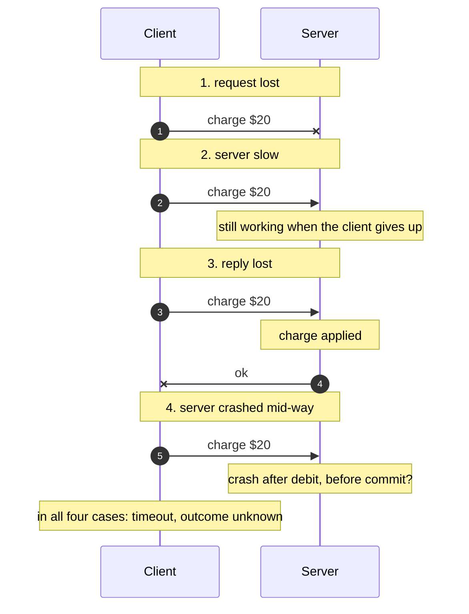
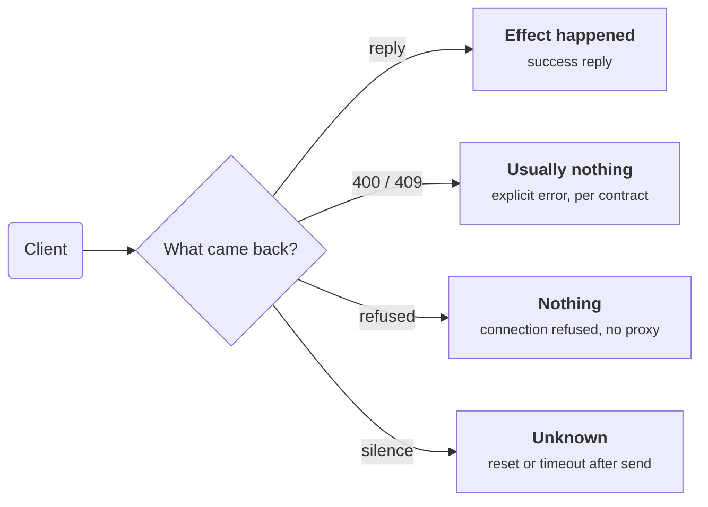
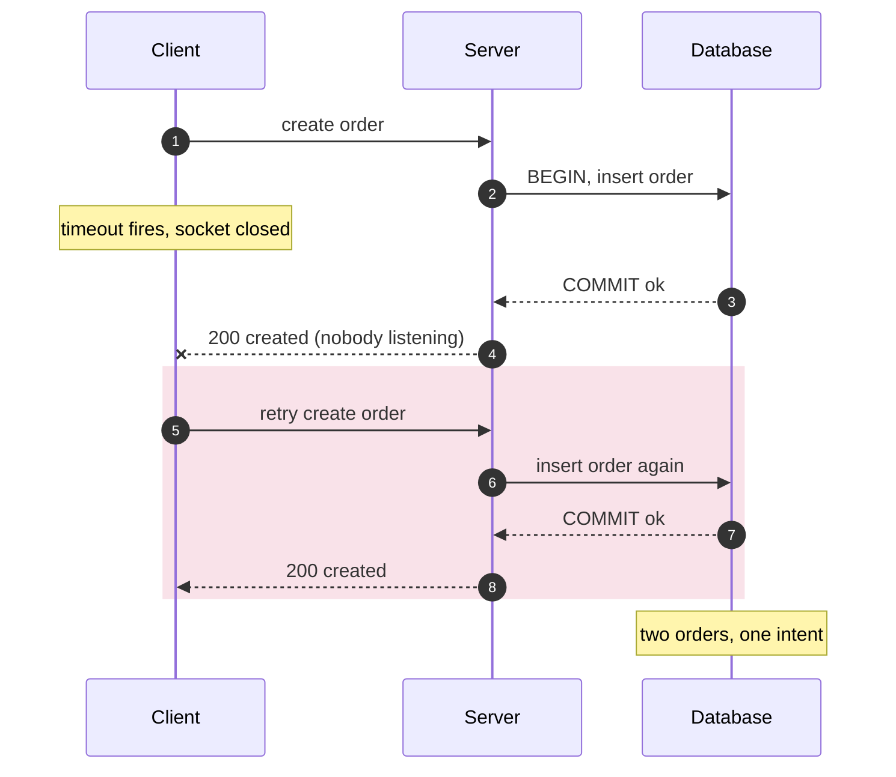
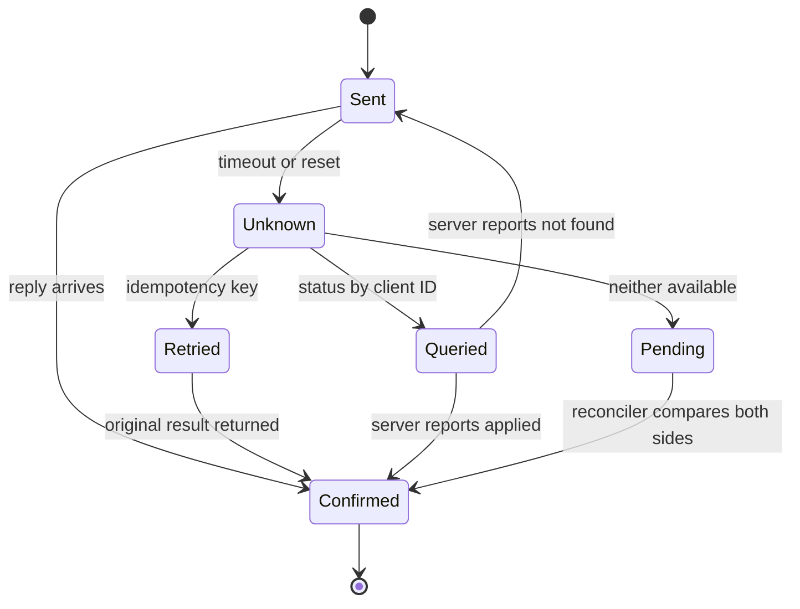

+++
title = 'Partial failure and timeouts'
description = 'A remote call that times out has an unknown outcome. Timeouts detect slowness, not failure, and the right value comes from measured latency percentiles, not from a round number.'
question = 'What does a timed-out call tell you, and how long should you wait before giving up?'
weight = 1
difficulty = 2
prerequisites = ['/notes/systems-design/thinking-in-invariants/01-what-a-design-promises']
date = 2026-09-20
lastmod = 2026-10-30
verified = 2026-09-20
+++

## The idea in one minute

In a single process, a function call either returns or the whole program
dies. A remote call has a third outcome: **nothing comes back**. The request
may have been lost on the way, the server may be working on it, the server may
have finished and the reply been lost, or the server may have crashed halfway.
From the caller's side these look identical. This is **partial failure**: some
parts of the system work while others do not, and the parts that work cannot
reliably tell which is which.

A timeout is how the caller stops waiting. It is not a failure detector. It
tells you that a reply did not arrive within a chosen time, and nothing about
whether the work happened. The consequence to act on: **every remote write
needs a plan for the "unknown" outcome** (usually retry with an idempotency
key, or reconcile later), and every timeout needs a value chosen from the
dependency's measured latency, with the false-timeout rate you are willing to
pay written down.

## A picture



Only case 1 is a clean "did not happen". Case 3 is a clean "did happen". The
client cannot tell them apart without asking the server again.

## How it really works

### Why a remote call is not a function call

Waldo, Wyant, Wollrath, and Kendall made the argument in 1994: designs that try
to make remote calls look like local ones fail, because latency, memory
access, concurrency, and above all **partial failure** are different in kind,
not degree. A local call cannot half-succeed in a way the caller does not
notice. A remote one can.

The classic reduction is the **two generals problem**: two parties that
communicate over a channel that can lose messages cannot reach certainty that
both agree, no matter how many acknowledgments they exchange. Every "ack of the
ack" can itself be lost. Practical systems do not escape this; they shrink the
window of uncertainty and make the uncertain case safe to repeat.

| What the client observes | What may have happened on the server |
| --- | --- |
| Success reply | The effect happened (assuming the server is honest about it) |
| Explicit error reply (`400`, `409`, `UNAVAILABLE` before work) | Usually nothing, if the server says so; read the error contract |
| Connection refused | Nothing: the request never reached a listening process |
| Connection reset or timeout after sending | Anything: not started, in progress, done, or partly done |

Follow each observation to what the client may safely conclude; only one branch
ends in "unknown", and it is the common one.



The last row is the one that matters. "Connection refused" is the only network
error that reliably means the request was not processed, and even that holds
only if no proxy accepted it first. Once a load balancer or sidecar sits in the
path, the client is talking to the proxy, and a refused upstream connection
behind it may surface as a `502` or `503` whose meaning depends on the proxy.

### The server does not know the client gave up

A timeout is a client-side decision. When it fires, the client closes its
socket or cancels its context, but the server usually keeps going: the
database transaction commits, the email is sent, the message is published.
Some protocols carry cancellation (gRPC propagates cancellation and deadlines
to the server, and HTTP/2 has `RST_STREAM`), but the server only stops if its
code checks for cancellation, and work already handed to a database or another
service is rarely recalled.

Watch the server keep working after the client has given up, and what a
naive retry does next.



Two things follow. First, a timeout **does not undo** anything, so the caller
must treat a timed-out write as possibly applied. Second, aggressive timeouts
**create work**: the server finishes requests nobody is waiting for, and if the
client retries, the server now does the same work twice. The next lesson,
[retries and idempotency](/notes/systems-design/failure-modes/02-retries-and-idempotency/), covers the retry
side; [overload and backpressure](/notes/systems-design/failure-modes/04-overload-and-backpressure/) covers
what happens when that wasted work piles up.

### Gray failure

The cleanest failure is a crash: the process is gone, connections are
refused, health checks fail, and the load balancer removes it. The failures that
hurt are messier. Huang and colleagues at Microsoft named them **gray
failures**: a component is degraded in a way that the failure detector does not
see but its clients do. Their central observation is **differential
observability**: the health checker and the application observe the component
through different paths, so they disagree about whether it works.

Common shapes:

- **Fail-slow.** A disk with a failing sector, a NIC negotiating at a lower
  speed, a noisy neighbor, or a process stuck in garbage collection. Requests
  succeed, just ten times slower. Gunawi and colleagues collected over a
  hundred such incidents from large operators and found that a single slow
  component often cascaded into cluster-wide slowness.
- **Partial function.** The health endpoint returns `200` because it does not
  touch the database, while every real request that does touch it fails.
- **One-way or partial partitions.** A node can reach the coordinator but not
  its peers, so it is "up" by one view and "down" by another.

Compare the two paths into the same replica: the health check never touches
the slow disk or the database, so it cannot see what users see.

```mermaid {title="Differential observability: the probe and the request take different paths"}
flowchart LR
  H("Health checker")
  U("User request")
  subgraph R["Replica d"]
    P["/ping handler"]
    A["Order handler"]
  end
  K("Failing disk")
  D[("Database")]
  H -->|"200 OK"| P
  U -->|"10x slower"| A
  A --> K
  A --> D
  class P good
  class A warn
```

The lesson for design: **health checks should exercise the path that
requests take**, or at least the dependencies they use, and client-side
signals (latency, error rate per backend) should feed back into routing. Outlier
detection in proxies such as Envoy does exactly this: it ejects a backend from
the load-balancing pool based on the errors that real traffic sees. Be careful
in the other direction too: a deep health check that fails when a shared
dependency is down can make every instance fail its check at once, and a load
balancer that removes them all turns a partial outage into a total one. Many
load balancers "fail open" when every target is unhealthy for this reason.

### Choosing a timeout from percentiles

A timeout trades two errors against each other:

| Timeout too short | Timeout too long |
| --- | --- |
| False timeouts: healthy but slow requests are abandoned, then retried | Threads, connections, and memory held by requests that will never succeed |
| Extra load from the retries, which makes the dependency slower | The caller's own latency budget consumed by one dependency |
| More "unknown outcome" writes to reconcile | Slow detection of a dead dependency |

A round number such as 30 seconds says nothing about either error. A better
method, described in the AWS Builders' Library article on timeouts and
retries: **pick the false-timeout rate you accept, then read the matching
latency percentile from the dependency's metrics**. If 0.1% of healthy calls
may be cut off, the timeout is the dependency's p99.9 latency, plus some
headroom.

The percentiles the program below measures show why a round number is
arbitrary: the tail jumps by more than ten times between p90 and p99.

```mermaid {title="Observed latency percentiles of the simulated dependency (ms)"}
xychart-beta
  x-axis ["p50", "p90", "p99", "p99.9"]
  y-axis "Latency (ms)" 0 --> 400
  bar [9.7, 17.1, 214.8, 383.4]
```

Three refinements matter in practice:

1. **Measure what the client sees**, not what the server reports. Server-side
   latency excludes queueing in the client's connection pool, TLS handshakes,
   DNS, and the network. Measure at the caller.
2. **Successful-reply percentiles hide the requests that never return.** A
   latency histogram is built from replies. Requests that were lost never
   contribute a sample, so the p99.9 of replies understates the true tail. The
   program below shows this directly.
3. **Separate connect and request timeouts.** A TCP connect to a healthy host
   in the same region takes about one round trip; a connect timeout of a few
   hundred milliseconds detects a dead host quickly. The request timeout covers
   the work and must be much longer. A single timeout for both either detects
   dead hosts slowly or cuts off legitimate slow work.

And the timeout must fit inside the caller's own budget. If your API promises a
reply in 500 ms and calls three dependencies in sequence, they cannot each have
a 400 ms timeout. [Circuit breakers and deadlines](/notes/systems-design/failure-modes/03-circuit-breakers-and-deadlines/)
turns this into **deadline propagation**: pass the
remaining budget down instead of giving each hop its own fixed value.

> [!IMPORTANT]
> A timeout answers "how long am I willing to wait?", not "did it fail?". Write
> down the outcome the caller assumes on timeout for every write: *possibly
> applied*. Then design the retry or reconciliation that makes that assumption
> safe.

### Handling the unknown outcome

There are three honest responses to a timed-out write:

- **Retry with an idempotency key**, so the server can recognize the repeat and
  return the original result instead of doing the work twice.
- **Ask before acting again**: query the server for the operation's status by a
  client-chosen ID. This works when the server records operations under that ID
  atomically with their effect.
- **Reconcile asynchronously**: record the attempt as "pending" and let a
  background job compare both sides later. Payment systems and ledgers do this
  routinely; it is the only option when the other side offers neither of the
  first two.

Trace a timed-out write through its lifecycle: every path out of "unknown"
ends in a confirmed state, never in a guess.



What is never correct is to assume failure and re-issue a non-idempotent write,
or to assume success and move on. Both turn an ambiguity into a wrong answer.

## Code

The program builds a simulated RPC with a realistic shape: most calls take
about 10 ms, 2% hit a slow path of up to 400 ms, 0.2% of requests are lost
before the server sees them, and 0.2% of replies are lost after the server
applied the effect. It measures the latency percentiles the way a dashboard
would (from replies only), uses each as a timeout, and counts what happens.
Then it adds one degraded replica whose health check is a ping.

```python {title="timeouts.py"}
"""timeouts.py: what a client learns when it times out, and what it does not.

A simulated RPC with a long-tailed latency distribution and a server that keeps
working after the client gives up. Standard library only; runs offline.
"""

from __future__ import annotations

import random
from dataclasses import dataclass

LOST_REQUEST = 0.002   # dropped before the server sees it: no effect
LOST_REPLY = 0.002     # server applied the effect, the reply never arrives


@dataclass
class Call:
    applied: bool          # did the server perform the side effect (eventually)?
    reply_at: float | None  # ms after send when the reply arrives; None = never


def network(rng: random.Random) -> float:
    return rng.lognormvariate(0.0, 0.4)  # one-way delay, median 1 ms


def service(rng: random.Random) -> float:
    if rng.random() < 0.02:           # 2% of requests hit a slow path
        return rng.uniform(40, 400)   # lock wait, GC pause, cold cache
    return rng.lognormvariate(2.0, 0.5)  # median about 7 ms


def rpc(rng: random.Random, slow_factor: float = 1.0) -> Call:
    if rng.random() < LOST_REQUEST:
        return Call(applied=False, reply_at=None)
    done = network(rng) + service(rng) * slow_factor
    if rng.random() < LOST_REPLY:
        return Call(applied=True, reply_at=None)
    return Call(applied=True, reply_at=done + network(rng))


def percentile(sorted_ms: list[float], p: float) -> float:
    return sorted_ms[min(len(sorted_ms) - 1, int(p / 100 * len(sorted_ms)))]


def outcomes(calls: list[Call], timeout: float) -> tuple[float, float, float]:
    ok = sum(1 for c in calls if c.reply_at is not None and c.reply_at <= timeout)
    late = [c for c in calls if c.reply_at is None or c.reply_at > timeout]
    applied = sum(1 for c in late if c.applied)
    n = len(calls)
    return 100 * ok / n, 100 * applied / n, 100 * (len(late) - applied) / n


def main() -> None:
    rng = random.Random(7)
    # 1. Measure the dependency the way production metrics would: replies only.
    sample = sorted(c.reply_at for c in (rpc(rng) for _ in range(50_000)) if c.reply_at)
    marks = {p: percentile(sample, p) for p in (50, 90, 99, 99.9)}
    print("observed latency:", "  ".join(f"p{p}={ms:.1f}ms" for p, ms in marks.items()))

    # 2. Pick a timeout from those percentiles and replay fresh traffic.
    calls = [rpc(rng) for _ in range(100_000)]
    print(f"\n{'timeout':>16} {'ok':>8} {'timed out, applied':>20} {'timed out, not':>16}")
    for p, ms in marks.items():
        ok, applied, not_applied = outcomes(calls, ms)
        print(f"{f'p{p} ({ms:.0f}ms)':>16} {ok:7.2f}% {applied:19.2f}% {not_applied:15.2f}%")
    print("the client sees the last two columns as the same error")

    # 3. Gray failure: one replica of four is slow, but its health check is a ping.
    print(f"\n{'replica':>8} {'ping':>6} {'median':>8} {'requests timed out':>20}")
    timeout = marks[99.9]
    for name, factor in (("a", 1.0), ("b", 1.0), ("c", 1.0), ("d", 8.0)):
        ping_ok = network(rng) + network(rng) < 50  # never touches the slow path
        replica = [rpc(rng, factor) for _ in range(20_000)]
        _, applied, not_applied = outcomes(replica, timeout)
        median = percentile(sorted(c.reply_at for c in replica if c.reply_at), 50)
        status = "OK" if ping_ok else "FAIL"
        print(f"{name:>8} {status:>6} {median:6.1f}ms {applied + not_applied:19.2f}%")


if __name__ == "__main__":
    main()
```

Run it with `python3 timeouts.py`:

```text
observed latency: p50=9.7ms  p90=17.1ms  p99=214.8ms  p99.9=383.4ms

         timeout       ok   timed out, applied   timed out, not
      p50 (10ms)   49.90%               49.90%            0.20%
      p90 (17ms)   89.91%                9.89%            0.20%
     p99 (215ms)   98.53%                1.27%            0.20%
   p99.9 (383ms)   99.49%                0.31%            0.20%
the client sees the last two columns as the same error

 replica   ping   median   requests timed out
       a     OK    9.6ms                0.44%
       b     OK    9.7ms                0.53%
       c     OK    9.7ms                0.47%
       d     OK   62.1ms                2.40%
```

Read the table from the bottom up. With the timeout at the observed p99.9, the
client should see about 0.1% timeouts, yet it sees 0.51%. The difference is the
lost requests and lost replies: they never produced a latency sample, so the
dashboard percentile cannot account for them. Of the 0.51%, more than half
(0.31%) were **applied on the server** even though the client saw an error. At
a p50 timeout, half of all calls "fail" while the server does every one of them,
which is how an over-eager timeout plus a retry doubles the load on a healthy
dependency.

Plot the "timed out, applied" column against the timeout: the shorter the
timeout, the more completed work the client mistakes for failure.

```mermaid {title="Calls the server applied but the client saw as timed out (%)"}
xychart-beta
  x-axis ["p50 (10ms)", "p90 (17ms)", "p99 (215ms)", "p99.9 (383ms)"]
  y-axis "Timed out but applied (%)" 0 --> 50
  bar [49.90, 9.89, 1.27, 0.31]
```

The gray-failure section shows replica `d` with a median latency six times its
peers and five times the timeout rate, while its ping health check reports
`OK`. A load balancer that trusts the ping keeps sending it a quarter of the
traffic.

## Where it breaks

- **The latency distribution moves.** A timeout set from last month's p99.9
  is wrong after a schema change, a new dependency, or a traffic shift. Review
  timeouts with the latency data, or derive them from live percentiles with
  limits on how far they can move.
- **Percentiles under load are not percentiles at rest.** When the dependency
  is overloaded, its whole distribution shifts right. A timeout chosen at
  normal load fires on a large fraction of requests, retries add load, and the
  timeout becomes the trigger of the overload rather than the defense against
  it. Retry budgets and load shedding, covered later in this module, are what break
  that loop.

  Follow the loop once around: each step makes the next one worse, and
  nothing inside the loop stops it.

  ```mermaid {title="A timeout set at rest becomes the trigger under load"}
  flowchart LR
    L["Dependency load rises"] --> S["Latency shifts right"]
    S --> T["Fixed timeout fires often"]
    T --> R["Clients retry"]
    R --> W["Server still finishes abandoned work"]
    W --> L
    B["Retry budget + load shedding"]
    B -.->|"breaks the loop"| R
    class L,S,T,R,W warn
    class B good
  ```

- **Lost work is invisible to the histogram.** As the program shows, reply-based
  percentiles understate the tail. Count timeouts and resets as their own
  metric, not as missing data.
- **Cancellation is best effort.** Propagating cancellation saves server work
  only when every layer checks for it. Do not rely on it for correctness.
- **The simulation is simple.** Latencies here are independent. Real slowness
  is correlated: a garbage-collection pause or a slow disk delays many requests
  at once, which makes tails heavier and false timeouts burstier than this
  model suggests.

## Remember this

- A remote call can succeed, fail, or leave you not knowing; design for the
  third case.
- A timeout means "no reply in time", never "did not happen". Treat timed-out
  writes as possibly applied.
- Gray failures pass health checks; check the path real requests take.
- Pick a timeout from an accepted false-timeout rate and the client-measured
  latency percentile, not a round number.
- Reply-based percentiles hide lost requests; count timeouts separately.
- Use separate connect and request timeouts, and fit both inside the caller's
  own budget.

## Try it

1. Run `timeouts.py`. Raise `LOST_REPLY` to 0.01 and explain why the "timed
   out, applied" column grows at every timeout value but the percentiles
   barely move.
2. Change the slow path to 10% of requests. Which percentile now makes a
   sensible timeout, and what false-timeout rate does it imply?
3. Replace the ping health check with one that calls `rpc(rng, factor)` five
   times and fails if the median exceeds three times the fleet median. Does it
   catch replica `d`? What would make it flap?
4. For a service you know, list each outbound call with its current timeout,
   the dependency's client-side p99.9, and what the caller does on timeout.
   Which writes lack a plan for the unknown outcome?

## Check yourself

1. A client's request to create an order times out. What can it conclude?

   
   Only that no reply arrived within the timeout. The order may not exist, may
   be in progress, may exist with the reply lost, or may be partly created if
   the server crashed. The client must treat it as possibly applied and either
   retry with an idempotency key, query the status by a client-chosen ID, or
   reconcile later.
   

2. What is differential observability, and why does it make gray failures
   dangerous?

   
   The failure detector and the clients observe a component through different
   paths, so they disagree about its health. A health check that does not
   exercise the slow disk or the failing dependency reports healthy while real
   requests fail or crawl, so automated recovery never kicks in.
   

3. You accept a 0.1% false-timeout rate. How do you choose the timeout?

   
   Take the dependency's latency at p99.9, measured at the client (including
   connection pool waits, TLS, and network), add some headroom, and check that
   it fits within the caller's own latency budget. Revisit it when the latency
   distribution changes.
   

4. Why does a very short timeout increase load on a healthy dependency?

   
   The server does not know the client gave up, so it completes the abandoned
   requests anyway. If the client then retries, each cut-off request is
   processed at least twice. Under load, the extra work slows the dependency,
   which causes more timeouts.
   

5. Why keep connect and request timeouts separate?

   
   A connect should take about one round trip, so a short connect timeout
   detects a dead or unreachable host quickly. The request itself may
   legitimately take much longer. One combined value is either too long to
   detect dead hosts fast or too short for real work.
   

## Sources

- J. Waldo, G. Wyant, A. Wollrath, S. Kendall, *A Note on Distributed Computing*, Sun Microsystems Laboratories technical report SMLI TR-94-29, November 1994.
- P. Huang, C. Guo, L. Zhou, J. R. Lorch, Y. Dang, M. Chintalapati, R. Yao, *Gray Failure: The Achilles' Heel of Cloud-Scale Systems*, 16th Workshop on Hot Topics in Operating Systems (HotOS), ACM, 2017.
- H. S. Gunawi et al., [Fail-Slow at Scale: Evidence of Hardware Performance Faults in Large Production Systems](https://www.usenix.org/conference/fast18/presentation/gunawi), USENIX FAST 2018.
- M. Brooker, [Timeouts, retries, and backoff with jitter](https://aws.amazon.com/builders-library/timeouts-retries-and-backoff-with-jitter/), Amazon Builders' Library.
- gRPC authors, [Deadlines](https://grpc.io/docs/guides/deadlines/) and [Cancellation](https://grpc.io/docs/guides/cancellation/), gRPC documentation.
- Envoy project, [Outlier detection](https://www.envoyproxy.io/docs/envoy/latest/intro/arch_overview/upstream/outlier), Envoy documentation.
