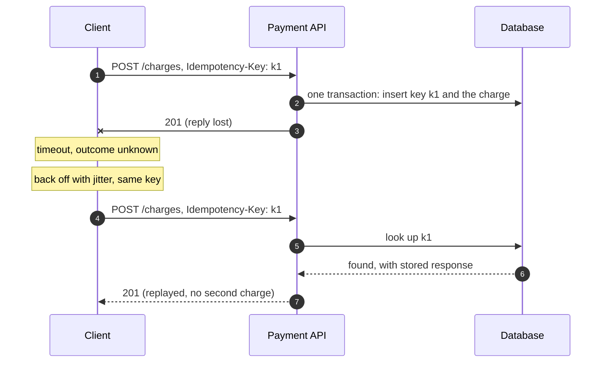
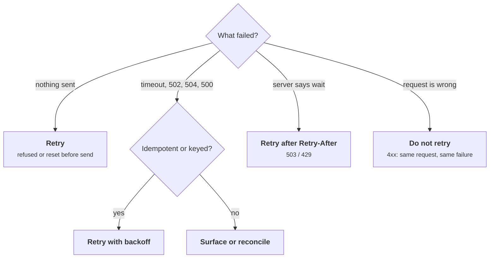
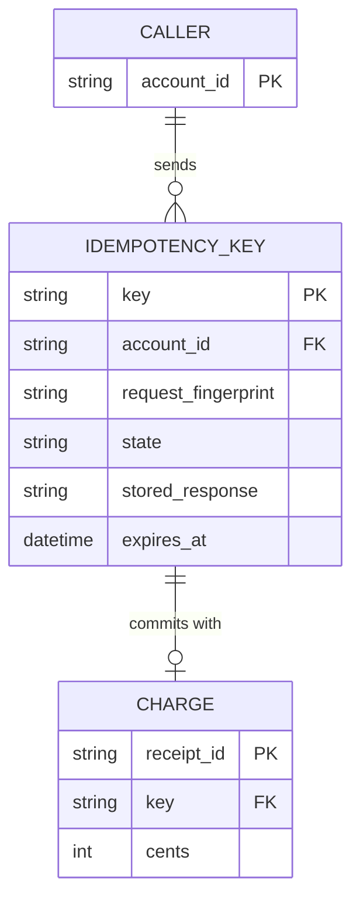
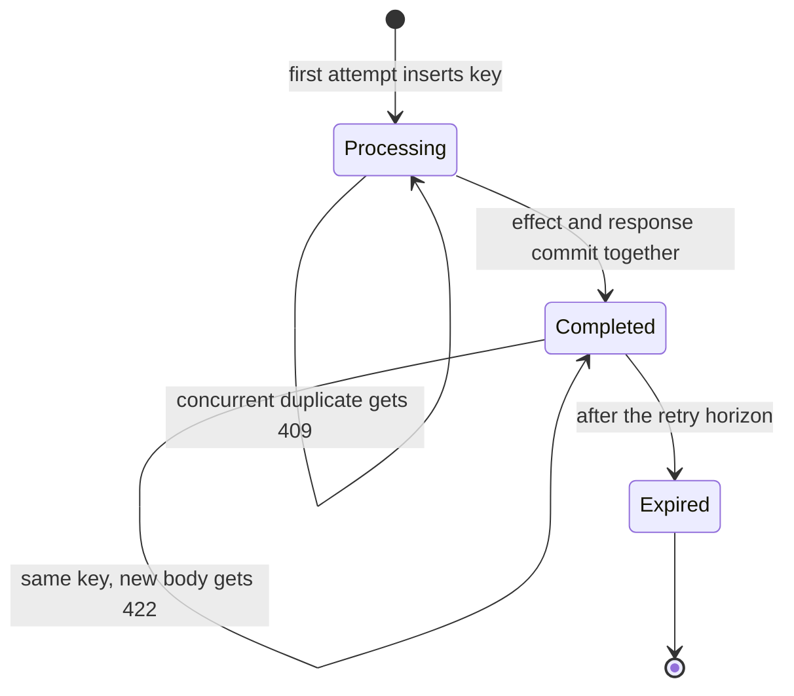
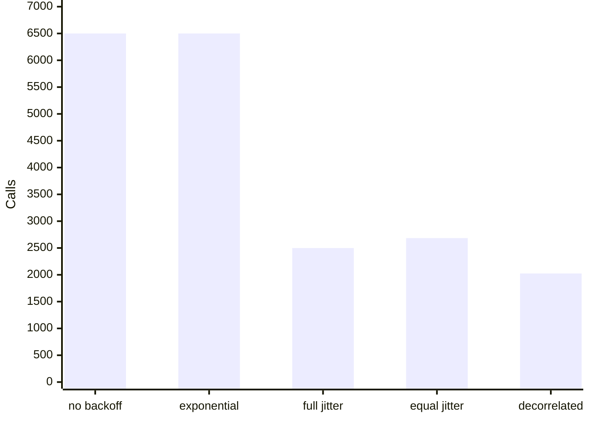

+++
title = 'Retries and idempotency'
description = 'Retries turn transient faults into successes and outages into storms. Back off with jitter, cap retries with a budget, and make every retried write idempotent with a key the server records atomically with the effect.'
question = 'When is it safe to retry, and how do you keep retries from duplicating work or flattening a struggling service?'
weight = 2
difficulty = 3
prerequisites = ['/notes/systems-design/failure-modes/01-partial-failure-and-timeouts']
date = 2026-09-22
lastmod = 2026-10-30
verified = 2026-09-22
+++

## The idea in one minute

Most faults in a distributed system are transient: a dropped packet, a
restarting instance, a brief lock wait. Retrying turns many of them into
successes the user never notices. But retries have two costs that are easy to
miss. They **multiply load** at exactly the moment a dependency is struggling,
and they **repeat side effects** whenever the first attempt actually succeeded
and only its reply was lost.

Three controls address this. **Exponential backoff with jitter** spreads
retries out in time so clients do not hit the server in synchronized waves.
**Retry budgets** cap the fraction of traffic that may be retries, so an outage
does not become a self-inflicted denial of service. **Idempotency keys** let
the server recognize a repeat and return the first result instead of doing the
work again. The consequence to act on: **never retry a write the server cannot
deduplicate, and never retry without a limit that holds under total failure**.

## A picture



The retry carries the **same** key as the first attempt. The server's record of
the key and the charge itself commit in one transaction.

## How it really works

### What a retry can and cannot fix

Retries help when the failure is **transient and independent** of the retry:
a packet loss, a connection reset during a deploy, a single overloaded
instance behind a load balancer that routes the retry elsewhere. They do not
help, and actively hurt, when the failure is **caused by load**: the
dependency is slow because it has too much work, and each retry adds more.

Classify errors before retrying:

| Response | Retry? |
| --- | --- |
| Connection refused, reset before the request was sent | Yes; nothing was processed |
| Timeout, reset after sending, `502`/`504` from a proxy | Only if the operation is idempotent or carries an idempotency key |
| `503` or `429` with `Retry-After` | Yes, but no sooner than the header says (RFC 9110 section 10.2.3) |
| `500` | Rarely, and only idempotent operations; it may be a deterministic bug |
| `400`, `401`, `403`, `404`, `409`, `422` | No; the same request will fail the same way |

Read the table as a decision path: the question that comes first is whether a
repeat is safe, and only then whether it is useful.



HTTP defines which methods are **idempotent**: GET, HEAD, OPTIONS, TRACE, PUT,
and DELETE (RFC 9110 section 9.2.2). Repeating one has the same intended effect
on the server as sending it once. POST and PATCH are not. That is a property of
the *method's semantics*, and a server can break it: a PUT handler that also
appends to an audit log or bumps a counter is not idempotent in practice.

### Retry storms and amplification

Picture a three-tier call chain where every layer retries a failed call up to
three times, so four attempts. When the bottom dependency fails completely,
one user request becomes 4 × 4 × 4 = **64 calls** at the bottom. The
dependency that most needs relief receives sixty-four times its normal load.

Count the attempts layer by layer: each tier multiplies what the tier above
sent it.

```mermaid {title="Three layers of four attempts turn one request into 64 database calls"}
flowchart LR
  U("User")
  A("API")
  B("Service")
  C("Data tier")
  D[("Database (down)")]
  U -->|"1 request"| A
  A -->|"4 attempts"| B
  B -->|"16 attempts"| C
  C -->|"64 calls"| D
```

Google's SRE book describes this multiplication in its chapter on cascading
failures and advises thinking about retries for the stack as a whole. The usual
answer is to retry at **one** layer only, typically the one closest to the user
or the one with the most context, and let the others fail fast.

The other storm is **synchronization**. After a network blip or a deploy, many
clients fail at the same moment. If they all retry after the same fixed delay,
or after the same exponential sequence (100 ms, 200 ms, 400 ms), they arrive
again together, collide again, and back off together. Exponential backoff
alone reduces the *rate* of retries but keeps the clients in lockstep.

### Backoff with jitter

Marc Brooker's 2015 post on the AWS Architecture Blog, "Exponential Backoff And
Jitter", simulated clients contending for a shared resource and compared
policies. The fix for lockstep is to randomize the delay. With `base` the
initial delay, `cap` the maximum, and `attempt` counting from zero:

| Policy | Sleep before the next attempt |
| --- | --- |
| Exponential, no jitter | `min(cap, base * 2^attempt)` |
| Full jitter | `random(0, min(cap, base * 2^attempt))` |
| Equal jitter | `t = min(cap, base * 2^attempt)`; `t/2 + random(0, t/2)` |
| Decorrelated jitter | `min(cap, random(base, previous_sleep * 3))` |

The post's conclusion: exponential backoff without jitter was clearly the worst;
jittered variants completed with far less total work, with full jitter and
decorrelated jitter performing well. Full jitter is the usual default because
it is simple and spreads arrivals uniformly over the backoff window. The
program below reproduces the qualitative result in a different model.

Two practical points. **Cap the delay and cap the attempts**: unbounded
exponential growth produces waits of hours. And **honor `Retry-After`**: when
the server tells you when to come back, that is better information than any
formula.

### Retry budgets

Per-request limits ("at most three retries") bound one request's cost but not
the aggregate. During a full outage every request uses all its retries, so load
still multiplies. A **retry budget** caps retries as a fraction of total
traffic. Google's SRE book describes a per-client budget: a request is retried
only while retries make up less than 10% of the client's requests. Under normal
conditions the budget is never touched; during an outage the extra load is
bounded at about 10% per layer instead of 300%.

gRPC implements a variant as **retry throttling** in its retry design (gRFC
A6): each client keeps a token count per server, failures subtract one token,
successes add a configurable fraction, and retries are allowed only while the
count is above half its maximum. Envoy's retry budgets limit active retries to
a percentage of active requests. The shapes differ; the principle is the same:
**retries are a privilege of a healthy system**.

Follow gRPC's token count through an outage: retries switch off on their own
once failures drain the bucket, and come back only after successes refill it.

```mermaid {title="gRPC retry throttling: retries are allowed only above half the tokens"}
stateDiagram-v2
  [*] --> Allowed
  Allowed --> Allowed: success adds a fraction, failure subtracts 1
  Allowed --> Throttled: tokens fall to half of max
  Throttled --> Throttled: failures, first attempts only
  Throttled --> Allowed: successes refill above half
```

### Idempotency keys

Backoff and budgets control *how much* you retry. Idempotency controls *what
happens* when a retried write lands twice. For operations that are not
naturally idempotent, such as "charge this card" or "create this order", the
client generates a unique **idempotency key** per logical operation and sends
it with every attempt. The server stores the key with the result of the first
attempt and, on a repeat, returns the stored result instead of acting again.

The IETF HTTPAPI working group's Internet-Draft
`draft-ietf-httpapi-idempotency-key-header` standardizes this pattern for
HTTP as an `Idempotency-Key` request header. It is a draft, not an RFC, so
check its current revision before depending on details; the main points in its
recent revisions are:

- The header value is a Structured Field string, for example
  `Idempotency-Key: "8e03978e-40d5-43e8-bc93-6894a57f9324"`, and the draft
  recommends a random identifier such as a UUID.
- A resource that requires a key should document it, along with how long keys
  are kept before they expire.
- It describes error responses for misuse: a missing required key (`400`), a
  key reused with a different request payload (`422`), and a retry that
  arrives while the first request is still being processed (`409`).

The pattern predates the draft: several payment APIs have long accepted an
idempotency key header on POST requests, and the draft cites such
implementations.

The server-side rules that make keys work:

1. **Record the key atomically with the effect.** Insert the key row and the
   charge row in one database transaction, or make the key the primary key of
   the effect itself. If the effect commits and the server crashes before the
   key is written, the retry sees no key and charges again. The program shows
   this gap costing real money.
2. **Store the response, not just the key.** A retry must get the same answer
   as the first attempt, including the same resource ID.
3. **Bind the key to the request.** Store a fingerprint of the request body
   (or the fields that matter) and reject a key reused with different content.
   Otherwise a client bug that reuses keys silently drops real operations.
4. **Handle concurrent duplicates.** Two attempts can arrive at once, for
   example when a client times out early and retries while the first is still
   running. Take a lock or insert the key with a "processing" state first, and
   make the second attempt wait or return `409`.
5. **Scope keys** to the caller (account or API credential) so one client cannot
   collide with or probe another's keys, and **expire** them after a period
   longer than any client's retry horizon.

The rules translate into a small data model: the key row is scoped to a
caller, carries the request fingerprint and stored response, and points at
exactly one effect.



Each key also has a lifecycle; the "processing" state is what turns a
concurrent duplicate into a `409` instead of a second charge.



> [!IMPORTANT]
> The key must be generated **once per logical operation**, before the first
> attempt, and reused on every retry. A key generated inside the retry loop is
> a new operation each time and deduplicates nothing.

Idempotency keys make one hop safe. When the server's work itself fans out to
a queue or another service, the same problem recurs at each hop; the
[exactly-once and the outbox](/notes/systems-design/concurrency-and-consistency/05-exactly-once-and-the-outbox/)
lesson covers how to carry the guarantee through.

## Code

Two programs. The first charges 2,000 orders through a payment API whose replies
are lost 15% of the time. The client retries up to four times on timeout. The
three servers differ only in how they handle keys: no keys, keys written after
the charge (with a 3% chance of crashing in between), and keys written in the
same transaction as the charge.

```python {title="payments.py"}
"""payments.py: retrying a charge with and without idempotency keys.

A simulated payment API behind a lossy network. The client retries on timeout.
Standard library only; runs offline.
"""

from __future__ import annotations

import random
import uuid
from dataclasses import dataclass, field

REPLY_LOSS = 0.15   # the charge is applied, but the reply never arrives
CRASH_GAP = 0.03    # server dies after charging, before recording the key
MAX_ATTEMPTS = 4


class Timeout(Exception):
    pass


@dataclass
class PaymentServer:
    mode: str  # "none", "key-after-charge", "key-in-same-txn"
    rng: random.Random
    reply_loss: float = REPLY_LOSS
    charges: list[tuple[str, int]] = field(default_factory=list)  # the ledger
    keys: dict[str, tuple[tuple[str, int], str]] = field(default_factory=dict)

    def charge(self, key: str | None, account: str, cents: int) -> str:
        request = (account, cents)
        if self.mode != "none" and key in self.keys:
            seen, response = self.keys[key]
            if seen != request:
                return "422 key reused with a different request"
            return response  # replay the stored result; no second charge
        receipt = f"ch_{len(self.charges):04d}"
        if self.mode == "key-in-same-txn":
            # ledger row and key row commit together, or not at all
            self.charges.append(request)
            self.keys[key] = (request, receipt)
        else:
            self.charges.append(request)
            if self.mode == "key-after-charge":
                if self.rng.random() < CRASH_GAP:
                    raise Timeout  # crashed: charge committed, key never written
                self.keys[key] = (request, receipt)
        if self.rng.random() < self.reply_loss:
            raise Timeout  # the client cannot tell this from a lost request
        return receipt


def pay(server: PaymentServer, use_key: bool, account: str, cents: int,
        rng: random.Random) -> str | None:
    key = str(uuid.UUID(int=rng.getrandbits(128))) if use_key else None
    for _ in range(MAX_ATTEMPTS):
        try:
            return server.charge(key, account, cents)  # same key on every retry
        except Timeout:
            continue
    return None  # outcome unknown: hand to reconciliation


def run(mode: str, use_key: bool, orders: int = 2_000) -> None:
    rng = random.Random(42)
    server = PaymentServer(mode, rng)
    unknown = 0
    for i in range(orders):
        if pay(server, use_key, f"acct-{i}", 2_000, rng) is None:
            unknown += 1
    duplicates = len(server.charges) - len({a for a, _ in server.charges})
    print(f"{mode:<17} {orders:>7} {len(server.charges):>8} {duplicates:>11} "
          f"{unknown:>8}  ${duplicates * 20:,}")


def main() -> None:
    print(f"{'server':<17} {'orders':>7} {'charges':>8} {'duplicates':>11} "
          f"{'unknown':>8}  overcharged")
    run("none", use_key=False)
    run("key-after-charge", use_key=True)
    run("key-in-same-txn", use_key=True)

    # The two error cases a key-aware server must handle.
    server = PaymentServer("key-in-same-txn", random.Random(1), reply_loss=0.0)
    print()
    print("first request      ", server.charge("k-1", "acct-9", 2_000))
    print("retry, same body   ", server.charge("k-1", "acct-9", 2_000))
    print("same key, new body ", server.charge("k-1", "acct-9", 9_900))


if __name__ == "__main__":
    main()
```

Run it with `python3 payments.py`:

```text
server             orders  charges  duplicates  unknown  overcharged
none                 2000     2337         337        0  $6,740
key-after-charge     2000     2057          57        0  $1,140
key-in-same-txn      2000     2000           0        0  $0

first request       ch_0000
retry, same body    ch_0000
same key, new body  422 key reused with a different request
```

Without keys, every lost reply becomes a duplicate charge: 337 customers paid
twice. Writing the key *after* the charge fixes most of them but not the 57
where the server crashed in the gap, which is the failure that passes every
happy-path test. Only the atomic version is exact. The last three lines show
the replay and the payload check.

The duplicate column, charted: the half-measure removes most duplicates but
leaves exactly the ones a crash creates.

```mermaid {title="Duplicate charges out of 2,000 orders, by server design"}
xychart-beta
  x-axis ["no keys", "key after charge", "key in same txn"]
  y-axis "Duplicate charges" 0 --> 350
  bar [337, 57, 0]
```

The second program has two parts. First, 500 clients hit a server that accepts
20 requests per millisecond, all at the same instant, and retry rejections
under each policy. Second, 1,000 user requests pass through three layers that
each make up to four attempts while the database is down.

```python {title="backoff.py"}
"""backoff.py: retry storms, backoff with jitter, and retry budgets.

Part 1: 500 clients hit a server that can accept 20 requests per millisecond,
all at once (say, after a deploy or a network blip). Failed requests retry
under different backoff policies. Part 2: retry amplification across three
layers during an outage, with and without a retry budget.
Standard library only; runs offline.
"""

from __future__ import annotations

import random
from collections import defaultdict
from typing import Callable

CLIENTS, CAPACITY, BASE, CAP = 500, 20, 1.0, 2_000.0  # times in ms

Policy = Callable[[random.Random, int, float], float]  # (rng, attempt, last) -> sleep


def no_backoff(rng: random.Random, attempt: int, last: float) -> float:
    return 0.0


def exponential(rng: random.Random, attempt: int, last: float) -> float:
    return min(CAP, BASE * 2 ** attempt)


def full_jitter(rng: random.Random, attempt: int, last: float) -> float:
    return rng.uniform(0, min(CAP, BASE * 2 ** attempt))


def equal_jitter(rng: random.Random, attempt: int, last: float) -> float:
    half = min(CAP, BASE * 2 ** attempt) / 2
    return half + rng.uniform(0, half)


def decorrelated(rng: random.Random, attempt: int, last: float) -> float:
    return min(CAP, rng.uniform(BASE, max(BASE, last) * 3))


def storm(policy: Policy, seed: int = 3) -> tuple[int, int]:
    rng = random.Random(seed)
    pending: dict[int, list[tuple[int, float]]] = defaultdict(list)
    pending[0] = [(0, 0.0)] * CLIENTS  # (attempt number, last sleep)
    calls, slot, done = 0, 0, 0
    while done < CLIENTS:
        arrivals = pending.pop(slot, [])
        rng.shuffle(arrivals)
        calls += len(arrivals)
        done += min(CAPACITY, len(arrivals))
        for attempt, last in arrivals[CAPACITY:]:  # rejected this millisecond
            sleep = policy(rng, attempt, last)
            pending[slot + 1 + int(sleep)].append((attempt + 1, sleep))
        slot += 1
    return calls, slot


def amplification(layers: int, attempts: int, budget: float | None,
                  requests: int = 1_000) -> int:
    """Calls reaching the database when it fails every request."""
    sent = [0] * layers      # requests issued by each layer (first tries)
    retried = [0] * layers   # retries issued by each layer
    db_calls = 0

    def call(layer: int) -> bool:
        nonlocal db_calls
        if layer == layers:
            db_calls += 1
            return False  # the outage: every database call fails
        sent[layer] += 1
        for attempt in range(attempts):
            if attempt > 0:
                if budget is not None and retried[layer] >= budget * sent[layer]:
                    return False  # budget spent: fail fast, do not retry
                retried[layer] += 1
            if call(layer + 1):
                return True
        return False

    for _ in range(requests):
        call(0)
    return db_calls


def main() -> None:
    print(f"{'policy':<14} {'calls':>7} {'per client':>11} {'all done at':>12}")
    for name, policy in [("no backoff", no_backoff), ("exponential", exponential),
                         ("full jitter", full_jitter), ("equal jitter", equal_jitter),
                         ("decorrelated", decorrelated)]:
        calls, finished = storm(policy)
        print(f"{name:<14} {calls:>7} {calls / CLIENTS:>11.1f} {finished:>10}ms")

    print("\n1,000 user requests during a database outage, 3 layers, 4 attempts each:")
    print(f"  no budget:          {amplification(3, 4, None):>6} database calls")
    print(f"  10% retry budget:   {amplification(3, 4, 0.10):>6} database calls")


if __name__ == "__main__":
    main()
```

Run it with `python3 backoff.py`:

```text
policy           calls  per client  all done at
no backoff        6500        13.0         25ms
exponential       6500        13.0      28072ms
full jitter       2499         5.0         45ms
equal jitter      2685         5.4         61ms
decorrelated      2025         4.0         48ms

1,000 user requests during a database outage, 3 layers, 4 attempts each:
  no budget:           64000 database calls
  10% retry budget:     1331 database calls
```

Exponential backoff without jitter does exactly as much work as no backoff at
all, 13 calls per client, because the clients stay synchronized: every wave
arrives together, 20 succeed, and the rest back off by the same amount. It also
takes over 28 seconds, because the waves get further apart. Every jittered
policy cuts the work by more than half and finishes in tens of milliseconds.
"No backoff" looks fast here only because this simulated server rejects excess
requests for free; a real server spends CPU on every rejection, and 6,500 calls
in 25 ms would push it further into overload. In the second part, the budget
turns 64,000 database calls into 1,331, which is 1,000 × 1.1³.

Compare the work each policy spent to get the same 500 clients through: the
two unjittered policies tie at the top.



## Where it breaks

- **Retries hide problems.** A dependency failing 5% of requests looks healthy
  to callers that retry. Record retries as a metric, and alert on the retry
  rate, not only the final error rate.
- **Keys do not fix non-atomic effects downstream.** If the payment API calls a
  card network and then writes its database, a crash between the two still
  leaves the outcome unknown. Keys must be passed along to the next hop, or the
  state reconciled.
- **Expired keys reopen the window.** A client that retries after the key has
  expired creates a duplicate. Expiry must exceed the longest retry horizon,
  including offline mobile clients and replayed queues.
- **Jitter needs randomness per client.** Seeding every client's generator with
  the same value, or deriving delay from a shared clock, restores lockstep.
- **The simulation is a model.** Its server has fixed capacity and free
  rejections, and its outage is total. Real overload degrades capacity as load
  rises, which makes the case for jitter and budgets stronger, not weaker; the
  [overload and backpressure](/notes/systems-design/failure-modes/04-overload-and-backpressure/)
  lesson models that.
- **Budgets need a healthy baseline.** A 10% budget on a client that sends two
  requests a minute permits almost no retries. Low-volume clients need a
  minimum allowance or a token bucket with a small reserve.

## Remember this

- Retry transient, independent faults; do not retry errors caused by load or by
  the request itself.
- Retry at one layer, not every layer: amplification multiplies.
- Back off exponentially **with jitter**, cap the delay, and honor `Retry-After`.
- Cap aggregate retries with a budget (about 10% of traffic), not only per
  request.
- Non-idempotent writes need an idempotency key generated once per operation and
  stored atomically with the effect, together with the response.
- Bind keys to the request payload, scope them to the caller, and expire them
  after the retry horizon.

## Try it

1. Run `payments.py`. Move the key insert in the `key-after-charge` server to
   *before* the charge. What failure does that introduce, and how does a
   "processing" state fix it?
2. Add a 409 path: give the server an in-flight set, and simulate a client that
   retries while its first attempt is still running.
3. In `backoff.py`, make each rejection cost capacity: every rejected request
   in a slot reduces the next slot's capacity by one, to a floor of five. How do
   the policies compare now?
4. Change the budget to the gRPC throttling scheme: a token count starting at
   10, minus one per failure, plus 0.1 per success, retries allowed only above
   5. Compare the database calls with the 10% ratio budget.
5. Pick an API your team owns. List every non-idempotent write, how a client
   would retry it today, and what stops a duplicate.

## Check yourself

1. Why does exponential backoff without jitter still produce retry storms?

   
   Clients that failed together compute the same delay sequence, so they retry
   together. Each wave collides again. Backoff lowers the rate of waves but
   keeps clients synchronized; jitter randomizes the delay so arrivals spread
   across the window.
   

2. A service has three layers, each retrying three times. The database goes
   down. How many database calls does one user request cause, and what is the
   usual fix?

   
   Four attempts per layer, so 4 × 4 × 4 = 64. Retry at only one layer, and
   cap aggregate retries with a budget so an outage adds a bounded fraction of
   load instead of multiplying it.
   

3. A server records the idempotency key after committing the charge. What goes
   wrong?

   
   If the server crashes between the charge commit and the key write, the
   charge exists but the key does not. The client's retry finds no key and
   charges again. The key and the effect must commit atomically.
   

4. Why should the server store a fingerprint of the request with the key?

   
   To detect a key reused with different content. Without it, a client bug that
   reuses a key for a new operation gets the old result back and the new
   operation silently never happens. The Idempotency-Key draft suggests `422`
   for this case.
   

5. Where should the client generate the idempotency key?

   
   Once per logical operation, before the first attempt, and persisted with
   the client's own record of the operation if the client might restart. A key
   generated per attempt makes every retry look new.
   

## Sources

- M. Brooker, [Exponential Backoff And Jitter](https://aws.amazon.com/blogs/architecture/exponential-backoff-and-jitter/), AWS Architecture Blog, March 2015.
- M. Brooker, [Timeouts, retries, and backoff with jitter](https://aws.amazon.com/builders-library/timeouts-retries-and-backoff-with-jitter/), Amazon Builders' Library.
- M. Featonby, [Making retries safe with idempotent APIs](https://aws.amazon.com/builders-library/making-retries-safe-with-idempotent-APIs/), Amazon Builders' Library.
- J. Jena, S. Dalal, [The Idempotency-Key HTTP Header Field](https://datatracker.ietf.org/doc/draft-ietf-httpapi-idempotency-key-header/), IETF HTTPAPI Working Group, Internet-Draft (work in progress).
- R. Fielding, M. Nottingham, J. Reschke (eds.), [RFC 9110: HTTP Semantics](https://www.rfc-editor.org/rfc/rfc9110), IETF, June 2022 (section 9.2.2, idempotent methods; section 10.2.3, Retry-After).
- B. Beyer, C. Jones, J. Petoff, N. R. Murphy (eds.), *Site Reliability Engineering*, O'Reilly, 2016: chapters [Handling Overload](https://sre.google/sre-book/handling-overload/) and [Addressing Cascading Failures](https://sre.google/sre-book/addressing-cascading-failures/).
- gRPC authors, [gRFC A6: gRPC Retry Design](https://github.com/grpc/proposal/blob/master/A6-client-retries.md).
