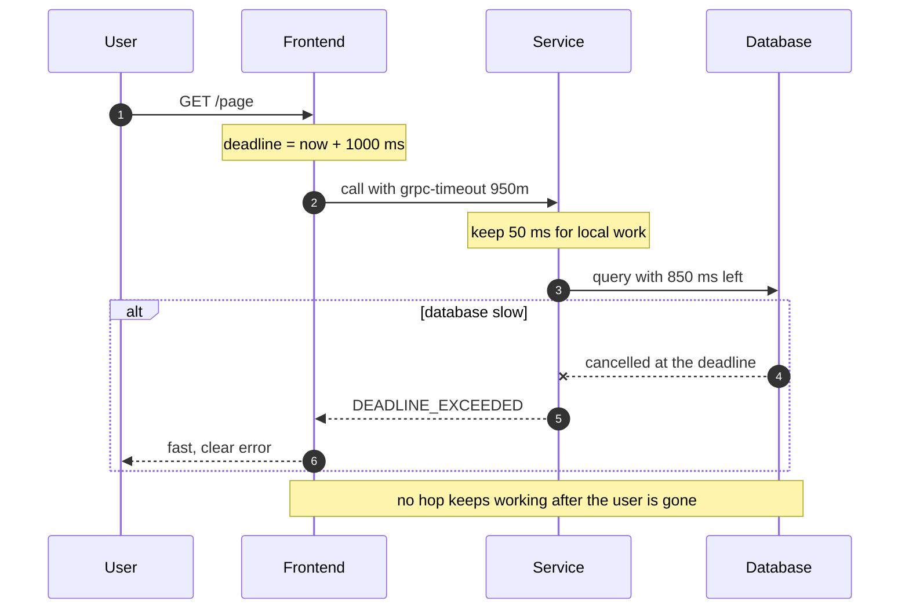

+++
title = 'Circuit breakers and deadlines'
description = "A circuit breaker turns slow failures into fast ones so callers stop spending threads on a dead dependency. Deadlines carry the caller's remaining budget down the call graph, and hedged requests trim the tail when the dependency is merely slow."
question = 'How do you stop waiting on a dependency that is failing, and stop doing work nobody is waiting for?'
weight = 3
difficulty = 3
prerequisites = ['/notes/systems-design/failure-modes/01-partial-failure-and-timeouts', '/notes/systems-design/failure-modes/02-retries-and-idempotency']
date = 2026-09-24
lastmod = 2026-10-30
verified = 2026-09-24
+++

## The idea in one minute

When a dependency fails fast, its callers fail fast too, and that is
manageable. When it fails **slowly**, every call holds a thread, a connection,
and a slice of the caller's memory until the timeout fires. A caller that sends
fifty requests a second to a dependency with a one-second timeout has fifty
requests stuck at any moment, and if its worker pool is fifty threads, it has
stopped serving everything else. The slow dependency has taken down a healthy
service.

Three tools address this. A **circuit breaker** watches the outcome of calls
and, once failures pass a threshold, stops calling for a while and fails
immediately instead, then probes to detect recovery. A **deadline** is an
absolute "give up by" time that travels with the request, so every hop knows
how much of the user's patience is left and nobody works on a request that has
already been abandoned. A **hedged request** sends a second copy after a short
delay to cut the latency tail. The consequence to act on: **every outbound
dependency needs a breaker or an equivalent fast-fail path, every request needs
a deadline that shrinks as it travels, and fallbacks must be designed, not
improvised**.

## A picture

```mermaid {title="A breaker opens on failures and probes before it closes again"}
stateDiagram-v2
  direction LR
  state "Closed" as C
  state "Open" as O
  state "Half-open" as H
  C : calls pass through, outcomes recorded
  O : calls fail fast, no load on dependency
  H : a few probe calls
  [*] --> C
  C --> O: failure rate over threshold
  O --> H: cooldown elapsed
  H --> C: probes succeed
  H --> O: any probe fails
  class C good
  class O warn
  class H queue
```

The breaker sits in the caller, in front of one dependency. It has no view of
the dependency except the outcomes of its own calls.

## How it really works

### Why slow failure is worse than fast failure

Little's law ties the three numbers together: the average number of requests
in flight equals the arrival rate times the average time each spends in the
system. A caller sending 50 requests per second to a dependency answering in
20 ms has one request in flight on average. When the dependency hangs and every
call waits for a one-second timeout, the same traffic holds **50** requests in
flight. Nothing about the caller changed; its concurrency went up fifty-fold
because its dependency got slower.

Plot Little's law for that caller: in-flight requests grow in a straight line
with the dependency's latency, at a fixed 50 requests per second.

```mermaid {title="Requests in flight at 50 per second, by dependency latency"}
xychart-beta
  x-axis ["20 ms", "100 ms", "250 ms", "500 ms", "1000 ms"]
  y-axis "Requests in flight" 0 --> 50
  line [1, 5, 12.5, 25, 50]
```

If those in-flight requests share a pool, such as threads in a servlet
container, connections to a database, or goroutines bounded by a semaphore, the
pool fills and requests for *unrelated* features queue behind it. This is the
mechanism behind most cascading failures: a slow leaf exhausts a shared
resource in every service above it. A breaker and the bulkheads discussed in
[blast radius and cells](/notes/systems-design/failure-modes/05-blast-radius-and-cells/) are the two defenses:
stop sending to the slow thing, and stop sharing the pool with it.

Look at what shares the pool: the search feature never calls the slow
dependency, yet it waits for a thread like everything else.

```mermaid {title="One slow dependency drains a shared pool for unrelated features"}
flowchart LR
  U("Users")
  subgraph SV["Caller service"]
    F1["Search"]
    F2["Checkout"]
    P["<b>Shared pool</b><br/><small>50 threads, all waiting</small>"]
  end
  D("Slow dependency")
  U --> F1
  U --> F2
  F2 --> P
  F1 -.->|"queued, unrelated"| P
  P -->|"1 s timeouts"| D
  class P warn
  class F1 neutral
```

### The breaker as a state machine

Michael Nygard named the pattern in *Release It!*, by analogy with an
electrical breaker that trips to protect the circuit. Its three states:

| State | Calls | Moves when |
| --- | --- | --- |
| **Closed** | Pass through; each outcome is recorded in a sliding window | The failure rate (or slow-call rate) over the window passes a threshold, with at least a minimum number of calls → open |
| **Open** | Rejected immediately with an error, or served by a fallback | A cooldown elapses → half-open |
| **Half-open** | A small, fixed number of probe calls go through; the rest are rejected | All probes succeed → closed. Any probe fails → open again, with a fresh cooldown |

The details matter more than the diagram:

- **Window type.** A *count-based* window judges the last N calls; a
  *time-based* window judges the last N seconds. Count-based windows react
  slowly at low traffic; time-based windows can open on a handful of calls
  unless there is a minimum.
- **Minimum calls.** Without one, two failures out of three calls at 3 a.m.
  open the circuit. Libraries such as Resilience4j expose this as
  `minimumNumberOfCalls`.
- **What counts as failure.** Timeouts, connection errors, and `5xx` should
  count. A `404` or a validation error is the dependency working correctly
  and should not. Counting **slow calls** (over some latency threshold) as
  failures lets the breaker react to fail-slow before timeouts pile up.
- **Probe limit.** Half-open must admit only a few calls. If it admits all
  traffic the moment the cooldown ends, a recovering dependency gets the full
  load, falls over again, and the breaker oscillates.
- **Scope.** One breaker per dependency, and often per endpoint or per host.
  A single breaker for "the payments service" opens for all regions when one
  replica set fails.

### What to do when the circuit is open

Opening the circuit converts a slow error into a fast one. That only helps if
the caller has something useful to do with a fast error. Options, roughly in
order of preference:

- **Degrade gracefully.** Show the product page without personalized
  recommendations; accept the order and send the confirmation email later.
- **Serve stale data** from a cache, labeled as such where it matters.
- **Fail the request quickly** with a clear, retryable error, so the user's
  client can back off instead of waiting.

Fallbacks are code paths that run only during incidents, which makes them the
least-tested code in the system. A fallback that calls another dependency can
fail in its own way, or overload that dependency because it now carries all
the traffic. Exercise fallbacks deliberately, for example by forcing breakers
open in a test environment or in a controlled production experiment.

> [!NOTE]
> "Circuit breaking" in Envoy and similar proxies means something different:
> hard limits on concurrent connections, pending requests, and retries to an
> upstream cluster. Those are **bulkheads**. The closest proxy analog to
> Nygard's breaker is outlier detection, which ejects individual hosts based on
> observed errors.

### Deadlines, not just timeouts

A timeout is local: "I will wait two seconds for this call." A **deadline** is
end to end: "this whole request must finish by 12:00:01.500". Without
propagation, timeouts compose badly. Suppose the frontend gives up after one
second, but calls a service with a two-second timeout, which calls a database
with a five-second timeout. When the database is slow, the frontend has long
since returned an error to the user, yet the service and database keep
working for several more seconds on a request whose answer will be thrown away.
Under load that wasted work is what pushes the system over.

gRPC builds deadlines into the protocol. The client sets a deadline on the
call; the library sends the remaining time in the `grpc-timeout` request header
as a relative duration (relative so that clock skew between machines does not
matter), and the server sees it as the deadline of the incoming request. When
it passes, the client gets `DEADLINE_EXCEEDED` and the server's context is
cancelled. The gRPC documentation stresses two points: by default **no deadline
is set**, so a client can wait indefinitely, and servers should pass the
incoming deadline on to their own outbound calls. In Go this happens when the
handler passes its request `context.Context` to the outbound call; in Java the
gRPC `Context` carries it.

Rules that make deadlines effective:

1. **Set one at the edge.** The first service to receive a user request sets
   the deadline from the product's latency target.
2. **Propagate the remaining budget,** minus a small reserve for the local work
   still to do after the call returns.
3. **Check before expensive work.** Before starting a database query or a fan-out,
   check whether enough budget remains to finish. If not, fail now.
4. **Drop expired work from queues.** A request that waited in a queue past its
   deadline should be discarded when dequeued, not processed. The
   [overload and backpressure](/notes/systems-design/failure-modes/04-overload-and-backpressure/) lesson shows
   how much capacity this saves.
5. **Do not retry past the deadline.** Retries consume the same budget; a retry
   that cannot finish in time is pure waste.

Follow the budget as it travels: each hop forwards what is left minus a small
reserve, so every layer gives up at the same moment instead of working on
alone.



### Hedged requests and the tail at scale

Breakers handle dependencies that are failing. A different problem is a
dependency that is healthy on average but has a long latency tail: most replies
in 10 ms, one in a hundred in a second. Jeffrey Dean and Luiz André Barroso's
2013 paper "The Tail at Scale" explains why this tail dominates at scale.
If a request fans out to 100 servers and must wait for all of them, and each
server is slow 1% of the time, then 1 − 0.99¹⁰⁰ ≈ 63% of requests wait on at
least one slow server. The rare event at one server becomes the common case
for the user.

The same formula, plotted for growing fan-out with each server slow 1% of the
time:

```mermaid {title="Chance a request waits on at least one slow server (%)"}
xychart-beta
  x-axis "Fan-out" ["1", "10", "20", "50", "100"]
  y-axis "Requests that hit a slow server (%)" 0 --> 70
  line [1.0, 9.6, 18.2, 39.5, 63.4]
```

Their techniques for tolerating, rather than eliminating, variability include:

- **Hedged requests.** Send the request to one replica; if no reply arrives
  within, say, the 95th-percentile latency, send a second copy to another
  replica and use whichever answers first. This bounds the extra load to about
  5%. The paper reports a Bigtable benchmark in which hedging after a 10 ms
  delay cut the 99.9th-percentile latency for reading 1,000 values from
  1,800 ms to 74 ms while sending only 2% more requests.

  Watch one hedged read: the second copy goes out only after the p95 delay,
  and the client uses whichever reply lands first.

  ```mermaid {title="A hedged read races a second replica after the p95 delay"}
  sequenceDiagram
    autonumber
    participant C as Client
    participant R1 as Replica 1
    participant R2 as Replica 2
    C->>R1: read key
    Note over C: no reply by p95 (15 ms)
    C->>R2: same read (hedge)
    R2-->>C: reply at 25 ms, used
    R1-->>C: reply at 900 ms, discarded
  ```
- **Tied requests.** Send to two replicas at once, each told about the other,
  and have the first one to start executing cancel its twin. This removes
  queueing delay without doubling the work.
- **Micro-partitions, selective replication, and latency-induced probation:**
  finer-grained load balancing, extra copies of hot data, and temporarily
  excluding slow machines.

gRPC supports hedging as a client policy (gRFC A6) with a hedging delay and a
maximum number of attempts. Hedging has the same precondition as retrying:
**the operation must be idempotent**, because both copies may execute. It is a
latency tool for reads and idempotent writes, never for "charge the card".
And it is not a cure for overload: if the tail is caused by too much load,
hedges add load. Pair hedging with a budget, as with retries.

## Code

The first program puts a breaker in front of a dependency that fails 2% of
calls normally, then hangs every call to a one-second timeout from t = 10 s to
t = 30 s. Requests arrive every 50 ms, and results come back in time order, so
the breaker only learns about a failure when its timeout expires, as in real
life.

```python {title="breaker.py"}
"""breaker.py: a circuit breaker in front of a dependency that goes down.

Simulated time. One request every 50 ms for 60 s. The dependency fails 2% of
calls normally, fails every call (after a 1 s timeout) from t=10 s to t=30 s,
then recovers. Standard library only; runs offline.
"""

from __future__ import annotations

import heapq
import random
from collections import deque
from dataclasses import dataclass, field

TIMEOUT_MS = 1_000


def dependency(rng: random.Random, t_ms: int) -> tuple[bool, int]:
    """Returns (ok, latency in ms)."""
    if 10_000 <= t_ms < 30_000:
        return False, TIMEOUT_MS            # down: every call hangs to the timeout
    if rng.random() < 0.02:
        return False, 30                    # normal background errors fail fast
    return True, int(rng.lognormvariate(3.0, 0.3))  # about 20 ms


class Open(Exception):
    """Raised instead of calling the dependency."""


@dataclass
class CircuitBreaker:
    window: int = 20             # judge the last N calls
    min_calls: int = 10          # ...but only once there are this many
    threshold: float = 0.5       # failure rate that opens the circuit
    cooldown_ms: int = 5_000     # how long to stay open before probing
    probes: int = 3              # trial calls allowed in half-open
    state: str = "closed"
    results: deque[bool] = field(default_factory=deque)
    opened_at: int = 0
    probes_left: int = 0
    probe_ok: int = 0
    log: list[str] = field(default_factory=list)

    def _move(self, new: str, t_ms: int, why: str) -> None:
        self.log.append(f"t={t_ms / 1000:5.2f}s  {self.state:>9} -> {new:<9} {why}")
        self.state = new

    def before_call(self, t_ms: int) -> None:
        if self.state == "open":
            if t_ms - self.opened_at < self.cooldown_ms:
                raise Open
            self._move("half-open", t_ms, "cooldown elapsed, probing")
            self.probes_left, self.probe_ok = self.probes, 0
        if self.state == "half-open":
            if self.probes_left == 0:
                raise Open                  # probes already in flight or used
            self.probes_left -= 1

    def after_call(self, t_ms: int, ok: bool) -> None:
        if self.state == "open":
            return                          # a straggler from before it opened
        if self.state == "half-open":
            if not ok:
                self.opened_at = t_ms
                self._move("open", t_ms, "probe failed")
                return
            self.probe_ok += 1
            if self.probe_ok == self.probes:
                self.results.clear()
                self._move("closed", t_ms, f"{self.probes} probes succeeded")
            return
        self.results.append(ok)
        if len(self.results) > self.window:
            self.results.popleft()
        failures = self.results.count(False)
        if len(self.results) >= self.min_calls and failures / len(self.results) >= self.threshold:
            self.opened_at = t_ms
            self._move("open", t_ms, f"{failures}/{len(self.results)} recent calls failed")


def run(breaker: CircuitBreaker | None) -> dict[str, int]:
    rng = random.Random(11)
    stats = {"ok": 0, "failed": 0, "fast-failed": 0, "dependency calls": 0, "ms waiting": 0}
    in_flight: list[tuple[int, bool]] = []  # (completion time, ok), a min-heap
    for t in range(0, 60_000, 50):
        while in_flight and in_flight[0][0] <= t:  # deliver results in time order
            done, ok = heapq.heappop(in_flight)
            stats["ok" if ok else "failed"] += 1
            if breaker:
                breaker.after_call(done, ok)
        try:
            if breaker:
                breaker.before_call(t)
        except Open:
            stats["fast-failed"] += 1       # served a fallback in microseconds
            continue
        ok, latency = dependency(rng, t)
        heapq.heappush(in_flight, (t + latency, ok))
        stats["dependency calls"] += 1
        stats["ms waiting"] += latency
    for _, ok in in_flight:
        stats["ok" if ok else "failed"] += 1
    return stats


def main() -> None:
    breaker = CircuitBreaker()
    with_cb, without = run(breaker), run(None)
    print("\n".join(breaker.log))
    print(f"\n{'':<18} {'no breaker':>11} {'breaker':>9}")
    for key in without:
        print(f"{key:<18} {without[key]:>11} {with_cb[key]:>9}")


if __name__ == "__main__":
    main()
```

Run it with `python3 breaker.py`:

```text
t=11.45s     closed -> open      10/20 recent calls failed
t=16.45s       open -> half-open cooldown elapsed, probing
t=17.45s  half-open -> open      probe failed
t=22.45s       open -> half-open cooldown elapsed, probing
t=23.45s  half-open -> open      probe failed
t=28.45s       open -> half-open cooldown elapsed, probing
t=29.45s  half-open -> open      probe failed
t=34.45s       open -> half-open cooldown elapsed, probing
t=34.57s  half-open -> closed    3 probes succeeded

                    no breaker   breaker
ok                         786       698
failed                     414        51
fast-failed                  0       451
dependency calls          1200       749
ms waiting              416533     52703
```

Without a breaker, every request during the outage waits the full second:
about 417 seconds of caller time spent waiting, most of it on calls that were
always going to fail. With the breaker, the circuit opens 1.45 s into the
outage (one timeout plus enough failures to fill half the window), probes every
five seconds, and closes 4.45 s after recovery. Caller waiting time drops by
about 87%. The cost is visible too: the breaker kept failing fast for those 4.45
seconds after the dependency was healthy, which accounts for most of the 88
fewer successes. The
cooldown is a direct trade between load on a struggling dependency and time to
notice recovery.

The breaker log, laid out against the outage window:

```mermaid {title="The breaker during a 20-second outage (simulated time)"}
timeline
  title Breaker states from breaker.py
  t=10s : dependency starts hanging every call
  t=11.45s : closed to open after 10 of 20 calls fail
  t=16.45s to 29.45s : three half-open probes, each fails and reopens
  t=30s : dependency recovers
  t=34.45s : half-open, probing again
  t=34.57s : closed after 3 probes succeed
```

The second program shows why the tail matters under fan-out and what hedging
after the p95 buys.

```python {title="hedge.py"}
"""hedge.py: tail latency under fan-out, and what a hedged request buys.

Each backend answers in about 10 ms, but 1 call in 100 takes about a second.
Standard library only; runs offline.
"""

from __future__ import annotations

import random


def backend(rng: random.Random) -> float:
    if rng.random() < 0.01:
        return rng.uniform(800, 1_200)       # a GC pause, a slow disk, a queue
    return rng.lognormvariate(2.3, 0.25)     # about 10 ms


def hedged(rng: random.Random, after_ms: float) -> tuple[float, int]:
    """Send one request; if no reply by after_ms, send a second to another
    replica and take whichever answers first. Returns (latency, requests)."""
    first = backend(rng)
    if first <= after_ms:
        return first, 1
    return min(first, after_ms + backend(rng)), 2


def pct(values: list[float], p: float) -> float:
    s = sorted(values)
    return s[min(len(s) - 1, int(p / 100 * len(s)))]


def main() -> None:
    rng = random.Random(5)
    trials = 20_000
    p95 = pct([backend(rng) for _ in range(trials)], 95)
    print(f"one backend: p95 = {p95:.1f} ms, so hedge after {p95:.1f} ms\n")
    print(f"{'fan-out':>7} {'policy':>9} {'p50':>8} {'p99':>8} {'p99.9':>8} "
          f"{'slow (>500ms)':>14} {'extra load':>11}")
    for fanout, requests in ((1, 20_000), (10, 5_000), (100, 2_000)):
        for policy in ("plain", "hedged"):
            latencies, sent = [], 0
            for _ in range(requests):
                if policy == "plain":
                    parts = [(backend(rng), 1) for _ in range(fanout)]
                else:
                    parts = [hedged(rng, p95) for _ in range(fanout)]
                latencies.append(max(lat for lat, _ in parts))  # wait for all
                sent += sum(n for _, n in parts) - fanout
            n = len(latencies)
            slow = sum(1 for v in latencies if v > 500) / n
            print(f"{fanout:>7} {policy:>9} {pct(latencies, 50):>6.0f}ms "
                  f"{pct(latencies, 99):>6.0f}ms {pct(latencies, 99.9):>6.0f}ms "
                  f"{slow:>13.1%} {sent / (n * fanout):>10.1%}")
    print(f"\nchance a 100-way fan-out waits on a slow backend: 1 - 0.99^100 = {1 - 0.99**100:.0%}")


if __name__ == "__main__":
    main()
```

Run it with `python3 hedge.py`:

```text
one backend: p95 = 15.4 ms, so hedge after 15.4 ms

fan-out    policy      p50      p99    p99.9  slow (>500ms)  extra load
      1     plain     10ms    851ms   1164ms          1.1%       0.0%
      1    hedged     10ms     23ms     30ms          0.0%       5.1%
     10     plain     15ms   1161ms   1197ms          9.5%       0.0%
     10    hedged     15ms     29ms     37ms          0.1%       5.1%
    100     plain    920ms   1195ms   1200ms         62.7%       0.0%
    100    hedged     24ms     36ms   1009ms          0.7%       5.1%

chance a 100-way fan-out waits on a slow backend: 1 - 0.99^100 = 63%
```

At a fan-out of 100 the median request is slow (920 ms): most requests wait on
at least one slow backend, matching the 63% from the formula. Hedging each
sub-request after the single-backend p95 brings the p99 down to 36 ms for about
5% extra requests. The p99.9 stays high because occasionally both copies are
slow. The model assumes slowness is independent across replicas; when it is
not, hedging buys much less.

## Where it breaks

- **Breakers see only their own traffic.** A caller with little traffic to a
  dependency may never collect enough calls to open, and a caller with a lot
  may open on a blip. Tune `min_calls` and the window to traffic, and prefer
  failure rates to counts.
- **Breaker plus retries.** A retry layer *outside* the breaker turns each
  fast failure into several, and a retry layer *inside* it hides failures from
  the breaker until retries are exhausted. Decide the order deliberately:
  usually retries inside a single attempt's budget, the breaker around the
  whole operation.

  Read the stack from the outside in: each layer wraps the one below and is
  bounded by it.

  ```mermaid {title="Where retries, the breaker, and the deadline sit"}
  block-beta
    columns 1
    D["Request deadline, set once at the edge"]
    B["Circuit breaker around the whole operation"]
    R["Retry loop, bounded by budget and remaining deadline"]
    A["One attempt with its own timeout"]
    X[("Dependency")]
  ```
- **Many independent breakers can synchronize.** Hundreds of instances that
  opened together reach half-open together and probe together. Jitter the
  cooldown.
- **A breaker is not a fix.** It protects the caller and sheds load from the
  dependency. Something still has to restore the dependency, and an open
  breaker can mask the problem from the dependency's owners if its metrics are
  not watched.
- **Deadlines only work if every hop honors them.** One service that ignores
  the incoming deadline and starts a fresh 30-second timeout reintroduces the
  wasted work. Check propagation at every boundary, including queues and batch
  jobs.
- **Hedging assumes independence and idempotence.** Correlated slowness (a
  shared overloaded database behind every replica) defeats it, and a
  non-idempotent operation executed twice is a correctness bug.

## Remember this

- Slow failure is worse than fast failure: it multiplies in-flight work by the
  timeout.
- A breaker has three states; probe with a few calls in half-open, never with
  the full load.
- Count timeouts, `5xx`, and slow calls as failures; do not count client errors.
- An open breaker is only as good as its designed, tested fallback.
- Set a deadline at the edge and propagate the remaining budget; drop work whose
  deadline has passed.
- Hedge only idempotent calls, after about the p95, with a budget on extra load.

## Try it

1. Run `breaker.py`. Change `cooldown_ms` to 1,000 and to 20,000. Plot "ms
   waiting" against successes lost after recovery. Where would you set it?
2. Make the dependency fail slowly but partially: 40% of calls hang from
   t = 10 s to 30 s. Does the breaker open? Add a slow-call threshold that
   counts calls over 500 ms as failures.
3. Add jitter to the cooldown and run 50 breakers in parallel against the same
   dependency. Count how many probes arrive in the same 100 ms.
4. In `hedge.py`, make slowness correlated: when one backend is slow, its
   hedge is slow with 50% probability. How much of the benefit survives?
5. Trace one user request through a system you know. Write down the timeout at
   each hop. Does any inner timeout exceed the outer one?

## Check yourself

1. A dependency's latency goes from 20 ms to its 1-second timeout. Why can this
   take down a caller that has no bugs?

   
   By Little's law, requests in flight equal arrival rate times latency. A
   fifty-fold latency increase means fifty times as many requests held at once.
   If they share a thread or connection pool with other work, the pool
   exhausts and unrelated requests queue or fail.
   

2. Why does half-open admit only a few calls?

   
   A dependency that has just recovered may not handle full load immediately,
   for example with cold caches. Sending all traffic at once can knock it over
   again, and the breaker will oscillate. A few probes test recovery without
   risking it.
   

3. How does deadline propagation reduce load during an incident?

   
   Each hop knows how much of the user's budget remains and can refuse or
   abandon work that cannot finish in time. Without it, inner services keep
   processing requests whose callers have already given up, which consumes
   capacity exactly when it is scarce.
   

4. Why does gRPC send the deadline as a relative timeout rather than a
   timestamp?

   
   Machine clocks disagree. A relative duration ("100 ms left") is converted to
   a local deadline by the receiver using its own clock, so skew between client
   and server does not shorten or extend the budget. Only the network transit
   time is lost.
   

5. When should you not use hedged requests?

   
   For non-idempotent operations, because both copies may execute. And when
   the latency tail is caused by overload, because hedges add load. They work
   best for idempotent reads where slowness is independent across replicas,
   with the hedge delay near the p95 so the extra load stays small.
   

## Sources

- M. T. Nygard, *Release It! Design and Deploy Production-Ready Software*, 2nd edition, Pragmatic Bookshelf, 2018 (chapter on stability patterns: circuit breaker, bulkheads, timeouts).
- M. Fowler, [CircuitBreaker](https://martinfowler.com/bliki/CircuitBreaker.html), March 2014.
- J. Dean, L. A. Barroso, [The Tail at Scale](https://research.google/pubs/the-tail-at-scale/), *Communications of the ACM* 56(2), February 2013.
- gRPC authors, [Deadlines](https://grpc.io/docs/guides/deadlines/) guide and [gRPC over HTTP/2 protocol](https://github.com/grpc/grpc/blob/master/doc/PROTOCOL-HTTP2.md) (the `grpc-timeout` header).
- gRPC authors, [gRFC A6: gRPC Retry Design](https://github.com/grpc/proposal/blob/master/A6-client-retries.md) (retry and hedging policies).
- Resilience4j, [CircuitBreaker documentation](https://resilience4j.readme.io/docs/circuitbreaker).
- Envoy project, [Circuit breaking](https://www.envoyproxy.io/docs/envoy/latest/intro/arch_overview/upstream/circuit_breaking) and [Outlier detection](https://www.envoyproxy.io/docs/envoy/latest/intro/arch_overview/upstream/outlier).
- J. D. C. Little, "A Proof for the Queuing Formula: L = λW", *Operations Research* 9(3), 1961.
