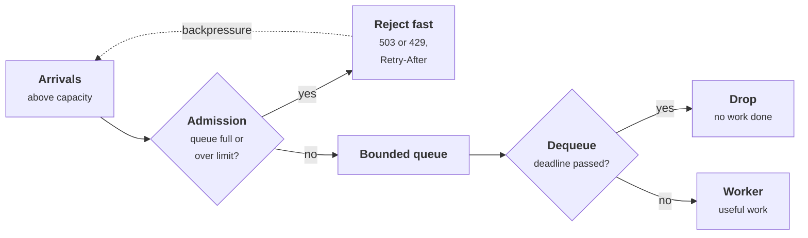
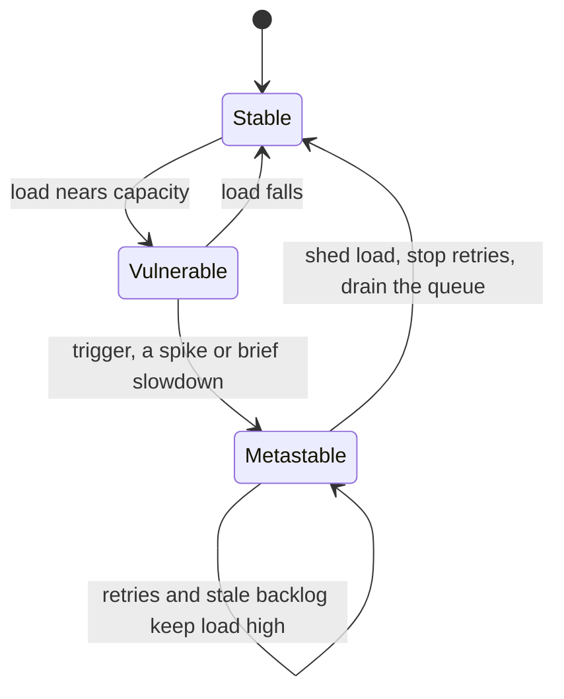
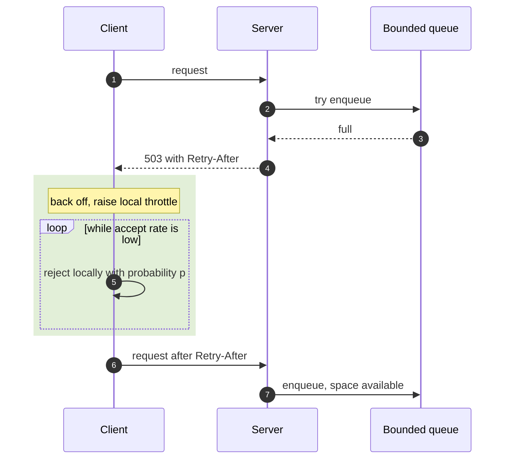
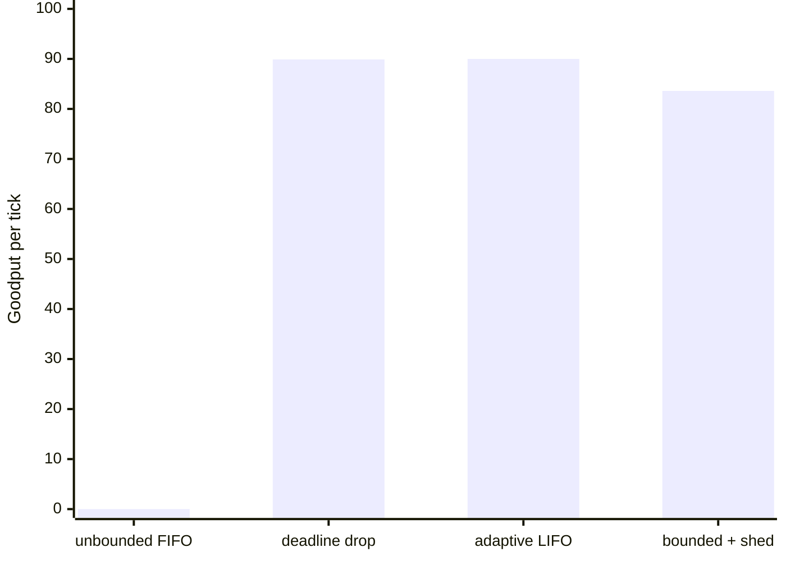

+++
title = 'Overload and backpressure'
description = 'An overloaded server with an unbounded queue keeps busy while doing no useful work. Bound the queue, shed load early and cheaply, drop requests whose callers have gone, and push back on senders so goodput stays at capacity.'
question = 'What happens when load exceeds capacity, and how do you keep doing useful work instead of collapsing?'
weight = 4
difficulty = 3
prerequisites = ['/notes/systems-design/failure-modes/01-partial-failure-and-timeouts', '/notes/systems-design/thinking-in-invariants/03-back-of-the-envelope-capacity']
date = 2026-09-26
lastmod = 2026-09-26
verified = 2026-09-26
+++

## The idea in one minute

Every server has a capacity. When requests arrive faster than that, the excess
has to go somewhere. If it goes into an unbounded queue, the queue grows,
every request waits longer, and soon every request waits longer than its
client is willing to. From then on the server is **fully busy doing useless
work**: it completes requests whose callers have already timed out. Those
callers retry, adding more load. The server can stay in this state long after
the original spike is gone.

The distinction that matters is between **throughput** (requests completed)
and **goodput** (requests completed in time to be useful). Overload controls
exist to keep goodput near capacity when offered load exceeds it: **bound the
queue**, **reject excess early and cheaply**, **discard work whose deadline has
passed**, prefer **fresh requests** over stale ones, and **push back** on
senders so the overload is felt at the edge, not in the middle. The
consequence to act on: **decide in advance what your service does with the
request it cannot serve in time**, because the default is to serve it late,
which is the worst choice.

## A picture



Two decision points protect the worker: admission at the front of the queue and
a deadline check at the back. Neither does useful work; both keep the worker
doing only useful work.

## How it really works

### Latency rises before throughput falls

Queueing theory gives the shape. For the simplest model (random arrivals,
random service times, one server), the average time in the system is the
service time divided by `(1 − ρ)`, where `ρ` is utilization. At 50%
utilization requests take twice the bare service time; at 90%, ten times; at
99%, a hundred times. Real systems differ in the constants, not the shape:
**latency grows without bound as utilization approaches 100%**, long before
throughput stops increasing. That is why capacity plans target utilization well
below 100% and why the
[back-of-the-envelope capacity](/notes/systems-design/thinking-in-invariants/03-back-of-the-envelope-capacity/)
lesson budgets headroom rather than peak.

Plot `1 / (1 − ρ)` and the knee is plain: the curve is nearly flat to 50% and
nearly vertical past 90%.

```mermaid {title="Time in system as a multiple of service time, by utilization"}
xychart-beta
  x-axis "Utilization (%)" ["10", "50", "70", "80", "90", "95", "99"]
  y-axis "Multiple of bare service time" 0 --> 100
  line [1.1, 2, 3.3, 5, 10, 20, 100]
```

Above 100%, the queue grows by the difference between arrival and service
rates every second, without limit. Little's law (requests in the system equal
arrival rate times time in the system) then says the wait grows with it.

### Congestion collapse and metastable failure

Once queueing delay exceeds client timeouts, three things compound:

1. **Every completed request is late.** The server's throughput is unchanged,
   but its goodput falls toward zero.
2. **Clients retry.** Each timed-out request is sent again, so offered load rises
   above the original arrival rate, often doubling it.
3. **Work is duplicated.** The original request is still in the queue; the retry
   joins behind it. The server processes both, late.

The result is a stable bad state. Bronson and colleagues called this a
**metastable failure**: a system that, after a trigger such as a load spike or a
brief slowdown, stays degraded even after the trigger is removed, because a
**sustaining effect** (here, retries and the stale backlog) keeps load above
capacity. A follow-up study by Huang and colleagues found the pattern across
many public incident reports from large operators, with retries as one of the
most common sustaining effects. The way out is to break the loop: shed load,
stop retries, or drain the queue, not to wait.

Trace the states: removing the trigger does not lead back to stable, because
the sustaining effect loops on itself. Only an action from outside exits.



### Bounded queues and load shedding

A queue exists to absorb short bursts. A burst that lasts longer than the
queue can drain within the client timeout is not a burst; it is overload, and
queueing it only converts a fast rejection into a slow one. Bound the queue at
roughly what the server can process within the clients' patience, often much
less, and **reject** what does not fit.

Rejection must be **cheap**. A server that parses, authenticates, and logs
every request before deciding to reject it can still be overwhelmed by
rejections. Shed as early as possible: in the load balancer, at the connection
accept, or as the first thing the handler does. The AWS Builders' Library
article on load shedding describes measuring the server's own concurrency or
latency and rejecting before doing expensive work, and making the rejection
path's cost a small fraction of the success path's.

Follow a request inward: every hop it passes makes a rejection more expensive,
so the cheapest place to say no is the first one.

```mermaid {title="Shed as early as possible: rejection cost grows with depth"}
flowchart LR
  C("Clients")
  L("Load balancer")
  A["<b>Accept</b><br/><small>TLS, parse</small>"]
  H["<b>Handler start</b><br/><small>auth, log</small>"]
  W("Expensive work")
  C --> L
  L -->|"shed: cheapest"| A
  A -->|"shed: cheap"| H
  H -->|"shed: costly"| W
  class A good
  class H neutral
```

Not all requests are equal, so shedding can be selective:

- **By priority.** Health checks, control traffic, and paying users before
  batch jobs and prefetches.
- **By age.** A request that already spent most of its deadline in transit is
  the least likely to finish usefully.
- **By cost.** A query that scans a year of data can be refused while cheap
  lookups continue.

### Dropping expired work

The cheapest request to process is the one whose client has given up. When a
deadline travels with the request, as described in
[circuit breakers and deadlines](/notes/systems-design/failure-modes/03-circuit-breakers-and-deadlines/), the
server can check it at dequeue and discard expired work without doing it.

Kathleen Nichols and Van Jacobson's **CoDel** (Controlled Delay) applied a
related idea to network router queues: control the time packets spend in the
queue, not its length, and drop when the minimum queueing delay over an
interval stays above a small target. Ben Maurer's account of Facebook's
infrastructure, "Fail at Scale", describes using the same idea for server
request queues: when a queue has not emptied recently, requests are allowed to
wait only a short time before being dropped. A queue that is regularly empty
is absorbing bursts; one that never empties is hiding overload.

### LIFO under overload

Under normal load, first-in-first-out is fair. Under overload, FIFO is the
worst order: it serves the oldest request first, the one most likely to have
already timed out, and every request waits behind the whole backlog. **Last-in-
first-out** serves the newest request, whose client is still waiting, and lets
the stale tail time out without delaying fresh work. "Fail at Scale" describes
**adaptive LIFO**: FIFO while the queue is short, LIFO once it builds up, used
together with the controlled-delay dropping above. LIFO alone keeps goodput up,
but the stale requests are still in the queue and are still served when the
queue drains; the program below shows the cost.

### Admission control and backpressure

Load shedding happens at the overloaded server. **Backpressure** moves the
signal upstream so senders slow down before the server has to drop anything.

- **In protocols.** TCP's receive window stops a sender from outrunning the
  receiver's buffer. HTTP/2 has per-stream and per-connection flow-control
  windows (RFC 9113). Reactive Streams makes demand explicit: the consumer
  requests *n* items and the producer sends no more.
- **In queues between services.** A bounded queue between a producer and a
  consumer blocks or fails the producer when full. An unbounded message queue
  removes backpressure entirely and lets the backlog grow until it hits disk
  or memory limits, often hours later.
- **At the client.** Google's SRE book describes **client-side adaptive
  throttling**: each client tracks requests sent and requests accepted over
  the last two minutes, and rejects locally with probability
  `max(0, (requests − K × accepts) / (requests + 1))`, with `K` typically 2.
  When the backend rejects most traffic, clients stop sending most of it, which
  makes rejections cheap for the backend.

  For a client with many requests (so the `+ 1` is negligible) and `K = 2`,
  the local rejection probability is zero until fewer than half its requests
  are accepted, then rises in a straight line:

  ```mermaid {title="Client-side throttling with K = 2: local rejection probability"}
  xychart-beta
    x-axis "Backend accept rate (%)" ["100", "50", "40", "30", "20", "10", "0"]
    y-axis "Rejected locally (%)" 0 --> 100
    line [0, 0, 20, 40, 60, 80, 100]
  ```
- **Adaptive concurrency limits.** Rather than a fixed limit, the server or
  client measures latency and adjusts how many requests it allows in flight,
  in the spirit of TCP congestion control. Envoy's adaptive concurrency filter
  and Netflix's open-source concurrency-limits library work this way.

Put together, the signal travels back to the sender in steps: the bounded
queue refuses, the server says when to return, and the client throttles
itself.



Rate limits are the policy form of admission control: each client gets a share
and excess gets `429 Too Many Requests`. They protect against one client
taking more than its share; they do not protect against the sum of
well-behaved clients exceeding capacity. The design of a rate limiter is its
own lesson, [a rate limiter](/notes/systems-design/worked-designs/01-a-rate-limiter/).

> [!IMPORTANT]
> An overloaded service must reject **early, cheaply, and with a signal**
> (`503` or `429`, ideally with `Retry-After`), and its clients must treat
> that signal as a reason to back off, not to retry immediately.

## Code

The program models one server that completes 100 requests per tick. Clients
give up five ticks after sending and retry once. Offered load is 80 per tick,
doubles to 160 for 50 ticks, then returns to 80. Four policies:

| Policy | Queue | At dequeue |
| --- | --- | --- |
| Unbounded FIFO | No limit | Serve whatever is oldest |
| Deadline drop | No limit | Discard requests whose client gave up |
| Adaptive LIFO | No limit | Serve newest first when the queue is long |
| Bounded + shed | 250 requests, reject the rest | Discard expired requests |

```python {title="overload.py"}
"""overload.py: goodput under overload for four queueing policies.

A server completes 100 requests per tick. Clients give up 5 ticks after sending
and retry once. Load is 80/tick, spikes to 160/tick for ticks 50-99, then
returns to 80/tick. Standard library only; runs offline.
"""

from __future__ import annotations

import math
import random
from collections import deque
from dataclasses import dataclass

CAPACITY, PATIENCE, TICKS = 100, 5, 300
BOUND = CAPACITY * PATIENCE // 2   # bounded queue: at most 2.5 ticks of work


@dataclass
class Request:
    sent: int
    is_retry: bool


def poisson(rng: random.Random, lam: float) -> int:
    """Knuth's method; fine for the small rates used here."""
    limit, k, p = math.exp(-lam), 0, 1.0
    while True:
        p *= rng.random()
        if p <= limit:
            return k
        k += 1


def load(tick: int) -> float:
    return 160.0 if 50 <= tick < 100 else 80.0


def simulate(policy: str) -> tuple[list[tuple[int, int, int]], int]:
    """Returns (good, wasted, rejected) per tick, and the peak queue length."""
    rng = random.Random(2026)
    queue: deque[Request] = deque()
    retries_due: dict[int, int] = {}
    out, peak = [], 0
    for tick in range(TICKS):
        arrivals = [Request(tick, False) for _ in range(poisson(rng, load(tick)))]
        arrivals += [Request(tick, True) for _ in range(retries_due.pop(tick, 0))]
        rejected = 0
        for req in arrivals:
            if policy == "bounded + shed" and len(queue) >= BOUND:
                rejected += 1                   # fast "503, try later"
                if not req.is_retry:
                    retries_due[tick + 1] = retries_due.get(tick + 1, 0) + 1
                continue
            queue.append(req)
        peak = max(peak, len(queue))
        good = wasted = done = 0
        lifo = policy == "adaptive LIFO" and len(queue) > CAPACITY
        while done < CAPACITY and queue:
            req = queue.pop() if lifo else queue.popleft()
            late = tick - req.sent >= PATIENCE  # the client already gave up
            if late and policy in ("deadline drop", "bounded + shed"):
                continue                        # discard unserved: costs nothing
            done += 1
            if late:
                wasted += 1
            else:
                good += 1
        # Clients whose requests are still unserved give up and retry once.
        for req in queue:
            if tick - req.sent == PATIENCE - 1 and not req.is_retry:
                retries_due[tick + 1] = retries_due.get(tick + 1, 0) + 1
        out.append((good, wasted, rejected))
    return out, peak


def main() -> None:
    phases = [("before", 0, 50), ("spike", 50, 100), ("after", 100, 150),
              ("long after", 250, 300)]
    print("goodput = requests finished before the client gave up, per tick")
    print(f"capacity {CAPACITY}/tick; offered load 80, then 160 during the spike\n")
    print(f"{'policy':<16}" + "".join(f"{name:>12}" for name, _, _ in phases)
          + f"{'wasted':>9}{'rejected':>10}{'peak queue':>12}")
    for policy in ("unbounded FIFO", "deadline drop", "adaptive LIFO", "bounded + shed"):
        series, peak = simulate(policy)
        cells = "".join(
            f"{sum(g for g, _, _ in series[a:b]) / (b - a):>12.1f}" for _, a, b in phases)
        wasted = sum(w for _, w, _ in series)
        rejected = sum(r for _, _, r in series)
        print(f"{policy:<16}{cells}{wasted:>9}{rejected:>10}{peak:>12}")


if __name__ == "__main__":
    main()
```

Run it with `python3 overload.py`:

```text
goodput = requests finished before the client gave up, per tick
capacity 100/tick; offered load 80, then 160 during the spike

policy                before       spike       after  long after   wasted  rejected  peak queue
unbounded FIFO          80.4        24.5         0.0         0.0    23776         0       21213
deadline drop           80.4       100.0        89.9        82.0        0         0        1234
adaptive LIFO           80.4       100.0        90.0        82.0     3445         0       10408
bounded + shed          80.4       100.0        83.6        82.0        0      5294         250
```

The unbounded FIFO server collapses during the spike: it is completing 100
requests every tick, but only 24.5 per tick on average arrive in time to
matter, and once the backlog exceeds five ticks of work, none do. When the
spike ends, offered load returns to 80, below capacity, and goodput stays at
**zero** for the remaining 200 ticks. Retries of late requests keep the
backlog growing. This is a metastable failure in about 90 lines: the trigger is
gone and the system does not recover on its own.

Every other policy keeps goodput at capacity during the spike and recovers
immediately. Deadline drop never wastes a unit of work. Adaptive LIFO also
holds goodput, but it leaves a backlog of over 10,000 stale requests that it
eventually serves late (3,445 wasted units), which is why production designs
pair it with dropping. The bounded queue rejects 5,294 requests quickly
instead of accepting them and failing slowly; its clients learn within one tick
that they should retry or give up.

The "after" column, charted: the trigger is gone for every policy, but only
the unbounded FIFO server stays at zero.



## Where it breaks

- **Rejection is not free.** The model treats rejecting and dropping as costing
  nothing. Real rejections cost a connection, a TLS handshake, and some
  parsing. If rejected clients retry immediately and the rejection path is
  expensive, the server can still be overwhelmed by rejections alone.
  Client-side throttling and backoff are what bound this.
- **Bounds need tuning and change with the code.** A queue bound or
  concurrency limit set from last quarter's profile is wrong after the service
  gets slower per request. Adaptive limits based on observed latency age
  better than constants.
- **Deadlines must be real.** Deadline drop needs to know when the client gives
  up. Without propagated deadlines, a server must guess with a fixed queue-time
  limit, which is wrong for some callers.
- **LIFO is unfair.** A client unlucky enough to be at the bottom of the stack
  waits until it times out. That is acceptable for interchangeable requests
  from many users and unacceptable when a request is a step in a sequence that
  must complete.
- **Shedding protects the server, not the user.** Rejected requests are still
  failures from the user's point of view. Shedding keeps goodput at capacity
  instead of zero; only more capacity, or less demand, fixes the deficit.
- **One server is not a fleet.** Load balancers that send more traffic to
  instances that reject quickly (because those look "fast") can concentrate
  load. Least-outstanding-requests balancing and treating rejections as
  failures in balancing decisions help.

## Remember this

- Goodput, not throughput: count only requests completed before the caller
  gave up.
- Latency grows like `1 / (1 − utilization)`; plan for headroom, not peak.
- Unbounded queues plus retries cause metastable failure that outlives its
  trigger.
- Bound queues to what can be served within the deadline; reject the rest early
  and cheaply.
- Drop expired work at dequeue; under overload, serve newest first.
- Push back on senders with flow control, `429`/`503` and `Retry-After`, and
  client-side throttling.

## Try it

1. Run `overload.py`. Remove the retry in the unbounded FIFO case (never add to
   `retries_due`). Does the server now recover after the spike? How long does
   it take?
2. Make rejection cost one fifth of a request's capacity. At what rejection
   volume does the bounded server's goodput start to fall?
3. Add a "LIFO + deadline drop" policy. Compare peak queue and wasted work
   with plain adaptive LIFO.
4. Implement client-side adaptive throttling with `K = 2` for the bounded
   server's clients and measure how many requests reach the server during the
   spike.
5. For a service you own, find every queue (thread pools, connection pools,
   message queues, OS socket backlogs). Which ones are unbounded? What happens
   to a request that waits in each longer than its client's timeout?

## Check yourself

1. Why does goodput fall to zero while the server is 100% busy?

   
   Every request waits behind a backlog longer than the client's timeout. The
   server still completes requests at full rate, but every completion arrives
   after its client has given up, so none of the work is useful.
   

2. The spike ends and offered load drops below capacity, yet the server stays
   broken. Why?

   
   A sustaining effect keeps effective load above capacity: clients retry
   timed-out requests while the originals remain queued, so the server sees
   original load plus retries, and the stale backlog keeps every new request
   late. This is a metastable failure; breaking it needs shedding, retry
   limits, or draining the queue.
   

3. Why is LIFO better than FIFO under overload, and why is it not enough on its
   own?

   
   LIFO serves the newest request, whose client is still waiting, instead of
   the oldest, which has probably timed out. But the stale requests stay in the
   queue and are served later anyway, wasting capacity, so LIFO is paired with
   dropping requests whose deadline has passed.
   

4. What makes load shedding effective, beyond deciding to reject?

   
   Rejecting early and cheaply, before parsing, authenticating, or touching
   dependencies, so the rejection path costs a small fraction of a real
   request. And sending a clear signal (`503` or `429` with `Retry-After`) that
   clients respect by backing off.
   

5. How does client-side adaptive throttling reduce load on an overloaded
   backend?

   
   Each client compares requests sent with requests accepted. When the backend
   rejects many requests, the client starts rejecting locally with a probability
   that grows with the gap, so most excess requests never reach the backend
   and its remaining capacity goes to requests it can serve.
   

## Sources

- N. Bronson, A. Aghayev, A. Charapko, T. Zhu, *Metastable Failures in Distributed Systems*, Workshop on Hot Topics in Operating Systems (HotOS), ACM, 2021.
- L. Huang, M. Magnusson, A. B. Muralikrishna, S. Estyak, R. Isaacs, A. Aghayev, T. Zhu, A. Charapko, *Metastable Failures in the Wild*, USENIX Symposium on Operating Systems Design and Implementation (OSDI), 2022.
- K. Nichols, V. Jacobson, [Controlling Queue Delay](https://queue.acm.org/detail.cfm?id=2209336), *ACM Queue* 10(5), May 2012.
- B. Maurer, [Fail at Scale: Reliability in the face of rapid change](https://queue.acm.org/detail.cfm?id=2839461), *ACM Queue* 13(8), 2015.
- D. Yanacek, [Using load shedding to avoid overload](https://aws.amazon.com/builders-library/using-load-shedding-to-avoid-overload/), Amazon Builders' Library.
- B. Beyer, C. Jones, J. Petoff, N. R. Murphy (eds.), *Site Reliability Engineering*, O'Reilly, 2016: [Handling Overload](https://sre.google/sre-book/handling-overload/) and [Addressing Cascading Failures](https://sre.google/sre-book/addressing-cascading-failures/).
- M. Thomson, C. Benfield (eds.), [RFC 9113: HTTP/2](https://www.rfc-editor.org/rfc/rfc9113), IETF, June 2022 (section 5.2, flow control).
- Reactive Streams, [Specification for the JVM](https://www.reactive-streams.org/).
- J. D. C. Little, "A Proof for the Queuing Formula: L = λW", *Operations Research* 9(3), 1961.
