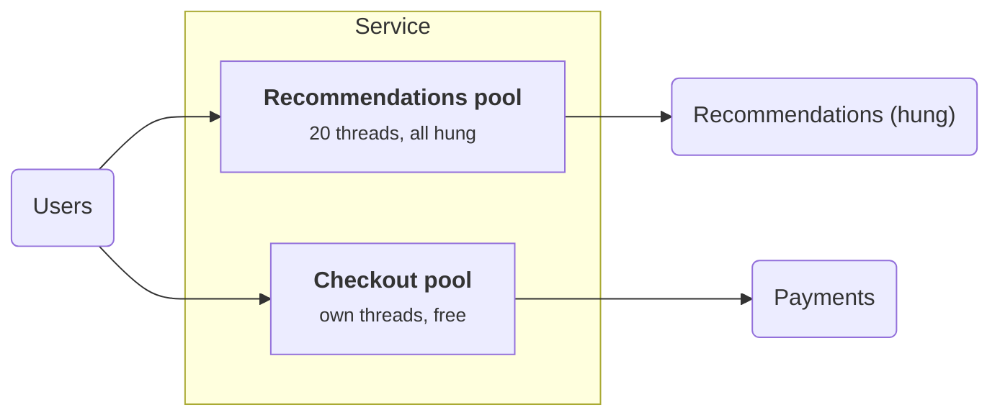
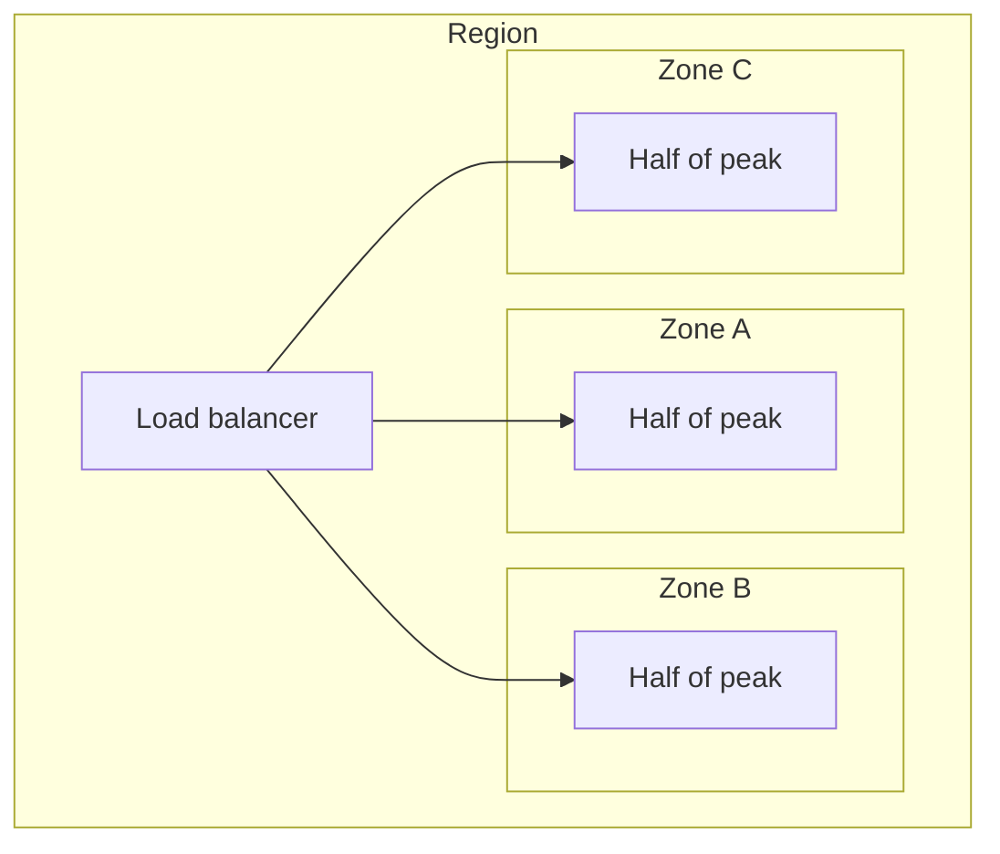
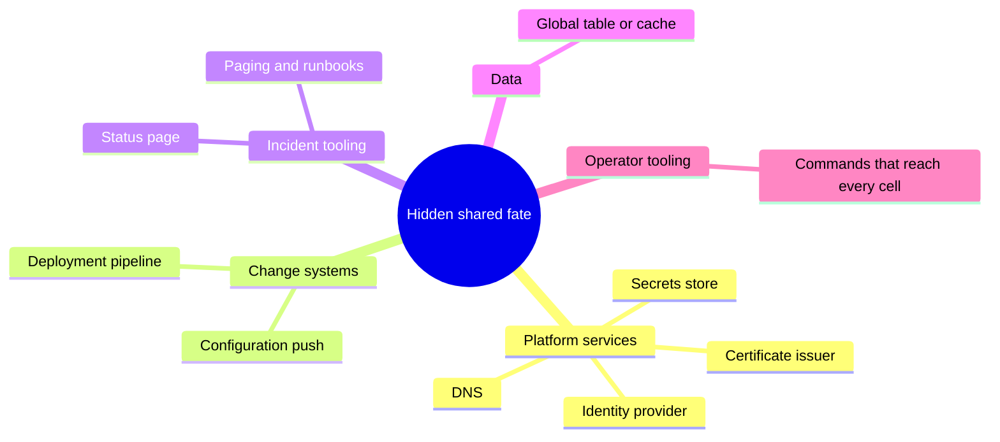

+++
title = 'Blast radius and cells'
description = 'You cannot prevent every failure, but you can choose how much of the system each one takes down. Bulkheads, cells, and shuffle sharding bound the blast radius; static stability keeps the data plane running when the control plane fails.'
question = 'When something breaks, how do you make sure it takes down a small part of the system instead of all of it?'
weight = 5
difficulty = 3
prerequisites = ['/notes/systems-design/failure-modes/03-circuit-breakers-and-deadlines', '/notes/systems-design/failure-modes/04-overload-and-backpressure']
date = 2026-09-28
lastmod = 2026-10-30
verified = 2026-09-28
+++

## The idea in one minute

The earlier lessons in this module make components react well to failure. This
one asks a different question: **when a failure gets through anyway, how much
does it take with it?** A bad deploy, a poison request that crashes every
server it touches, a tenant who sends ten times their usual load, an operator
typo: if every customer shares every server, every one of these is a total
outage.

The **blast radius** of a failure is the fraction of customers or requests it
affects. Four techniques bound it. **Bulkheads** give each workload its own
resources so one cannot exhaust another's. **Cells** split the whole service
into independent copies, each serving a slice of customers. **Shuffle
sharding** gives each customer a random small set of workers so that two
customers almost never share the same set. **Static stability** means the
system keeps serving with what it already has when the parts that change it,
the control plane, are down. The consequence to act on: **for each shared
component, write down what fraction of customers fail when it fails, and
design until no single fault takes everyone**.

## A picture

```mermaid {title="A thin router sends each customer to one full-stack cell"}
flowchart TB
  U["<b>Clients</b>"] --> R["<b>Cell router</b><br/><small>customer → cell;<br/>as thin as possible</small>"]
  R --> C1["<b>Cell 1</b><br/><small>full stack:<br/>API, workers, data</small>"]
  R --> C2["<b>Cell 2</b><br/><small>full stack</small>"]
  R --> C3["<b>Cell 3</b><br/><small>full stack</small>"]
  CP["<b>Control plane</b><br/><small>placement, config,<br/>provisioning</small>"] -.->|"pushes config;<br/>not on request path"| R
  CP -.-> C1
  CP -.-> C2
  CP -.-> C3
  class U neutral
  class R queue
  class C1,C3 good
  class C2 warn
  class CP memory
```

A failure inside cell 2 affects only the customers mapped to cell 2. The router
and the control plane are the remaining shared parts, so both are kept small,
and the request path does not depend on the control plane being up.

## How it really works

### Bulkheads

A ship's hull is divided into watertight compartments so that one breach floods
one compartment, not the ship. Nygard's *Release It!* borrows the name for
software: partition resources so that a failure in one partition cannot
consume the others. The resources are the ones that run out:

- **Thread and connection pools per dependency.** If calls to the
  recommendations service have their own pool of 20 threads, a hang there
  fills those 20 and nothing else; checkout keeps its threads.
- **Separate fleets per workload class.** Interactive API traffic and batch
  exports on different instances, so a large export cannot starve requests
  with a human waiting.
- **Per-tenant quotas** on concurrency, queue slots, and storage, so one tenant
  cannot fill a shared queue.

Compare the two pools: the hang fills the recommendations compartment and
stops there, while checkout keeps its own threads.



Bulkheads trade efficiency for isolation: capacity reserved for one partition
sits idle while another is overloaded. The design choice is how much sharing to
give up, and where.

### Cells

A **cell** is a complete, independent instance of a service (its API servers,
workers, caches, and data stores) serving a fixed subset of customers. A thin
**routing layer** maps each request to its cell, usually by customer or tenant
ID. AWS describes this pattern in its whitepaper on cell-based architecture,
and uses it widely in its own services.

What cells give you:

- **Bounded blast radius.** A failure inside a cell, whether a corrupted
  database, a bad deploy, or a poison workload, affects only that cell's
  customers. With 20 cells of equal size, a single-cell failure affects about 5%.
- **Bounded size.** Each cell has a maximum size that was load-tested. Growth
  means adding cells, not making one cell bigger, so the system never runs at a
  scale nobody has tested.
- **Safer change.** Deploy to one cell, watch it, then proceed cell by cell. A
  bad change is caught while it affects one cell's customers. The
  [safe change](/notes/systems-design/reliability-in-production/03-safe-change/)
  lesson covers progressive rollout in detail.

What cells cost:

- **The router is shared.** It must be simpler and more reliable than anything
  behind it: a lookup in a mapping table, no business logic, no calls to
  dependencies on the request path.
- **Cross-cell operations are hard.** Anything that needs data from two cells,
  such as a global search or a transfer between customers in different cells,
  needs a separate path that does not reintroduce the shared fate.
- **Migration.** Moving a customer between cells (to rebalance or isolate a
  heavy one) is a data migration with all the consistency problems of
  replication.
- **Hot customers.** A customer larger than a cell cannot be served by one. They
  need a dedicated cell or a design that splits them.

### Shuffle sharding

Cells and fixed shards divide customers into groups that share fate. Shuffle
sharding, described by Colm MacCárthaigh in the Amazon Builders' Library, makes
the groups overlap in a way that **almost no two customers share fate
entirely**.

Take 8 workers. With fixed sharding into 4 pairs, each customer gets one pair,
and a poison customer that crashes its pair takes down every other customer on
that pair: a quarter of everyone. With shuffle sharding, each customer gets
**a random pair** of the 8 workers. There are C(8, 2) = 28 possible pairs, so
the chance that another customer has exactly the same pair as the poison
customer is 1 in 28, about 3.6%. Customers who share one worker with the
poison customer lose that worker but can still use their other one, provided
their client retries on another worker in its shard.

Look at three tenants on the same 8 workers: only a tenant whose pair is
exactly the poison pair goes down, and tenant A survives on its other worker.

```mermaid {title="Shuffle sharding: overlap with the poison tenant is usually partial"}
flowchart LR
  P("Poison tenant")
  A("Tenant A")
  B("Tenant B")
  subgraph W["8 workers"]
    W1["W1"]
    W3["W3 crashed"]
    W5["W5"]
    W6["W6 crashed"]
    W8["W8"]
  end
  P --> W3
  P --> W6
  A --> W3
  A -->|"retry here"| W5
  B --> W1
  B --> W8
  class W3,W6 warn
  class W1,W5,W8 good
```

The numbers grow quickly with pool size. With 100 workers and shards of 5,
there are about 75 million possible shards. The article's best-known example
is Amazon Route 53, which assigns each hosted zone a set of four virtual name
servers out of 2,048; C(2048, 4) is about 730 billion. An attack that takes out
one customer's four name servers leaves practically every other customer with
at least one of theirs.

For the 8-worker example, the exact split of other tenants by how many workers
they share with the poison tenant:

```mermaid {title="8 workers, shards of 2: share of tenants by overlap with the poison shard (%)"}
xychart-beta
  x-axis ["share 0 workers", "share 1 worker", "share both"]
  y-axis "Tenants (%)" 0 --> 60
  bar [53.6, 42.9, 3.6]
```

Shuffle sharding requires three things:

1. **A fault-tolerant client.** The customer's client, resolver, or load
   balancer must try another worker in the shard when one fails. Without retry
   across the shard, partial overlap is as bad as full overlap.
2. **Stateless or replicated workers.** Any worker in a shard must be able to
   serve any of that shard's customers.
3. **A failure that is confined to what the bad customer touches.** It works
   for poison requests, per-customer overload, and targeted attacks. It does not
   help against a bad deploy that reaches every worker, which is why it is
   combined with cells and progressive rollout.

### Static stability

Most systems have two halves. The **data plane** serves requests: it routes
packets, answers queries, runs the workload. The **control plane** changes the
data plane: it launches instances, updates routing tables, rotates
certificates, and pushes configuration. Control planes are usually more
complex, change more often, and are less available than the data planes they
manage.

A system is **statically stable** if the data plane keeps working when the
control plane is down, and if it does not need to *change* in order to survive
a failure. The Builders' Library article "Static stability using Availability
Zones" by Becky Weiss and Mike Furr describes the canonical example: a service
running in three Availability Zones that provisions enough capacity in each so
that losing one zone leaves enough capacity in the other two. Recovery from a
zone failure then requires no new instances, so it does not depend on the
instance-launching control plane, which may itself be impaired by the event
that took the zone out.

The deployment looks like this: each zone already runs half of peak, so any
two zones carry the whole load with no launches needed.



The arithmetic is short. With `n` zones and peak load `L`, surviving one zone
loss without scaling means each zone must handle `L / (n − 1)`, for a total of
`n / (n − 1) × L`: 150% of peak with three zones, 133% with four. Static
stability is paid for in idle capacity.

The overprovisioning `n / (n − 1)` falls quickly as zones are added:

```mermaid {title="Total capacity needed to survive one zone loss, as % of peak"}
xychart-beta
  x-axis "Zones" ["2", "3", "4", "6"]
  y-axis "Capacity (% of peak)" 100 --> 200
  bar [200, 150, 133, 120]
```

The same principle applies everywhere a data plane consumes a control plane's
output:

- **Keep the last known good configuration.** Proxies and agents that fetch
  config from a central service should keep serving with the last valid
  version when it is unreachable, instead of failing closed. Envoy, for
  example, keeps its current configuration when its xDS management server is
  unreachable.
- **Do not put the control plane on the request path.** A request that calls
  a central service to look up its route, its quota, or its credentials on
  every call has made that service part of every request's blast radius. Cache
  locally with expiry long enough to ride out an outage.
- **Credentials and certificates need slack.** If certificates last 24 hours and
  the issuing service is down for 25, every service fails at once. Renew well
  before expiry, so the issuer can be down for a meaningful fraction of the
  lifetime.
- **Push, do not pull, on the critical path.** A data plane that holds its
  state locally and receives updates degrades to "stale"; one that pulls on
  demand degrades to "down".

Watch the proxy during a control-plane outage: updates stop, requests do not.

```mermaid {title="Last known good configuration keeps the data plane serving"}
sequenceDiagram
  autonumber
  participant CP as Control plane
  participant PX as Proxy (data plane)
  participant C as Client
  CP->>PX: push config v7
  Note over PX: keep v7 as last known good
  rect rgb(249, 226, 233)
    Note over CP: control plane down
    PX--xCP: fetch update fails
    C->>PX: request
    PX-->>C: served with v7, stale but up
  end
  CP->>PX: push config v8 after recovery
```

### Hidden shared dependencies

Blast radius is defined by **shared fate**, and shared fate hides. The AWS
summary of the February 2017 Amazon S3 disruption in US-EAST-1 is a widely
read example. An operator command intended to remove a small number of servers
had an input entered incorrectly and removed a larger set, including servers
supporting two S3 subsystems that then needed a full restart. Many services
that depended on S3 in that region were affected, and the AWS Service Health
Dashboard itself could not be updated for a time because it depended on S3.
Among the follow-up actions AWS listed were making the tool remove capacity
more slowly with safeguards against going below minimum capacity, and
continuing to partition services into smaller cells.

Look for these shared dependencies in your own design:

| Shared thing | Why it escapes the cells |
| --- | --- |
| DNS, identity provider, secrets store, certificate issuer | Every cell calls it, often on startup or per request |
| Deployment pipeline and configuration system | One bad push reaches every cell at once unless staged |
| Status page, paging, and runbooks | Hosted on the infrastructure they are meant to report on |
| A "global" table or cache | Added for one cross-cell feature, then read by everything |
| Operator tooling | One command can address every cell unless scoped |

Grouped by kind, the same list is a checklist to walk for any design:



> [!IMPORTANT]
> Isolation is a property of the **whole path**, including deploys, config, and
> operator tools. Cells that share a configuration push, a credential issuer, or
> an admin command are one cell for those failures.

For multi-tenant systems the same reasoning protects confidentiality, not only
availability; the [tenant isolation](/notes/application-security/authorization/03-tenant-isolation/)
lesson covers that side, and the
[multi-tenant inference gateway](/notes/systems-design/worked-designs/04-a-multi-tenant-inference-gateway/)
design combines both.

## Code

The program places 10,000 tenants on a pool of workers in three ways: every
tenant on every worker, fixed cells, and shuffle shards of the same size. One
tenant is poison and crashes every worker in its shard. A tenant is "down" if
all its workers are crashed and "degraded" if only some are, assuming its
client retries on a surviving worker. It then prints the exact overlap
probabilities and the shard counts behind them.

```python {title="shuffle.py"}
"""shuffle.py: the blast radius of a poison tenant under three placements.

A poison tenant sends requests that crash any worker that handles them.
Each healthy tenant is "down" if every worker it can use is crashed, and
"degraded" if some are. Clients retry on another worker in their shard.
Standard library only; runs offline.
"""

from __future__ import annotations

import random
from math import comb

TENANTS = 10_000


def no_isolation(rng: random.Random, workers: int, k: int) -> list[tuple[int, ...]]:
    return [tuple(range(workers))] * TENANTS          # everyone uses every worker


def fixed_cells(rng: random.Random, workers: int, k: int) -> list[tuple[int, ...]]:
    cells = [tuple(range(i, i + k)) for i in range(0, workers, k)]
    return [rng.choice(cells) for _ in range(TENANTS)]  # one cell per tenant


def shuffle_shards(rng: random.Random, workers: int, k: int) -> list[tuple[int, ...]]:
    return [tuple(sorted(rng.sample(range(workers), k))) for _ in range(TENANTS)]


def blast(placement, workers: int, k: int, seed: int = 1) -> tuple[float, float]:
    rng = random.Random(seed)
    shards = placement(rng, workers, k)
    poison, others = shards[0], shards[1:]
    crashed = set(poison)                 # the poison tenant crashes its whole shard
    down = sum(1 for s in others if crashed.issuperset(s))
    degraded = sum(1 for s in others if crashed.intersection(s)) - down
    return 100 * down / len(others), 100 * degraded / len(others)


def overlap_table(workers: int, k: int) -> None:
    """Exact chance that a random other shard shares j workers with the poison
    tenant's shard (the hypergeometric distribution)."""
    total = comb(workers, k)
    print(f"\n{workers} workers, shards of {k}: {total:,} possible shards")
    for j in range(k + 1):
        ways = comb(k, j) * comb(workers - k, k - j)
        rare = f"   (1 in {total / ways:,.0f})" if ways / total < 0.05 else ""
        print(f"  share {j} of {k} workers: {ways / total:9.4%}{rare}")


def main() -> None:
    print(f"{TENANTS:,} tenants, one of them poison; share of the others affected")
    print(f"{'workers':>7} {'per tenant':>10}  {'placement':<16} {'down':>8} {'degraded':>9}")
    for workers, k in ((8, 2), (100, 5)):
        for name, placement in [("no isolation", no_isolation),
                                ("fixed cells", fixed_cells),
                                ("shuffle shards", shuffle_shards)]:
            down, degraded = blast(placement, workers, k)
            print(f"{workers:>7} {k:>10}  {name:<16} {down:7.2f}% {degraded:8.2f}%")

    overlap_table(8, 2)
    overlap_table(100, 5)

    print("\nshards that fully overlap one tenant's, out of all possible shards:")
    for n, size in ((8, 2), (100, 5), (2048, 4)):
        print(f"  C({n}, {size}) = {comb(n, size):>18,}  ->  1 in {comb(n, size):,}")


if __name__ == "__main__":
    main()
```

Run it with `python3 shuffle.py`:

```text
10,000 tenants, one of them poison; share of the others affected
workers per tenant  placement            down  degraded
      8          2  no isolation      100.00%     0.00%
      8          2  fixed cells        25.84%     0.00%
      8          2  shuffle shards      3.32%    43.39%
    100          5  no isolation      100.00%     0.00%
    100          5  fixed cells         5.16%     0.00%
    100          5  shuffle shards      0.00%    23.43%

8 workers, shards of 2: 28 possible shards
  share 0 of 2 workers:  53.5714%
  share 1 of 2 workers:  42.8571%
  share 2 of 2 workers:   3.5714%   (1 in 28)

100 workers, shards of 5: 75,287,520 possible shards
  share 0 of 5 workers:  76.9590%
  share 1 of 5 workers:  21.1426%
  share 2 of 5 workers:   1.8385%   (1 in 54)
  share 3 of 5 workers:   0.0593%   (1 in 1,686)
  share 4 of 5 workers:   0.0006%   (1 in 158,500)
  share 5 of 5 workers:   0.0000%   (1 in 75,287,520)

shards that fully overlap one tenant's, out of all possible shards:
  C(8, 2) =                 28  ->  1 in 28
  C(100, 5) =         75,287,520  ->  1 in 75,287,520
  C(2048, 4) =    730,862,190,080  ->  1 in 730,862,190,080
```

With no isolation, one poison tenant takes down everyone. Fixed cells of two
take down about a quarter, as expected for four cells. Shuffle sharding with
the same number of workers per tenant takes down 3.32% (the simulated estimate
of 1 in 28), and with 100 workers and shards of 5, **no** other tenant out of
10,000 is fully down, while about 23% lose one worker and keep running on the
rest. The overlap table shows why: the chance of a full overlap falls from 1 in
28 to 1 in 75 million. The price is in the "degraded" column. Many more tenants
are touched a little, which is fine only if their clients retry across the
shard.

## Where it breaks

- **Shuffle sharding needs retries across the shard.** A client that sticks to
  one worker turns "degraded" into "down". The calculation assumes the failure
  is confined to the poison tenant's workers; a failure that spreads (a crashed
  worker's load shifting onto its neighbors until they fall too) is not modeled.
- **Cells do not stop correlated changes.** A configuration push, a library
  upgrade, or a certificate expiry that reaches every cell at the same time
  takes them all. Stage changes by cell, and stagger expiry times.
- **The router is the new single point of failure.** If it holds business logic,
  calls dependencies, or shares a database with the cells, it brings the shared
  fate back. Keep it a static mapping with a local copy.
- **Static stability costs capacity.** Running 150% of peak is expensive, and
  teams under cost pressure remove the headroom. Then the first zone failure
  needs an auto-scaling event at the worst possible time.
- **Last known good can be last known bad.** Keeping stale config through a
  control-plane outage is right; keeping a configuration that is causing the
  outage is not. Data planes need a way to fall back to an older known-good
  version, not only the latest.
- **The model counts tenants, not load.** A poison tenant that is also the
  largest customer may represent a large share of revenue on its own. Weight
  blast radius by what matters.

## Remember this

- Blast radius is the fraction of customers a fault takes down; design it on
  purpose.
- Bulkheads separate pools so one workload cannot exhaust another's resources.
- Cells are independent full copies behind a thin router; deploy and fail one
  cell at a time.
- Shuffle sharding makes full overlap rare: 1 in C(n, k), provided clients retry
  across the shard.
- Static stability: the data plane keeps serving, without changes, when the
  control plane is down. Provision `n / (n − 1)` for zone loss.
- Hunt for hidden shared fate: config pushes, identity, DNS, tooling, status
  pages.

## Try it

1. Run `shuffle.py`. Add a second poison tenant (use `shards[1]` as well).
   How many tenants are fully down under each placement now, and why does
   shuffle sharding degrade more gracefully than fixed cells?
2. Add a "cells of shuffle shards" placement: 4 cells of 25 workers, each
   tenant shuffle-sharded within one cell. Compare it with plain shuffle
   sharding when a bad deploy takes down one whole cell.
3. Compute the capacity needed for static stability with two, three, four, and
   six zones. At which point does the extra zone pay for itself in reduced
   overprovisioning?
4. Draw your service's request path and mark each component as data plane or
   control plane. Which control-plane components are called on every request?
5. List every thing all your cells (or all your instances) share. For each,
   write what fraction of customers fail when it fails.

## Check yourself

1. With 8 workers and shards of 2, why is shuffle sharding's blast radius
   smaller than fixed sharding's?

   
   Fixed sharding has only 4 shards, so the poison tenant's shard is shared by
   a quarter of all tenants. Shuffle sharding draws from 28 possible pairs, so
   only about 1 in 28 tenants has exactly the same pair. Others share at most
   one worker and keep the other, if their client retries.
   

2. What must be true of clients for shuffle sharding to work?

   
   They must be fault tolerant across their shard: when a worker fails or
   times out, they retry on another worker in the same shard. Without that,
   losing any one worker in the shard is an outage for that customer, and
   partial overlap is as harmful as full overlap.
   

3. What makes a design statically stable?

   
   The data plane keeps serving through a failure without needing to change,
   and without the control plane. For example, enough capacity is already
   running in the surviving zones, and proxies keep their last valid
   configuration, so recovery does not depend on launching instances or
   pushing config during the incident.
   

4. Why must a cell router be simpler than the cells behind it?

   
   It is the one component every request passes through, so its failure is a
   total outage. Any logic, dependency, or shared database it uses adds back the
   shared fate that cells were meant to remove.
   

5. Your service has three zones and peaks at 9,000 requests per second. How
   much capacity does each zone need to survive losing one zone without
   scaling?

   
   The two surviving zones must carry 9,000 between them, so each zone needs
   4,500 requests per second, for a total of 13,500, or 150% of peak.
   

## Sources

- C. MacCárthaigh, [Workload isolation using shuffle-sharding](https://aws.amazon.com/builders-library/workload-isolation-using-shuffle-sharding/), Amazon Builders' Library.
- B. Weiss, M. Furr, [Static stability using Availability Zones](https://aws.amazon.com/builders-library/static-stability-using-availability-zones/), Amazon Builders' Library.
- Amazon Web Services, [Reducing the Scope of Impact with Cell-Based Architecture](https://docs.aws.amazon.com/wellarchitected/latest/reducing-scope-of-impact-with-cell-based-architecture/reducing-scope-of-impact-with-cell-based-architecture.html), AWS Well-Architected whitepaper.
- Amazon Web Services, [AWS Fault Isolation Boundaries](https://docs.aws.amazon.com/whitepapers/latest/aws-fault-isolation-boundaries/abstract-and-introduction.html), AWS whitepaper.
- Amazon Web Services, [Summary of the Amazon S3 Service Disruption in the Northern Virginia (US-EAST-1) Region](https://aws.amazon.com/message/41926/), March 2017.
- M. T. Nygard, *Release It! Design and Deploy Production-Ready Software*, 2nd edition, Pragmatic Bookshelf, 2018 (bulkheads).
- Envoy project, [xDS configuration API overview](https://www.envoyproxy.io/docs/envoy/latest/intro/arch_overview/operations/dynamic_configuration).
