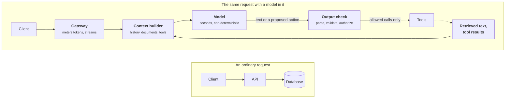

+++
title = 'What changes with a model'
description = 'A model in the request path is slow, metered by the token, probabilistic, stateless, and steerable by its input. Each property breaks an assumption of ordinary service design and needs a named answer.'
question = 'What is different about a system with a language model in it, and what stays the same?'
weight = 1
difficulty = 1
prerequisites = []
date = 2026-10-30T09:05:00Z
lastmod = 2026-10-30T09:05:00Z
verified = 2026-10-30
+++

## The idea in one minute

Put a language model in the request path and five assumptions of ordinary
service design stop holding. The component is **slow** (seconds, streamed),
**metered by size** (tokens, not requests), **probabilistic** (the same input
can give a different output, and some outputs are wrong), **stateless but
context-hungry** (it remembers nothing between calls, so everything it needs is
resent every time), and **steerable by its input** (text it reads can change
what it does).

None of these is exotic on its own. Slow dependencies, metered APIs, and
untrusted input all exist elsewhere. What is new is having all five in one
component that also sits at the center of the product. The consequence to act
on: **an AI design is an ordinary design plus an explicit answer to each of the
five**, and a review that cannot point to the answer for one of them has found
a gap.

## A picture



Three boxes become six or seven, and one arrow now points backwards: the
model's output can cause a tool call whose result becomes the next input. Each
new box exists because of one of the five properties.

## How it really works

### Slow: latency has a shape

A database query returns in milliseconds, all at once. A model call returns a
stream, and two numbers describe it:

- **Time to first token (TTFT).** Queueing plus **prefill**: the model reads the
  whole prompt in one parallel pass, which is compute-bound, so TTFT grows with
  input length.
- **Time per output token (TPOT).** Each further token needs one sequential
  **decode** step that rereads the model weights and the cached attention state
  from memory. Decode is bound by memory bandwidth, so TPOT depends on the
  model size, the hardware, and how many other requests share the batch.

```text
total ≈ TTFT + output_tokens × TPOT

a chat answer      0.4 s + 300 × 0.02 s  ≈  6.4 s
a routing decision 0.3 s +  10 × 0.02 s  ≈  0.5 s
an agent task      30 calls × ~4 s       ≈  2 min, before any tool runs
```

The design consequences follow directly. Responses stream, so the client sees
progress after TTFT, not after the total. Timeouts are tens of seconds, which
means each request holds a connection, a worker, and accelerator memory for a
long time; **concurrency limits matter more than request rate**, as in
[overload and backpressure](/notes/systems-design/failure-modes/04-overload-and-backpressure/).
A long agent task is a background job with durable state, not an HTTP request.
And because output length drives latency, asking for a shorter answer is often
the cheapest latency fix available.

### Metered by size: the token is the unit

Cost, latency, rate limits, and capacity are all proportional to **tokens**, and
one request can be 50 tokens or 500,000. A design that counts requests is wrong
by orders of magnitude in both directions.

| Ordinary design counts | An AI design counts |
| --- | --- |
| Requests per second | Input tokens/s and output tokens/s, separately |
| Rate limit: requests per minute | Tokens per minute, concurrent streams, a spend budget |
| Payload size, rarely | Context length, on every call |
| Cost per request, roughly constant | Cost per request varying 1,000-fold or more |

Output tokens cost several times more than input tokens, on hosted APIs and on
your own hardware alike, because each output token is a sequential decode step
while input is processed in parallel. Input that repeats exactly from the start
of the prompt can be served from a **prefix cache** at a fraction of the price,
which makes prompt layout a cost decision (stable content first). The next
module works through this arithmetic in
[tokens, context, and cost](/notes/systems-design/model-interfaces/01-tokens-context-and-cost/).

### Probabilistic: correctness becomes a rate

The same prompt can produce different text. Sampling at a temperature above
zero is random by design, and even greedy decoding is not guaranteed to repeat:
inference servers batch requests together, and floating-point sums computed in
a different order (because the batch size changed) can flip a close choice
between two tokens. Thinking Machines Lab traced this to kernels that are not
**batch-invariant** and showed it can be removed, at a throughput cost. Hosted
models add a further source: the provider may update the model behind an alias.

Three consequences:

- **Tests become evaluations.** A unit test asserts one output. An evaluation
  measures a **pass rate** over a dataset, and a rate measured on 20 cases is
  nearly meaningless. The program below shows a model with a true 90% pass rate
  measured anywhere from 76% to 99% on a 20-case set.
- **Errors compound.** If each step of a pipeline or agent is right 95% of the
  time and steps fail independently, ten steps are all right only 60% of the
  time. For an agent that runs the same task repeatedly, the bar is stricter:
  the τ-bench authors measure **pass^k**, the chance that all *k* independent
  trials succeed, which falls much faster than the single-trial pass rate.
- **Outputs are validated, not trusted.** Anything a program consumes is parsed
  against a schema, and the design says what happens when parsing fails.
  Retrying a failed parse usually works; it also adds a full model call to the
  tail latency of that request.

A model upgrade, a prompt edit, or a change of sampling settings is a behavior
change even when no code changed. They are versioned and released like code,
with an evaluation as the gate; see
[prompts as versioned code](/notes/systems-design/model-interfaces/03-prompts-as-versioned-code/).

### Stateless but context-hungry: you carry the memory

The model keeps nothing between calls. Everything it should know (instructions,
the conversation, retrieved documents, tool definitions, tool results) is
assembled into the **context window** on every call. That makes the **context
builder** the real core of the application: the model can only be as good as
what it is shown. It also means state lives in stores you control, never in the
model process, so any replica, or a different model, can serve the next call.

The window is finite, and every token in it costs money and [prefill](/notes/inference-engineering/inference-mechanics/01-prefill-and-decode/) time on
every call. A conversation that resends its whole history grows its per-call
input linearly with turns, so its total input grows with the square of the
number of turns. Context is therefore a budget to allocate, not a bucket to
fill, and more context is not reliably better: models use information in the
middle of a long context less reliably than at its ends.

### Steerable by its input: the model is not a trust boundary

A model does not separate instructions from data. Text arriving in a retrieved
document, a web page, an email, or a tool result can redirect it. This is
**prompt injection**, and no known filter or instruction stops it reliably
(see [prompt injection](/notes/ai-security-engineering/how-attacks-work/01-prompt-injection/)).

> [!IMPORTANT]
> Treat model output as untrusted input. What a model's output is allowed to
> cause must be limited by the system around it (credentials, tool allowlists,
> argument validation, approval for irreversible actions), never by
> instructions inside the prompt.

That is why the picture has an output check between the model and its tools,
and why retrieved text is drawn as untrusted.

### What does not change

Load balancing, timeouts, retries with backoff, idempotency, queues, caching,
replication, observability, least privilege. Every one of them is still needed,
and many AI incidents are ordinary incidents: a dependency got slow, a queue
filled, a deploy was not rolled back, a retry storm amplified a brief outage.
The model adds to classic design; it does not replace it.

### The three shapes of AI system

| Shape | What the model does | Example | Hard part |
| --- | --- | --- | --- |
| **Single call** | Transforms input to output once | Classify, extract, summarize | Cost and quality at volume |
| **Retrieval-augmented** | Answers from context you fetch | Assistant over private documents | What goes into the context |
| **Agentic** | Chooses actions in a loop until done | Coding or support agent | State, budgets, permissions, long-running work |

Design for the simplest shape that solves the problem. Each step up multiplies
calls per request, latency, cost, and the number of places untrusted text
enters the context.

## Code

The program simulates a model call whose latency is `TTFT + tokens × TPOT`,
whose output parses against a schema 92% of the time, and whose parsed answers
are right 95% of the time. It shows how wide a pass-rate estimate is at
different eval sizes (95% Wilson score interval), how per-step accuracy
compounds, and what a validate-and-retry loop buys in accuracy and costs in
calls and tail latency.

```python {title="model_component.py"}
"""model_component.py: what changes when a component is slow, metered, and probabilistic.

A simulated model call: latency = TTFT + output_tokens x TPOT, cost by tokens, and a
fixed chance of a wrong answer. Shows (1) why a pass rate needs a sample size,
(2) how per-step accuracy compounds, (3) what a validate-and-retry loop buys and costs.
Standard library only; every number is simulated.
"""

from __future__ import annotations

import math
import random
from dataclasses import dataclass


@dataclass
class Call:
    ok: bool          # was the answer right?
    parse_ok: bool    # did the output parse against the schema?
    latency_s: float
    in_tok: int
    out_tok: int


def model_call(rng: random.Random, p_right: float, p_parse: float, in_tok: int) -> Call:
    out_tok = max(20, int(rng.gauss(300, 80)))
    ttft = 0.15 + in_tok * 0.00012            # grows with input (prefill)
    tpot = rng.uniform(0.015, 0.03)           # per output token (decode)
    parse_ok = rng.random() < p_parse
    return Call(parse_ok and rng.random() < p_right, parse_ok, ttft + out_tok * tpot, in_tok, out_tok)


def wilson(passes: int, n: int, z: float = 1.96) -> tuple[float, float]:
    """95% Wilson score interval for a binomial proportion."""
    p = passes / n
    centre = (p + z * z / (2 * n)) / (1 + z * z / n)
    half = z * math.sqrt(p * (1 - p) / n + z * z / (4 * n * n)) / (1 + z * z / n)
    return centre - half, centre + half


def main() -> None:
    rng = random.Random(7)
    true_rate = 0.90
    print("1) The same model, measured on eval sets of different sizes (true pass rate 90%)")
    print(f"   {'cases':>6} {'measured':>9} {'95% interval':>17} {'width':>7}")
    for n in (20, 50, 200, 1000, 5000):
        passes = sum(model_call(rng, true_rate, 1.0, 2000).ok for _ in range(n))
        lo, hi = wilson(passes, n)
        print(f"   {n:>6} {passes / n:>9.1%} {f'{lo:.1%} - {hi:.1%}':>17} {hi - lo:>7.1%}")

    print("\n2) Steps in a row, each right 95% of the time")
    print(f"   {'steps':>6} {'all right':>10} {'pass^3 (3 runs all right)':>27}")
    for k in (1, 3, 5, 10, 20, 50):
        p = 0.95 ** k
        print(f"   {k:>6} {p:>10.1%} {p ** 3:>27.1%}")

    print("\n3) Validate and retry: 92% of outputs parse, 95% of parsed outputs are right")
    n = 20000
    for max_tries in (1, 2, 3):
        right = parsed = calls = 0
        lat: list[float] = []
        for _ in range(n):
            t = 0.0
            for attempt in range(max_tries):
                c = model_call(rng, 0.95, 0.92, 2000)
                calls += 1
                t += c.latency_s
                if c.parse_ok:
                    parsed += 1
                    right += c.ok
                    break
            lat.append(t)
        lat.sort()
        print(f"   tries<={max_tries}: parsed {parsed / n:6.1%}  right {right / n:6.1%}  "
              f"calls/request {calls / n:4.2f}  p50 {lat[n // 2]:4.1f} s  p99 {lat[int(n * 0.99)]:4.1f} s")


if __name__ == "__main__":
    main()
```

Run it with `python3 model_component.py`:

```text
1) The same model, measured on eval sets of different sizes (true pass rate 90%)
    cases  measured      95% interval   width
       20     95.0%     76.4% - 99.1%   22.7%
       50     88.0%     76.2% - 94.4%   18.2%
      200     87.5%     82.2% - 91.4%    9.2%
     1000     89.5%     87.4% - 91.3%    3.8%
     5000     89.8%     88.9% - 90.6%    1.7%

2) Steps in a row, each right 95% of the time
    steps  all right   pass^3 (3 runs all right)
        1      95.0%                       85.7%
        3      85.7%                       63.0%
        5      77.4%                       46.3%
       10      59.9%                       21.5%
       20      35.8%                        4.6%
       50       7.7%                        0.0%

3) Validate and retry: 92% of outputs parse, 95% of parsed outputs are right
   tries<=1: parsed  92.0%  right  87.5%  calls/request 1.00  p50  7.0 s  p99 12.9 s
   tries<=2: parsed  99.3%  right  94.0%  calls/request 1.08  p50  7.2 s  p99 17.7 s
   tries<=3: parsed  99.9%  right  95.0%  calls/request 1.09  p50  7.2 s  p99 19.4 s
```

Read the three parts in order. A 20-case eval of a 90% model reported 95%, and
its interval spans 23 points; at 1,000 cases the interval is under 4 points
wide. Compounding is harsh: 20 steps at 95% each finish cleanly about a third of
the time, and requiring three repeated runs to all succeed takes that below 5%.
Validate-and-retry raises the right-answer rate from 87.5% to 95.0% for only 9%
more calls on average, but the slowest requests are the ones that retried, so
p99 latency rises from about 13 s to 19 s while p50 barely moves.

## Where it breaks

- **Independence is an assumption.** The compounding table assumes steps fail
  independently. Real failures correlate: a confusing input makes several steps
  fail together, and an agent can also recover from a bad step. Measure
  end-to-end task success; use the product rule only to see the shape.
- **Retries do not fix wrong answers.** The retry loop above only retries
  parse failures. An output that parses and is wrong passes straight through;
  catching it needs a semantic check, a second model, or a human.
- **Determinism is achievable, at a price.** Batch-invariant kernels, fixed
  seeds, and pinned model snapshots make greedy decoding repeatable on your own
  servers. A hosted API usually cannot promise this, so tests that compare exact
  strings are fragile there.
- **The five properties are not equally weighted.** For a batch summarization
  job, latency barely matters and cost dominates; for an agent with write access,
  the steerability row dominates everything else. Rank them per design.

## Remember this

- Five properties: slow, token-metered, probabilistic, context-hungry,
  steerable by input. Each needs a named answer.
- Latency is `TTFT + tokens × TPOT`; prefill grows with input, decode with
  output.
- Count input and output tokens separately; never count only requests.
- Correctness is a measured rate with an interval, guarded by evaluations.
- The context builder decides what the model knows; the system around it
  decides what it may do.
- Ordinary distributed-systems design still applies in full.

## Try it

1. Run `model_component.py`. Raise `p_parse` to 0.99 in part 3. How much of the
   p99 increase from retries disappears, and what does that say about investing
   in structured output?
2. Change part 2 to use 99% per step. How many steps can an agent take before
   its chance of an all-correct run falls below 80%?
3. Take an endpoint you maintain. If a model call of 2,000 input and 400 output
   tokens were added, with TTFT 0.5 s and TPOT 25 ms, what is its new p50? Which
   timeout in the call chain breaks first?
4. For a product you use, decide which of the three shapes it is and why it
   could not be the simpler one.

## Check yourself

1. Why is a requests-per-minute limit the wrong primary control for a model
   endpoint?

   
   Requests vary in size by orders of magnitude. One request with a
   200,000-token context consumes as much accelerator time and money as
   hundreds of small ones. The resource is tokens (and concurrent streams), so
   limits, quotas, and budgets are expressed in tokens per minute and
   concurrency, with a spend cap.
   

2. What are the two numbers that describe model latency, and what does each
   depend on?

   
   Time to first token, which is queueing plus prefill and grows with input
   length because prefill is compute-bound over the whole prompt; and time per
   output token, which is one sequential decode step, bound by memory bandwidth,
   and depends on model size, hardware, and batch occupancy. Total latency is
   roughly TTFT plus output tokens times TPOT.
   

3. Greedy decoding at temperature 0 gives different outputs on two runs. Name
   two plausible causes.

   
   The server batched the request with different neighbors, and kernels that are
   not batch-invariant summed floating-point values in a different order,
   flipping a near-tie between two tokens. Or the hosted model behind the alias
   was updated between the runs. Other causes include a different hardware type
   or engine version.
   

4. Why can a system prompt not be the place where permissions are enforced?

   
   The system prompt is text in the same context window as untrusted text, and
   the model has no reliable way to rank one over the other. A retrieved
   document or tool result can override it. Permissions must be enforced by code
   outside the model: the credentials the tools run with, an allowlist, argument
   validation, and approval for irreversible actions.
   

5. A 50-case eval shows a new prompt at 88% against the old one's 84%. Is that
   an improvement?

   
   Not shown. The 95% interval for a proportion near 0.85 on 50 cases is roughly
   plus or minus 10 points, far wider than the 4-point difference. A paired
   comparison on the same cases is more sensitive, but 50 cases will still
   rarely resolve a 4-point change; use more cases or a paired test before
   claiming it.
   

## Sources

- H. He and Thinking Machines Lab, [Defeating Nondeterminism in LLM Inference](https://thinkingmachines.ai/blog/defeating-nondeterminism-in-llm-inference/), September 2025.
- S. Yao, N. Shinn, P. Razavi, K. Narasimhan, [τ-bench: A Benchmark for Tool-Agent-User Interaction in Real-World Domains](https://arxiv.org/abs/2406.12045), 2024 (the pass^k metric).
- N. F. Liu et al., [Lost in the Middle: How Language Models Use Long Contexts](https://arxiv.org/abs/2307.03172), *TACL* 12, 2024.
- K. Greshake et al., [Not what you've signed up for: Compromising Real-World LLM-Integrated Applications with Indirect Prompt Injection](https://arxiv.org/abs/2302.12173), AISec 2023.
- W. Kwon et al., [Efficient Memory Management for Large Language Model Serving with PagedAttention](https://arxiv.org/abs/2309.06180), SOSP 2023 (prefill, decode, and KV cache in a [serving engine](/notes/inference-engineering/serving-systems/01-anatomy-of-a-serving-engine/)).
- E. B. Wilson, "Probable Inference, the Law of Succession, and Statistical Inference", *Journal of the American Statistical Association* 22(158), 1927.
