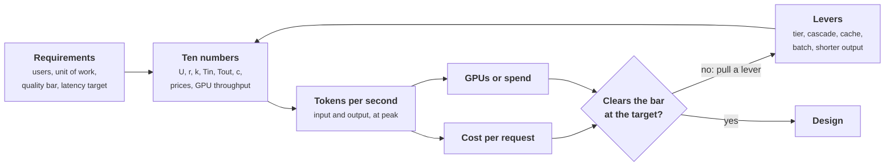

+++
title = 'Cost, latency, and quality'
description = 'Ten numbers size any AI workload in tokens per second, GPUs or spend, and cost per request. Cost, latency, and quality then trade against each other through a small set of levers, each with a measurable price.'
question = 'How do you size an AI workload before choosing anything, and which levers trade cost, latency, and quality?'
weight = 2
difficulty = 2
prerequisites = ['/notes/systems-design/how-ai-systems-differ/01-what-changes-with-a-model', '/notes/systems-design/thinking-in-invariants/03-back-of-the-envelope-capacity']
date = 2026-10-30T09:10:00Z
lastmod = 2026-10-30T09:10:00Z
verified = 2026-10-30
+++

## The idea in one minute

Before drawing boxes, turn the requirements into tokens. About ten numbers
(users at peak, requests per user, model calls per request, input and output
tokens per call, the cached share of input, and a few prices and throughputs)
multiply out to input and output tokens per second, a GPU count or a monthly
bill, and a cost per request. Those numbers decide whether the design is one API
key or a fleet of accelerators, and they often decide the architecture.

Once sized, the three quantities trade against each other. **Quality** is a
pass rate on your evaluation. **Latency** is time to first token plus output
length times time per token. **Cost** is tokens times price, or GPU-hours. The
levers that move them (model tier, routing and cascades, caching, batching,
output length, context size) each have a price you can compute. The
consequence to act on: **write down the quality bar and the latency target
before comparing costs**, then pick the cheapest design that clears both, never
the best model by default.

## A picture



The loop matters: every lever changes one of the ten numbers, and the
arithmetic is cheap enough to rerun for each option.

## How it really works

### The ten numbers

```text
1  active users at peak                    U
2  requests per user per minute            r
3  model calls per request                 k     (1 for chat, 2-5 for RAG, 10-100 for an agent)
4  input tokens per call                   Tin   (grows with context)
5  output tokens per call                  Tout
6  cached share of input                   c     (0 to ~0.9)
7  output speed per stream                 1 / TPOT
8  output tokens/s one GPU sustains        G     (for this model, engine, and latency target)
9  prices per million tokens               Pin, Pcached, Pout
10 planned occupancy                       ~0.6  (headroom for bursts and failures)
```

From which:

```text
calls/s            = U × r × k / 60
input tokens/s     = calls/s × Tin
output tokens/s    = calls/s × Tout
GPUs (self-hosted) = output tokens/s ÷ G ÷ occupancy        (then add spares)
cost per request   = k × (Tin(1 − c) Pin + Tin c Pcached + Tout Pout) / 10^6
```

Worked for a chat assistant with 2,000 users at peak, each sending one request
every two minutes, 3,000 input tokens and 350 output tokens per call, 60% of
input cached:

```text
calls/s           = 2,000 × 0.5 × 1 / 60     = 16.7
input tokens/s    = 16.7 × 3,000              = 50,000
output tokens/s   = 16.7 × 350                = 5,833
GPUs              = 5,833 / 2,500 / 0.6       ≈ 3.9   → 4, plus spares
cost per request  = (1,200 × $3 + 1,800 × $0.30 + 350 × $15) / 10^6 ≈ $0.0094
```

Three habits keep these numbers honest:

- **Measure G; do not look it up.** Output throughput per GPU depends on the
  model, the [serving engine](/notes/inference-engineering/serving-systems/01-anatomy-of-a-serving-engine/), [quantization](/notes/inference-engineering/making-it-cheaper/01-quantization/), context length, and above all the
  latency target. Larger batches raise tokens per second per GPU and also raise
  TPOT for every stream in the batch, so "throughput at a TPOT of 30 ms" and
  "maximum throughput" can differ several-fold. A load test at your prompt
  lengths gives the real figure.
- **Input dominates agents.** An agent resends its growing history on every
  step, so input per task grows with the square of the step count. Part 2 of the
  program shows a 40-step task consuming 1.49 million input tokens.
- **Size for the peak.** Internal tools often see several times their daily
  mean at the start of the working day. Capacity, rate limits, and provider
  quotas are all set by the peak.

### The latency budget of one call

Latency targets are set per stage. For a retrieval-augmented answer:

| Stage | Typical budget | What sets it |
| --- | --- | --- |
| Gateway, auth, routing | 5–20 ms | Ordinary service code |
| Query rewrite (small model) | 200–500 ms | A whole extra model call; often worth skipping |
| Hybrid retrieval | 20–100 ms | Index type and filter selectivity |
| Rerank top 50–100 | 50–200 ms | Reranker size and batch |
| Time to first token | 0.3–2 s | Prompt length, queueing, prefix-cache hits |
| Streaming the answer | 300 tokens × 20–40 ms | Model size, batch occupancy, output length |

These are planning ranges, not measurements; replace them with your own traces.
Two properties of the table drive design. TTFT is what the user feels as
"slow", so everything before the first token (rewrites, retrieval, [reranking](/notes/systems-design/retrieval/03-evaluating-retrieval/),
long uncached prompts) competes for the same budget. And the streaming term is
usually the largest, so **output length is a latency lever**: a 150-token answer
streams in half the time of a 300-token one.

### Quality is a bar, not a ranking

Quality is the pass rate on an evaluation built from real inputs, with the bar
taken from the requirement ("90% of answers rated correct", "no action without
approval"). Two consequences:

- **Set the bar before measuring.** Otherwise it drifts to wherever the
  preferred option landed.
- **Report an interval.** As the previous lesson showed, 200 cases resolve
  about ±5 points; a 2-point difference between two models needs many more
  cases or a paired comparison.

### The levers and their prices

| Lever | Moves | Price you pay |
| --- | --- | --- |
| Smaller model tier | Cost down roughly 10× per tier; TTFT and TPOT down | Quality on hard cases |
| **Routing** by difficulty | Cost toward the small tier's | A router that can be wrong |
| **Cascade**: small first, escalate on a failed check | Cost down; quality depends on the check | Extra latency on escalated requests |
| **Prefix caching** | Input cost and TTFT down for the cached share | Prompt layout discipline (stable first) |
| **Batch APIs** or an offline lane | About half the price on several hosted APIs | Results in hours, not seconds |
| Shorter output | Cost and latency down linearly | Less detail; must be evaluated |
| Less context (fewer, better chunks) | Input cost and TTFT down | Recall, unless reranking keeps the right chunks |
| Self-hosting | Cost per token down at high steady volume | Idle GPUs, operations, a narrower model choice |

A cascade deserves arithmetic, because it is easy to overestimate. If a small
model answers everything and a check escalates a share of requests to the large
model, the result is right when the small model was right and not escalated, or
when the request was escalated and the large model got it right. The escalated
requests are the hard ones, so the large model's accuracy on them is lower than
its average. Part 3 of the program uses 80% on that slice, against 93% overall.

### Hosted API or your own GPUs

The program prints that one GPU at an illustrative $4 per hour produces about
130 million output tokens a day at 60% occupancy, which is about $0.74 per
million output tokens. That looks far cheaper than a hosted price of $15 per
million, and the comparison is misleading in three ways. The self-hosted model
is whatever open-weight model fits your GPUs, not the hosted one, so its quality
must be evaluated separately. GPUs are paid for at peak while traffic averages
far less, so the real occupancy over a day is often a third of the planned one.
And the figure ignores [prefill](/notes/inference-engineering/inference-mechanics/01-prefill-and-decode/) time, spares, engineers, and upgrades. Self-hosting
wins on steady high volume, data that may not leave your environment, or a need
for a model the providers do not offer; the arithmetic decides only after those
corrections.

## Code

The program sizes three workloads from the ten numbers, shows how an agent's
input grows with steps, and prices a two-model cascade. Prices and throughputs
are illustrative inputs, not quotes.

```python {title="size_workload.py"}
"""size_workload.py: size an AI workload in tokens, then compare levers.

Part 1 sizes three workloads from the same handful of numbers (users, calls, tokens,
cache share) and prices them on a hosted API and on self-hosted GPUs.
Part 2 shows why an agent's input grows with the square of its steps.
Part 3 prices a two-model cascade against always using the large model.
Prices and throughputs are illustrative inputs, not quotes. Standard library only.
"""

from __future__ import annotations

from dataclasses import dataclass

PRICE_IN, PRICE_CACHED, PRICE_OUT = 3.00, 0.30, 15.00   # $ per million tokens (illustrative)
GPU_OUT_TOK_S = 2500.0   # output tokens/s one GPU sustains at the latency target (measure this)
OCCUPANCY = 0.6          # plan to run at 60% so bursts and failures fit
GPU_HOUR = 4.00          # $ per GPU-hour (illustrative)


@dataclass
class Workload:
    name: str
    users: float          # active at peak
    req_per_user_min: float
    calls_per_req: float  # model calls per request
    tok_in: float         # average input tokens per call
    tok_out: float        # average output tokens per call
    cached: float         # share of input served from the prefix cache


def size(w: Workload) -> None:
    calls_s = w.users * w.req_per_user_min * w.calls_per_req / 60
    in_s, out_s = calls_s * w.tok_in, calls_s * w.tok_out
    gpus = out_s / GPU_OUT_TOK_S / OCCUPANCY
    per_req = w.calls_per_req * (w.tok_in * (1 - w.cached) * PRICE_IN
                                 + w.tok_in * w.cached * PRICE_CACHED
                                 + w.tok_out * PRICE_OUT) / 1e6
    in_share = 1 - w.calls_per_req * w.tok_out * PRICE_OUT / 1e6 / per_req
    print(f"  {w.name:<15}{calls_s:>8.1f}{in_s:>11,.0f}{out_s:>10,.0f}{gpus:>7.1f}"
          f"{per_req:>10.4f}{in_share:>9.0%}")


def agent_tokens(steps: int, base: int, per_step: int) -> int:
    """Each step resends the whole history: base prompt plus everything added so far."""
    return sum(base + i * per_step for i in range(steps))


def main() -> None:
    print("Part 1: three workloads at peak")
    print(f"  {'workload':<15}{'calls/s':>8}{'in tok/s':>11}{'out tok/s':>10}{'GPUs':>7}"
          f"{'$/request':>10}{'in share':>9}")
    for w in (Workload("chat assistant", 2000, 0.5, 1, 3000, 350, 0.6),
              Workload("RAG answers", 2000, 0.3, 2, 9000, 400, 0.3),
              Workload("coding agent", 300, 0.1, 30, 40000, 600, 0.85),
              Workload("coding, no cache", 300, 0.1, 30, 40000, 600, 0.0)):
        size(w)
    print(f"  one GPU: ${GPU_HOUR * 24:.0f}/day for {GPU_OUT_TOK_S * OCCUPANCY * 86400 / 1e6:.0f} M "
          f"output tokens/day at {OCCUPANCY:.0%} occupancy")

    print("\nPart 2: input tokens for one agent task (8,000-token base, +1,500 per step)")
    for steps in (5, 10, 20, 40):
        total = agent_tokens(steps, 8000, 1500)
        print(f"  {steps:>3} steps: {total:>9,} input tokens, {total / steps:>7,.0f} per step on average")

    print("\nPart 3: cascade on 1,000,000 requests (2,000 in, 300 out each)")
    small_in, small_out = 0.25, 1.25      # $ per million, illustrative small tier
    large_in, large_out = 3.00, 15.00
    small_acc, large_acc = 0.82, 0.93     # pass rates on this task (from your eval)
    large_on_hard = 0.80                  # the large model's pass rate on the escalated, harder slice
    req, tin, tout = 1_000_000, 2000, 300
    large_only = req * (tin * large_in + tout * large_out) / 1e6
    print(f"  large only: ${large_only:>9,.0f}  accuracy {large_acc:.1%}")
    for escalate, caught in ((0.25, 0.80), (0.35, 0.95)):
        # The small model answers everything; a check escalates `escalate` of requests.
        # `caught` of the small model's errors are among the escalated ones.
        small_cost = req * (tin * small_in + tout * small_out) / 1e6
        large_cost = escalate * req * (tin * large_in + tout * large_out) / 1e6
        errors_kept = (1 - small_acc) * (1 - caught)
        right_kept = (1 - escalate) - errors_kept
        accuracy = right_kept + escalate * large_on_hard
        print(f"  cascade, escalate {escalate:.0%}, check catches {caught:.0%} of errors: "
              f"${small_cost + large_cost:>9,.0f}  accuracy {accuracy:.1%}")

if __name__ == "__main__":
    main()
```

Run it with `python3 size_workload.py`:

```text
Part 1: three workloads at peak
  workload        calls/s   in tok/s out tok/s   GPUs $/request in share
  chat assistant     16.7     50,000     5,833    3.9    0.0094      44%
  RAG answers        20.0    180,000     8,000    5.3    0.0514      77%
  coding agent       15.0    600,000     9,000    6.0    1.1160      76%
  coding, no cache    15.0    600,000     9,000    6.0    3.8700      93%
  one GPU: $96/day for 130 M output tokens/day at 60% occupancy

Part 2: input tokens for one agent task (8,000-token base, +1,500 per step)
    5 steps:    55,000 input tokens,  11,000 per step on average
   10 steps:   147,500 input tokens,  14,750 per step on average
   20 steps:   445,000 input tokens,  22,250 per step on average
   40 steps: 1,490,000 input tokens,  37,250 per step on average

Part 3: cascade on 1,000,000 requests (2,000 in, 300 out each)
  large only: $   10,500  accuracy 93.0%
  cascade, escalate 25%, check catches 80% of errors: $    3,500  accuracy 91.4%
  cascade, escalate 35%, check catches 95% of errors: $    4,550  accuracy 92.1%
```

The coding agent has the fewest users and by far the largest cost per request,
and three quarters of it is input. Remove its [prefix cache](/notes/inference-engineering/making-it-cheaper/03-prefix-caching/) and the cost per
request rises from $1.12 to $3.87, with input now 93% of the bill. That one row
is the argument for keeping an agent's prompt prefix stable. Part 2 shows the
quadratic: doubling steps from 20 to 40 more than triples the input tokens.
Part 3 shows the realistic shape of a cascade: a third to less than half of the
cost of the large model alone, for one or two points of accuracy. Whether that trade is
acceptable depends on the bar, which is why the bar comes first.

## Where it breaks

- **Averages hide the tail.** Mean tokens per call can be 3,000 while the p99
  is 40,000. The tail drives KV-cache memory, TTFT, and timeouts. Size with the
  distribution, or at least the p95, of input length.
- **G is not a constant.** Throughput per GPU falls as context grows, because
  each decode step reads more KV cache, and it depends on the mix of prompt and
  output lengths in the batch. A sizing done at 3,000 tokens is wrong at 30,000.
- **Cached share is a hope until measured.** It depends on traffic patterns,
  cache eviction, minimum cacheable lengths, and whether anything near the top
  of the prompt changes per request.
- **Cascade accuracy hinges on the check.** The formula assumes the check
  catches a fixed share of the small model's errors. A check that is itself a
  model call has its own error rate and latency, and it must be evaluated as a
  component.
- **Prices change.** Hosted prices and discounts move every few months. Keep the
  ten numbers in a script, as here, and rerun it when they change.

## Remember this

- Size in tokens first: calls/s, input and output tokens/s, then GPUs or spend.
- Measure GPU throughput at your latency target and prompt lengths.
- Agents are input-heavy; their tokens grow with the square of steps.
- TTFT is what users feel; output length drives the total.
- Set the quality bar and the latency target before comparing cost.
- Every lever has a price you can compute; a cascade's depends on its check.

## Try it

1. Run `size_workload.py`. Halve `GPU_OUT_TOK_S`. Which workload's GPU count
   changes most in absolute terms, and why?
2. Set the RAG workload's cached share to 0.8 by moving its fixed instructions
   to the front. How much does cost per request fall?
3. In part 3, find the escalation share at which the cascade stops being
   cheaper than half the large-only cost.
4. Add a fourth workload: a nightly batch summarization of 2 million documents,
   6,000 input and 300 output tokens each, at half price. What does a run cost,
   and how many GPU-hours would it take at your measured `G`?

## Check yourself

1. Why do the numbers come before the architecture?

   
   Token arithmetic can change the architecture: it decides between a hosted
   API and a GPU fleet, whether caching or batching is essential, whether an
   agent design is affordable at all, and which quotas must be negotiated. Boxes
   drawn first tend to survive even when the numbers say they should not.
   

2. Why does an agent's input-token total grow faster than its number of steps?

   
   Each step resends the whole history: the base prompt plus every earlier
   step's output and tool results. Step i costs roughly base + i × per-step
   tokens, so the total over n steps is about n × base + per-step × n²/2.
   Caching the stable prefix and compacting history are what bring it down.
   

3. A cascade's small model is right 82% of the time and the large model 93%.
   Why can the cascade not simply be expected to reach 93%?

   
   Two losses. The check misses some of the small model's errors, which are
   kept. And the requests it escalates are the hard ones, on which the large
   model is less accurate than its average. Both must be measured on your data.
   

4. A GPU produces output tokens at $0.74 per million and a hosted API charges
   $15. Name three reasons the comparison may be misleading.

   
   The models differ, so quality must be compared on your evaluation. GPU
   occupancy over a whole day is usually far below the planned peak occupancy.
   The figure ignores prefill time, spare capacity, operations staff, and
   upgrades. Hosted discounts for caching and batching also narrow the gap.
   

## Sources

- J. D. C. Little, "A Proof for the Queuing Formula: L = λW", *Operations Research* 9(3), 1961.
- W. Kwon et al., [Efficient Memory Management for Large Language Model Serving with PagedAttention](https://arxiv.org/abs/2309.06180), SOSP 2023.
- Y. Zhong et al., [DistServe: Disaggregating Prefill and Decoding for Goodput-optimized Large Language Model Serving](https://arxiv.org/abs/2401.09670), OSDI 2024 (TTFT and TPOT as separate service-level objectives).
- L. Chen, M. Zaharia, J. Zou, [FrugalGPT: How to Use Large Language Models While Reducing Cost and Improving Performance](https://arxiv.org/abs/2305.05176), 2023 (cascades).
- Anthropic, [Message Batches](https://docs.anthropic.com/en/docs/build-with-claude/batch-processing) and OpenAI, [Batch API](https://platform.openai.com/docs/guides/batch): both documented a 50% discount for asynchronous batches as of 2025; check current terms.
