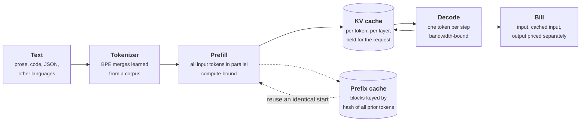

+++
title = 'Tokens, context, and cost'
description = 'Tokens are the unit of price, latency, and memory. A context window costs prefill compute that grows faster than linearly, KV-cache memory per token, and money per call; prompt order decides how much of it a prefix cache can reuse.'
question = 'What does a token cost in compute, memory, and money, and how does prompt layout change the bill?'
weight = 1
difficulty = 3
prerequisites = ['/notes/systems-design/how-ai-systems-differ/02-cost-latency-and-quality']
date = 2026-10-30T10:05:00Z
lastmod = 2026-10-30T10:05:00Z
verified = 2026-10-30
+++

## The idea in one minute

A model reads and writes **tokens**: pieces of text chosen by a tokenizer that
was trained on some corpus. How many tokens a given text becomes depends on how
much it resembles that corpus, so code, JSON, rare names, and many non-English
languages cost more tokens per character than ordinary English prose.

Each token in the context costs three things. **Compute**: [prefill](/notes/inference-engineering/inference-mechanics/01-prefill-and-decode/) touches every
weight once per input token, plus an attention term that grows with the square
of the length. **Memory**: the key and value vectors of every token in every
layer stay in accelerator memory (the **KV cache**) for as long as the request
lives, which caps how many requests fit on a GPU. **Money**: hosted prices are
per token, with output several times dearer than input. A **prefix cache**
reuses the work for a prompt's unchanged beginning, so the consequence to act
on is simple: **put stable content first, put anything that varies per request
last, and budget the window instead of filling it**.

## A picture



Prefill builds the KV cache; each decode step reads all of it and appends one
token's worth. The [prefix cache](/notes/inference-engineering/making-it-cheaper/03-prefix-caching/) lets a later request skip prefill for the blocks
it shares with an earlier one.

## How it really works

### What a token is

Most current tokenizers are variants of **byte-pair encoding** (BPE), adapted to
text by Sennrich and colleagues: start from bytes (or characters), count the
most frequent adjacent pair in a training corpus, merge it into a new symbol,
repeat until the vocabulary reaches a target size, typically tens of thousands
to a few hundred thousand entries. At inference, the learned merges are applied
in order. Byte-level BPE can encode any input, because any text is bytes; text
unlike the training corpus simply falls back toward one token per byte.

That fallback is the cost asymmetry. OpenAI's rule of thumb is about four
characters of English per token for its tokenizers. Petrov and colleagues
measured the same sentence across languages and found some languages needing
several times, and in extreme cases more than ten times, as many tokens as
English. A token-priced API therefore charges more, responds more slowly, and
fits less content into the window for those users. Code, JSON with long keys,
UUIDs, and base64 behave similarly.

Practical consequences:

- **Count with the model's own tokenizer.** Estimates from character counts can
  be off by a factor of two or more outside English prose. Most providers expose
  a token-counting endpoint or publish the tokenizer.
- **Different model families use different tokenizers.** The same prompt can be
  a different number of tokens on two models, so a budget or a price comparison
  must be done per model.
- **Formats are a cost choice.** Compact keys and fewer repeated field names
  shrink structured prompts and outputs.

### The context window is a budget

Every call sends everything the model should know. Allocate it on purpose:

```text
a 128,000-token window, allocated for a support assistant

system instructions and policies     3,000    stable      cacheable
tool definitions                     2,000    stable      cacheable
retrieved documents                  4,000    per request
conversation so far                  6,000    grows per turn
the user's message                     200
reserved for the answer              1,000
                                    ------
used                                16,200    most of the window left empty on purpose
```

More is not reliably better. Liu and colleagues found models use information in
the middle of a long context less reliably than at the beginning or end, and the
RULER benchmark found the effective context of many models to be well below the
advertised maximum on tasks harder than finding one fact. Every token is also
paid for in prefill time and money on every call, so a lean, ordered context is
usually both cheaper and better.

### Compute: prefill and decode

For a dense transformer with *P* parameters, a forward pass costs about **2*P*
floating-point operations per token** (a multiply and an add per weight), plus
attention. With causal masking, attention over a prompt of length *n* adds about
`2 × layers × d_model × n²` operations in total. The program works this out for
an 8-billion-parameter model on one H100 at an assumed 50% of peak BF16
throughput:

| Prompt | Dense FLOPs | Attention share | Prefill time |
| --- | --- | --- | --- |
| 1,000 tokens | 1.6 × 10¹³ | 2% | ~0.03 s |
| 10,000 tokens | 1.6 × 10¹⁴ | 14% | ~0.4 s |
| 100,000 tokens | 1.6 × 10¹⁵ | 62% | ~8.5 s |

So TTFT grows faster than linearly with prompt length once the prompt is long,
which is why long-context requests need their own latency target.

Decode is different. Each step produces one token per sequence and must read
every weight from memory once, whatever the batch size. At batch size one, an
8B model in BF16 is 16 GB of weights, and at 3.35 TB/s of memory bandwidth the
floor is about **4.8 ms per token**. Batching many sequences shares that read
across them, which is why servers batch aggressively and why per-stream speed
falls as the batch grows. It is also why output tokens are priced higher: a
token of output occupies a sequential step and a slot in the batch, while a
token of input is one of thousands processed in the same parallel pass.

### Memory: the KV cache

Each layer keeps a key and a value vector for every token, for each key-value
head. Per token:

```text
KV bytes per token = 2 (K and V) × layers × kv_heads × head_dim × bytes per value

Llama 3 8B:  2 × 32 × 8 × 128 × 2 B = 131,072 B  = 128 KiB
Llama 3 70B: 2 × 80 × 8 × 128 × 2 B = 327,680 B  = 320 KiB
```

These models use **grouped-query attention** (8 key-value heads shared by 32 or
64 query heads), which already cuts the cache four- to eight-fold compared with
one KV head per query head. Even so, one 128k-token context of the 70B model
holds 40 GiB of cache. On an 80 GB GPU running the 8B model, about 60 GB is left
after weights and activations: room for about 114 concurrent 4,000-token
sequences, or fewer than 4 at 128,000 tokens. **Context length is a concurrency
limit**, and long-context traffic needs either separate capacity or admission
control by tokens. [PagedAttention](/notes/inference-engineering/batching-and-scheduling/02-paged-kv-memory/) (vLLM) stores the cache in fixed-size blocks
so it can be allocated without fragmentation and shared between requests.

### Money: prices and prefix caching

Hosted APIs price input, cached input, and output separately. The ratio of
output to input price is commonly around four to five, and cached input is
discounted heavily: Anthropic documents cache reads at 10% of the base input
price (with a surcharge for writing the cache), and OpenAI documents automatic
caching for prompts of at least 1,024 tokens with a discount that depends on the
model, as of 2025. Check the current pages before a number goes into a plan.

Serving engines implement the same idea on your own hardware. vLLM's automatic
prefix caching splits the KV cache into blocks and identifies each block by a
hash of its tokens and **every token before it**; SGLang's RadixAttention keeps
shared prefixes in a radix tree. Either way the rule is the same:

> [!IMPORTANT]
> A cache hit requires an identical prefix, token for token, from the very first
> token. Anything that changes per request (a timestamp, a user name, a request
> ID, a shuffled tool list) invalidates every block after it.

That makes prompt layout a cost decision. In the program, the same 9,200-token
prompts cost $37 per 2,000 requests with stable content first, $48 when the
retrieved documents are placed before the tool definitions, and $64 when a
timestamp is placed at the very top.

### A conversation's cost grows with the square of its turns

A chat that resends its full history pays for turn 1 once, turn 2's input
includes turn 1, and so on. With a fixed prefix *s* and *t* tokens added per
turn, the input for *n* turns is about `n × s + t × n²/2`. A 40-turn
conversation adding 500 tokens a turn resends about 400,000 tokens of history in
total. Prefix caching makes the repeated part cheap (each turn extends the
previous prompt), and **compaction** (summarizing or dropping old turns) bounds
it, at the cost of losing detail the user may refer back to.

## Code

The program trains a tiny byte-level BPE tokenizer on English support text and
counts tokens for other text, computes KV-cache size and prefill and decode time
from published model shapes and datasheet numbers, and replays 2,000 requests
against a block-hashed prefix cache with three prompt layouts. The tokenizer is
far smaller than a real one, so its absolute counts are higher; the gaps between
kinds of text are the point.

```python {title="tokens_and_cache.py"}
"""tokens_and_cache.py: what a token is, what a context costs, and why prompt order matters.

Part 1 trains a tiny byte-level BPE tokenizer on English prose and counts tokens for
other kinds of text. Part 2 works out KV-cache memory and prefill/decode time from a
published model shape and GPU datasheet numbers. Part 3 replays requests against a
prefix cache with two prompt layouts. Standard library only; every price is illustrative.
"""

from __future__ import annotations

import hashlib
import random
from collections import Counter

CORPUS = (
    "The service returns an error when the request is too large. Retry the request "
    "after reducing the size of the payload. The gateway counts tokens for every "
    "request and rejects requests that exceed the limit. Users should check the "
    "status of their order before they ask for a refund. The order was delivered "
    "and the customer asked for a refund because the item was damaged. "
) * 8


def train_bpe(text: str, merges: int) -> list[tuple[bytes, bytes]]:
    """Byte-level BPE (Sennrich et al., 2016): repeatedly merge the most frequent pair."""
    words = Counter(tuple(bytes([b]) for b in w.encode()) for w in text.split(" "))
    rules: list[tuple[bytes, bytes]] = []
    for _ in range(merges):
        pairs: Counter[tuple[bytes, bytes]] = Counter()
        for word, n in words.items():
            for a, b in zip(word, word[1:]):
                pairs[(a, b)] += n
        if not pairs:
            break
        best = max(pairs, key=lambda p: (pairs[p], p))
        rules.append(best)
        merged: Counter[tuple[bytes, ...]] = Counter()
        for word, n in words.items():
            out, i = [], 0
            while i < len(word):
                if i + 1 < len(word) and (word[i], word[i + 1]) == best:
                    out.append(word[i] + word[i + 1])
                    i += 2
                else:
                    out.append(word[i])
                    i += 1
            merged[tuple(out)] += n
        words = merged
    return rules


def encode(text: str, rules: list[tuple[bytes, bytes]]) -> int:
    """Number of tokens: apply the merges in training order to each space-separated word."""
    rank = {r: i for i, r in enumerate(rules)}
    total = 0
    for w in text.split(" "):
        parts = [bytes([b]) for b in w.encode()]
        while len(parts) > 1:
            cands = [(rank.get((a, b), 1 << 30), i) for i, (a, b) in enumerate(zip(parts, parts[1:]))]
            r, i = min(cands)
            if r == 1 << 30:
                break
            parts[i:i + 2] = [parts[i] + parts[i + 1]]
        total += len(parts) + 1  # +1 for the space, kept as its own token here
    return total - 1


def part1() -> None:
    rules = train_bpe(CORPUS, 300)
    samples = {
        "English, in-domain": "The customer asked for a refund because the order was damaged.",
        "English, new words": "Kubernetes autoscaler oscillation under heterogeneous workloads.",
        "JSON": '{"order_id": "ord_8841", "status": "delivered", "total": 42.00}',
        "Python": "def refund(order_id: str) -> None:\n    raise ValueError(order_id)",
        "Hindi": "ग्राहक ने रिफंड मांगा क्योंकि सामान टूटा हुआ था।",
    }
    print("Part 1: tokens for the same tokenizer (300 merges, trained on English support text)")
    print(f"  {'text':<20}{'chars':>6}{'UTF-8 bytes':>12}{'tokens':>8}{'chars/token':>12}")
    for name, s in samples.items():
        n = encode(s, rules)
        print(f"  {name:<20}{len(s):>6}{len(s.encode()):>12}{n:>8}{len(s) / n:>12.2f}")


def part2() -> None:
    # Llama 3 shapes from "The Llama 3 Herd of Models" (2024): layers, KV heads, head dim.
    models = {"8B": (32, 8, 128, 8.0e9), "70B": (80, 8, 128, 70.6e9)}
    print("\nPart 2: KV cache and time per token (BF16, one H100 SXM: 80 GB, 3.35 TB/s, 989 TFLOP/s)")
    for name, (layers, kv_heads, head_dim, params) in models.items():
        per_tok = 2 * layers * kv_heads * head_dim * 2          # K and V, 2 bytes each
        print(f"  Llama 3 {name}: {per_tok / 1024:.0f} KiB of KV cache per token;"
              f" a 128k-token context holds {per_tok * 131072 / 2**30:.1f} GiB")
    params, weights = 8.0e9, 8.0e9 * 2
    bw, flops, mfu = 3.35e12, 989e12, 0.5
    layers, d_model = 32, 4096
    for prompt in (1_000, 10_000, 100_000):
        dense = 2 * params * prompt                    # every weight touches every token
        attn = 2 * layers * d_model * prompt ** 2      # causal QK^T and AV
        t = (dense + attn) / (flops * mfu)
        print(f"  8B prefill of {prompt:>7,} tokens: ~{t:5.2f} s at {mfu:.0%} of peak"
              f" (attention is {attn / (dense + attn):4.0%} of the FLOPs)")
    print(f"  8B decode, batch 1: >= {weights / bw * 1e3:.1f} ms per token (read all weights once per step)")
    kv = 2 * 32 * 8 * 128 * 2
    free = 80e9 - weights - 4e9                                  # leave 4 GB for activations
    for ctx in (4_000, 32_000, 128_000):
        print(f"  8B on one GPU: {free / (kv * ctx):5.1f} sequences of {ctx:>7,} tokens fit in the KV cache")


def prefix_blocks(tokens: list[str], block: int) -> list[str]:
    """Hash each full block together with everything before it, like a paged prefix cache."""
    out, h = [], hashlib.sha256()
    for i in range(0, len(tokens) - len(tokens) % block, block):
        h.update("\x00".join(tokens[i:i + block]).encode())
        out.append(h.copy().hexdigest()[:16])
    return out


def part3() -> None:
    rng = random.Random(3)
    system = [f"sys{i}" for i in range(3000)]
    tools = [f"tool{i}" for i in range(2000)]
    price_in, price_cached, price_out = 3.00, 0.30, 15.00          # $ per million, illustrative
    block = 128
    print("\nPart 3: 2,000 requests, 3,000-token system prompt, 2,000 tokens of tools,")
    print("        ~4,000 retrieved tokens and a 200-token question that change per request")
    for layout in ("stable first", "timestamp first", "docs before tools"):
        cache: set[str] = set()
        hit = total = 0
        for r in range(2000):
            docs = [f"doc{rng.randrange(10**6)}" for _ in range(4000)]
            question = [f"q{r}-{i}" for i in range(200)]
            stamp = [f"time{r}"]                                   # "Current time: 10:42:17"
            if layout == "stable first":
                prompt = system + tools + docs + question
            elif layout == "timestamp first":
                prompt = stamp + system + tools + docs + question
            else:
                prompt = system + docs + tools + question
            blocks = prefix_blocks(prompt, block)
            n = 0
            for b in blocks:
                if b not in cache:
                    break
                n += 1
            hit += n * block
            total += len(prompt)
            cache.update(blocks)
        share = hit / total
        cost = (total - hit) * price_in + hit * price_cached + 2000 * 300 * price_out
        print(f"  {layout:<18} cached share {share:5.1%}   ${cost / 1e6:6.2f} per 2,000 requests")


if __name__ == "__main__":
    part1()
    part2()
    part3()
```

Run it with `python3 tokens_and_cache.py`:

```text
Part 1: tokens for the same tokenizer (300 merges, trained on English support text)
  text                 chars UTF-8 bytes  tokens chars/token
  English, in-domain      62          62      21        2.95
  English, new words      64          64      52        1.23
  JSON                    63          63      43        1.47
  Python                  65          65      47        1.38
  Hindi                   48         128     128        0.38

Part 2: KV cache and time per token (BF16, one H100 SXM: 80 GB, 3.35 TB/s, 989 TFLOP/s)
  Llama 3 8B: 128 KiB of KV cache per token; a 128k-token context holds 16.0 GiB
  Llama 3 70B: 320 KiB of KV cache per token; a 128k-token context holds 40.0 GiB
  8B prefill of   1,000 tokens: ~ 0.03 s at 50% of peak (attention is   2% of the FLOPs)
  8B prefill of  10,000 tokens: ~ 0.38 s at 50% of peak (attention is  14% of the FLOPs)
  8B prefill of 100,000 tokens: ~ 8.54 s at 50% of peak (attention is  62% of the FLOPs)
  8B decode, batch 1: >= 4.8 ms per token (read all weights once per step)
  8B on one GPU: 114.4 sequences of   4,000 tokens fit in the KV cache
  8B on one GPU:  14.3 sequences of  32,000 tokens fit in the KV cache
  8B on one GPU:   3.6 sequences of 128,000 tokens fit in the KV cache

Part 3: 2,000 requests, 3,000-token system prompt, 2,000 tokens of tools,
        ~4,000 retrieved tokens and a 200-token question that change per request
  stable first       cached share 54.2%   $ 37.26 per 2,000 requests
  timestamp first    cached share  0.0%   $ 64.21 per 2,000 requests
  docs before tools  cached share 32.0%   $ 48.31 per 2,000 requests
```

The tokenizer turns in-domain English into about three characters per token and
everything else into far fewer. The Hindi sentence has no learned merges at all,
so every UTF-8 byte is a token: 48 characters become 128 tokens. Part 2 shows
attention overtaking the dense term near 100,000 tokens and the KV cache
limiting concurrency long before compute does. Part 3 shows the layout effect:
5,000 stable tokens out of 9,200 is a 54% cached share only if nothing before
them changes.

## Where it breaks

- **The FLOP model is a lower bound.** Real prefill also pays for memory traffic,
  kernel launch, and communication between GPUs when a model is split across
  them. The 50% utilization figure is an assumption; measure TTFT at your prompt
  lengths.
- **Mixture-of-experts models change the arithmetic.** They activate only a
  fraction of their parameters per token, so FLOPs per token follow the active
  parameters while memory follows the total.
- **Cache hits are probabilistic.** Provider caches expire after minutes, may
  be per-region or per-organization, and have minimum lengths. Your own prefix
  cache competes with live requests for KV memory and is evicted under load,
  exactly when it would help most.
- **Token counts are not the only multilingual cost.** A language that needs
  more tokens also often has lower model quality. Fixing the bill does not fix
  the quality gap; evaluate per language.
- **Compaction loses information.** A summary of old turns is a lossy copy
  written by a model; facts the user refers to later may be gone or distorted.

## Remember this

- Token counts depend on the tokenizer and the text; count with the model's
  own tokenizer.
- Prefill is about 2 × parameters FLOPs per token plus attention that grows with
  n²; decode is bound by reading the weights each step.
- KV cache per token = 2 × layers × KV heads × head dim × bytes; context length
  limits concurrency.
- Output tokens cost more because each is a sequential step.
- Prefix caches need an identical start: stable first, variable last.
- Budget the context window; filling it costs money and often quality.

## Try it

1. Run `tokens_and_cache.py`. Raise the merge count from 300 to 1,000. Which
   samples improve, and why does the Hindi count not move?
2. Compute the KV cache per token for a model with 61 layers, 8 KV heads, head
   dimension 128, in FP8 (1 byte per value). How many 32k-token sequences fit in
   40 GB?
3. In part 3, add a fourth layout that puts the user's name after the system
   prompt but before the tools. Predict the cached share before you run it.
4. Take a real prompt from a system you work on and mark each section stable or
   variable. Reorder it so every stable section comes first. What fraction of
   its tokens is now a cacheable prefix?

## Check yourself

1. Why does a sentence in some languages cost several times as many tokens as
   its English translation?

   
   BPE merges are learned from a training corpus. Text that appears often in that
   corpus gets long merged tokens; text that rarely appears falls back toward
   one token per byte, and many scripts use two or three UTF-8 bytes per
   character. More tokens means higher cost, more latency, and less content per
   window.
   

2. Why is TTFT for a 100,000-token prompt more than ten times TTFT for a
   10,000-token prompt?

   
   The dense part of prefill grows linearly with the number of tokens, but
   attention grows with the square of the sequence length. At 100,000 tokens
   attention is the larger term for an 8B model, so the total grows faster than
   linearly.
   

3. Your 70B model serves 128k-token contexts. What limits how many requests one
   server can run at once, and what are two ways to raise it?

   
   KV-cache memory: 320 KiB per token, so 40 GiB per full-length sequence. Raise
   concurrency by quantizing the KV cache (FP8 halves it), by adding GPUs or
   moving long-context traffic to dedicated capacity, by sharing cached prefixes
   between requests, or by admitting requests by token budget rather than by
   count.
   

4. A prompt starts with "Current time: 10:42:17". What does this do to prefix
   caching, and what is the fix?

   
   The first tokens differ on every request, and each cache block is keyed by all
   tokens before it, so nothing after the timestamp can ever hit. Move the
   timestamp (and anything else per-request) to the end of the prompt, after the
   stable system prompt and tool definitions.
   

5. Why are output tokens priced higher than input tokens?

   
   Input tokens are processed together in one parallel prefill pass that keeps
   the accelerator's compute busy. Each output token needs its own sequential
   decode step that rereads the weights and the KV cache, holds a batch slot, and
   uses memory bandwidth rather than compute efficiently. Output occupies the
   hardware for far longer per token.
   

## Sources

- R. Sennrich, B. Haddow, A. Birch, [Neural Machine Translation of Rare Words with Subword Units](https://arxiv.org/abs/1508.07909), ACL 2016.
- A. Petrov, E. La Malfa, P. H. S. Torr, A. Bibi, [Language Model Tokenizers Introduce Unfairness Between Languages](https://arxiv.org/abs/2305.15425), NeurIPS 2023.
- Llama Team, AI @ Meta, [The Llama 3 Herd of Models](https://arxiv.org/abs/2407.21783), July 2024 (layer counts, KV heads, head dimension).
- J. Ainslie et al., [GQA: Training Generalized Multi-Query Transformer Models from Multi-Head Checkpoints](https://arxiv.org/abs/2305.13245), EMNLP 2023.
- J. Kaplan et al., [Scaling Laws for Neural Language Models](https://arxiv.org/abs/2001.08361), 2020 (the 2N FLOPs-per-token forward-pass estimate).
- W. Kwon et al., [Efficient Memory Management for Large Language Model Serving with PagedAttention](https://arxiv.org/abs/2309.06180), SOSP 2023; vLLM documentation, [Automatic Prefix Caching](https://docs.vllm.ai/en/latest/design/prefix_caching.html).
- L. Zheng et al., [SGLang: Efficient Execution of Structured Language Model Programs](https://arxiv.org/abs/2312.07104), NeurIPS 2024 (RadixAttention).
- N. F. Liu et al., [Lost in the Middle: How Language Models Use Long Contexts](https://arxiv.org/abs/2307.03172), *TACL* 12, 2024.
- C.-P. Hsieh et al., [RULER: What's the Real Context Size of Your Long-Context Language Models?](https://arxiv.org/abs/2404.06654), COLM 2024.
- NVIDIA, [H100 Tensor Core GPU datasheet](https://www.nvidia.com/en-us/data-center/h100/) (H100 SXM: 80 GB HBM3, 3.35 TB/s, 989 TFLOP/s dense BF16).
- Anthropic, [Prompt caching](https://docs.anthropic.com/en/docs/build-with-claude/prompt-caching); OpenAI, [Prompt caching](https://platform.openai.com/docs/guides/prompt-caching), read as documented in 2025.
- OpenAI Help Center, [What are tokens and how to count them?](https://help.openai.com/en/articles/4936856-what-are-tokens-and-how-to-count-them)
