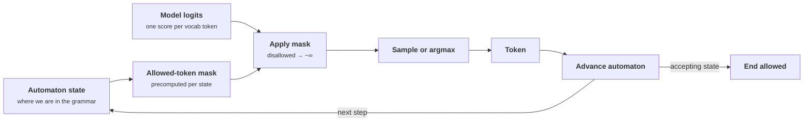
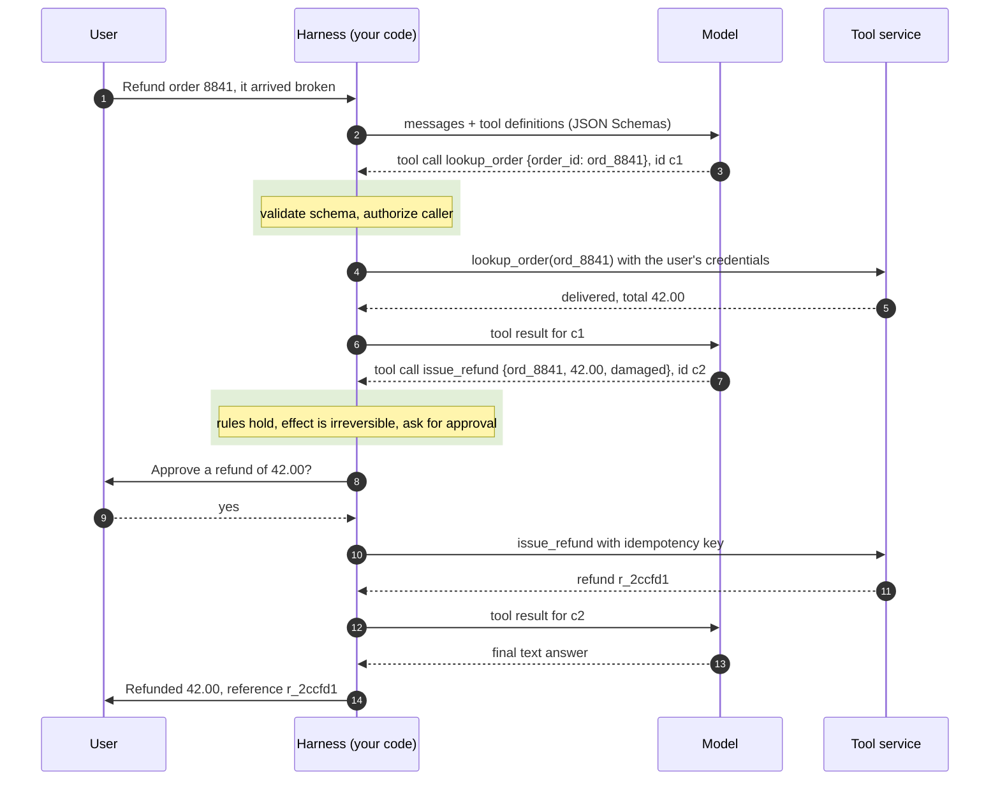

+++
title = 'Structured output and tool calls'
description = 'Constrained decoding masks every token that cannot extend a valid output, so replies always match the schema. It guarantees syntax, not truth. A tool call is the same mechanism plus a protocol in which the model proposes and your harness validates, authorizes, and executes.'
question = 'How do you get output a program can rely on, and how should a tool call travel from the model to an effect?'
weight = 2
difficulty = 3
prerequisites = ['/notes/systems-design/model-interfaces/01-tokens-context-and-cost', '/notes/systems-design/failure-modes/02-retries-and-idempotency']
date = 2026-10-30T10:10:00Z
lastmod = 2026-10-30T10:10:00Z
verified = 2026-10-30
+++

## The idea in one minute

A program that consumes model output needs it in a fixed shape. Asking nicely
in the prompt gets valid JSON most of the time, and "most of the time" is a
production incident at volume. **Constrained decoding** fixes the syntax: at
every step, the engine masks the probability of every token that could not
extend a string the schema or grammar accepts, so the model can only produce
valid output. What it cannot fix is meaning. A constrained reply always parses
and can still name the wrong label, an amount that exceeds the order total, or a
customer the caller may not see.

**Tool calling** is the same mechanism with a protocol around it. You describe
functions with JSON Schemas; the model replies with a structured request to call
one; **your code** decides whether to run it, runs it, and returns the result as
more context. The model never executes anything. The consequence to act on:
**treat every structured output and every tool argument as untrusted input**,
validated against the schema and against business rules, authorized against
the caller, and made idempotent before anything changes state.

## A picture



The model still chooses; the mask only removes choices that would break the
grammar. Whether the remaining choice is correct is up to the model.

## How it really works

### Four levels of structure

| Level | Mechanism | Guarantees |
| --- | --- | --- |
| Prompt only | "Reply in JSON with keys label and confidence" | Nothing; failure rate depends on model and prompt |
| JSON mode | Decoding constrained to syntactically valid JSON | Parses; keys and types can be anything |
| **Schema-constrained output** | Decoding constrained to a JSON Schema or grammar | Parses and matches the schema's structure |
| Semantic validation | Your code checks values against rules and data | What the business actually needs |

Hosted APIs offer schema-constrained output (OpenAI's Structured Outputs with
`strict` schemas; tool definitions with strict input schemas on several
providers), and open-source engines offer it for self-hosted models (Outlines,
XGrammar, llama.cpp grammars, and the guided-decoding options in vLLM and
SGLang). Semantic validation is always yours.

### How the mask is computed

Willard and Louf showed how to make this cheap for regular languages. Compile
the regular expression (or a JSON Schema reduced to one) into a finite-state
machine over characters. Then, once per vocabulary and grammar, walk every token
string from every state and record which tokens lead to a live state. At
decoding time the mask for the current state is a lookup, not a scan of the
vocabulary.

Three details make it harder than it sounds:

- **Tokens do not align with grammar symbols.** A token such as `": "` or
  `"},{"` crosses several grammar boundaries, and the same text can be tokenized
  several ways. The index must consider every token string from every state,
  which is why precomputation matters.
- **JSON is not regular.** Nested objects and arrays need a stack. XGrammar
  compiles context-free grammars to a pushdown automaton and splits tokens into
  those whose validity is fixed for a state (precomputed) and those that depend on
  the stack (checked at runtime), keeping per-token overhead small.
- **Only accepting states may end.** The end-of-sequence token is allowed only
  when the text so far is a complete valid string. If the output budget runs out
  first, the reply is truncated and invalid regardless of the mask.

### What constraints do to quality

The mask changes the distribution the model samples from. If the model "wanted"
to write a preamble or a code fence, constrained decoding forces a different
path; usually the model then writes the intended JSON, as in the program below.
Two effects are worth designing around:

- **Field order is reasoning order.** Generation is left to right, so a schema
  with `answer` before `reasoning` makes the model commit before it reasons.
  Put explanation or evidence fields first if you want them to inform the answer.
- **Tight formats can cost accuracy on reasoning tasks.** Tam and colleagues
  reported lower reasoning accuracy under strict format restrictions on some
  tasks; others have argued the effect largely disappears with good prompts and
  schemas. Treat it as something to evaluate on your task, not a rule.

Schema support is also partial. Hosted strict modes typically require every
property to be listed as required and `additionalProperties` to be false, and
support a subset of JSON Schema keywords. Constraints the subset cannot express
(cross-field rules, "amount ≤ order total") belong in your validator.

### The tool-call protocol

On the wire, a tool call is a round trip through your code:



The details are consistent across providers even though names differ:

- **Definitions.** Each tool has a name, a description, and a JSON Schema for
  its input. The description is a prompt: say when to use the tool, when not to,
  and what the result means.
- **Calls carry IDs.** The model's reply contains one or more calls, each with
  an ID; each result is sent back tagged with the ID it answers. Models can
  propose several calls in one turn (parallel tool calls), and the harness may
  run independent reads concurrently.
- **The loop ends on a stop reason.** The response says whether the model
  stopped to call tools or finished. The harness loops until it finishes or a
  budget (steps, tokens, wall-clock time) runs out; the budget is enforced by the
  harness, never left to the model.
- **Errors go back as results.** A rejected call returns an instructive error
  ("order_id must match `^ord_[0-9]+$`") so the model can correct itself.

### What the harness must check

Arguments are model output, and model output can be steered by any text in the
context, including the result of the previous tool call. Before anything runs:

1. **The tool is allowed** for this caller and this task. A tool the model
   invents, or one outside the allowlist, is denied.
2. **The arguments validate** against the schema, including unknown fields.
3. **Business rules hold**: the order belongs to this user, the amount does not
   exceed the total, the status permits the action. Return the same error for
   "does not exist" and "not yours", so the tool does not leak existence.
4. **The effect class is respected.** Read-only calls run. Reversible writes may
   run with logging. Irreversible effects (money, deletion, external messages)
   wait for an approval that the model cannot grant itself.
5. **Writes are idempotent.** A retried call must not refund twice. The key
   should be derived by the harness (for example, task ID plus step) rather
   than trusted from the model, as in
   [retries and idempotency](/notes/systems-design/failure-modes/02-retries-and-idempotency/).
6. **The tool runs with the caller's authority**, not a superuser credential,
   so a hijacked plan is limited to what the user could already do.

> [!WARNING]
> Tool results are untrusted text that enters the next prompt. A web page or a
> ticket body can contain instructions aimed at the model. The checks above are
> what keep such an instruction from becoming an effect; see
> [MCP and tool security](/notes/ai-security-engineering/securing-agents/05-mcp-and-tool-security/).

### MCP: one protocol for tools

The **Model Context Protocol** standardizes how an application (the host, with
an MCP client) discovers and calls tools exposed by servers. It uses JSON-RPC
2.0 messages: `tools/list` returns tool names, descriptions, and input schemas,
and `tools/call` invokes one. Servers can also expose **resources** (data the
application may read into context) and **prompts** (templates). The 2025-06-18
revision defines two transports, stdio for a local process and Streamable HTTP
for a remote service, and an OAuth-based authorization model for remote servers.
The specification is revised regularly; design against the revision your
clients and servers both implement.

MCP changes the wiring, not the trust model. The harness checks above still
apply to every call, and a third-party server's tool descriptions are prompts
written by someone else, so they are pinned, reviewed, and monitored like any
dependency.

## Code

Two programs. The first simulates a model replying with
`{"label": ..., "confidence": ...}` that sometimes adds a preamble, a code
fence, or single quotes, and compares free sampling with constrained decoding.
For this tiny schema the set of valid strings is finite (3 labels × 101
confidences), so its prefix set serves as the automaton.

```python {title="constrained.py"}
"""constrained.py: free sampling versus grammar-constrained decoding for a JSON reply.

A simulated model classifies support messages and replies with
{"label": <one of three>, "confidence": 0.00-1.00}. Sometimes it adds a preamble,
wraps the JSON in a code fence, or uses single quotes. Constrained decoding masks
every token that cannot extend a valid output. For this tiny schema the set of valid
strings is finite, so its prefix set is the automaton; real engines compile a JSON
Schema or grammar into a finite-state or pushdown automaton instead.
Standard library only; the model is a stand-in.
"""

from __future__ import annotations

import json
import math
import random

LABELS = ("refund", "shipping", "other")
VOCAB = ['{', '}', '"label"', '"label": ', ':', ': ', ',', ', ', '"confidence"',
         '"confidence": ', '"refund"', '"shipping"', '"other"', "'label'", "'refund'",
         "'shipping'", "'other'", "'confidence'", '0', '1', '2', '3', '4', '5', '6', '7',
         '8', '9', '0.', '1.', '.', ' ', '\n', '```', '```json\n', 'Sure', '! ', 'Here',
         ' is', ' the', ' JSON', ':\n', '<eos>']


def valid_strings() -> set[str]:
    out = set()
    for label in LABELS:
        for c in range(101):
            out.add(f'{{"label": "{label}", "confidence": {c // 100}.{c % 100:02d}}}')
    return out


VALID = valid_strings()
PREFIXES = {s[:i] for s in VALID for i in range(len(s) + 1)}


def intended(rng: random.Random, truth: str) -> str:
    """What the model 'wants' to write, before any constraint."""
    label = truth if rng.random() < 0.9 else rng.choice([l for l in LABELS if l != truth])
    body = f'{{"label": "{label}", "confidence": 0.{rng.randrange(60, 99)}}}'
    r = rng.random()
    if r < 0.06:
        return "Sure! Here is the JSON:\n" + body
    if r < 0.10:
        return "```json\n" + body + "\n```"
    if r < 0.13:
        return body.replace('"', "'")
    return body


def logits(text: str, plan: str, rng: random.Random) -> list[float]:
    """High score for tokens that continue the plan (or the JSON inside it), noise elsewhere."""
    core = plan[plan.find("{"):plan.rfind("}") + 1].replace("'", '"')
    out = []
    for tok in VOCAB:
        score = rng.gauss(0.0, 1.0)
        for target, bonus in ((plan, 9.0), (core, 6.0)):
            if target.startswith(text):
                rest = target[len(text):]
                if tok == "<eos>" and rest == "":
                    score += bonus
                elif tok != "<eos>" and rest.startswith(tok):
                    score += bonus + len(tok) * 0.1  # prefer longer matching tokens
        out.append(score)
    return out


def decode(plan: str, rng: random.Random, constrained: bool, max_tokens: int) -> tuple[str, int]:
    text, masked = "", 0
    for _ in range(max_tokens):
        scores = logits(text, plan, rng)
        if constrained:
            for i, tok in enumerate(VOCAB):
                ok = (text in VALID) if tok == "<eos>" else (text + tok) in PREFIXES
                if not ok:
                    scores[i] = -math.inf
                    masked += 1
        tok = VOCAB[max(range(len(VOCAB)), key=lambda i: scores[i])]   # greedy
        if tok == "<eos>":
            break
        text += tok
    return text, masked


def check(text: str, truth: str) -> tuple[bool, bool]:
    try:
        obj = json.loads(text)
        ok = (isinstance(obj, dict) and set(obj) == {"label", "confidence"}
              and obj["label"] in LABELS and 0 <= obj["confidence"] <= 1)
    except (json.JSONDecodeError, TypeError):
        return False, False
    return ok, ok and obj["label"] == truth


def main() -> None:
    n = 2000
    print(f"{n} simulated replies; schema: label in {LABELS}, confidence 0.00-1.00")
    print(f"{'mode':<28}{'parses + valid':>15}{'right label':>13}{'masked/reply':>14}")
    for constrained, max_tokens in ((False, 40), (True, 40), (True, 6)):
        rng = random.Random(11)
        valid = right = masked = 0
        sample = ""
        for _ in range(n):
            truth = rng.choice(LABELS)
            plan = intended(rng, truth)
            text, m = decode(plan, rng, constrained, max_tokens)
            v, r = check(text, truth)
            valid += v
            right += r
            masked += m
            if not v and not sample:
                sample = text
        mode = ("constrained" if constrained else "free sampling") + f", max {max_tokens} tok"
        print(f"{mode:<28}{valid / n:>15.1%}{right / n:>13.1%}{masked / n:>14.0f}")
        if sample:
            print(f"    first invalid output: {sample!r}")


if __name__ == "__main__":
    main()
```

Run it with `python3 constrained.py`:

```text
2000 simulated replies; schema: label in ('refund', 'shipping', 'other'), confidence 0.00-1.00
mode                         parses + valid  right label  masked/reply
free sampling, max 40 tok             86.7%        78.1%             0
    first invalid output: 'Sure! Here is the JSON:\n{"label": "shipping", "confidence": 0.91}'
constrained, max 40 tok              100.0%        90.1%           479
constrained, max 6 tok                 0.0%         0.0%           246
    first invalid output: '{"label": "shipping", "confidence": '
```

Free sampling fails to parse about one reply in eight. Constrained decoding
makes every reply valid and recovers the right label whenever the model knew
it, so the right-label rate rises to the model's underlying 90%, and no higher:
**the mask fixed syntax, not knowledge**. With a 6-token budget, constrained
decoding still produces nothing usable, because the reply is cut off before an
accepting state.

The second program is the harness side: it receives ten proposed tool calls and
decides what runs.

```python {title="tool_harness.py"}
"""tool_harness.py: the model proposes, the harness decides.

A harness receives tool calls from a simulated model and, before anything runs,
checks: the tool exists and is allowed for this caller, the arguments match the JSON
Schema subset declared for the tool, business rules hold, irreversible effects have
approval, and a retried call with the same idempotency key does not run twice.
Standard library only; the orders and the model's calls are invented.
"""

from __future__ import annotations

import hashlib
import re
from dataclasses import dataclass, field
from typing import Any, Callable

ORDERS = {"ord_8841": {"status": "delivered", "total": 42.00, "owner": "u_17"}}


@dataclass
class Tool:
    name: str
    effect: str                      # "read", "reversible", "irreversible"
    schema: dict[str, Any]           # a JSON Schema subset: type, properties, required
    run: Callable[[dict[str, Any]], dict[str, Any]]
    rules: Callable[[dict[str, Any], str], str | None] = lambda a, u: None


def type_ok(value: Any, spec: dict[str, Any]) -> str | None:
    t = spec["type"]
    if t == "string" and not isinstance(value, str):
        return "must be a string"
    if t == "number" and (isinstance(value, bool) or not isinstance(value, (int, float))):
        return "must be a number"
    if "pattern" in spec and not re.search(spec["pattern"], value):
        return f"must match {spec['pattern']!r}"
    if "enum" in spec and value not in spec["enum"]:
        return f"must be one of {spec['enum']}"
    if "exclusiveMinimum" in spec and not value > spec["exclusiveMinimum"]:
        return f"must be > {spec['exclusiveMinimum']}"
    return None


def validate(args: dict[str, Any], schema: dict[str, Any]) -> str | None:
    props = schema["properties"]
    for key in schema["required"]:
        if key not in args:
            return f"missing required argument {key!r}"
    for key, value in args.items():
        if key not in props:
            return f"unknown argument {key!r}"           # additionalProperties: false
        err = type_ok(value, props[key])
        if err:
            return f"{key} {err}"
    return None


def refund_rules(args: dict[str, Any], user: str) -> str | None:
    order = ORDERS.get(args["order_id"])
    if order is None or order["owner"] != user:
        return "no such order for this user"             # same answer: do not leak existence
    if order["status"] != "delivered":
        return "only delivered orders can be refunded"
    if args["amount"] > order["total"]:
        return f"amount exceeds order total {order['total']:.2f}"
    return None


ORDER_ID = {"type": "string", "pattern": "^ord_[0-9]+$"}
TOOLS = {
    "lookup_order": Tool("lookup_order", "read",
                         {"properties": {"order_id": ORDER_ID}, "required": ["order_id"]},
                         lambda a: {k: v for k, v in ORDERS[a["order_id"]].items() if k != "owner"},
                         lambda a, u: None if ORDERS.get(a["order_id"], {}).get("owner") == u
                         else "no such order for this user"),
    "issue_refund": Tool("issue_refund", "irreversible",
                         {"properties": {"order_id": ORDER_ID,
                                         "amount": {"type": "number", "exclusiveMinimum": 0},
                                         "reason": {"type": "string",
                                                    "enum": ["damaged", "late", "other"]}},
                          "required": ["order_id", "amount", "reason"]},
                         lambda a: {"refund_id": "r_" + hashlib.sha256(a["order_id"].encode()).hexdigest()[:6]},
                         refund_rules),
}


@dataclass
class Harness:
    user: str
    allowed: set[str]
    approvals: set[str] = field(default_factory=set)      # idempotency keys a human approved
    done: dict[str, dict[str, Any]] = field(default_factory=dict)
    executed: int = 0

    def handle(self, call: dict[str, Any]) -> str:
        name, args, key = call.get("name"), call.get("arguments", {}), call.get("idempotency_key")
        tool = TOOLS.get(name)
        if tool is None or name not in self.allowed:
            return f"DENY   {name}: not an allowed tool"
        err = validate(args, tool.schema) or tool.rules(args, self.user)
        if err:
            return f"REJECT {name}: {err}  (returned to the model so it can correct the call)"
        if tool.effect != "read":
            if not key:
                return f"REJECT {name}: writes need an idempotency key"
            if key in self.done:
                return f"DEDUP  {name}: key {key} already ran, returning {self.done[key]}"
            if tool.effect == "irreversible" and key not in self.approvals:
                return f"HOLD   {name}: waiting for human approval of {args}"
        result = tool.run(args)
        self.executed += 1
        if key:
            self.done[key] = result
        return f"RUN    {name}: {result}"


def main() -> None:
    h = Harness(user="u_17", allowed={"lookup_order", "issue_refund"})
    calls = [
        {"name": "lookup_order", "arguments": {"order_id": "8841"}},
        {"name": "lookup_order", "arguments": {"order_id": "ord_8841"}},
        {"name": "issue_refund", "arguments": {"order_id": "ord_8841", "amount": "42",
                                               "reason": "damaged"}},
        {"name": "issue_refund", "arguments": {"order_id": "ord_8841", "amount": 420.0,
                                               "reason": "damaged"}, "idempotency_key": "k1"},
        {"name": "issue_refund", "arguments": {"order_id": "ord_8841", "amount": 42.0,
                                               "reason": "damaged"}, "idempotency_key": "k2"},
        "approve k2",
        {"name": "issue_refund", "arguments": {"order_id": "ord_8841", "amount": 42.0,
                                               "reason": "damaged"}, "idempotency_key": "k2"},
        {"name": "issue_refund", "arguments": {"order_id": "ord_8841", "amount": 42.0,
                                               "reason": "damaged"}, "idempotency_key": "k2"},
        {"name": "delete_account", "arguments": {"user": "u_17"}},
        {"name": "lookup_order", "arguments": {"order_id": "ord_9999", "verbose": True}},
    ]
    for i, call in enumerate(calls, 1):
        if isinstance(call, str):
            h.approvals.add(call.split()[1])
            print(f"{i:>2}. human approves {call.split()[1]}")
            continue
        print(f"{i:>2}. {h.handle(call)}")
    print(f"\ntool executions: {h.executed} (one read, one refund) out of {len(calls) - 1} proposals")


if __name__ == "__main__":
    main()
```

Run it with `python3 tool_harness.py`:

```text
 1. REJECT lookup_order: order_id must match '^ord_[0-9]+$'  (returned to the model so it can correct the call)
 2. RUN    lookup_order: {'status': 'delivered', 'total': 42.0}
 3. REJECT issue_refund: amount must be a number  (returned to the model so it can correct the call)
 4. REJECT issue_refund: amount exceeds order total 42.00  (returned to the model so it can correct the call)
 5. HOLD   issue_refund: waiting for human approval of {'order_id': 'ord_8841', 'amount': 42.0, 'reason': 'damaged'}
 6. human approves k2
 7. RUN    issue_refund: {'refund_id': 'r_2ccfd1'}
 8. DEDUP  issue_refund: key k2 already ran, returning {'refund_id': 'r_2ccfd1'}
 9. DENY   delete_account: not an allowed tool
10. REJECT lookup_order: unknown argument 'verbose'  (returned to the model so it can correct the call)

tool executions: 2 (one read, one refund) out of 9 proposals
```

Nine proposals produce two executions. Calls 1, 3, 4, and 10 are rejected with
errors the model can act on; call 5 waits for a human; call 8, a retry of an
approved refund, is answered from the idempotency record instead of refunding
twice; call 9 asks for a tool that does not exist for this caller.

## Where it breaks

- **Schemas cannot express everything.** "Amount at most the order total" or
  "end date after start date" needs data or cross-field logic. Schema
  enforcement is the first check, not the last.
- **Truncation beats the mask.** A low `max_tokens`, a long reasoning field, or
  an unbounded array can end the reply before it is complete. Bound array
  lengths and string sizes in the schema and reserve output budget.
- **Masking can mislead.** When the model is unsure or wants to refuse, the mask
  still forces a value into every required field. Provide an explicit
  "unknown" or refusal option in the schema so the model has a valid way to
  decline.
- **The program's harness trusts the model's idempotency key.** In production
  the harness derives the key itself; a model that varies the key across
  retries would otherwise defeat deduplication.
- **Approval fatigue is real.** If every call needs approval, people approve
  without reading. Reserve approval for irreversible, high-impact effects and
  make the approval prompt state exactly what will happen.

## Remember this

- Prompting for JSON is a hope; constrained decoding is a guarantee of syntax.
- Masks come from an automaton over the grammar, precomputed per state.
- Valid structure is not a correct value; validate semantics in code.
- Field order is reasoning order; leave a valid way to say "unknown".
- The model proposes tool calls; the harness validates, authorizes, gates, and
  executes them idempotently with the caller's authority.
- Tool results are untrusted input to the next step.

## Try it

1. Run `constrained.py`. Change the free-sampling preamble rate from 6% to 30%.
   What happens to the parse rate, and does the constrained right-label rate
   change?
2. Add a fourth label `"unknown"` and make the model choose it when its belief
   is wrong. How does the right-label rate compare with a forced choice?
3. In `tool_harness.py`, make the harness derive the idempotency key from a task
   ID and step number, and show that a model varying its own key no longer
   causes a double refund.
4. Write the schema and description for a `send_email` tool. Which effect class
   is it, which rules does the harness check, and what does the approval prompt
   say?

## Check yourself

1. Why does JSON mode not guarantee that a program can consume the output?

   
   It guarantees syntactically valid JSON only. Keys may be missing or extra,
   types may be wrong, and values may violate the schema. Schema-constrained
   decoding fixes structure; semantic validation is still needed for values.
   

2. How can a constrained-decoding engine apply a grammar mask without scanning
   the whole vocabulary at every step?

   
   It compiles the grammar into an automaton and precomputes, for each state,
   which vocabulary tokens lead to a live state. At each step the mask is a
   lookup by the current state. For context-free grammars, a pushdown automaton
   precomputes the tokens whose validity does not depend on the stack and checks
   only the rest at runtime.
   

3. A constrained reply is valid JSON matching the schema, and the refund amount
   is 420 for a 42 order. Which component should have caught it?

   
   The harness's business-rule validation, which checks the amount against the
   order total from the system of record before executing. A JSON Schema cannot
   express a rule that depends on other data.
   

4. Why must a tool's credentials be the caller's, not a service account with
   broad access?

   
   Any text in the context can steer the model's tool calls. If the tool runs as
   a superuser, a successful injection can do anything the superuser can. With
   the caller's authority, the worst case is limited to what that caller could
   already do.
   

5. Why should explanation fields come before answer fields in a schema?

   
   Generation is left to right. Fields emitted later are conditioned on fields
   emitted earlier, so an answer generated after the explanation can use it; an
   answer generated first cannot.
   

## Sources

- B. T. Willard, R. Louf, [Efficient Guided Generation for Large Language Models](https://arxiv.org/abs/2307.09702), 2023 (FSM-indexed masking; the basis of Outlines).
- Y. Dong et al., [XGrammar: Flexible and Efficient Structured Generation Engine for Large Language Models](https://arxiv.org/abs/2411.15100), MLSys 2025.
- Z. R. Tam et al., [Let Me Speak Freely? A Study on the Impact of Format Restrictions on Performance of Large Language Models](https://arxiv.org/abs/2408.02442), 2024.
- OpenAI, [Introducing Structured Outputs in the API](https://openai.com/index/introducing-structured-outputs-in-the-api/), August 2024, and the [Structured Outputs guide](https://platform.openai.com/docs/guides/structured-outputs).
- Anthropic, [Tool use with Claude](https://docs.anthropic.com/en/docs/agents-and-tools/tool-use/overview).
- Model Context Protocol, [Specification, revision 2025-06-18](https://modelcontextprotocol.io/specification/2025-06-18).
- JSON-RPC Working Group, [JSON-RPC 2.0 Specification](https://www.jsonrpc.org/specification), 2010.
- JSON Schema, [Draft 2020-12](https://json-schema.org/draft/2020-12).
- K. Greshake et al., [Not what you've signed up for: Compromising Real-World LLM-Integrated Applications with Indirect Prompt Injection](https://arxiv.org/abs/2302.12173), AISec 2023.
