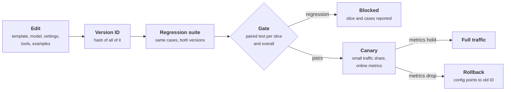

+++
title = 'Prompts as versioned code'
description = 'A prompt version is everything that changes model behavior: template, model snapshot, sampling settings, tool schemas, and examples. Hash it, ship it through a pipeline, and gate it on a paired evaluation that checks every slice, not just the average.'
question = 'How do you change a prompt or a model without silently breaking part of your traffic?'
weight = 3
difficulty = 3
prerequisites = ['/notes/systems-design/model-interfaces/02-structured-output-and-tool-calls', '/notes/systems-design/reliability-in-production/03-safe-change']
date = 2026-10-30T10:15:00Z
lastmod = 2026-10-30T10:15:00Z
verified = 2026-10-30
+++

## The idea in one minute

A prompt is code that runs on a probabilistic interpreter. Changing a word,
swapping the model snapshot, or moving the temperature from 0.2 to 0.7 changes
behavior as surely as a code change, and often in parts of the traffic nobody
looked at. Yet prompts are routinely edited in a dashboard, deployed instantly,
and judged by trying three examples.

Treat them like code. A **prompt version** is the hash of everything that
changes behavior: the template, the model snapshot, sampling settings, tool
schemas, and few-shot examples. Versions live in version control, are referenced
by ID from application config, and are logged on every call. A change ships only
after a **regression suite** runs both versions on the same labeled cases and a
**paired comparison** shows no significant drop overall or in any important
slice. The consequence to act on: **an average that moved by one point can hide
a slice that fell by twelve**, so gate on slices, and measure the noise floor so
you know what "no change" looks like.

## A picture



Rollback is a config change because the old version still exists under its ID;
nothing has to be rebuilt.

## How it really works

### What a version contains

Anything that changes the output distribution belongs in the version:

| Component | Why it changes behavior |
| --- | --- |
| Template text and its slots | The instructions themselves |
| Few-shot examples | Often stronger than the instructions |
| **Model snapshot** | A dated snapshot, not a moving alias; an alias can change under you |
| Sampling settings | Temperature, top-p, max tokens, stop sequences |
| Tool names, descriptions, and schemas | Descriptions are prompts; schemas constrain output |
| Retrieval settings, if any | Which chunks, how many, in what order |
| Output schema | Field order and enums change what the model writes |

Hash a canonical serialization of all of it and use the first dozen hex
characters as the ID. Content addressing has two useful properties: identical
configurations get identical IDs wherever they are built, and any edit, however
small, gets a new one. Log the ID with every call and every trace, so a
complaint, a cost spike, or an evaluation result can be tied to the exact
configuration that produced it.

### Keep prompts out of the code path, not out of review

Store templates as files in the repository next to their tests, not as string
literals scattered through code and not only in a vendor dashboard. Application
config references a version ID per route (`triage: ac6455e12bcd`), so a rollout
or rollback edits one line. Reviews look at the diff of the template and at the
evaluation report together. Untrusted text (user messages, retrieved documents)
is inserted into marked slots and never concatenated into the instruction text
itself, which keeps the template's own diff meaningful.

### The regression suite

A useful suite has three kinds of cases:

- **A representative sample** of real traffic, labeled, large enough to resolve
  the differences you care about.
- **Slices** that matter more than their share of traffic: other languages,
  high-value customers, long inputs, cases that must be refused.
- **Pinned failures**: every bug report that was fixed becomes a case, so it
  stays fixed.

Each case is scored by the cheapest reliable method: exact match or a schema
and rule check where possible, a rubric scored by a person or a separately
evaluated [model grader](/notes/systems-design/evaluation-in-production/02-model-graders/) where not.

### Paired comparison and the noise floor

Run both versions on the same cases. Because the cases are shared, compare them
**case by case**: what matters is how many cases the new version fixed and how
many it broke. Under "no real change" those **discordant** cases should split
about evenly, which is exactly **McNemar's test**. Dietterich recommended it for
comparing two classifiers on one test set because it uses the pairing that an
unpaired comparison of two percentages throws away.

Two further habits:

- **Measure the noise floor.** At a temperature above zero, the same version run
  twice disagrees with itself on some cases. Run the old version against itself
  and look at the discordant counts; differences of that size are noise.
- **Gate every slice that matters, and correct for many looks.** Testing ten
  slices at a 5% significance level will flag a false regression fairly often.
  Use a stricter level per slice, or require both significance and a minimum
  drop, as the program does.

> [!IMPORTANT]
> A model upgrade is a prompt change. The same template on a new snapshot is a
> new version and goes through the same gate; newer models are usually better on
> average and occasionally much worse on a slice you depend on.

### After the gate

Offline cases never cover everything, so the release continues online: a canary
on a small share of traffic, with the metrics that can be measured live (parse
failures, refusals, tool-call errors, escalations to humans, user feedback,
cost per request), compared with the old version over the same period.
Automated rollback on those metrics follows the same pattern as any
[safe change](/notes/systems-design/reliability-in-production/03-safe-change/).

## Code

The program hashes three versions (V1, a new template V2, and V1's template on a
new model snapshot), runs each on the same 600 labeled cases in four slices
against a simulated model, and compares them with an exact McNemar test overall
and per slice. A slice blocks the release if it drops more than 3 points and the
drop is significant at 5%.

```python {title="prompt_gate.py"}
"""prompt_gate.py: version a prompt by content, then gate the change on a paired eval.

A prompt version is the hash of everything that changes behavior: template, model,
and sampling settings. Two versions run on the same 600 labeled cases against a
simulated model. The gate compares them case by case (an exact McNemar test on the
discordant pairs), overall and per slice, and also runs the old version against
itself to measure the noise floor. Standard library only; pass rates are invented.
"""

from __future__ import annotations

import hashlib
import json
import math
import random
from dataclasses import dataclass


@dataclass(frozen=True)
class PromptVersion:
    template: str
    model: str
    temperature: float
    max_tokens: int

    @property
    def id(self) -> str:
        blob = json.dumps(self.__dict__, sort_keys=True).encode()
        return hashlib.sha256(blob).hexdigest()[:12]


V1 = PromptVersion("Classify the ticket into one of: {labels}.\nTicket: {text}",
                   "model-2026-06", 0.7, 50)
V2 = PromptVersion("You are a support triage expert. Think about the customer's intent, "
                   "then classify into one of: {labels}.\nTicket: {text}",
                   "model-2026-06", 0.7, 50)
V1_NEW_MODEL = PromptVersion(V1.template, "model-2026-09", 0.7, 50)

# Simulated pass probability per (version, slice). V2 helps English billing and hurts
# non-English tickets; the aggregate barely moves.
SLICES = {"billing": 200, "shipping": 200, "account": 120, "non-English": 80}
P_PASS = {
    V1.id: {"billing": 0.84, "shipping": 0.90, "account": 0.88, "non-English": 0.86},
    V2.id: {"billing": 0.92, "shipping": 0.91, "account": 0.88, "non-English": 0.72},
}


def difficulty(case: int) -> float:
    """Each case has a fixed difficulty, so the two versions' outcomes are correlated."""
    return random.Random(case * 7919).random()


def run(v: PromptVersion, seed: int) -> dict[str, list[bool]]:
    rng = random.Random(seed)
    out: dict[str, list[bool]] = {}
    case = 0
    for name, n in SLICES.items():
        p = P_PASS[v.id][name]
        res = []
        for _ in range(n):
            d = difficulty(case)
            # Pass if the case is easy enough, with sampling noise at temperature 0.7.
            res.append(d + rng.gauss(0, 0.08) < p)
            case += 1
        out[name] = res
    return out


def mcnemar_p(b: int, c: int) -> float:
    """Exact two-sided McNemar: under no change, discordant pairs split 50/50."""
    n = b + c
    if n == 0:
        return 1.0
    k = min(b, c)
    tail = sum(math.comb(n, i) for i in range(k + 1)) / 2 ** n
    return min(1.0, 2 * tail)


def compare(name: str, old: dict[str, list[bool]], new: dict[str, list[bool]],
            max_drop: float = 0.03, alpha: float = 0.05) -> bool:
    print(f"\n{name}")
    print(f"  {'slice':<12}{'n':>5}{'old':>8}{'new':>8}{'fixed':>7}{'broke':>7}{'p':>8}  verdict")
    passed = True
    rows = list(old) + ["ALL"]
    for s in rows:
        a = sum(old.values(), []) if s == "ALL" else old[s]
        b = sum(new.values(), []) if s == "ALL" else new[s]
        fixed = sum(1 for x, y in zip(a, b) if not x and y)
        broke = sum(1 for x, y in zip(a, b) if x and not y)
        pa, pb = sum(a) / len(a), sum(b) / len(b)
        p = mcnemar_p(fixed, broke)
        regress = pb < pa - max_drop and p < alpha
        if regress:
            verdict = "REGRESSION"
        elif p >= alpha:
            verdict = "no clear change"
        else:
            verdict = "better" if pb > pa else f"worse, within {max_drop * 100:.0f} pt"
        passed &= not regress
        print(f"  {s:<12}{len(a):>5}{pa:>8.1%}{pb:>8.1%}{fixed:>7}{broke:>7}{p:>8.3f}  {verdict}")
    print(f"  gate: {'PASS' if passed else 'BLOCK'}")
    return passed


def main() -> None:
    for v in (V1, V2, V1_NEW_MODEL):
        print(f"version {v.id}  model={v.model}  temperature={v.temperature}")
    P_PASS[V1_NEW_MODEL.id] = {"billing": 0.86, "shipping": 0.80, "account": 0.89, "non-English": 0.87}
    base = run(V1, seed=1)
    compare("V1 against itself, new sampling seed (the noise floor)", base, run(V1, seed=2))
    compare("V2 (new template) against V1", base, run(V2, seed=3))
    compare("V1 template on the new model snapshot", base, run(V1_NEW_MODEL, seed=4))


if __name__ == "__main__":
    main()
```

Run it with `python3 prompt_gate.py`:

```text
version c91a2ff1226d  model=model-2026-06  temperature=0.7
version ac6455e12bcd  model=model-2026-06  temperature=0.7
version 2f1c5f1e473f  model=model-2026-09  temperature=0.7

V1 against itself, new sampling seed (the noise floor)
  slice           n     old     new  fixed  broke       p  verdict
  billing       200   82.5%   83.5%     12     10   0.832  no clear change
  shipping      200   87.5%   89.0%      9      6   0.607  no clear change
  account       120   85.8%   85.0%      6      7   1.000  no clear change
  non-English    80   86.2%   86.2%      2      2   1.000  no clear change
  ALL           600   85.3%   86.0%     29     25   0.683  no clear change
  gate: PASS

V2 (new template) against V1
  slice           n     old     new  fixed  broke       p  verdict
  billing       200   82.5%   92.0%     22      3   0.000  better
  shipping      200   87.5%   89.5%      8      4   0.388  no clear change
  account       120   85.8%   87.5%      5      3   0.727  no clear change
  non-English    80   86.2%   73.8%      0     10   0.002  REGRESSION
  ALL           600   85.3%   87.8%     35     20   0.058  no clear change
  gate: BLOCK

V1 template on the new model snapshot
  slice           n     old     new  fixed  broke       p  verdict
  billing       200   82.5%   85.5%     10      4   0.180  no clear change
  shipping      200   87.5%   78.0%      0     19   0.000  REGRESSION
  account       120   85.8%   85.0%      4      5   1.000  no clear change
  non-English    80   86.2%   83.8%      2      4   0.688  no clear change
  ALL           600   85.3%   82.7%     16     32   0.029  worse, within 3 pt
  gate: BLOCK
```

V1 against itself disagrees on 54 of 600 cases, and the discordant pairs split
29 to 25: that is the noise floor. V2 is a real improvement on billing (22 fixed,
3 broken) and its overall pass rate rises 2.5 points, short of significance. A
dashboard showing only the overall number would ship it. The non-English slice
broke 10 cases and fixed none, and the gate blocks the release. The new model
snapshot is the more dangerous change: with the template unchanged, shipping
fell from 87.5% to 78.0%, 19 cases broken and none fixed.

## Where it breaks

- **Paired tests need the same cases and stable labels.** If labels are noisy or
  graded by a model that also changed, the comparison measures the grader.
  Version graders like prompts and evaluate them against human labels.
- **Slices you did not define are invisible.** The gate catches regressions only
  in slices that exist in the suite. Build slices from production metadata
  (language, customer tier, input length) and add new ones when incidents reveal
  them.
- **Small slices cannot show small drops.** With 80 non-English cases, a
  3-point drop is indistinguishable from noise; only a large drop is caught. Size
  important slices for the smallest drop you must detect.
- **Offline cases age.** Traffic drifts, products change, and a suite collected
  last year may no longer represent today's inputs. Refresh it from recent
  traffic and keep the pinned failures.
- **Hosted models can change without a new ID.** A dated snapshot is the
  strongest pin a provider offers; snapshots are also retired on a schedule, so
  track retirement dates as an operational risk.

## Remember this

- A version is the hash of template, model snapshot, settings, tools, and
  examples.
- Log the version ID on every call; roll back by changing config.
- Compare versions case by case on the same suite; McNemar uses the pairing.
- Measure the noise floor by running the old version against itself.
- Gate on slices; an average can hide a large drop in one.
- A new model snapshot is a new version and goes through the same gate.

## Try it

1. Run `prompt_gate.py`. Increase the non-English slice to 400 cases. Does the
   overall result for V2 change verdict, and why?
2. Change the gate to a per-slice significance level of 0.01 (a Bonferroni
   correction for five comparisons). Which verdicts change?
3. Add a fifth slice of 30 "must refuse" cases where V2 is 10 points worse.
   Does the gate catch it? How many cases would it need?
4. For a prompt in a system you work on, list every component in the "what a
   version contains" table. Which ones are not currently versioned or logged?

## Check yourself

1. Why should the model snapshot be part of the prompt version?

   
   The same template behaves differently on a different model. If the model is
   not part of the version, a model upgrade ships without passing the gate, and
   logs cannot tell which model produced an output.
   

2. Why does a paired test detect differences that comparing two percentages
   misses?

   
   Most cases are passed or failed by both versions; they carry no information
   about the difference but add variance to each percentage. A paired test looks
   only at cases where the versions disagree, and asks whether fixes and breaks
   are balanced, so it removes the shared variance.
   

3. The old version run against itself shows 54 discordant cases out of 600.
   What does that tell you?

   
   That sampling alone changes the outcome on about 9% of cases. A new version
   whose discordant cases are of that number and split evenly has shown no real
   difference. It also suggests lowering temperature for this task, if
   determinism matters more than diversity.
   

4. A new prompt improves the overall pass rate by 2.5 points. Why can it still
   be blocked?

   
   An important slice can regress significantly while the average rises, because
   other slices improve more. The non-English slice in the program lost 12 points
   while the average went up. The gate checks slices for that reason.
   

## Sources

- Q. McNemar, "Note on the sampling error of the difference between correlated proportions or percentages", *Psychometrika* 12(2), 1947.
- T. G. Dietterich, "Approximate Statistical Tests for Comparing Supervised Classification Learning Algorithms", *Neural Computation* 10(7), 1998.
- E. Miller, [Adding Error Bars to Evals: A Statistical Approach to Language Model Evaluations](https://arxiv.org/abs/2411.00640), 2024.
- OpenAI, [Models](https://platform.openai.com/docs/models) and Anthropic, [Models overview](https://docs.anthropic.com/en/docs/about-claude/models/overview): dated snapshots versus aliases, as documented in 2025.
- B. Beyer et al. (eds.), *Site Reliability Engineering*, O'Reilly, 2016: [Release Engineering](https://sre.google/sre-book/release-engineering/).
